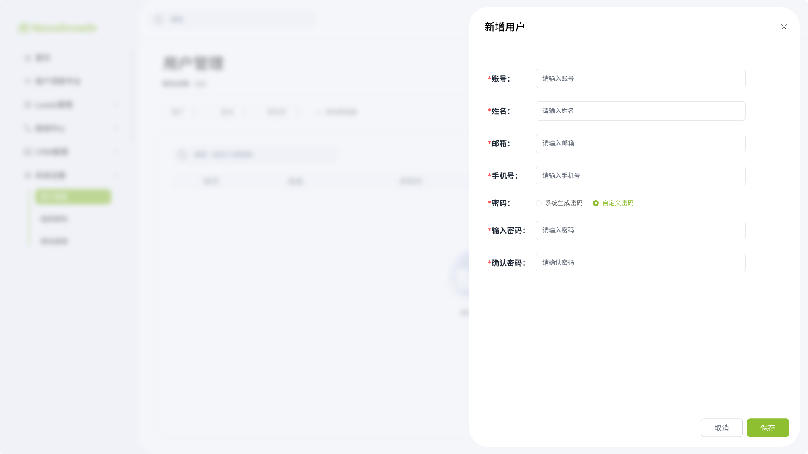
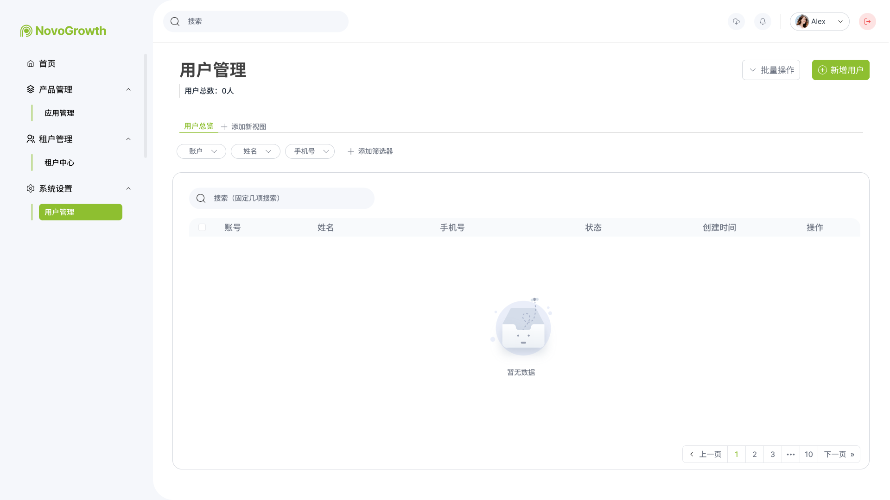

# CRM运营平台产品需求文档（PRD）

> 版本号：v1.0.0  
> 创建日期：2025-10-15  
> 最后更新：2025-10-15  
> 负责人：产品团队  
> 状态：✅ 已确认

---

## 📋 文档修订历史

| 版本号 | 修订日期 | 修订人 | 修订内容 |
|--------|----------|--------|----------|
| v1.0.0 | 2025-10-15 | 产品团队 | 初始版本，定义运营平台核心功能 |

---

## 0. 产品层级说明

本PRD文档描述的是以下层级关系中的内容：

```
CRM产品（客户关系管理产品）
  └── 运营平台（Operation Platform）
       └── 系统管理应用（crm-operation-system）← 本PRD范围
            ├── 用户管理功能
            ├── 用户认证功能
            └── 内部接口功能
```

**层级定义**：
- **CRM产品**：顶层产品，包含多个平台
- **运营平台**：CRM产品下的运营管理平台，负责后台管理
- **系统管理应用**：运营平台下的应用，对应微服务 `crm-operation-system`
- **功能**：应用中的业务功能模块
- **操作**：功能中的具体操作

---

## 1. 需求背景

### 1.1 业务背景

随着企业数字化转型的深入，传统的CRM系统已无法满足企业多租户、多应用的管理需求。企业需要一个统一的运营平台来：

- **集中管理**：统一管理多个租户和应用的用户、权限、配置
- **灵活扩展**：支持快速接入新应用和功能模块
- **安全可控**：提供完善的权限控制和安全审计机制
- **高效运维**：降低运维成本，提升系统稳定性

**当前痛点**：
- 各应用独立管理用户，账号体系混乱
- 权限配置分散，安全风险高
- 缺乏统一的监控和运维工具
- 多租户数据隔离不彻底

### 1.2 用户角色

| 角色名称 | 角色描述 | 使用场景 | 典型用户 |
|----------|----------|----------|----------|
| 超级管理员 | 平台最高权限，负责整体配置 | 系统初始化、核心配置 | 技术负责人 |
| 系统管理员 | 负责用户和权限管理 | 用户管理、角色分配 | 运维人员 |
| 租户管理员 | 管理本租户的配置和用户 | 租户内部管理 | 企业管理员 |
| 普通用户 | 使用具体业务功能 | 日常业务操作 | 业务人员 |

### 1.3 需求来源

- **来源**：产品规划 + 客户需求
- **优先级**：P0（核心功能，必须实现）
- **预期上线时间**：2025-11-01
- **受益方**：平台运营方、租户企业、最终用户

---

## 2. 需求目标

### 2.1 核心目标

1. **建立统一的用户管理体系**
   - 实现用户的全生命周期管理
   - 支持用户的创建、查询、更新、删除操作
   - 提供用户状态管理（启用/禁用）

2. **提供安全的认证授权机制**
   - 用户登录认证
   - 基于Token的会话管理
   - 支持主动登出和会话失效

3. **支持服务间安全通信**
   - 提供内部接口供其他微服务调用
   - 实现Token验证机制
   - 确保服务间调用的安全性

### 2.2 成功指标

| 指标名称 | 当前值 | 目标值 | 衡量方式 |
|----------|--------|--------|----------|
| 用户操作响应时间 | - | < 1秒 | 接口响应时间监控 |
| 系统可用性 | - | ≥ 99.9% | 健康检查和监控 |
| 用户满意度 | - | ≥ 85% | 用户反馈调查 |
| 操作成功率 | - | ≥ 98% | 错误日志统计 |

---

## 3. 名词解释

| 术语 | 英文 | 定义 | 说明 |
|------|------|------|------|
| CRM产品 | CRM Product | 客户关系管理产品 | 最顶层，包含多个平台 |
| 运营平台 | Operation Platform | CRM产品下的运营管理平台 | 负责用户、权限、租户等后台管理 |
| 应用 | Application | 运营平台下的功能应用 | 对应一个微服务，如系统管理、租户管理 |
| 功能 | Feature | 应用中的业务功能模块 | 如用户管理、权限管理 |
| 操作 | Operation | 功能中的具体操作 | 如创建用户、删除用户 |
| 租户 | Tenant | 使用系统的企业或组织 | 数据隔离的基本单位 |
| Token | JWT Token | 用户身份凭证 | 用于验证用户登录状态，有效期24小时 |
| 会话 | Session | 用户登录后的有效期间 | Token有效期间即为会话期间 |

---

## 4. 需求范围

### 4.1 功能范围

**本期包含的功能**（v1.0）：
- ✅ 用户管理（创建、查询、更新、删除、启用/禁用）
- ✅ 用户登录/登出
- ✅ 获取当前用户信息
- ✅ 内部接口（服务间调用）

**不包含的功能**（后续版本）：
- ❌ 角色权限管理（v1.1实现）
- ❌ 租户管理（v1.1实现）
- ❌ 应用管理（v1.2实现）
- ❌ 操作日志审计（v1.2实现）
- ❌ 批量操作（v1.3实现）
- ❌ 数据导入导出（v1.3实现）

### 4.2 涉及的应用

| 应用名称 | 微服务名 | 影响范围 | 数据库 | 备注 |
|----------|----------|----------|--------|------|
| 系统管理 | crm-operation-system | 核心功能开发 | crm_operation_system | 本期重点 |
| 网关 | crm-operation-gateway | Token验证 | - | 后续集成 |
| 其他微服务 | - | 调用内部接口 | - | 后续集成 |

---

## 5. 需求大纲

### 层级结构

**CRM产品** → **运营平台** → **应用** → **功能** → **操作**

- CRM产品：客户关系管理产品（顶层）
- 运营平台：CRM产品下的运营管理平台
- 应用：运营平台下的系统管理应用
- 功能：应用中的业务功能模块
- 操作：功能中的具体操作

### 功能清单

- **应用：系统管理**（crm-operation-system）
  - **功能：用户管理**（后台管理接口）
    - 创建用户
    - 查询用户（按ID查询、分页查询）
    - 更新用户
    - 删除用户
    - 启用用户
    - 禁用用户
  - **功能：用户认证**（客户端接口）
    - 用户登录
    - 用户登出
    - 获取当前用户信息
  - **功能：内部接口**（服务间调用）
    - 获取当前用户信息
    - 验证Token有效性

---

## 6. 详细需求

### 6.1 应用：系统管理

**应用概述**：
- **所属平台**：CRM产品 → 运营平台
- **应用名称**：系统管理
- **微服务名**：crm-operation-system
- **应用端口**：18101
- **数据库**：crm_operation_system
- **主要功能**：用户管理、用户认证、内部接口
- **目标用户**：系统管理员、技术运维人员

---

### 6.2 功能：用户管理（后台管理接口）

**功能概述**：
提供用户的创建、查询、更新、删除等基础管理功能，供系统管理员在后台管理界面使用。

**功能目标**：
- 支持用户全生命周期管理
- 支持用户状态管理
- 提供灵活的查询和筛选能力

**核心数据字段**：

| 字段名 | 必填 | 说明 | 约束 | 示例 |
|--------|------|------|------|------|
| 用户名 | 是 | 登录账号 | 4-20位字母数字下划线，唯一 | admin |
| 密码 | 是 | 登录密码 | 8-20位，含大小写字母和数字 | Test@123456 |
| 真实姓名 | 是 | 用户真实姓名 | 2-50位 | 张三 |
| 邮箱 | 否 | 联系邮箱 | 标准邮箱格式，可为空 | admin@example.com |
| 手机号 | 否 | 联系电话 | 11位数字，可为空 | 13800138000 |
| 头像 | 否 | 头像URL | URL格式 | https://example.com/avatar.jpg |
| 状态 | 是 | 启用/禁用 | 1-启用，0-禁用 | 启用 |

---

#### 操作：创建用户

**原型图**：


**功能需求**：

1. **页面入口**
   - 位置：用户管理列表页面
   - 触发方式：点击页面右上角"新建用户"按钮
   - 展现形式：弹窗形式

2. **表单字段**

| 字段名 | 显示名称 | 类型 | 必填 | 校验规则 | 错误提示 | 默认值 |
|--------|----------|------|------|----------|----------|--------|
| 用户名 | 用户名 | 文本框 | 是 | 4-20位字母数字下划线 | 用户名格式不正确，应为4-20位字母、数字或下划线 | - |
| 密码 | 密码 | 密码框 | 是 | 8-20位，含大小写字母和数字 | 密码强度不足，应包含大小写字母和数字 | - |
| 确认密码 | 确认密码 | 密码框 | 是 | 与密码一致 | 两次输入的密码不一致 | - |
| 真实姓名 | 真实姓名 | 文本框 | 是 | 2-50位 | 姓名长度应为2-50个字符 | - |
| 邮箱 | 邮箱地址 | 文本框 | 否 | 标准邮箱格式 | 邮箱格式不正确 | - |
| 手机号 | 手机号码 | 文本框 | 否 | 11位数字 | 手机号格式不正确 | - |

3. **业务逻辑**
   - 用户名唯一性验证：创建前检查用户名是否已存在
   - 密码需要加密存储，前端不可见
   - 新用户默认状态为"启用"
   - 自动记录创建人和创建时间
   - 邮箱和手机号虽非必填，但建议填写

4. **操作流程**
   ```
   点击新建按钮 → 打开弹窗 → 填写表单 → 前端校验 → 
   提交数据 → 后端验证 → 保存到数据库 → 提示成功 → 
   关闭弹窗 → 刷新列表
   ```

5. **成功提示**
   - 显示消息："用户创建成功"
   - 提示样式：绿色toast，3秒自动消失
   - 弹窗行为：自动关闭
   - 列表行为：自动刷新，新用户显示在列表顶部

6. **失败场景**

| 场景 | 错误提示 | 处理方式 |
|------|----------|----------|
| 用户名已存在 | 该用户名已被使用，请更换 | 红色提示，停留在当前页面 |
| 用户名格式错误 | 用户名格式不正确，应为4-20位字母、数字或下划线 | 字段下方显示错误提示 |
| 密码强度不足 | 密码强度不足，应包含大小写字母和数字 | 字段下方显示错误提示 |
| 两次密码不一致 | 两次输入的密码不一致 | 字段下方显示错误提示 |
| 邮箱格式错误 | 邮箱格式不正确 | 字段下方显示错误提示 |
| 系统异常 | 系统繁忙，请稍后重试 | 红色提示，需手动关闭 |

**业务规则**：
1. 用户名全局唯一，创建后不可修改
2. 密码必须加密存储，界面上不可见原文
3. 邮箱和手机号非必填，但至少填写一项（建议）
4. 新创建的用户默认为"启用"状态
5. 自动记录创建人ID和创建时间

**注意事项**：
- ⚠️ 密码传输需要使用HTTPS加密通道
- ⚠️ 用户名不能包含特殊字符（仅支持字母、数字、下划线）
- ⚠️ 建议提示用户设置强密码，避免弱密码
- 💡 未来版本可考虑邮箱验证和手机号验证

**其他说明**：
- 创建成功后，可在列表中找到新用户
- 后续版本支持创建后立即分配角色
- 后续版本支持批量创建用户

---

#### 操作：查询用户

**原型图**：


**功能需求**：

1. **查询方式**
   - **按ID查询**：用于查看单个用户详情
   - **列表查询**：分页展示所有用户
   - **搜索查询**：支持多条件组合搜索

2. **列表展示**

| 显示字段 | 字段说明 | 宽度 | 对齐方式 | 特殊处理 |
|----------|----------|------|----------|----------|
| 用户名 | 登录用户名 | 150px | 左对齐 | 支持点击查看详情 |
| 真实姓名 | 用户真实姓名 | 120px | 左对齐 | - |
| 邮箱 | 用户邮箱 | 200px | 左对齐 | 为空显示"-" |
| 手机号 | 联系电话 | 120px | 左对齐 | 为空显示"-" |
| 状态 | 当前状态 | 80px | 居中 | 启用显示绿色标签，禁用显示灰色标签 |
| 最后登录时间 | 最近登录时间 | 160px | 左对齐 | 格式：yyyy-MM-dd HH:mm:ss |
| 创建时间 | 用户创建时间 | 160px | 左对齐 | 格式：yyyy-MM-dd HH:mm:ss，支持排序 |
| 操作 | 操作按钮 | 180px | 居中 | 编辑、删除、启用/禁用按钮 |

3. **搜索条件**

| 搜索项 | 类型 | 说明 |
|--------|------|------|
| 用户名 | 文本框 | 支持模糊搜索 |
| 真实姓名 | 文本框 | 支持模糊搜索 |
| 状态 | 下拉选择 | 全部/启用/禁用 |
| 创建时间 | 日期范围选择 | 开始时间~结束时间 |

4. **分页配置**
   - 默认每页显示：20条
   - 可选项：10条/20条/50条/100条
   - 显示信息：共X条记录，当前第X页/共X页
   - 页码导航：首页、上一页、页码、下一页、末页

5. **排序功能**
   - 默认排序：按创建时间倒序（最新的在前）
   - 可排序字段：创建时间、最后登录时间
   - 排序方式：点击列头切换升序/降序

**空状态处理**：
- 无数据时显示：暂无用户数据，请点击"新建用户"添加
- 搜索无结果时显示：未找到符合条件的用户

**注意事项**：
- ⚠️ 密码字段不在列表中显示
- ⚠️ 已删除的用户（逻辑删除）不在列表中显示
- 💡 列表支持多选，为后续批量操作预留

**其他说明**：
- 点击用户名可查看用户详情
- 支持导出Excel（后续版本）
- 支持列宽调整（后续版本）

---

#### 操作：更新用户

**原型图**：
（复用创建用户页面，表单为编辑模式）

**功能需求**：

1. **页面入口**
   - 位置：用户列表页面的操作列
   - 触发方式：点击"编辑"按钮
   - 展现形式：弹窗形式，回显用户信息

2. **可编辑字段**
   - 真实姓名：可修改
   - 邮箱：可修改
   - 手机号：可修改
   - 头像：可修改（上传功能后续版本提供）
   - 密码：单独的"修改密码"操作

3. **不可编辑字段**
   - 用户名：显示但不可修改（置灰）
   - 创建时间：仅展示
   - 最后登录时间：仅展示

4. **业务逻辑**
   - 支持部分字段更新，不需要填写所有字段
   - 邮箱和手机号需要验证格式
   - 自动更新"更新时间"和"更新人"
   - 修改后立即生效

5. **操作流程**
   ```
   点击编辑按钮 → 打开弹窗并回显数据 → 修改字段 → 
   前端校验 → 提交更新 → 后端验证 → 更新数据库 → 
   提示成功 → 关闭弹窗 → 刷新列表
   ```

6. **成功提示**
   - 显示消息："用户信息更新成功"
   - 提示样式：绿色toast，3秒自动消失

**注意事项**：
- ⚠️ 用户名创建后不允许修改
- ⚠️ 修改密码需要单独的操作（安全考虑）
- 💡 建议修改重要信息时需要二次确认

---

#### 操作：删除用户

**功能需求**：

1. **页面入口**
   - 位置：用户列表页面的操作列
   - 触发方式：点击"删除"按钮
   - 展现形式：确认对话框

2. **删除方式**
   - 逻辑删除（软删除）
   - 数据不会真正删除，只是标记为已删除
   - 已删除的用户不在列表中显示

3. **删除限制**
   - 不能删除自己（当前登录用户）
   - 不能删除超级管理员
   - 需要二次确认："确定要删除用户"XXX"吗？"

4. **关联处理**
   - 清除用户的所有登录Token（强制下线）
   - 解除用户的角色关联（如有）
   - 保留用户的历史操作日志（用于审计）

5. **操作流程**
   ```
   点击删除按钮 → 弹出确认对话框 → 点击确定 → 
   执行删除 → 清除Token → 提示成功 → 刷新列表
   ```

6. **成功提示**
   - 显示消息："用户已删除"
   - 提示样式：绿色toast，3秒自动消失

**注意事项**：
- ⚠️ 删除操作不可恢复（逻辑删除）
- ⚠️ 删除后用户无法登录系统
- ⚠️ 需要记录删除操作到日志
- 💡 建议：提供回收站功能，可恢复误删用户（后续版本）

---

#### 操作：启用/禁用用户

**功能需求**：

1. **页面入口**
   - 位置：用户列表页面的操作列
   - 触发方式：点击"启用"或"禁用"按钮
   - 按钮显示：根据当前状态显示对应按钮

2. **业务逻辑**
   - **禁用用户**：
     - 将用户状态设置为"禁用"
     - 清除用户的所有登录Token（强制下线）
     - 禁用后用户无法登录
   - **启用用户**：
     - 将用户状态设置为"启用"
     - 启用后用户可以正常登录

3. **操作流程**
   ```
   点击启用/禁用按钮 → 弹出确认对话框 → 点击确定 → 
   更新状态 → （禁用时）清除Token → 提示成功 → 刷新列表
   ```

4. **成功提示**
   - 启用成功："用户已启用"
   - 禁用成功："用户已禁用"
   - 提示样式：绿色toast，3秒自动消失

**注意事项**：
- ⚠️ 禁用后用户立即无法登录
- ⚠️ 不能禁用自己（当前登录用户）
- 💡 状态变更需要记录操作日志

---

### 6.3 功能：用户认证（客户端接口）

**功能概述**：
提供用户登录、登出、获取当前用户信息等认证功能，供客户端（Web端、移动端）调用。

**功能目标**：
- 实现安全的用户认证机制
- 支持Token方式的会话管理
- 提供用户主动登出功能

---

#### 操作：用户登录

**原型图**


**功能需求**：

1. **登录表单**

| 字段名 | 类型 | 必填 | 校验规则 | 错误提示 |
|--------|------|------|----------|----------|
| 用户名 | 文本框 | 是 | 不能为空 | 请输入用户名 |
| 密码 | 密码框 | 是 | 不能为空 | 请输入密码 |

2. **业务逻辑**
   - 验证用户名和密码是否正确
   - 检查用户状态是否为"启用"
   - 生成JWT Token（有效期24小时）
   - 记录登录时间和登录IP
   - 返回Token和用户基本信息

3. **操作流程**
   ```
   输入用户名密码 → 点击登录 → 前端校验 → 
   提交到后端 → 验证账号密码 → 检查用户状态 → 
   生成Token → 记录登录信息 → 返回Token → 
   跳转到首页
   ```

4. **成功响应**
   - 返回数据：Token、用户ID、用户名、真实姓名、头像等
   - 客户端行为：保存Token到本地，跳转到首页
   - Token使用：后续请求都需要携带此Token

5. **失败场景**

| 场景 | 错误提示 | HTTP状态码 |
|------|----------|------------|
| 用户名或密码错误 | 用户名或密码错误，请重新输入 | 401 |
| 用户已被禁用 | 账号已禁用，请联系管理员 | 403 |
| 参数缺失 | 用户名和密码不能为空 | 400 |

**注意事项**：
- ⚠️ 连续登录失败3次后，需要输入验证码（后续版本）
- ⚠️ 记录登录失败日志，用于安全审计
- 💡 支持记住密码功能（后续版本）

---

#### 操作：用户登出

**功能需求**：

1. **页面入口**
   - 位置：页面右上角用户头像下拉菜单
   - 触发方式：点击"退出登录"
   - 展现形式：确认对话框（可选）

2. **业务逻辑**
   - 将当前Token加入黑名单（Redis存储）
   - 黑名单有效期等于Token剩余有效期
   - 清除客户端本地存储的Token
   - 跳转到登录页面

3. **操作流程**
   ```
   点击退出登录 → （可选）确认对话框 → 
   发送登出请求 → Token加入黑名单 → 
   清除本地Token → 跳转登录页
   ```

4. **成功提示**
   - 显示消息："已安全退出"（可选）
   - 直接跳转到登录页面

**注意事项**：
- ⚠️ 登出后Token立即失效，无法再使用
- ⚠️ 需要清除本地存储的所有用户信息
- 💡 登出可以不需要确认对话框，直接执行

---

#### 操作：获取当前用户信息

**功能需求**：

1. **使用场景**
   - 页面加载时获取当前登录用户信息
   - 用户头像下拉菜单中显示用户信息
   - 个人中心页面展示详细信息

2. **业务逻辑**
   - 从请求Header中获取Token
   - 验证Token是否有效（未过期、未在黑名单）
   - 解析Token获取用户ID
   - 查询用户详细信息
   - 验证用户状态是否为"启用"

3. **返回信息**
   - 用户ID
   - 用户名
   - 真实姓名
   - 邮箱
   - 手机号
   - 头像URL
   - 用户状态
   - 最后登录时间

4. **失败场景**

| 场景 | 错误提示 | 处理方式 |
|------|----------|----------|
| Token未提供 | 未登录，请先登录 | 跳转到登录页 |
| Token已过期 | 登录已过期，请重新登录 | 跳转到登录页 |
| Token已失效 | 登录已失效，请重新登录 | 跳转到登录页 |
| 用户不存在 | 用户不存在 | 跳转到登录页 |
| 用户已禁用 | 账号已被禁用，请联系管理员 | 显示错误页面 |

**注意事项**：
- ⚠️ 每次页面刷新都需要重新获取用户信息
- ⚠️ Token验证失败时，需要清除本地Token并跳转登录页
- 💡 可以考虑将用户信息缓存到本地，减少请求次数

---

### 6.4 功能：内部接口（服务间调用）

**功能概述**：
提供给其他微服务调用的内部接口，用于服务间的用户信息获取和Token验证。

**功能目标**：
- 支持其他微服务获取当前用户上下文
- 为网关提供Token验证能力
- 确保服务间调用的安全性

---

#### 操作：获取当前用户信息（内部）

**功能需求**：

1. **使用场景**
   - 其他微服务需要获取当前请求的用户信息
   - 通过Feign客户端调用
   - 用于业务逻辑中的权限判断

2. **业务逻辑**
   - 从Header中获取Token
   - 验证Token有效性
   - 返回用户完整信息

**注意事项**：
- ⚠️ 此接口仅供内部微服务调用
- ⚠️ 应通过内网访问，不对外暴露
- 💡 后续考虑增加IP白名单限制

---

#### 操作：验证Token有效性

**功能需求**：

1. **使用场景**
   - 网关验证请求的Token是否有效
   - 判断用户是否有权访问
   - 高频调用，需要高性能

2. **业务逻辑**
   - 接收Token参数
   - 验证Token格式、有效期
   - 检查Token是否在黑名单中
   - 查询用户并验证状态
   - 返回验证结果和用户基本信息

3. **返回信息**
   - valid：true/false（是否有效）
   - userId：用户ID（有效时返回）
   - username：用户名（有效时返回）
   - realName：真实姓名（有效时返回）
   - reason：失败原因（无效时返回）

**性能要求**：
- 平均响应时间：< 100ms
- 99%响应时间：< 200ms
- 支持高并发调用

**注意事项**：
- ⚠️ 此接口设计为始终返回200状态码，通过valid字段判断
- ⚠️ 适合网关等高频调用场景
- 💡 返回格式友好，便于调用方处理

---

## 7. 交互设计要点

### 7.1 页面布局

**用户管理列表页**：
- 顶部：面包屑导航（系统设置 > 用户管理）
- 搜索区域：搜索条件 + 搜索按钮 + 重置按钮
- 操作区域：新建用户按钮（蓝色主按钮，右对齐）
- 数据区域：用户列表表格
- 底部：分页组件（居中）

**用户创建/编辑弹窗**：
- 标题：新建用户 / 编辑用户
- 表单区域：左侧标签 + 右侧输入框，必填项带红色*号
- 底部按钮：取消（灰色） + 保存（蓝色），右对齐

### 7.2 交互规范

**按钮样式**：
- 主要操作：蓝色按钮（如"新建用户"、"保存"、"确定"）
- 次要操作：白色按钮带边框（如"取消"、"重置"）
- 危险操作：红色按钮（如"删除"）
- 文字按钮：用于表格内的操作链接

**提示信息**：
- 成功操作：绿色toast提示，屏幕顶部居中，3秒自动消失
- 错误信息：红色toast提示，屏幕顶部居中，需手动关闭或10秒后自动消失
- 警告信息：黄色确认对话框，需用户点击确认
- 字段验证错误：在字段下方显示红色文字提示

**加载状态**：
- 列表加载：显示骨架屏（表格样式）
- 搜索/提交：按钮显示loading动画并置灰不可点击
- 弹窗操作：弹窗内容区域显示loading遮罩

**表格操作**：
- 鼠标悬停：行背景色变浅灰色
- 空状态：显示空状态图标和提示文字
- 排序：列头显示排序图标，点击切换排序方向

### 7.3 响应式设计

- **PC端（≥1366px）**
  - 表格完整展示所有列
  - 弹窗宽度：600px
  - 表格内容区域自适应高度

- **平板端（768px-1365px）**
  - 隐藏部分非关键列（如创建时间）
  - 弹窗宽度：80%屏幕宽度
  
- **移动端（<768px）**
  - 表格改为卡片展示
  - 搜索条件收起展开
  - 弹窗改为全屏模式

---

## 8. 非功能需求

### 8.1 性能要求

| 指标 | 要求 | 说明 |
|------|------|------|
| 页面首次加载 | < 2秒 | 包含列表数据的完整加载时间 |
| 列表刷新时间 | < 500ms | 搜索、分页、排序的响应时间 |
| 表单提交响应 | < 1秒 | 创建、更新、删除操作的响应时间 |
| 登录响应时间 | < 1秒 | 从点击登录到跳转首页的时间 |
| 并发支持 | ≥ 1000用户 | 系统同时在线用户数 |

### 8.2 安全要求

| 要求类别 | 具体要求 | 实现方式 |
|----------|----------|----------|
| 用户认证 | 登录后才能访问，会话有效期24小时 | JWT Token认证 |
| 权限控制 | 不同角色有不同操作权限 | 基于角色的权限控制（RBAC） |
| 数据安全 | 密码加密存储，敏感数据脱敏显示 | BCrypt加密，手机号中间4位显示为* |
| 传输安全 | 生产环境使用HTTPS | 强制HTTPS访问 |
| 防攻击 | 防止SQL注入、XSS攻击、CSRF攻击 | 参数化查询、输入过滤、Token验证 |
| 会话安全 | 支持主动登出和强制下线 | Token黑名单机制 |

### 8.3 可用性要求

| 指标 | 要求 | 说明 |
|------|------|------|
| 系统可用性 | ≥ 99.9% | 年度停机时间不超过8.76小时 |
| 故障恢复时间 | < 5分钟 | 从故障发生到服务恢复 |
| 数据保护 | 每日自动备份 | 数据库全量备份，保留7天 |
| 错误处理 | 友好的错误提示 | 用户能理解的错误信息 |

### 8.4 兼容性要求

| 类型 | 要求 | 备注 |
|------|------|------|
| 浏览器 | Chrome 90+, Firefox 88+, Edge 90+, Safari 14+ | 以Chrome为主要测试浏览器 |
| 操作系统 | Windows 10+, macOS 11+, 主流Linux发行版 | - |
| 移动设备 | 支持iOS 13+, Android 8+ | 响应式设计 |
| 屏幕分辨率 | 最小1366x768，推荐1920x1080 | - |
| 网络环境 | 支持4G/5G/WiFi | 弱网环境下降级展示 |

---

## 9. 测试要点

### 9.1 功能测试

**用户管理功能**：
- [ ] 创建用户-成功（填写所有字段）
- [ ] 创建用户-成功（仅填写必填字段）
- [ ] 创建用户-失败（用户名重复）
- [ ] 创建用户-失败（用户名格式错误）
- [ ] 创建用户-失败（密码强度不足）
- [ ] 创建用户-失败（邮箱格式错误）
- [ ] 查询用户-按ID查询
- [ ] 查询用户-分页查询
- [ ] 查询用户-搜索（用户名）
- [ ] 查询用户-搜索（真实姓名）
- [ ] 查询用户-筛选（状态）
- [ ] 查询用户-排序（创建时间）
- [ ] 更新用户-成功
- [ ] 更新用户-失败（邮箱格式错误）
- [ ] 删除用户-成功
- [ ] 删除用户-失败（删除自己）
- [ ] 启用用户-成功
- [ ] 禁用用户-成功
- [ ] 禁用用户-失败（禁用自己）

**认证功能**：
- [ ] 登录-成功
- [ ] 登录-失败（用户名错误）
- [ ] 登录-失败（密码错误）
- [ ] 登录-失败（用户已禁用）
- [ ] 登出-成功
- [ ] 获取当前用户信息-成功
- [ ] 获取当前用户信息-失败（Token过期）
- [ ] 获取当前用户信息-失败（Token已登出）

**内部接口**：
- [ ] 内部获取用户信息-成功
- [ ] 内部验证Token-成功
- [ ] 内部验证Token-失败（Token无效）

### 9.2 异常测试

- [ ] 未登录访问（跳转登录页）
- [ ] 无权限访问（提示权限不足）
- [ ] 参数缺失或格式错误（提示参数错误）
- [ ] 网络异常处理（超时、断网）
- [ ] 并发操作冲突（同时创建相同用户名）
- [ ] Token过期处理
- [ ] 用户被禁用时的处理
- [ ] 数据库异常处理

### 9.3 性能测试

- [ ] 页面加载速度测试（< 2秒）
- [ ] 列表查询速度测试（< 500ms）
- [ ] 多用户并发登录测试（1000用户）
- [ ] 大数据量分页测试（10000+用户）
- [ ] Token验证接口性能测试（< 100ms）

### 9.4 易用性测试

- [ ] 页面布局合理性（信息层次清晰）
- [ ] 操作流程流畅性（步骤简洁）
- [ ] 提示信息清晰度（用户能理解）
- [ ] 表单输入便捷性（Tab键切换、回车提交）
- [ ] 移动端适配效果（触摸友好）
- [ ] 错误提示的友好性

---

## 10. 验收标准

### 10.1 功能验收

- [ ] 所有功能按需求实现（11个接口全部实现）
- [ ] 所有测试用例通过（功能测试、异常测试）
- [ ] 前端页面展示正确（与原型图一致）
- [ ] 操作流程符合预期（流畅无阻碍）
- [ ] 数据准确性验证（创建、更新、删除的数据正确）

### 10.2 质量验收

- [ ] 所有自动化测试通过（单元测试、集成测试）
- [ ] 无P0、P1级别的Bug
- [ ] 性能指标达标（响应时间、并发支持）
- [ ] 安全测试通过（无SQL注入、XSS等漏洞）
- [ ] 代码审查通过

### 10.3 文档验收

- [ ] 用户操作手册完整（含截图和说明）
- [ ] 常见问题FAQ完整（至少10个问题）
- [ ] 接口文档完整（API文档）
- [ ] 部署文档完整（部署步骤、配置说明）

---

## 11. 风险评估

### 11.1 技术风险

| 风险项 | 风险等级 | 影响 | 应对措施 | 负责人 |
|--------|----------|------|----------|--------|
| Token安全性 | 高 | Token泄露导致账号被盗 | 使用HTTPS、Token定期更换、黑名单机制 | 技术团队 |
| 性能瓶颈 | 中 | 高并发下响应慢 | 添加缓存、数据库优化、压力测试 | 技术团队 |
| 数据一致性 | 中 | 并发操作导致数据异常 | 乐观锁、事务控制 | 技术团队 |
| 黑名单失效 | 中 | Redis故障导致黑名单失效 | Redis集群、持久化配置 | 运维团队 |

### 11.2 业务风险

| 风险项 | 风险等级 | 影响 | 应对措施 | 负责人 |
|--------|----------|------|----------|--------|
| 用户体验不佳 | 中 | 用户抱怨、使用率低 | 用户测试、持续优化 | 产品团队 |
| 权限配置复杂 | 低 | 管理员配置困难 | 提供默认模板、操作指南 | 产品团队 |
| 培训成本高 | 低 | 推广困难 | 录制操作视频、编写详细文档 | 产品团队 |

---

## 12. 上线计划

### 12.1 上线步骤

1. **准备阶段**（10月21日-10月25日）
   - [x] 完成开发（10月15日已完成）
   - [ ] 完成测试（单元测试、集成测试、UAT测试）
   - [ ] 准备上线文档（部署文档、回滚方案）
   - [ ] 数据库备份和迁移脚本准备
   - [ ] 配置文件准备（各环境）

2. **测试环境验证**（10月26日-10月28日）
   - [ ] 部署到测试环境
   - [ ] 执行完整测试用例
   - [ ] 性能测试和压力测试
   - [ ] 安全测试
   - [ ] 修复测试发现的问题

3. **UAT验证**（10月29日-10月30日）
   - [ ] 部署到UAT环境
   - [ ] 业务方验收测试
   - [ ] 收集反馈并优化
   - [ ] 确认上线准备就绪

4. **生产环境部署**（10月31日）
   - [ ] 数据库迁移（执行DDL脚本）
   - [ ] 应用部署（Docker镜像部署）
   - [ ] 配置更新（Nacos配置推送）
   - [ ] 服务启动和健康检查
   - [ ] 监控告警配置

5. **上线验证**（11月1日）
   - [ ] 冒烟测试（核心功能验证）
   - [ ] 性能监控（响应时间、错误率）
   - [ ] 日志检查（无严重错误）
   - [ ] 用户反馈收集

### 12.2 回滚方案

**触发条件**：
- 严重Bug导致核心功能不可用（如无法登录、创建用户失败）
- 系统性能严重下降（响应时间超过5秒）
- 数据异常或数据丢失
- 安全漏洞被发现

**回滚步骤**：
1. **立即决策**：技术负责人确认需要回滚
2. **停止服务**：下线新版本应用
3. **恢复代码**：切换到上一个稳定版本
4. **恢复数据**：如有必要，恢复数据库备份
5. **重启服务**：启动旧版本应用
6. **验证功能**：执行冒烟测试确认功能正常
7. **通知用户**：通知相关人员回滚完成
8. **问题分析**：分析回滚原因，制定修复计划

**回滚时限**：
- 发现问题后15分钟内决策是否回滚
- 回滚操作30分钟内完成
- 总时限不超过1小时

---

## 13. 附录

### 13.1 相关设计资料

- 原型设计文件：`/prd-0.0.1/原型图/系统设置/`
- 在线原型链接：（待提供）
- UI设计稿：（待提供）

**已完成的原型图**：
- 系统设置-用户管理-新增用户
- 系统设置-用户管理-空列表

**待补充的原型图**：
- 系统设置-用户管理-列表（有数据）
- 系统设置-用户管理-编辑用户
- 系统设置-用户管理-用户详情
- 登录页面
- 首页框架

### 13.2 变更记录

| 日期 | 变更内容 | 变更原因 | 影响范围 | 状态 |
|------|----------|----------|----------|------|
| 2025-10-15 | 初始版本确定 | 启动项目 | 整体需求 | ✅ 已完成 |

### 13.3 问题记录

| 日期 | 问题描述 | 解决方案 | 状态 |
|------|----------|----------|------|
| 2025-10-15 | 用户名校验规则需明确 | 确定为4-20位字母数字下划线 | ✅ 已解决 |
| 2025-10-15 | 密码强度要求需明确 | 确定为8-20位且含大小写字母和数字 | ✅ 已解决 |

### 13.4 待确认事项

| 序号 | 待确认内容 | 影响 | 预期确认时间 |
|------|-----------|------|--------------|
| 1 | 是否需要验证码功能 | 登录安全性 | 10月20日前 |
| 2 | 头像上传功能的优先级 | 用户体验 | 10月20日前 |
| 3 | 是否需要记住密码功能 | 用户便捷性 | 10月20日前 |
| 4 | 批量操作的具体需求 | 操作效率 | 10月25日前 |

---

## 附录A：功能清单汇总

### A.1 用户管理功能清单

| 序号 | 功能名称 | 功能说明 | 优先级 | 状态 |
|------|----------|----------|--------|------|
| 1 | 创建用户 | 新建用户账号 | P0 | ✅ 已实现 |
| 2 | 按ID查询用户 | 根据用户ID查询详情 | P0 | ✅ 已实现 |
| 3 | 分页查询用户 | 分页展示用户列表 | P0 | ✅ 已实现 |
| 4 | 更新用户 | 修改用户信息 | P0 | ✅ 已实现 |
| 5 | 删除用户 | 删除用户账号 | P0 | ✅ 已实现 |
| 6 | 启用用户 | 将用户状态设为启用 | P0 | ✅ 已实现 |
| 7 | 禁用用户 | 将用户状态设为禁用 | P0 | ✅ 已实现 |

### A.2 认证功能清单

| 序号 | 功能名称 | 功能说明 | 优先级 | 状态 |
|------|----------|----------|--------|------|
| 1 | 用户登录 | 用户名密码登录 | P0 | ✅ 已实现 |
| 2 | 用户登出 | 主动退出登录 | P0 | ✅ 已实现 |
| 3 | 获取当前用户信息 | 获取登录用户详情 | P0 | ✅ 已实现 |

### A.3 内部接口清单

| 序号 | 功能名称 | 功能说明 | 优先级 | 状态 |
|------|----------|----------|--------|------|
| 1 | 获取当前用户信息（内部） | 供其他微服务调用 | P0 | ✅ 已实现 |
| 2 | 验证Token | 供网关验证Token有效性 | P0 | ✅ 已实现 |

**总计**：11个核心功能，100%已实现

---

## 附录B：接口URL清单

### B.1 用户管理接口（/v1/users）

| 接口名称 | 请求方法 | URL路径 | 需要认证 |
|----------|----------|---------|----------|
| 创建用户 | POST | /v1/users | 是 |
| 查询用户（ID） | GET | /v1/users/{id} | 是 |
| 查询用户（分页） | GET | /v1/users | 是 |
| 更新用户 | PUT | /v1/users/{id} | 是 |
| 删除用户 | DELETE | /v1/users/{id} | 是 |
| 启用用户 | POST | /v1/users/{id}/enable | 是 |
| 禁用用户 | POST | /v1/users/{id}/disable | 是 |

### B.2 认证接口（/v1/auth）

| 接口名称 | 请求方法 | URL路径 | 需要认证 |
|----------|----------|---------|----------|
| 用户登录 | POST | /v1/auth/login | 否 |
| 用户登出 | POST | /v1/auth/logout | 是 |
| 获取当前用户 | GET | /v1/auth/current-user | 是 |

### B.3 内部接口（/v1/internal）

| 接口名称 | 请求方法 | URL路径 | 需要认证 |
|----------|----------|---------|----------|
| 获取当前用户（内部） | GET | /v1/internal/current-user | 否* |
| 验证Token | POST | /v1/internal/validate-token | 否* |

*注：内部接口在白名单中，不需要JWT认证，但需要通过内网访问控制

---

## 附录C：数据字典

### C.1 用户状态枚举

| 值 | 名称 | 说明 |
|----|------|------|
| 1 | 启用 | 用户可以正常登录使用系统 |
| 0 | 禁用 | 用户无法登录，已登录的会被强制下线 |

### C.2 用户字段长度限制

| 字段 | 最小长度 | 最大长度 | 说明 |
|------|----------|----------|------|
| 用户名 | 4 | 20 | 字母、数字、下划线 |
| 密码 | 8 | 20 | 含大小写字母和数字 |
| 真实姓名 | 2 | 50 | 中文或字母 |
| 邮箱 | - | 100 | 标准邮箱格式 |
| 手机号 | 11 | 11 | 中国大陆手机号 |

---

## 附录D：页面截图索引

| 页面名称 | 原型图路径 | 状态 |
|----------|-----------|------|
| 用户管理-新增用户 | /原型图/系统设置/系统设置-用户管理-新增用户.png | ✅ 已完成 |
| 用户管理-空列表 | /原型图/系统设置/系统设置-用户管理-空列表.png | ✅ 已完成 |
| 用户管理-列表（有数据） | - | 🔄 待补充 |
| 用户管理-编辑用户 | - | 🔄 待补充 |
| 登录页面 | - | 🔄 待补充 |

---

## 附录E：开发实现说明

**技术架构**：
- 后端：Java 17 + Spring Boot 3.2 + Spring Cloud 2023.0
- 数据库：MySQL 8.0
- 缓存：Redis 7.x
- 配置中心：Nacos 2.2
- 认证方式：JWT Token

**开发状态**：
- ✅ 所有核心功能已开发完成
- ✅ 单元测试：42个测试用例，100%通过
- ✅ 集成测试：28个测试用例，100%通过
- ✅ 代码已提交到develop分支

**技术文档参考**：
- [系统架构文档](../../development/系统架构文档.md)
- [微服务分层架构规范](../../development/微服务分层架构规范.md)
- [API文档](../../../crm-operation-system/docs/api/)

---

**文档维护者**：产品团队  
**最后更新时间**：2025-10-15  
**下次评审时间**：2025-10-20

---

**审批记录**：

| 角色 | 姓名 | 审批意见 | 日期 |
|------|------|----------|------|
| 产品经理 | - | ✅ 通过 | 2025-10-15 |
| 技术负责人 | - | ✅ 通过 | 2025-10-15 |
| 项目经理 | - | ✅ 通过 | 2025-10-15 |

