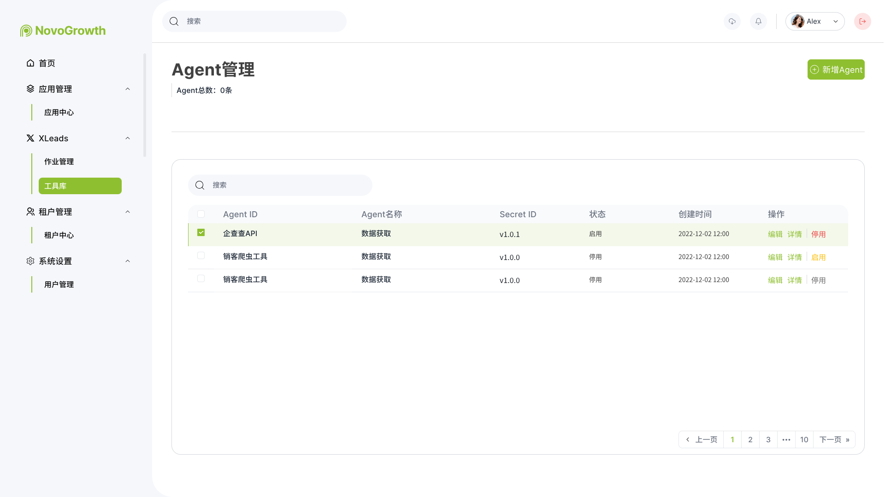
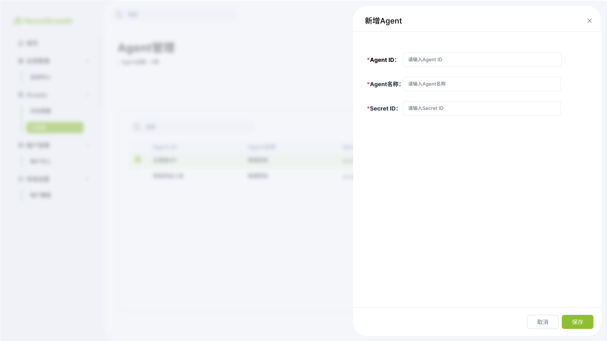

# Agent管理PRD

| **版本号** | **修订日期** | **修订人** | **修订内容** |
| --- | --- | --- | --- |
| v1.1 | 2026-08-03 | 产品经理 | 定稿启用/停用规则：启用可被新任务选择；停用禁止新任务进入，已有任务继续执行 |
| v1.0 | 2026-08-03 | 产品经理 | 初始版本：对齐 Agent 管理列表 / 新增 Agent 原型；启用/停用规则暂定 |

# 一、需求背景

中台通过 Agent 完成数据获取、加工与作业执行。任务管理中的「数据增强 Agent」「Agent 执行任务」等能力，均依赖已登记的 Agent 资源。当前需提供统一的 **Agent 管理**能力：录入 Agent 身份信息、维护启用/停用状态，供任务配置时选用。

# 二、需求目标

1. 提供 Agent 列表：查看 Agent ID、名称、Secret ID、状态、创建时间，支持分页与表格内搜索。
2. 支持「新增 Agent」录入 Agent ID、Agent 名称、Secret ID。
3. 支持编辑、详情查看。
4. 支持 Agent **启用 / 停用**状态切换：启用后可被新任务选择；停用后禁止新任务进入，已有任务继续执行。

# 三、名词解释

| 名词 | 定义描述 |
| --- | --- |
| Agent | 可被任务引用的执行资源（如企查查 API、销客爬虫工具等） |
| Agent ID | Agent 唯一标识，创建时由运营录入 |
| Agent 名称 | Agent 展示名称 / 能力归类名（如「数据获取」） |
| Secret ID | Agent 鉴权或版本类密钥标识（原型示意可为版本号或密钥串） |
| 启用 | Agent 可被**新任务**勾选 / 选用 |
| 停用 | Agent **禁止新任务进入**；已引用该 Agent 的在途 / 已有任务**继续执行**，不中断 |

# 四、功能设计

## （一）Agent 对象

> Agent 是中台工具库中可配置、可启停的执行资源单元。

**核心字段**

| 字段 | 说明 |
| --- | --- |
| `agent_id` | Agent ID，必填；建议全局唯一 |
| `agent_name` | Agent 名称，必填 |
| `secret_id` | Secret ID，必填 |
| `status` | 状态：启用 / 停用 |
| `created_at` | 创建时间，系统生成 |
| `updated_at` | 更新时间，系统维护 |

## （二）新增 / 编辑 Agent

**入口**

- 新增：列表页右上角「+ 新增 Agent」→ 弹窗「新增 Agent」
- 编辑：列表操作「编辑」→ 弹窗「编辑 Agent」（字段同新增，回填已有值）

**表单字段（对齐原型）**

| 字段 | 必填 | 说明 |
| --- | --- | --- |
| Agent ID | 是 | 文本；占位「请输入 Agent ID」；新增时建议不可与已有重复 |
| Agent 名称 | 是 | 文本；占位「请输入 Agent 名称」 |
| Secret ID | 是 | 文本；占位「请输入 Secret ID」 |

**底部操作**

- **取消** / 右上角关闭：不保存，关闭弹窗
- **保存**：校验必填通过后持久化；新增成功后列表刷新，默认状态建议为 **启用**（以实际上线为准；若需默认停用可后续调整）

**校验建议（可随迭代细化）**

| 项 | 规则 |
| --- | --- |
| 必填 | 三字段均非空 |
| Agent ID 唯一 | 新增/编辑时不可与其他 Agent 重复 |
| 长度 / 格式 | 本期可不做强格式限制；Secret ID 是否脱敏展示见详情规则 |

## （三）Agent 状态：启用 / 停用

| 状态 | 列表展示 | 操作入口文案（对齐原型） | 业务含义 |
| --- | --- | --- | --- |
| 启用 | 「启用」 | 操作列展示红色 **「停用」** | Agent **可被新任务选择** |
| 停用 | 「停用」 | 操作列展示 **「启用」** | **禁止新任务进入**；**已有任务继续执行** |

**业务规则**

1. 列表支持按行切换启用 ↔ 停用。  
2. **启用**  
   - 该 Agent 出现在任务侧可选列表中（数据增强勾选、Agent 执行任务下拉等）。  
   - 新建 / 编辑未提交的任务可勾选或选用该 Agent。  
3. **停用**  
   - **禁止新任务进入**：任务侧可选列表中**隐藏**该 Agent（或置灰且不可选，以实际上线为准）；新建任务、以及编辑时新增勾选，均不可再选用已停用 Agent。  
   - **已有任务继续执行**：此前已引用该 Agent 的任务（含草稿中已选中、待执行、执行中等）**不因停用而中断或自动剔除**，按原配置继续跑完。  
   - 若任务编辑时试图把已选 Agent **改选为**已停用 Agent，应拦截并提示不可用。  
4. **二次确认（建议）**  
   - 停用：确认文案提示「停用后新任务将无法选择该 Agent，已有任务不受影响，是否确认停用？」  
   - 启用：可直接切换，或轻量确认，以实际上线为准。  

> 任务侧选用约束需与《任务管理PRD》保持一致：仅启用态 Agent 可供新任务选择。

## （四）详情

**入口**：列表操作「详情」。

**内容**：只读展示 Agent ID、Agent 名称、Secret ID、状态、创建时间等（Secret ID 是否全文展示或脱敏，以安全要求为准）。

## （五）与任务管理的关系（摘要）

| 任务侧能力 | 与 Agent 管理关系 |
| --- | --- |
| 数据交付 · 数据增强 | 勾选**公司数据增强 Agent**，选项来自 Agent 名录 |
| Agent 执行任务 | Step 1 下拉选择具体 Agent，选项来自 Agent 名录 |

> 硬约束：任务侧新建 / 新勾选仅可选 **启用** 态 Agent；**停用** 态 Agent 不进入新任务，但不影响已引用任务继续执行。同步写入《任务管理PRD》。

---

# 五、页面设计

**原型图**：

## （一）Agent 管理列表页

**导航**：侧栏 XLeads → **工具库** → Agent 管理。

**页头**

- 标题：Agent 管理  
- 汇总：Agent 总数：N 条  
- 主操作：绿色按钮 **「+ 新增 Agent」**

**表格区**

- 支持表格内关键词搜索（原型示意）  
- 支持行多选（预留批量能力；批量启停本期可不做）

**列表字段**

| 列 | 说明 |
| --- | --- |
| 多选 | Checkbox |
| Agent ID | 如「企查查 API」「销客爬虫工具」 |
| Agent 名称 | 如「数据获取」 |
| Secret ID | 如版本号或密钥标识 |
| 状态 | 启用 / 停用 |
| 创建时间 | 日期时间 |
| 操作 | 见下表 |

**列表操作（按状态）**

| 状态 | 操作 |
| --- | --- |
| 启用 | 编辑、详情、**停用** |
| 停用 | 编辑、详情、**启用** |

**分页**：底部分页器。

## （二）新增 Agent 弹窗

**标题**：新增 Agent  

**字段**：Agent ID、Agent 名称、Secret ID（均为必填）  

**底部**：取消、保存  

## （三）编辑 Agent 弹窗

**标题**：编辑 Agent  

字段与新增一致并回填；Agent ID 是否允许修改本期建议 **不允许**（避免任务引用断裂），以实际上线为准。  

**底部**：取消、保存  

---

# 六、规则对照速查

| 能力 | 说明 |
| --- | --- |
| 新增 | Agent ID + 名称 + Secret ID，保存入库 |
| 编辑 / 详情 | 列表操作进入 |
| 启用 / 停用 | 启用：可被新任务选择；停用：禁止新任务进入，已有任务继续执行 |
| 删除 | 本期原型未提供删除；若需要物理删除另开需求 |

---

# 七、迭代计划

| 阶段 | 目标 | 说明 |
| --- | --- | --- |
| v1.0 | 列表与新增闭环 | 列表字段与操作；新增/编辑/详情；启停入口 |
| v1.1 | 启停规则定稿 | 启用可被新任务选择；停用禁止新任务进入、已有任务继续执行；停用二次确认 |
| 后续 | 与任务联动 | 任务侧仅展示启用 Agent；同步《任务管理PRD》 |
| 后续 | 安全与运维 | Secret 脱敏、审计日志、批量启停 |
