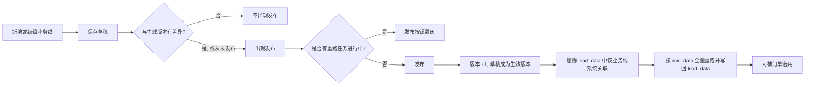
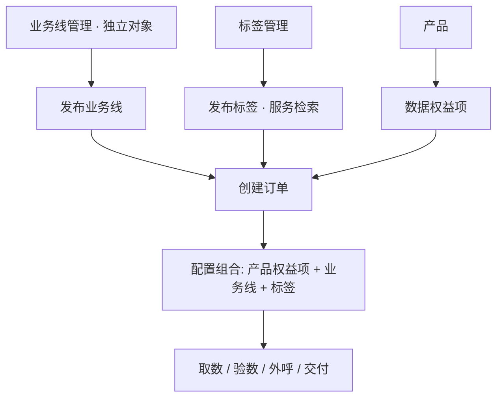
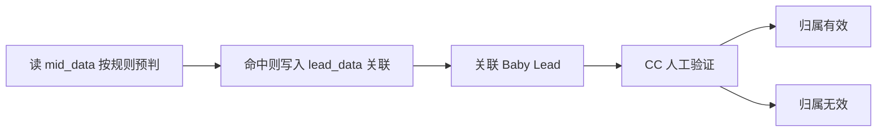
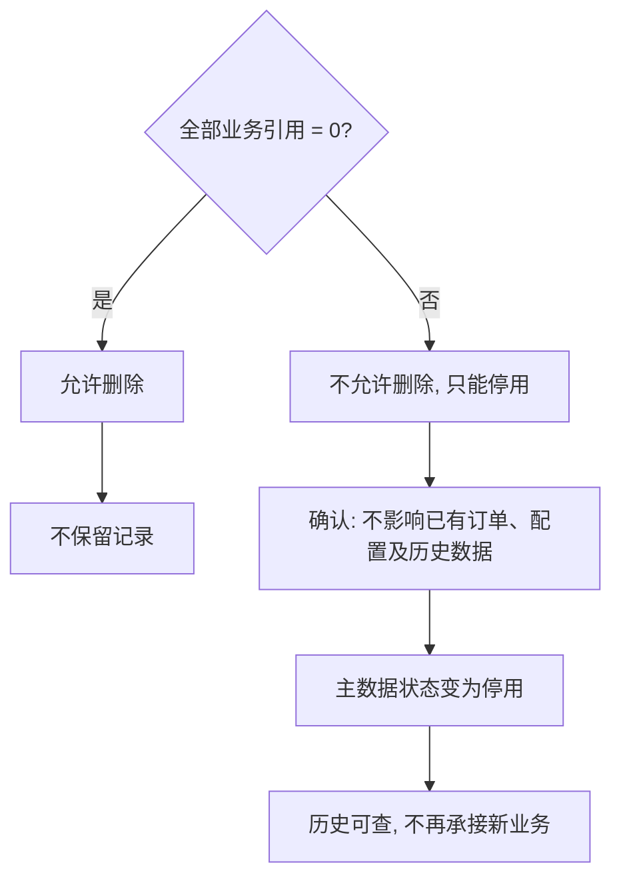

# XLeads-业务线管理 PRD

Last edited time: October 8, 2026
模块: XLeads
原型：[业务线管理](./原型图/业务线管理/业务线管理.html)

| 版本号 | 修订日期 | 修订人 | 修订内容 |
| --- | --- | --- | --- |
| v1.0 | 2026-09-27 | 产品经理 | 初始版本。业务线配置、业务方向取自业务标签等；删除与停用规则（历史版本） |
| v1.1 | 2026-10-08 | 产品经理 | 对齐当前原型与运行逻辑：业务线自带预判规则与业务字段，抽屉 + 保存草稿 / 发布，提示词规则暂隐藏；业务线为独立对象、不与产品直接关联；文案统一为「业务线定义」「Baby Leads数量」；主数据「生效 / 停用」与 CC「归属有效 / 归属无效」分界；补齐操作与历史数据处理；mid_data 判定、lead_data 落库；规则发布先清 lead_data 再按 mid_data 重跑；文档架构对齐标签管理 PRD |

# 一、需求背景

- **业务线是独立的业务对象**
    - 一条业务线表示一套可交付的业务能力：哪些公司可能归属这条线（预判规则），外呼时填哪些业务信息（业务字段）。
    - 它在业务线管理中独立维护，有自己的草稿、发布与生命周期。
- **业务线不与产品直接关联**
    - 产品目录 / 产品配置里，不挂死某条业务线。
    - 产品侧与数据相关的是**数据权益项**；权益项与业务线的搭配，不发生在产品上。
- **搭配发生在创建订单**
    - **订单**是配置「产品权益项 + 业务线 + 标签」的核心地方。
    - 下单时把本单要用的权益、走哪条业务线、按哪些标签检索 / 取数，一次性配齐。
- **规则变更需要发布门禁**
    - 保存草稿不立刻改线上预判结果；发布后版本 +1。
    - 预判规则变更时：先删 lead_data 中该业务线系统关联，再按 mid_data 全量重跑写回；重跑未完成前不可再次发布。
- **预判命中 ≠ 最终成立**
    - 预判规则把公司与业务线、Baby Lead 关联起来之后，还需要 CC 在工作台做人工验证：归属有效 / 归属无效。
    - 人工验证优先于系统预判；不等于主数据的「生效 / 停用」。
- **未投入使用才能删，进入业务后只能停用**
    - 存在任一正式业务引用时不允许删除，只能停用。
    - 停用表示停止未来新增业务，已经存在的业务数据保持原样。

# 二、需求目标

- **业务线作为主数据可独立配置、发布**
    - 预判规则、业务字段在本模块完成，不依赖产品模块。
- **与产品解耦，在订单组合**
    - 产品不直接绑定业务线。
    - 创建订单时，将产品数据权益项与业务线、标签组合使用。
- **系统预判 + 人工确认，两套状态边界清晰**
    - 预判规则给出公司可能归属该业务线的初判，并可关联 Baby Lead。
    - CC 在工作台判定「归属有效 / 归属无效」；本模块只管理主数据「生效 / 停用」。
- **业务字段挂在业务线上**
    - 外呼填写业务机会时，按该业务线已发布的字段方案渲染。
- **删除只清理从未进入业务流程的业务线**
    - 存在订单、Baby Lead、Lead、归属结论等任一引用时，删除被拒绝，改为停用。
- **停用切断新业务，不切断历史**
    - 新订单不能再选它；已有订单与历史数据保持原样。
- **规则只改预判，事实不随便抹掉**
    - 未交付数据可随新规则撤销；已交付数据不回收，仅可标记当前失效。

# 三、名词解释

| 名词 | 说明 |
| --- | --- |
| 业务线 | 独立的业务能力对象。在业务线管理中维护；**不与产品直接关联**。在创建订单时被选用，与产品权益项、标签搭配。 |
| 业务线定义 | 给人看的业务线说明。下游展示取**已发布版本**。 |
| 预判规则 | 系统侧判断公司是否**可能**命中 / 归属该业务线的规则。本期仅展示**条件规则**；提示词规则暂隐藏。预判命中不等于归属有效。 |
| 条件规则 | 与标签管理相同结构：字段条件或统计条件，多条之间用「且 / 或」连接。字段取自 mid_data。 |
| 提示词规则 | 自然语言提示词，由模型判断公司是否归属该业务线。**本期界面暂不展示**。 |
| 业务字段 | 挂在业务线上的字段方案。外呼填写业务机会时按这套字段走。 |
| 数据权益项 | 产品中的数据权益配置项。与业务线的搭配发生在**创建订单**，不在产品侧写死业务线。 |
| 标签 | 标签管理中维护的检索标签。在订单中与权益项、业务线一起配置，不在本模块维护。 |
| Baby Lead | 与业务线、公司发生关联的线索对象。关联后，CC 可在工作台对其上的业务线归属做有效性判定。 |
| Baby Leads数量 | 当前业务线已产出 / 关联的 Baby Leads 数量（列表展示字段）。 |
| 生效版本 | 最近一次发布成功的业务线内容、预判规则和业务字段。 |
| 草稿 | 已保存、尚未发布的修改。 |
| 规则版本 | 从 V1 起。每次发布成功 +1。保存草稿不加版本。 |
| 生效 / 停用 | **主数据生命周期状态**，在业务线管理中维护。生效可被新订单选用；停用停止承接新业务。与「是否已发布」正交。 |
| 归属有效 / 归属无效 | **人工验证**的实例级结论，表示某公司 / 某 Baby Lead 上「该业务线是否成立」。在 **CC 工作台**操作与改写，**不在**业务线管理模块操作。优先级高于系统预判。 |
| 系统预判 | 按当前生效预判规则，对 mid_data 扫描后得到的「是否可能归属」结论。 |
| 系统关联 | 落在 lead_data 中的公司—业务线关联及下游 Baby Lead / Lead 等业务关系。规则重跑时先清后建的，主要是这类系统关联。 |
| 撤销 | 数据尚未正式对外产生业务事实（如未交付 Lead），取消其后续流程。 |
| 失效 | 数据过去曾成立或已产生业务事实，但按当前规则 / 人工验证不再有效；历史可查，当前不再推进。 |
| 删除 | 仅当无任何正式业务引用时允许。删除后不保留记录，不建议恢复。 |
| mid_data | 预判规则的**判定数据源**。本模块仅使用其中的**公司**与**招聘岗位**字段，不含联系人。 |
| lead_data | 业务线关联的**落库库**。公司—业务线关系、Baby Lead、Lead 等正式关联写在这里。 |
| 国标行业分类 | GB/T 4754-2017 国民经济行业分类。国标行业门类 / 大类 / 中类的选项来自 `assets/国民经济行业分类_门类大类中类.json`。 |

# 四、整体流程

## （一）从配置到生效



## （二）运行逻辑：与产品、标签、订单的关系



要点：

1. **业务线 ≠ 产品附属物**：产品不直接关联业务线。
2. **权益项 × 业务线**：搭配发生在创建订单，而不是产品配置页。
3. **订单是组合中枢**：一单同时配置产品权益项、业务线、标签。
4. **标签服务检索**：标签管理定义并打标；订单选用标签用于检索 / 取数条件（详见标签管理 PRD）。

## （三）从预判到归属确认



- 系统预判读 mid_data、关联写 lead_data；**归属有效 / 归属无效**是 CC 人工验证，优先级高于系统预判。
- CC 判定「归属无效」只改写该实例结论，**不会**把业务线主数据改为停用。

## （四）停用与删除



# 五、业务设计

## （一）业务线在链路里的位置

### 1. 与产品的关系

- 业务线**不**在产品上配置、**不**与产品 SKU 直接绑定。
- 产品提供**数据权益项**；权益项本身不内置业务线。
- 需要「用哪个权益、走哪条业务线」时，在**创建订单**里选择并组合。

### 2. 订单

- 创建 / 配置订单时选择：
    - 产品数据权益项；
    - 业务线（须**已发布**且主数据状态**生效**）；
    - 标签（须已发布，用于检索 / 取数，见标签管理 PRD）。
- 订单保存后，该业务线产生订单关联，不能再删除。

### 3. 取数与验数

- 系统按订单上的权益、标签条件等获取并验证数据。
- 业务线标出本单所属业务能力；系统先按已发布预判规则给出可能归属，再经 CC 确认归属有效性（见第五章（五））。

### 4. CC 工作台

- 业务线与当前订单上的业务线一致。
- 业务机会上的业务字段，按该业务线**已发布**的字段方案展示。
- 当业务线已与公司 / Baby Lead 关联后，CC 可判定该实例为**归属有效**或**归属无效**（即人工验证；例如确认「这家公司没有该业务线」→ 归属无效）。
- 归属判定的具体交互、按钮与回写规则，以 CC 工作台 PRD 为准；本模块只约定状态含义与职责边界。

## （二）「发布」按钮的出现条件

以原型为准：

- **列表行内「发布」**：仅当该业务线 `published = false` 时显示；已发布行不显示。
- **编辑抽屉「发布」**：底部始终展示（与取消、保存并列）。
- 对比范围（是否真正按新内容生效，以是否点击发布为准）：
    - 业务线配置：名称、业务线定义。
    - 预判规则：条件规则全文、条件之间的且 / 或。
    - 业务字段：字段名称、类型、默认值、选项、是否必填、是否系统字段、字段顺序。
- **重跑进行中**：产品规则——本轮 lead_data 重跑未完成前，不允许再次发布（列表 / 抽屉「发布」置灰，提示 `数据重跑中，完成后可发布`）。

## （三）发布前与发布后

- **发布前**：下游与订单候选看到的仍是生效版本；草稿只在编辑 / 配置字段抽屉。
- **发布时**
    1. 草稿覆盖为新的生效版本（含预判规则与业务字段）。
    2. 规则版本 +1。首次发布记为 V1。
    3. **若本次变更包含预判规则**：启动重跑任务（见第五章（四））。
    4. **若仅改基础信息或业务字段**：不触发 mid_data / lead_data 重跑。
- **发布成功**
    - 列表行标记为已发布，行内「发布」消失；抽屉内「发布」仍在。
    - 有重跑任务时，结束前禁止再次发布；结束后若仍为未发布草稿差异，列表可再出「发布」。
    - 新开的业务机会使用新字段方案；历史已填值不回写。

## （四）预判规则与判定落库

- 用于系统初判公司是否**可能**命中该业务线，并支撑与 Baby Lead 的关联。
- 预判命中之后，仍需 CC 给出**归属有效 / 归属无效**（人工验证）终判（见第五章（五））。
- **判定读 mid_data，关联写 lead_data**
    - 规则字段全部取自 **mid_data**（仅公司信息、招聘岗位，不含联系人）。可选字段详见第六章（三）。
    - 公司—业务线关联及下游业务关系落在 **lead_data**。
- **本期只展示条件规则**；「提示词规则」暂不展示。
- 条件行结构（字段 / 统计、且 / 或、运算符）与标签管理一致，字段集以本模块原型为准。

### 预判规则变更后的重跑

发布且预判规则相对上一生效版本有变化时：

1. **清关联**：删除 lead_data 中该业务线的系统预判关联。
2. **重判定**：用新规则扫描 mid_data 全量公司 / 招聘岗位数据。
3. **写回**：命中则写入 lead_data；未命中不写。
4. **合成最终关系**：结合保留的归属有效 / 归属无效；**人工验证 > 系统预判**（见第五章（六））。

重跑期间可继续编辑并保存草稿；本轮跑完前禁止再次发布。

## （五）两套状态：主数据 vs 归属实例

业务线相关状态分两层，**不得混用名称、不得在错误模块改写**。

| 层级 | 状态值 | 作用对象 | 管理模块 | 含义 |
| --- | --- | --- | --- | --- |
| 主数据生命周期 | **生效** / **停用** | 业务线本身 | **业务线管理** | 这条业务线还能不能承接新订单 |
| 归属实例（人工验证） | **归属有效** / **归属无效** | 某公司 / 某 Baby Lead 上的业务线关系 | **CC 工作台** | 在这家公司下，该业务线是否真正成立 |

### 1. 主数据：生效 / 停用（本模块）

| 状态 | 含义 | 新业务 | 历史数据 |
| --- | --- | --- | --- |
| 生效 | 可被新订单选用（仍须已发布） | 允许 | 可查 |
| 停用 | 停止承接新业务 | 禁止 | 可查，关系保留 |

- 是否对订单可选，以「已发布 + 生效」为准。
- 停用后可以再次启用。
- 停用只阻止未来产生，不主动撤销已有 Baby Lead / Lead，也不把归属一律改成归属无效。
- 细则见第五章（六）；与 `业务线停用与删除.md` 冲突时，以本文为准。

### 2. 归属实例：归属有效 / 归属无效（CC 工作台 · 人工验证）

| 状态 | 含义 |
| --- | --- |
| 归属有效 | CC 确认：在该公司 / 该 Baby Lead 上，此业务线成立，可继续后续作业 |
| 归属无效 | CC 确认：在该公司下没有该业务线（或不成立），仅针对该实例 |

- **触发前提**：预判规则命中并完成业务线与公司 / Baby Lead 的关联之后。
- **操作入口**：仅 CC 工作台；业务线管理列表与编辑抽屉**不提供**归属有效 / 归属无效操作。
- **影响范围**：只改写当前公司 / Baby Lead 上的归属结论，**不**修改业务线主数据的生效 / 停用，**不**改变其他公司上的归属结果。
- **与预判的关系**：系统预判是初判；归属有效 / 归属无效是人工终判，**优先级更高**。规则重跑后系统预判可更新，但不得覆盖已有人工验证结论。

## （六）操作与历史数据处理

数据自下而上大致是：业务线配置 → 公司—业务线关系 / 系统预判 → Baby Lead → Lead → 客户交付。关系由两套来源决定：**系统预判**与**人工验证（归属有效 / 归属无效）**，最终以人工验证为准。

**一句话原则**：规则只负责更新系统预判；人工验证优先；未交付数据可被新规则撤销；已交付数据不回收，只改当前是否有效；停用挡未来、不否定过去；删除只清理从未进入业务的配置。

### 1. 修改基础信息

改名称、业务线定义、展示类信息不参与判定时：

> **不触发重跑，不影响历史数据。**

| 数据对象 | 处理 |
| --- | --- |
| 公司—业务线关系 / 系统预判 | 保留 |
| 归属有效 / 归属无效 | 保留 |
| Baby Lead / 未交付 Lead / 已交付 Lead | 保留 |

### 2. 修改预判规则（发布后）

编辑 → 发布 → 版本 +1 → **先删 lead_data 中该业务线系统关联 → 再按 mid_data 重跑写回** → 再按人工验证合成最终关系。

| 场景 | 系统预判 | 归属有效 / 归属无效 | Baby Lead | 未交付 Lead | 已交付 Lead |
| --- | --- | --- | --- | --- | --- |
| 新规则仍符合 | 更新为符合 | 保留 | 保留 | 保留 | 保留 |
| 新规则不符合，且从未人工验证 | 更新为不符合 | 无 | **失效** | **撤销** | **保留并标记失效** |
| 新规则不符合，人工验证为归属有效 | 更新为不符合 | 保留「归属有效」 | **保留** | **保留** | **保留** |
| 新规则不符合，人工验证为归属无效 | 更新为不符合 | 保留「归属无效」 | **失效** | **撤销** | **保留并标记失效** |

要点：

- 未生成 Lead：可直接失效 Baby Lead / 撤销关系。
- 已有 Lead 未交付：撤销 Lead，客户侧尚未形成交付事实。
- 已交付 Lead：**不收回**。关系可标失效，交付记录与客户历史保留。「已交付」是不可逆业务事实。
- 归属有效时，即使新规则不符合，最终关系仍保留。

### 3. 修改业务字段（发布后）

- 不触发 mid_data / lead_data 重跑。
- 新开业务机会用新字段方案；历史已填值不回写、不删除。

### 4. 停用

> **停用 ≠ 删除。停用 = 从今天起不再参与新判定与新数据生产。**

| 数据 | 停用后 |
| --- | --- |
| 历史公司—业务线关系、归属结论、Baby Lead、Lead、交付、订单 | 全部保留 |
| 新公司关联 / 新 Baby Lead / 新 Lead / 新订单选用 | 禁止 |

停用本身不主动撤销未交付数据；已产生的 Baby Lead / Lead 不因停用自动消失。

### 5. 重新启用

- 启用后按**当前最新生效规则**重新判定（同样走「清 lead_data 关联 → 按 mid_data 重跑」）。
- 历史归属有效 / 归属无效仍然保留，并在合成最终关系时继续优先。
- 不恢复停用前那一版系统关联快照。

### 6. 删除

> **删除只用于清理从未进入正式业务流程的业务线。**

任一正式业务引用存在则禁止删除，只能停用。允许删除时本身没有需要处理的历史业务数据。

| 检查对象 | 存在时 |
| --- | --- |
| 公司—业务线关系 | 禁止删除 |
| 归属有效 / 归属无效记录 | 禁止删除 |
| Baby Lead / Lead / 已交付 Lead | 禁止删除 |
| 订单 / 外呼任务 / 数据生产任务 / 交付记录 / 其他业务引用 | 禁止删除 |

### 7. 人工验证结果变更（CC 工作台）

| 操作 | 处理 |
| --- | --- |
| 判为归属有效 | 即使当前系统预判不符合，仍保留最终业务线关系及 Baby Lead / Lead |
| 判为归属无效，且尚未交付 | Baby Lead 失效；未交付 Lead 撤销 |
| 判为归属无效，且已交付 | Lead 与交付记录保留；当前状态标记失效 |

### 8. 「撤销」与「失效」

| 概念 | 含义 | 典型场景 |
| --- | --- | --- |
| 撤销 | 尚未正式对外产生业务事实，取消后续流程 | 未交付 Lead 在新规则下不再符合 |
| 失效 | 过去曾成立或已有业务事实，当前不再有效；历史可查 | 已交付后规则变更 / 归属无效 |

### 9. 完整处理矩阵

| 业务线操作 | 系统预判 | 归属有效 / 归属无效 | Baby Lead | 未交付 Lead | 已交付 Lead |
| --- | --- | --- | --- | --- | --- |
| 修改基础信息 | 不变 | 不变 | 保留 | 保留 | 保留 |
| 规则修改，仍符合 | 更新 | 保留 | 保留 | 保留 | 保留 |
| 规则修改，不符合、未人工验证 | 更新为不符合 | 无 | **失效** | **撤销** | **保留并标记失效** |
| 规则修改，不符合、归属有效 | 更新为不符合 | 保留归属有效 | **保留** | **保留** | **保留** |
| 规则修改，不符合、归属无效 | 更新为不符合 | 保留归属无效 | **失效** | **撤销** | **保留并标记失效** |
| 人工验证 → 归属有效 | 不影响 | 更新为归属有效 | 创建 / 保留 | 创建 / 保留 | 保留 |
| 人工验证 → 归属无效 | 不影响 | 更新为归属无效 | 失效 | 撤销 | 保留并标记失效 |
| 业务线停用 | 停止新判定 | 保留 | 保留 | 保留 | 保留 |
| 业务线重新启用 | 按最新规则重跑 | 保留 | 按最终结果处理 | 按最终结果处理 | 保留 |
| 业务线删除 | — | — | 前置条件必须为 0 | 前置条件必须为 0 | 前置条件必须为 0 |

```text
业务线规则 → 系统预判（读 mid_data，写 lead_data）
                │
      未人工验证 │ 已人工验证（归属有效 / 归属无效）
      跟随最新规则 │ 人工结果优先
                ▼
            最终关系 → Baby Lead → Lead
                              │
                     未交付可撤销 │ 已交付不回收（当前可失效）
```

## （七）什么时候允许删除

必须同时满足：下列正式业务引用均为 0。

| 检查对象 | 要求 |
| --- | --- |
| 订单 | 0 |
| 公司—业务线关系 | 0 |
| 归属有效 / 归属无效记录 | 0 |
| Baby Lead / Lead / 已交付 Lead | 0 |
| 外呼任务 / 数据生产任务 / 交付记录 / 其他业务引用 | 0 |

| 场景 | 是否允许删除 |
| --- | --- |
| 新建后仅有配置，无任何业务引用 | 允许 |
| 已配置规则 / 字段，业务引用仍为 0 | 允许 |
| 存在订单、Baby Lead、Lead、归属结论等任一引用 | 不允许，只能停用 |

删除后不保留记录。不建议恢复。真正允许删除时，本身不存在需要处理的历史业务数据。

# 六、功能设计

> 页面以运营端原型 [业务线管理](./原型图/业务线管理/业务线管理.html)为准。业务线管理在 XLeads 下，与标签管理同级。字段表与原型 `FIELDS` / `defaultSystemFields` 对齐。

## （一）业务线列表

路径：XLeads → 业务线管理。

### 1. 页面结构

- 标题「业务线管理」+「新增业务线」。
- 筛选：业务线名称、更新时间。
- 表内搜索。
- 列表即业务线清单（无类型 Tab）。

### 2. 列表字段

| 列 | 说明 |
| --- | --- |
| 业务线 | 当前展示名称 |
| Baby Leads数量 | 该业务线关联 / 产出的 Baby Leads 数量 |
| 业务线定义 | 说明文字 |
| 规则版本 | `V{n}`（原型默认至少 V1） |
| 更新时间 | 最近一次保存或发布的时间 |
| 操作 | 编辑、配置字段、发布（仅未发布行）、删除 |

### 3. 行内操作说明

| 操作 | 说明 |
| --- | --- |
| 编辑 | 打开抽屉，编辑业务线配置 + 预判规则 |
| 配置字段 | 打开独立抽屉，只改业务字段 |
| 发布 | 仅 `published = false` 时显示；重跑进行中产品规则置灰 |
| 删除 | 按第五章（七）校验；存在业务引用则拒绝并提示只能停用 |

## （二）新增 / 编辑业务线

右侧抽屉（约 1080px）。标题为「新增业务线」或「编辑业务线」。

底部按钮：取消、保存、发布（三者均展示）。

### 1. 业务线配置

| 字段 | 必填 | 说明 |
| --- | --- | --- |
| 业务线名称 | 是 | 订单候选、工作台展示名 |
| 业务线定义 | 否 | 给运营看的说明。占位：「请输入业务线定义」 |

### 2. 预判规则区

- 标题旁展示版本：`V{n}`。
- **本期只展示条件规则**。
- 提示文案（对齐原型）：字段取自 mid_data（公司 / 招聘岗位），不含联系人；用于判断公司是否命中该业务线。
- 「条件规则 / 提示词规则」切换与提示词输入：**暂不展示**（原型已注释保留）。
- 条件交互详见本章（三）。

### 3. 保存 / 发布

- 保存写入草稿，提示「已保存」；不启动重跑。
- 发布成功提示「已发布」；若预判规则有变化，先清 lead_data 关联再按 mid_data 重跑。
- 重跑未完成前，产品规则禁止再次发布。

## （三）预判条件规则

条件规则由若干条件行组成。每一行只做一件事：对**一个实际字段**做判断，或先筛选再对该字段做聚合判断。字段选择器里永远是真实字段。

### 1. 条件行

- 「新增条件」增加一行。草稿可 0 行。
- 多于 1 行时，行首出现关系：**且**、**或**。整组只用一种关系。
- 每行可删。
- 每行先选算法：**字段** 或 **统计**。再选字段。
- 一条完整条件：
    - **字段**：已选字段 + 已选运算符；运算符不是「为空 / 不为空」时，值必填。
    - **统计**：已选字段 + 已选聚合方式 + 已选比较符 + 已填数值。筛选条件可选。
- **属于 / 不属于**：多选；命中集合中任一值即「属于」。

### 2. 可选字段

字段按来源分成两组，**与原型 `FIELDS` 一致，取自 mid_data**（不含联系人）：

| 分组 key | 展示名 |
| --- | --- |
| company | 公司信息 |
| job | 招聘岗位 |

#### （1）公司信息

| 字段 | 类型 | 说明 |
| --- | --- | --- |
| 公司名称 | 文本 | — |
| 英文名 | 文本 | — |
| 企业规模 | 文本 | 输入（原型 `type: text`） |
| 登记状态 | 文本 | 输入 |
| 法定代表人 | 文本 | — |
| 注册资本 | 数字 | — |
| 成立日期 | 日期 | — |
| 营业期限 | 文本 | — |
| 注册地址 | 文本 | — |
| 经营范围 | 文本 | — |
| 国标行业门类 | 单选 | 选项见国民经济行业分类 · 门类 |
| 国标行业大类 | 单选 | 选项见国民经济行业分类 · 大类 |
| 国标行业中类 | 单选 | 选项见国民经济行业分类 · 中类 |
| 关键词 | 文本 | — |
| 统一社会信用代码 | 文本 | — |
| 参保人数 | 数字 | — |
| 福利 | 文本 | 输入 |

公司字段中，**仅**国标行业门类 / 大类 / 中类为单选（选项只显示名称，不含编号）；其余为文本 / 数字 / 日期输入。国标行业选项以 [国标行业](./原型图/标签管理/国民经济行业分类_门类大类中类.json)（GB/T 4754-2017）为准，经  [industry-options.js](./原型图/标签管理/industry-options.js) 加载。

#### （2）招聘岗位

| 字段 | 类型 | 说明 |
| --- | --- | --- |
| 岗位名称 | 文本 | — |
| 薪资 | 文本 | — |
| 岗位概要 | 文本 | — |
| 职位介绍 | 文本 | — |
| 岗位区域 | 文本 | — |
| 岗位学历 | 单选 | 不限、初中及以下、高中/中专、大专、本科、硕士、博士 |

### 3. 字段类型、逻辑运算符、统计方式

与原型 `OPS` / `AGG` / `COMPARE_OPS` 一致：

#### （1）文本

| 能力 | 选项 |
| --- | --- |
| 逻辑运算符 | 是、不是、包含、不包含、为空、不为空 |
| 统计方式 | 数量 |

#### （2）单选

| 能力 | 选项 |
| --- | --- |
| 逻辑运算符 | 是、不是、属于、不属于、为空、不为空 |
| 统计方式 | 数量、去重计数 |
| 取值说明 | **是 / 不是**单值；**属于 / 不属于**多值集合 |

#### （3）数字

| 能力 | 选项 |
| --- | --- |
| 逻辑运算符 | 等于、不等于、大于、小于、大于等于、小于等于、为空、不为空 |
| 统计方式 | 数量、求和、平均值、最大值、最小值 |
| 统计比较符 | 等于、不等于、大于、小于、大于等于、小于等于 |

#### （4）日期

| 能力 | 选项 |
| --- | --- |
| 逻辑运算符 | 等于、早于、晚于、为空、不为空 |
| 统计方式 | 数量、最早、最晚、时间跨度 |
| 统计比较符 | 等于、不等于、大于、小于、大于等于、小于等于 |

### 4. 一行里的两种算法

**（1）字段**：对当前对象上的这一个字段做一次判断。

**（2）统计**：对同一实际字段先筛选、再聚合、再比较。

```text
岗位名称
├── 字段：岗位名称 包含 销售
└── 统计：岗位名称
        ├── 筛选：包含 销售
        ├── 统计：数量
        └── 判断：> 0
```

## （四）配置字段

独立右侧抽屉。标题：`配置字段 · {业务线名称}`。

底部按钮：取消、保存。

- tip（对齐原型）：系统字段不可编辑、不可删除，默认不必填；「业务线」选项同步自已配置的业务线；自定义字段可编辑、删除。
- 右上角「新增字段」。
- 列：拖拽、字段名称、默认值、字段类型、是否系统字段、是否必填、操作。
- 本抽屉「保存」只写入业务字段草稿；需发布业务线后下游才看到新方案。
- 字段类型（原型 `FIELD_TYPES`）：日期、数字、数值区间、单行文本、多行文本、单选下拉、多选下拉、单选框、多选框。
- 单选、多选类字段至少配置一个选项。

### 1. 默认系统字段

与原型 `defaultSystemFields` / CC 工作台业务机会表单对齐，不可删改类型：

| 字段名称 | 字段类型 | 选项 / 说明 | 是否必填 | 是否可删除 |
| --- | --- | --- | --- | --- |
| 业务线 | 单选下拉 | 选项同步自业务线管理已配置名称 | 否 | 否 |
| 业务描述 | 单行文本 | — | 否 | 否 |
| 业务负责人 | 单选下拉 | 选项来自组织用户（原型示例：Alex / Taylor / Jordan） | 否 | 否 |
| 业务角色 | 单选下拉 | 决策人、影响人、执行人 | 否 | 否 |
| 负责范围 | 单选下拉 | 集团、区域、部门 | 否 | 否 |
| 业务覆盖人数 | 数字 | — | 否 | 否 |
| 预算范围 | 数值区间 | 最低值 — 最高值 | 否 | 否 |
| 预计采购时间 | 日期 | — | 否 | 否 |

### 2. 新增 / 编辑自定义字段

| 项 | 必填 | 说明 |
| --- | --- | --- |
| 字段名称 | 是 | 同一业务线内不可重复 |
| 字段类型 | 是 | 见上文 FIELD_TYPES |
| 默认值 | 否 | 非选项类可填 |
| 选项 | 选项类必填 | 至少一个 |
| 是否必填 | 否 | 默认不必填 |

## （五）提示词规则（本期暂不展示）

> 原型中已注释保留，**当前版本界面不展示**。

- 规则区切换：条件规则 / 提示词规则。
- 多行输入。占位：「请输入提示词，描述如何预判公司是否归属该业务线」。
- 发布时提示词不能为空。

## （六）停用与启用

- 存在正式业务引用时，删除被拒，引导停用。
- 停用确认：不影响已有订单、配置及历史数据，但不再承接新业务。
- 启用后回到生效，可再次出现在新订单候选（仍须已发布）；启用触发按最新规则重跑（清 lead_data → 扫 mid_data）。
- 本处「停用 / 启用」仅指主数据状态，与 CC 的「归属有效 / 归属无效」无关。

## （七）删除

- 列表「删除」按第五章（七）检查全部业务引用是否为 0。
- **允许删除**：无任何正式业务引用；删除后不保留记录。
- **不允许删除**：存在任一引用，只能停用。

## （八）本模块不包含的能力

- 不在业务线管理中配置或展示「归属有效 / 归属无效」。
- 不在本模块替 CC 判定某公司是否没有该业务线。
- 上述能力归属 CC 工作台；本 PRD 仅定义边界与状态名称。

# 七、迭代计划

| **优先级** | **范围** | **说明** |
| --- | --- | --- |
| **P0** | 业务线配置与发布门禁 | 列表、编辑抽屉、预判条件规则（公司 / 招聘岗位对齐原型）、配置字段与系统字段锁定；主数据生效 / 停用；删除按全量业务引用校验 |
| **P1** | 订单组合、预判重跑与归属确认 | 创建订单组合权益项 + 业务线 + 标签；规则发布清 lead_data 再扫 mid_data；重跑中发布置灰；CC 工作台落地归属有效 / 归属无效 |
| **P2** | 提示词规则恢复与运行态 | 恢复提示词规则并接入模型；发布重跑进度与失败重试；停用后的新增拦截落地 |
