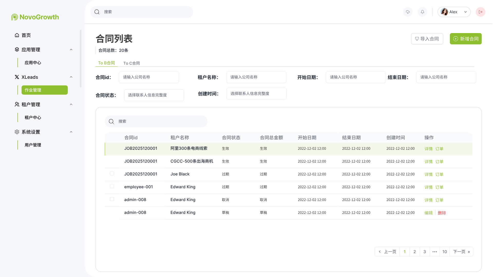
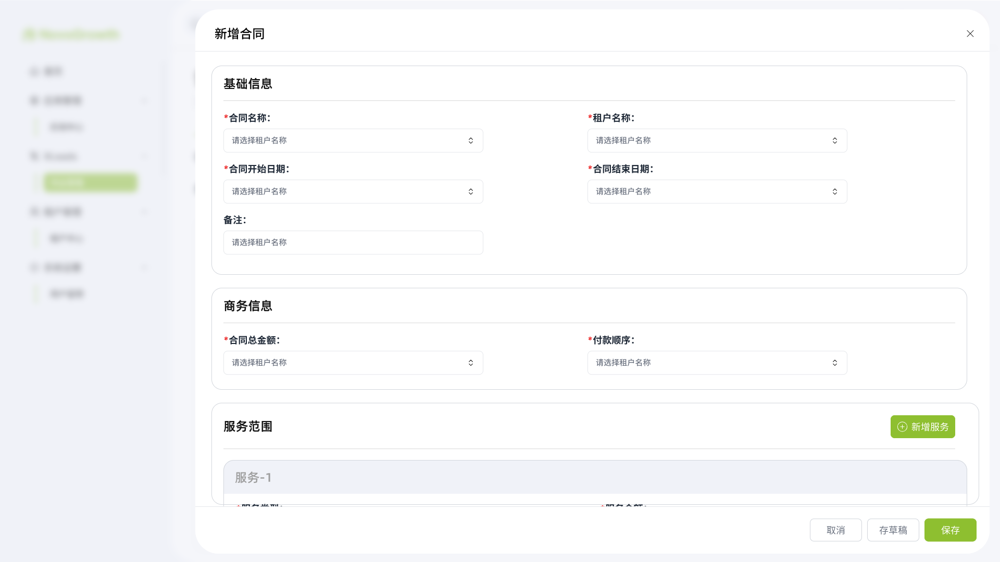
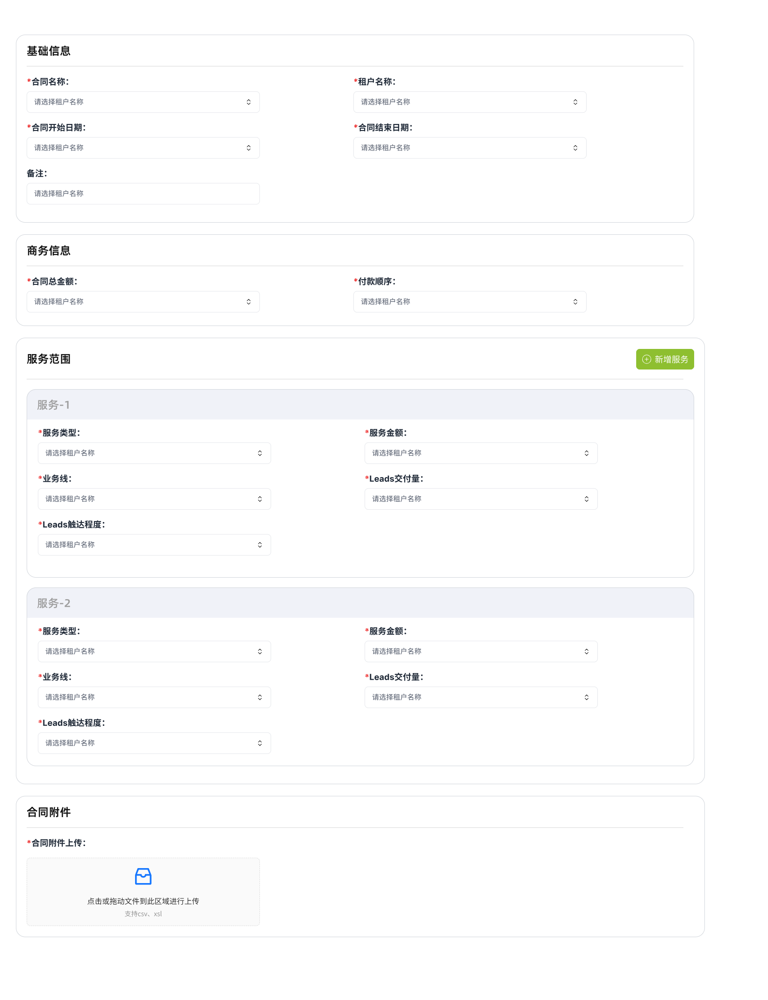

# 合同列表PRD

| **版本号** | **修订日期** | **修订人** | **修订内容** |
| --- | --- | --- | --- |
| v1.0 | 2026-07-30 | 产品经理 | 初始版本，基于合同列表 / 新增合同原型 |
| v1.1 | 2026-07-31 | 产品经理 | 固化合同→订单主链路；正式保存锁定；生命周期仅系统推进（无人工取消） |

# 一、需求背景

合同、订单、任务构成中台交付链路的三层对象：

| 对象 | 本质 | 时间代表什么 |
| --- | --- | --- |
| 合同 | 商业承诺 | 客户购买服务的有效周期 |
| 订单 | 某一项服务交付 | 该服务计划交付周期 |
| 任务 | 执行动作 | 某个具体执行动作的时间安排 |

合同是商业承诺的入口：约定租户、金额、服务范围与有效期。**「存草稿」不生成订单；「正式保存」后合同配置锁定，并按每个服务项自动生成一条订单草稿**，再由订单正式保存驱动租户订单任务（寻迹 / 推送）。合同生命周期由**系统**按有效期推进，**不提供人工取消**。

# 二、需求目标

1. 支持人工新建合同与导入合同（AI 解析字段），完成合同信息结构化录入。
2. 明确「存草稿 / 正式保存」差异：正式保存锁定合同，并按服务项自动生成订单草稿。
3. 提供合同列表的筛选、状态查看与操作入口（详情 / 订单 / 编辑 / 删除仅限草稿）。
4. 合同状态（生效 → 过期）由系统自动推进，无人工取消操作。

# 三、名词解释

| 名词 | 定义描述 |
| --- | --- |
| 合同 | 面向租户的商业承诺单元，包含基础信息、商务信息、服务范围与附件 |
| 服务项 | 合同服务范围内的一条服务配置；一个服务项对应一个订单 |
| 订单草稿 | 合同保存后由系统按服务项自动创建的订单，状态为草稿，待运营确认后执行 |
| 付款顺序 | 合同约定的开票与收款先后关系：现款后票 / 先票后款 |
| 服务类型 | 交付模式：寻迹模式 / 寻迹模式-含手机 / 推送模式 / 推送模式-含手机 |
| Leads 触达程度 | 线索需达到的业务深度：定位 / 邀约 / 成交 |

# 四、功能设计

## （一）合同设计

### 1.合同对象

> 合同是中台内可录入、可导入、可关联订单的商业承诺配置单元。人工「新增合同」完成四块配置后持久化；另支持「导入合同」经 AI 解析后回填字段。

**对象结构（四块配置）**

- **基础信息**：合同身份、租户、有效期、备注
- **商务信息**：合同总金额、付款顺序（及条件字段）
- **服务范围**：可新增多个服务项；每项对应一个订单
- **合同附件**：合同文件上传


### 2.合同表单设计

> 新增合同为单页四块表单：基础信息 → 商务信息 → 服务范围 → 合同附件。底部操作：取消 / 存草稿 / 保存。

#### （1）基础信息

- **合同名称**（必填）：文本输入
- **租户名称**（必填）：下拉选择已有租户
- **合同开始日期**（必填）：日期选择
- **合同结束日期**（必填）：日期选择；须晚于开始日期
- **备注**（选填）：多行文本

#### （2）商务信息

- **合同总金额**（必填）：金额数值
- **付款顺序**（必填）：现款后票 / 先票后款
- **开票日期**（条件必填）：付款顺序 = 先票后款时展示并必填

**付款顺序**

| 枚举值 | 额外字段 |
| --- | --- |
| 现款后票 | 无 |
| 先票后款 | 开票日期 |

#### （3）服务范围

> 支持新增多个服务项（「+ 新增服务」）。合同**正式保存**后，每个服务项对应生成一条订单草稿。

- **服务类型**（必填）：寻迹模式 / 寻迹模式-含手机 / 推送模式 / 推送模式-含手机
- **手机数量**（条件必填）：服务类型含「含手机」时展示并必填
- **服务金额**（必填）：该服务项金额
- **业务线**（必填）：福利类 / 销售类 / 跨境电商类
- **Leads 交付量**（必填）：该服务计划交付线索数量
- **Leads 触达程度**（必填）：定位 / 邀约 / 成交

**服务类型**

| 枚举值 | 额外字段 |
| --- | --- |
| 寻迹模式 | 无 |
| 寻迹模式-含手机 | 手机数量 |
| 推送模式 | 无 |
| 推送模式-含手机 | 手机数量 |

> 服务金额合计宜与合同总金额一致（校验规则可在迭代中细化）。

#### （4）合同附件

- **合同附件上传**（必填）：支持点击或拖拽上传；格式以实际上线约定为准（原型示意 csv / xls）

### 3.合同生命周期（系统推进，无人工取消）

| 状态 | 说明 | 如何进入 |
| --- | --- | --- |
| 草稿 Draft | 已创建未正式生效；可编辑、可删除 | 用户「存草稿」 |
| 生效 Active | 正式保存后、且仍在合同有效期内；**配置锁定不可再改** | 用户「正式保存」 |
| 过期 Expired | 已超过合同结束日期 | **系统**按结束日期自动推进；人工无「取消」入口 |

> **不设「取消」状态，不提供人工取消合同操作。** 生命周期仅：草稿（人工）→ 生效（人工正式保存）→ 过期（系统自动）。

**合同状态变更操作说明**

| 状态 | 详情 | 订单 | 编辑 | 删除 |
| --- | --- | --- | --- | --- |
| 草稿 | ✅ | ❌ | ✅ | ✅ |
| 生效 | ✅ | ✅ | ❌（已锁定） | ❌ |
| 过期 | ✅ | ✅ | ❌ | ❌ |

> 「订单」操作：跳转至该合同关联的订单列表 / 详情入口。

### 4.合同 → 订单 → 任务主链路

```
合同「存草稿」     → 仅合同草稿，不生成订单
合同「正式保存」   → 合同锁定不可再改
                   → 每个服务项自动生成 1 条「订单草稿」

订单「草稿编辑」   → 补数据需求 / 交付配置等（见《订单管理PRD》）
订单「正式保存」   → 订单锁定不可再改
                   ├─ 服务=寻迹 → 暂不建任务；客户每次寻迹 → 生成 1 条「租户订单-寻迹」任务
                   └─ 服务=推送 → 立刻生成 1 条「租户订单-推送」草稿任务
```

**与订单的关系（摘要）**

- **一对多**：一份合同可包含多个服务项；**一个服务项对应一个订单**
- **存草稿**：仅保存合同为草稿，**不生成订单**
- **正式保存**：合同进入生效并锁定；系统按服务项自动创建订单草稿；字段回填见《订单管理PRD》
- 订单侧补全与正式保存、以及寻迹/推送如何生成任务：见《订单管理PRD》《任务管理PRD》

---

## （二）创建合同

### 1.人工手动创建

入口：合同列表右上角「新增合同」。

流程：填写四块表单 → 存草稿 / 正式保存。

- **取消**：关闭表单，不持久化本次填写（或放弃未保存修改）
- **存草稿**：合同状态 = 草稿；**不生成订单**；仍可再编辑
- **正式保存（保存）**：合同状态 = 生效；**配置锁定不可再改**；按每个服务项自动生成 1 条订单草稿

### 2.导入合同

入口：合同列表右上角「导入合同」。

流程：上传合同文件 → AI 自动解析字段 → 回填至新增合同表单 → 用户确认 / 补全后存草稿或正式保存。

> 解析失败或字段不完整时，保留已识别内容，由用户手工补全后提交。正式保存规则同上。

---

# 五、页面设计

**原型图**：







## （一）合同列表页

**页头**

- 标题：合同列表
- 汇总：合同总数：N 条
- 操作：导入合同、新增合同

**Tab**

- To B：筛选 To B 维度合同
- To C：筛选 To C 维度合同

**筛选区**

- 合同 id、租户名称：文本
- 开始日期、结束日期：日期
- 合同状态：草稿 / 生效 / 过期（**无「取消」**）
- 创建时间：时间范围
- 另支持表格内关键词搜索

**列表字段**

- 多选、合同 id、租户名称、合同状态、合同总金额、开始日期、结束日期、创建时间、操作
- 操作按生命周期矩阵展示（详情 / 订单 / 编辑 / 删除）；**无「取消合同」操作**

**分页**：底部分页器。

## （二）新增合同页 / 弹窗

四块分区展示：基础信息、商务信息、服务范围、合同附件。

条件显隐：

- 付款顺序 = 先票后款 → 展示开票日期
- 服务类型含「含手机」 → 展示手机数量

服务范围支持「+ 新增服务」动态增加服务卡片（服务-1、服务-2 …）。

底部：取消 / 存草稿 / 正式保存（保存）。

> 正式保存成功后不可再进编辑；仅详情 / 跳转关联订单。

---

# 六、迭代计划

| 阶段 | 目标 | 说明 |
| --- | --- | --- |
| v1.0 | 合同列表与新建闭环 | 合同列表、新增合同四块表单、存草稿 / 保存自动生成订单草稿 |
| v1.1 | 主链路与生命周期 | 正式保存锁定；无人工取消；过期由系统推进；主链路对齐订单/任务 |
| 后续 | 导入与校验增强 | 导入合同 AI 解析细化；服务金额与合同总金额校验；合同详情页 |
