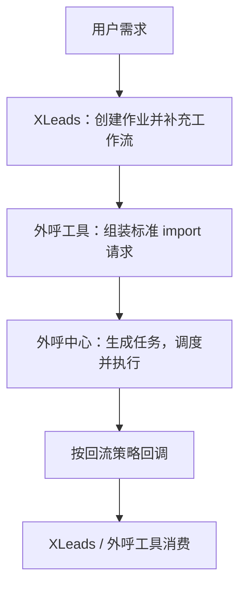
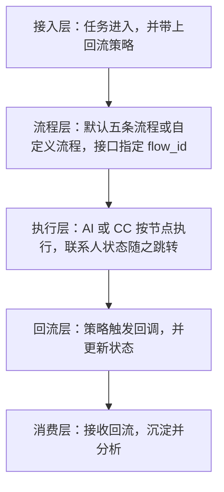
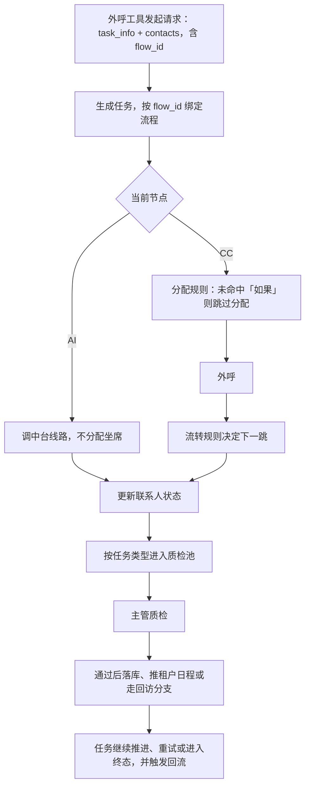
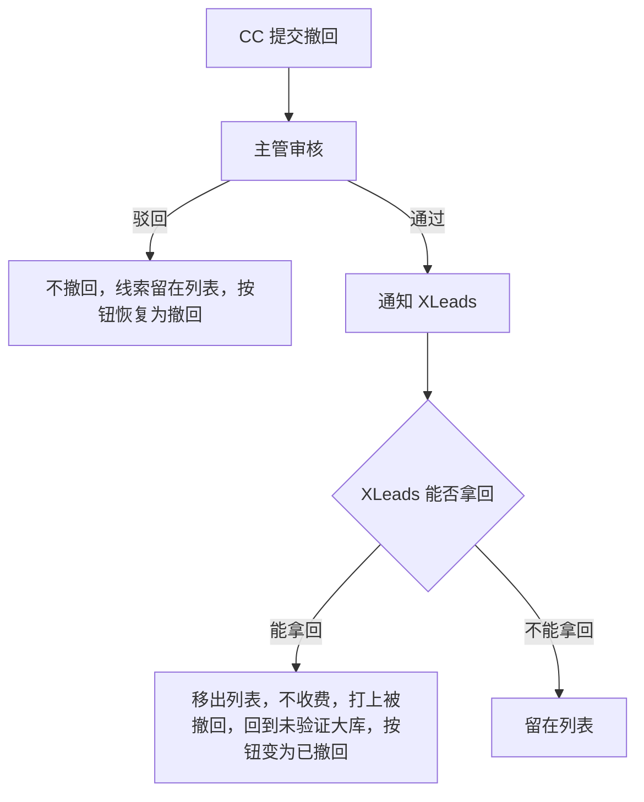

# 外呼中心-运营平台 PRD

Last edited time: October 10, 2026
模块: 联络中心

| 版本号 | 修订日期 | 修订人 | 修订内容 |
| --- | --- | --- | --- |
| v1.0 | 2026-04-28 | 产品经理 | 初始版本，定义角色权限与核心设计逻辑。 |
| v1.1 | 2026-05-06 | 产品经理 | 补充 XLeads「外呼工具」跨系统衔接、接入调用方及撤回 / 退回职责边界。 |
| v1.2 | 2026-05-28 | 产品经理 | 补充 CC 外呼工作台（坐席状态、超时规则、表单展示、邀约去重、姓名校验）；质检入池与四类型 Tab；通话状态取最新一次；流转节点仅可选后续节点。 |
| v1.3 | 2026-08-10 | 产品经理 | 「任务管理」更名为「外呼调度」，拆为任务列表 / 公司列表 / 任务执行流程三 Tab；任务改为「任务 → 公司 → 联系人」三级；系统默认四条流程 + 自定义流程；接口须显式指定 `flow_id`；分配规则条件扩展为任务 / 公司 / 联系人三维。 |
| v1.4 | 2026-08-11 | 产品经理 | 补充推送与复用规则（目标缺口判定、历史结果有效期 6 个月）；重构主管外呼任务列表为执行项三 Tab 与队列排序；对齐通话记录 / 外呼联系人列表 / 外呼详情 / 外呼工作台原型（含编辑门禁、业务线自动填充、邀约四要素去重）；本版暂不实现回访专用表单。 |
| v1.5 | 2026-08-12 | 产品经理 | CC 外呼工作台页头增加「外显号码」下拉切换：坐席可从授权主叫号中选择，后续外呼以此号码外显；通话中不可切换。 |
| v1.6 | 2026-08-13 | 产品经理 | 外呼联系人列表拆为「待执行 / 已完成」并补齐回访抽屉（定位 / 邀约回访、改期字段、沟通记录强制规则）；质检列表改为三 Tab（定位 / 邀约 / 回访质检），重写入池条件与质检通过后的落库 / 推送租户 / 回访分支处理规则。 |
| v1.7 | 2026-08-14 | 产品经理 | 回访质检补齐「质检」按钮显隐：质检结论不影响主数据的回访结果不展示质检按钮；需删数 / 撤回邀约 / 改期 / 已推租户后的取消改期等才展示，通过后可提示线下联系租户。 |
| v1.8 | 2026-08-17 | 产品经理 | 外呼管理首功能点调整为 Dashboard（外呼统计）；补齐「核心概览」「任务推进概览」「外呼执行分析」「团队绩效分析」指标、图表类型、计算公式与筛选口径。 |
| v1.9 | 2026-08-18 | 产品经理 | Dashboard「外呼情况占比」定为三态：已接通（`yy_1`）/ 号码异常 / 暂未接通；按挂机码归类。 |
| v1.10 | 2026-09-03 | 产品经理 | 外呼工作台对齐原型：个人信息去掉个人标签 / 意愿度，职级固定下拉；业务机会「业务线」改为下拉单选（福利业务 / 销售业务），邀约业务线同源。外呼 Dashboard 用户筛选增加固定项「机器人（AI外呼）」。 |
| v1.11 | 2026-09-08 | 产品经理 | 任务类型枚举调整为五种：人员核验 / 业务挖掘 / 商机增强 / 客户邀约 / 回访；同步接口说明、系统默认流程、Dashboard 类型分布、工作台表单模块映射。质检入池按类型分流：人员核验 / 业务挖掘 / 商机增强 → 定位质检；客户邀约 → 邀约质检；回访 → 回访质检。 |
| v1.12 | 2026-09-15 | 产品经理 | Dashboard 对齐最新稿：核心概览新增「有效联系人数」「外呼次数」；漏斗新增「有效联系人总量」；人工外呼趋势新增「有效联系人量」；外呼执行分析新增 AI / 人工 / 外呼总次数。明确各图表对时间筛选器与 CC 筛选器的跟随规则。有效联系人 = 人正确且电话正确。 |
| v1.13 | 2026-09-16 | 产品经理 | 质检列表以筛选项替代视图；主管分配增加人工外呼准入校验（未命中不分配、公司状态「暂不外呼」，全部命中不弹窗）；任务详情改为公司维度，下钻查看该公司联系人。通话记录列表增加「主叫号码」，筛选项「被叫号码」更名为「联系人号码」。工作台「联系人信息是否正确」增「不确定」，并明确再推 / 寻迹 / 解绑；「是否在职」明确在职绑定与离职解绑。公司下联系人增加「来源」（人工新建 / 系统推送）。定位质检入池改为「联系人信息是否正确」不为空；定位质检列补任务名称 / 是否信息正确 / 是否业务负责人；邀约质检列补任务名称，推送租户改为展示租户名称。 |
| v1.14 | 2026-10-10 | 产品经理 | 文档架构对齐业务线管理 PRD：同一日期合并为一个版本；原功能说明拆成业务设计与功能设计，功能设计只保留页面。对齐最新筛选原型：外呼调度任务列表 / 公司列表、外呼任务列表待分配 / 已分配 / 已完成 / 新增公司列表 Tab、定位 / 邀约 / 回访质检筛选项；筛选项支持展开收起；任务基础信息增加「任务业务线」；明确任务业务线 / 公司业务线 / 已确认业务线 / 已定位负责人业务线及公司维度筛选口径（固话、最近外呼、下次联系、预计采购、通话总时长）。公司列表增加「批量外呼」与操作列「更多」跳转待分配 / 已分配 / 已完成（自动带入公司名称）；从公司列表跳入已分配时，外呼CC 下拉仅展示已分配该公司的 CC。对齐常用话术原型：公共库 / 个人库、话术组、新建编辑弹窗（含 {{变量}}）、近30天使用频率；公共库全员可见，个人库仅本人可见。 |

# 一、需求背景

- **外呼接的是上游清单，打完要能回传**
    - 名单从 XLeads 进来，由 AI 与 CC 一起触达。
    - 进度和结果要回到上游，作业才能往下走。
- **两边各管一段**
    - XLeads 负责把需求送进作业、补工作流。外呼工具负责组装标准请求、调用外呼中心，并消费回流。
    - 外呼中心负责调度、外呼，以及把结果交回去。外呼工具不替坐席拨号，也不替 XLeads 改线索终态。
- **需要一个统一的运营平台**
    - 没有统一入口时，接入方式、分配规则、进度和统计口径都会散。
    - 本产品把接入、流程、执行、回流、消费收成一条闭环。

| 层级 | 能力 |
| --- | --- |
| 接入层 | 统一任务数据进入 |
| 流程层 | 任务执行流程，以及 CC 节点上的分配 / 流转 |
| 执行层 | 按节点（AI / CC）执行，联系人在节点间跳转 |
| 回流层 | 按策略把结果回传 |
| 消费层 | 结果沉淀，并用看板看进度和绩效 |

# 二、需求目标

- **接入口径清晰**
    - 系统对接走标准接口：数据来自 XLeads，请求通常由外呼工具发起；一次请求带任务基础信息和联系人列表，且必须带 `flow_id`。
    - 运营侧可在公司列表对已有公司做「批量外呼」建任务（见第五章（十一））。
    - 页面上的表单模块仍按 `task_type`（触达程度）展示。
- **调度按规则落到人或主管**
    - 条件可以看任务、公司、联系人。
    - 队列按期望开始时间、优先级排序。主管可以再分配。
- **执行在联系人上闭环**
    - 联系人在 AI / CC 节点之间流转，任务可以暂停、再分配。
    - 通话记在联系人上，并挂回所属任务。
- **结果按策略回流**
    - 支持实时、批量、任务完成等回调。
- **运营侧能管坐席，也能看数**
    - 坐席先授权，再绑定到 CC。超管维护这层绑定。
    - Dashboard 用于监控和绩效。

一次标准请求生成一个任务。任务负责编排和归档，本身不拨号。任务状态由下面的联系人汇总。同一个人可以出现在多个任务里，任务之间互不影响。

# 三、名词解释

| 名词 | 说明 |
| --- | --- |
| 联络中心 / 外呼中心 | 触达与跟进的业务域。本 PRD 指包含调度、外呼管理、外呼执行的运营平台。 |
| 调度中心 | 数据接入、回流、坐席分配、任务分配规则、任务流转规则的配置与调度。 |
| 外呼管理 | 主管侧：承接任务项、手动分配、执行队列、进度、干预、Dashboard。 |
| 外呼任务（模块） | 执行侧：AI 外呼、CC 工作台、通话记录及流转展示。 |
| 外呼工具 | 归属 XLeads。负责组装 import 请求、创建任务，并消费回流。不承担坐席执行和流程编排，也不替代 XLeads 对线索库的终态操作。 |
| 请求（import） | 推入外呼中心的一次导入载荷，含 `task_info`、`contacts`。系统据此生成任务。 |
| 任务 | 一次 import 对应一个任务。下面挂多家公司（多条任务项），不直接挂联系人列表。 |
| 任务项（执行项） | 一个任务 + 一家公司，下面挂多名联系人。主管「外呼任务列表」一行就是一个任务项。 |
| 联系人 | 任务项下最小的执行和状态单元。通话记在联系人上。 |
| CC | 坐席侧用户，接收分配并外呼。与中台坐席一对一绑定。 |
| 主管 | 可做二次分配、暂停 / 恢复等干预。 |
| 中台坐席 | 外呼中台侧的资源。外呼中心按授权拉取可用列表。 |
| 分配规则 | 条件（可选）+ 分配对象（CC / 主管）+ 策略（轮询 / 随机 / 平均 / 指定）。条件开启时，只有「如果」可配；「否则」写死为跳过分配、直接流转。 |
| 流转规则 | 按通话结果等决定联系人的下一节点（AI / 人工 / 结束）。作用在联系人上。 |
| 回流 | 按策略回调或导出结果。`callback_config` 定义策略，`callback_id` 做幂等。 |
| 撤回 | 发起方是 CC。CC 认为线索无效时提交撤回申请。用户尚未拜访时，一律先经主管审核，再由 XLeads 执行终态。入口弹窗标题为「撤回工单」。 |
| 退回 | 发起方是客户 / 租户端。用于已经拜访等场景。运营端配合审核和回访。这不叫撤回。 |
| 有效联系人 | 「联系人信息是否正确」= 是，即人正确且电话正确。Dashboard 的有效联系人数、有效联系人量、有效联系人总量都用这个口径，按联系人去重。「不确定」和「否」不计入。 |
| 任务业务线 | 这个任务主要验证哪些业务线。落在任务基础信息上，可多选。详见第五章（十一）。 |
| 公司业务线 | 该公司被预判上的业务线。现阶段对应公司上的「业务标签」；业务线管理模块上线后，改为业务线。 |
| 已确认业务线 | CC 在工作台业务机会里选了该业务线（业务负责人可为空），即认为这家公司有这条业务。 |
| 已定位负责人业务线 | CC 在工作台业务机会里选了该业务线，且业务负责人不为空。 |
| 话术公共库 | 常用话术中全员可见、可选用的话术集合。 |
| 话术个人库 | 常用话术中仅创建者本人可见、可选用、可维护的话术集合。 |

# 四、整体流程

## （一）从需求到回流



容器 1 (2).png

## （二）五层怎么分工



流程层的系统默认流程有五条：人员核验、业务挖掘、商机增强、客户邀约、回访。也可以另建自定义流程。CC 节点上配置分配和流转。

## （三）一次任务怎么走完



质检入池按类型分流，细则见第五章（八）：

- 定位质检：人员核验 / 业务挖掘 / 商机增强，且「联系人信息是否正确」已填写。
- 邀约质检：客户邀约，且已有邀约数据。
- 回访质检：回访提交，一行对应一次回访。

未通过时，按类型保留原数据，或只记下质检结论。

## （四）请求、任务、联系人

任务关系.png

一次 import 生成一个任务。任务下面是多家公司，每家公司是一条任务项，联系人挂在任务项上。拨号和通话结果落在联系人。任务状态由任务项和联系人汇总，任务本身不拨号。

# 五、业务设计

本章写规则：数据怎么进来、状态怎么变、什么时候允许分配和编辑、质检与撤回之后系统做什么。页面上有哪些字段和按钮，见第六章。

## （一）角色与数据范围

| 角色 | 做什么 | 能操作什么 | 能看到什么 |
| --- | --- | --- | --- |
| CC | 外呼执行 | 只处理分给自己的任务和联系人。不能改调度规则 | 本人相关数据。电话号码一律脱敏，拨号时由服务端带明文 |
| CC 主管 | 管团队执行 | 在管辖范围内分配、收回、调序、暂停和恢复。不能改调度规则，也不能改坐席绑定 | 管辖范围内的任务、任务项、联系人，以及监控数据 |
| 运营超管 | 配平台 | 调度中心的全部配置：坐席绑定、分配、流转、回流、权限 | 租户内全量数据 |

多角色用户看到各角色菜单的并集。通话记录里，主管看管辖范围；CC 看与自己有过交互的联系人相关通话，包含 AI 和其他 CC 打过的。导出默认仍然脱敏。

## （二）任务怎么接入

任务进入有两条路：

1. **标准接口**（面向系统）：典型调用方是 XLeads 的外呼工具。一次请求生成一个任务，并进入调度。
2. **公司列表 · 批量外呼**（面向运营 / 主管）：在已有公司上勾选后创建任务，见第五章（十一）§4。

**标准接口请求只含两块**：`task_info` + `contacts`。不再传 `fields_meta`。数据源固定为 XLeads。

### 1. task_info

| 字段 | 必填 | 说明 |
| --- | --- | --- |
| task_name | 是 | 任务名称 |
| task_desc | 是 | 任务描述 |
| task_type | 是 | 决定页面展示哪套表单。不参与选择执行流程 |
| flow_id | 是 | 执行流程 ID，可以是系统默认流程或自定义流程。非法则创建失败，不会按 `task_type` 悄悄换成别的流程 |
| task_business_lines | 否 | **任务业务线**：本任务主要验证哪些业务线，可多选。详情、工作台、筛选项均展示此字段 |
| source | 是 | 固定 XLeads |
| priority | 否 | 优先级 |
| expected_start_time | 是 | 期望开始时间 |
| created_time | 是 | 创建时间 |
| callback_config | 是 | 回流策略 |

`task_type` 五种：人员核验、业务挖掘、商机增强、客户邀约、回访。

`flow_id` 可以指向系统默认流程（人员核验 / 业务挖掘 / 商机增强 / 客户邀约 / 回访，如 `flow-001`～`flow-005`），也可以指向自定义流程。

### 2. contacts

| 字段 | 必填 | 说明 |
| --- | --- | --- |
| name | 是 | 姓名 |
| phone | 是 | 电话。界面脱敏，拨号时服务端使用明文 |
| company | 是 | 公司名称 |
| company_address | 否 | 有值时，工作台自动带出，只读展示 |
| visit_opportunity | 否 | 拜访商机。有值时自动带出，只读展示 |

### 3. 流程和表单各看各的

- 走哪条执行流程，只看 `flow_id`。
- 页面上出现哪些表单模块，只看 `task_type`。
- 创建时默认只校验 `flow_id` 是否合法。

| task_type | 工作台展示的模块 |
| --- | --- |
| 人员核验 | 页头 + 公司 + 个人 + 潜在联系人 |
| 业务挖掘 | 以上 + 业务机会 |
| 商机增强 | 以上 + 业务机会 |
| 客户邀约 | 以上 + 业务机会 + 邀约信息 |
| 回访 | 工作台仍按人员核验的基础模块展示。回访内容在「外呼联系人列表 → 已完成 → 回访」录入，不在工作台里做回访表单 |

接入侧若按类型预览表单，模块与上表一致：人员核验看公司和联系人；业务挖掘、商机增强增加业务机会；客户邀约再增加邀约。回访的录入不在首次外呼工作台完成。

同一任务、同一公司已经有成功邀约时，邀约整块隐藏，也不参与必填。这主要用于客户邀约。

## （三）推送、复用与回流

### 1. 什么时候必须再推给 CC

同公司可以做多条业务，也可以同时出现在多个任务里。**只有目标还有缺口、历史结果不能用、或者人或号码变了，才推给 CC。** 否则复用已有结论，不再打。

可复用的结论，从落库起 **6 个月内**有效。超过 6 个月，必须重新推给 CC，或做复核。换号、换人、离职这类主数据变更不等过期，**立刻重推**。

**必须推 CC**（满足任一条；优先只推缺口上的联系人）：

1. 定位目标还没完成。
2. 历史结果不能用：过期、质检未过、号码异常、非本人、没有有效结论，或「联系人信息是否正确」= 不确定。
3. 主数据发生了变更。
4. 任务目标变了，而且必须再外呼才能完成。
5. 这条业务线要找的人不同。此时只推缺口，不把已覆盖的人再推一遍。

**可以不推 CC**（仍可建立任务项，直接复用历史）：

1. 定位已完成，且结论仍在 6 个月有效期内。
2. 人、字段、结论都没变，只是重复定位。
3. 缺的是商机，却仍按「定位」来推。这时应改成商机目标再推。
4. 该业务线的商机已有有效结论（含「暂无商机」），且未过期。
5. 对象已无效：「联系人信息是否正确」= 否、离职解绑、勿扰、已撤回。该号码不再推。**「不确定」不算无效**，下次仍可推。

| 概念 | 说明 |
| --- | --- |
| 可建任务项 | 同公司同时出现在多个业务任务里是允许的，会形成多条「任务 × 公司」 |
| 必呼 CC | 只有当这个任务项的目标缺口，不能被未过期的历史结论盖住时，才必须打 |
| 定位 vs 商机 | 定位完成不等于商机完成 |
| 复用粒度 | 身份类结论可以跨业务线复用；商机类结论按业务线隔开 |

### 2. 回流

标准接口接入的任务，结果走回调。

| 策略 | 含义 |
| --- | --- |
| REALTIME | 实时回流 |
| BATCH | 批量回流 |
| ON_FINISH | 任务完成时回流 |

- `callback_id` 是唯一标识，用于去重。
- 扩展字段原样回传。

## （四）层级、状态与联系人结论

### 1. 三层对象

```text
任务   = 一次 import。状态由其下任务项、联系人汇总
任务项 = 列表里的一行，也是主管分配的单元。一个任务 + 一家公司
联系人 = 拨号和通话结果的最小单元
```

联系人来源在写入时确定，之后只读：

| 值 | 什么时候写入 |
| --- | --- |
| 系统推送 | 标准接口导入时带进来的联系人 |
| 人工新建 | CC 在工作台「+ 新增联系人」里创建 |

### 2. 任务项状态

| 状态值 | 名称 | 什么时候进入 |
| --- | --- | --- |
| PENDING_ASSIGN | 待分配 | 刚交给主管，或被收回之后 |
| ASSIGNED_QUEUED | 已分配 · 待执行 | 分配成功，或规则直接入队 |
| ASSIGNED_ACTIVE | 已分配 · 执行中 | 这家公司出现在该 CC 工作台的当前页 |
| HOLD_NO_CALL | 暂不外呼 | 未命中人工外呼准入：没有固话，也没有 AI 已接通的手机号。不分配 |
| ITEM_COMPLETED | 已完成 | 该任务项下应处理的联系人都到达终态 |

### 3. 任务状态

| 状态值 | 名称 | 说明 |
| --- | --- | --- |
| NEW | 待分配 | 下面还有待分配的任务项 |
| WAITING | 待执行 | 任务项都已分配，且都在待执行 |
| RUNNING | 执行中 | 有任务项正在执行，或已经有进度 |
| PAUSED | 已暂停 | 主管暂停。还没开始执行的停止推进 |
| COMPLETED | 已完成 | 没有待分配、也没有执行中的任务项。**暂不外呼不挡住完成** |
| FAILED | 执行失败 | 系统或数据异常。少用 |

调度列表上的任务，还会出现「待配置」：`flow_id` 合法，但流程还没配完。此时操作上可以去补流程。进度由公司和联系人的结果汇总。

主管列表上的主状态与上面的任务项状态对应：

| 主状态 | 子状态 | 定义 |
| --- | --- | --- |
| 待分配 | — | 还没分给任何 CC |
| 已分配 | 执行中 | 公司已经出现在该 CC 工作台当前页 |
| 已分配 | 待执行 | 已经分配，但还没上工作台 |
| 已完成 | — | 应处理的联系人全部处理完 |

主管只分配 **CC 外呼节点**上的任务项。AI 节点由系统自动执行，不进这套人工队列。

### 4. 联系人通话状态取最新一次

多次外呼时，展示取最新结果：有进行中的通话就显示通话中，否则取 `call_time` 最新的一条。

| 状态值 | 名称 | 说明 |
| --- | --- | --- |
| IN_CALL | 通话中 | 系统识别，不能手选 |
| CONNECTED | 已接通 | 最新一条已结束的记录是接通 |
| NOT_CONNECTED | 未接通 | 最新一条是未接通 |
| INVALID_NUMBER | 号码异常 | 最新一条是号码异常 |

Dashboard 另有一套三态统计，按挂机码归类，见本章（九）。列表上的这四态，和统计三态、通话记录页的四态，用途不同，不要混用。

### 5. 「联系人信息是否正确」提交之后

| 选项 | 含义 | 系统做什么 |
| --- | --- | --- |
| 是 | 人正确，电话也正确 | 更新主数据。寻迹可以搜到这个人。下次仍可推到外呼工作台。计入有效联系人 |
| 否 | 联系人不正确 | 这个电话以后不再推。与该公司解绑，不再出现在该公司的联系人里 |
| 不确定 | 还不能确认人或号码对不对 | 不按「否」解绑。下次仍可推到外呼工作台。不计入有效联系人，也不算无效对象 |

### 6. 「是否在职」提交之后

| 选项 | 含义 | 系统做什么 |
| --- | --- | --- |
| 是 | 仍在该公司任职 | 与该公司保持绑定 |
| 否 | 已不在该公司 | 与该公司解绑，不再出现在该公司联系人里。姓名和电话仍可能是对的，只是这个人不属于该公司 |

### 7. 提交之后，进度怎么变

前提是通话状态已经有值，并且提交成功。

| 条件 | 联系人在本任务中的状态 | 进度 |
| --- | --- | --- |
| 没填下次联系时间 | 本任务中已完成 | 已完成数 +1。该公司下都完成了，任务项可以完成 |
| 填了下次联系时间 | 待再次联系 | 进度不变，到时间再露出 |

提交成功后：先落库，再更新状态和进度，再按策略回流，然后自动切到下一个联系人或下一家公司。切换顺序见本章（七）。

## （五）流程、分配、流转与坐席

### 1. 流程怎么绑定

- 系统默认五条：人员核验、业务挖掘、商机增强、客户邀约、回访。默认流程可以改，不能删。
- 自定义流程可以新增、编辑、删除。
- 任务通过 `task_info.flow_id` 绑定到一条启用中的默认流程或自定义流程。
- 不按 `task_type` 猜测流程。`flow_id` 非法时创建失败，不落任务。
- 详情里的「执行流程」展示绑定的流程名称。表单模块仍看 `task_type`。

流程形态是：开始 → 若干 AI / CC 节点 → 结束。

| 节点 | 规则 |
| --- | --- |
| AI 自动外呼 | 调中台 AI 线路。不占坐席，也不和 CC 绑定。节点上不配分配规则。中台没开通 AI 线路时，流程里只能选 CC |
| CC 外呼 | 必须配置分配规则和流转规则 |

AI 外呼只在授权开通后才能被选为节点。它调用中台自动外呼接口。

### 2. 分配规则（CC 节点）

条件可以读任务、公司、联系人三个维度。可选字段和运算符见第六章（三）。

| 规则条件 | 行为 |
| --- | --- |
| 关 | 不做条件判断。全部按分配对象和策略分配，然后再流转 |
| 开 | 「如果」配置条件、对象和策略。「否则」写死：按流转规则直接走下一跳，跳过分配 |

分配对象：CC（直接执行）或主管（再由主管分给 CC）。

分配策略：轮流、随机、平均、指定人员。

执行先后：先看 `expected_start_time`，同一时间再看 `priority`，然后再看 `created_time`。

规则若直接命中某个 CC，该任务项按「优先级规则」进入该 CC 队列的中间段，不经过主管待分配。分配对象是主管时，任务项进入主管的待分配。

### 3. 流转规则（CC 节点）

一条流转 = 触发条件 + 当前节点 + 下一节点。作用在联系人上，只决定下一步去哪。

- 规则条件关：本节点做完，直接流转到配置的目标节点。
- 规则条件开：「如果 / 否则」都可以指定流转节点。默认至少支持 `call_status`、`call_count`，也可以选用任务 / 公司 / 联系人字段。
- 下一节点只能选当前节点之后的节点。不能退回，也不能选自己。可以跳过中间节点。
- END 是终态，不再配置流出。

### 4. 坐席资源

1. 中台把坐席授权给外呼中心。
2. 外呼中心按授权定时查询可用坐席。

| 接口 | 能力 |
| --- | --- |
| `GET /api/v1/seats/available` | 查询本授权下的可用坐席 |
| `GET /api/v1/seats/{seatId}` | 按 ID 查详情。不把供应商信息直接暴露出来 |

授权和坐席变化时：

| 变更 | 处理 |
| --- | --- |
| 授权过期 | 同步提醒 |
| 坐席被替换 | 同步换成新的坐席 ID，CC 绑定保留 |
| 坐席被删除 | 必须去掉与 CC 的关联 |
| 坐席新增 | 由人工再分配 CC |

只有超级管理员可以分配坐席。关系是一对一：一个坐席对应一个 CC。可以收回，也可以更换。

- 分配：选定 CC，校验可用后写入 `seat_assignment`，状态为空闲。
- 更换：先收回解绑，再绑定到新的 CC。

外显号码来自该坐席已授权的主叫号，CC 不能手输任意号码。详见本章（七）。

## （六）主管队列、准入与干预

### 1. 任务项怎么进队列

调度中心把任务拆成任务项之后：

- 分配对象是主管 → 进入「待分配」。
- 规则直接分给 CC → 跳过待分配，按优先级规则进入该 CC 的待执行队列。

```text
待分配 → 已分配·待执行 → 已分配·执行中 → 已完成
```

### 2. 人工外呼准入

点分配之后、打开分配弹窗之前，先按公司校验。公司须满足其一：

- 至少 1 个固话；或
- 至少 1 个 AI 已经接通的手机号。

| 结果 | 处理 |
| --- | --- |
| 本批公司全部命中 | 不弹提示，直接进入分配 |
| 至少 1 家未命中 | 弹出提示。确认后只分配命中的公司 |
| 未命中的公司 | 不分配。状态改为「暂不外呼」。不进工作台，也不挡住同批其他公司。从待分配列表拿掉，仍可在任务详情的公司列表里看到 |
| 取消 | 本批都不分配，也不改状态 |
| 命中数为 0 | 不能继续分配 |

提示文案和按钮见第六章（五）。

### 3. 同一 CC 的队列怎么排

范围是这个 CC 已分配的队列。

```text
【置顶段】→【中间段（优先级规则）】→【置底段】
```

| 段 | 怎么进去 | 段里面怎么排 |
| --- | --- | --- |
| 置顶 | 分配时选「置顶」 | 后置顶的更靠前 |
| 中间 | 选「按优先级规则」；或规则直接入队；或「指定之后」的锚点在中间段 | 优先级高的在前。同优先级时，创建早的在前。不超过置顶，也不落到置底后面 |
| 置底 | 分配时选「置底」 | 后置底的更靠后 |

「指定执行项之后」的锚点必须属于该 CC 的已分配队列，否则校验失败。

工作台里的公司队列沿用这三段。同一家公司里的联系人：`priority` 高的在前，相同则 `contact_id` 升序。

### 4. 主管可以怎么干预

| 操作 | 对象 | 说明 |
| --- | --- | --- |
| 分配 / 改派 | 待分配、已分配 · 待执行 | 指定 CC 和执行顺序。分配前走人工外呼准入 |
| 收回 | 已分配 · 待执行 | 回到待分配，并清掉队列位置 |
| 调整执行顺序 | 已分配 · 待执行 | 置顶 / 置底 / 按优先级 / 指定到某条之后 |
| 暂停 / 恢复 | 任务 | 暂停不影响正在执行的和已经完成的 |

本版默认：**正在执行的任务项不能改派。** 详情始终可以打开。改派以「任务项 · 待执行」为准，不在某一行联系人上单独改派。

### 5. 进度怎么看

任务维度：总联系人数、已完成数、未处理数、失败数、转人工数（AI → CC）。

CC 维度：处理量、接通率、完成率、平均通话时长。

这些是执行过程中的进度口径。Dashboard 的统计卡片和筛选规则见本章（九），两者不要混成同一套数。

## （七）工作台执行、邀约与回访

工作台的业务主体是公司（任务项）。电话打在联系人上，队列按公司推进。回访不在工作台里录入。

任意页面上的电话只展示脱敏号码。拨号由服务端携带明文调用中台。

### 1. 坐席三态与超时

上线、暂挂、下线互斥。只有上线可以外呼。

| 规则 | 触发 | 动作 |
| --- | --- | --- |
| 上线 → 暂挂 | 上线后连续 30 分钟没有任何外呼尝试 | 自动暂挂 |
| 暂挂 → 下线 | 暂挂后连续 30 分钟没有点上线 | 自动下线 |

手动切换后重新计时。上线期间只要有外呼，就不触发这段空闲暂挂；每次外呼建议重置计时。状态写入分段日志，供效能统计。上线总时长不含暂挂。暂挂时长含手动和自动。

### 2. 外显号码

CC 从当前坐席的授权主叫号里选择本次外显号。拨号时服务端把所选号码交给中台。

| 项 | 口径 |
| --- | --- |
| 号码来源 | 中台坐席上已授权的可用主叫号。与坐席分配的资源一致。CC 不能手输 |
| 默认值 | 进入工作台或上线时，沿用上次选用且仍然可用的号码；否则用列表里第一个可用号 |
| 生效范围 | 切换之后的外呼都用这个号作为 `caller_number`。已经结束的通话不改写 |
| 通话中 | 通话中不能切换。通话结束后恢复 |
| 暂挂 / 下线 | 可以查看当前号。建议允许预先选好，但只有上线后的拨号才会真正使用 |
| 只有 1 个可用号 | 仍展示当前号。下拉可以打开，但没有其他选项；也可以隐藏箭头，实现时约定 |
| 没有可用号 | 不能拨号。按钮置灰，并提示「暂无可用外显号码」 |
| 记住选择 | 按 CC 记住最近使用的号码。建议跨会话保留 |

`call_record.caller_number` 等于该次外呼实际使用的外显号。通话记录里的「主叫号码」按这个字段展示，脱敏规则不变。

### 3. 能不能拨、能不能改

外呼同时满足：

1. 坐席已上线。
2. 存在可用外显号码，并且本次使用当前选中的号。
3. 只处理当前正在执行的公司，不能跳到别的公司。
4. 公司内联系人串行。前一个联系人的通话状态还是空的时候，后面的拨号不可用。

表单编辑：

| 条件 | 个人信息 / 业务机会 / 邀约 |
| --- | --- |
| 这个联系人还没触发过外呼 | 只读。新增类操作不可用 |
| 已经至少触发过一次外呼 | 可以编辑 |

切到一个还没外呼过的联系人时，重新变为只读。公司信息、页头操作不受这条门禁。潜在联系人的编辑默认同此。

今日队列：默认处理今天应执行的任务项，按 `expected_start_time` 归到对应日期。当天没有可执行项时，顺延到后面最近有任务的日期。顺序遵循主管侧的置顶 / 中间 / 置底。进度按公司及其联系人实时更新。

### 4. 提交成功后切到哪里

前提：通话状态已有值，且提交成功。

1. 这家公司还有可执行的联系人 → 切到下一个联系人。
2. 否则先判定任务项是否完成 → 再切到下一家公司。
3. 没有下一家公司 → 提示「当前无下一可执行公司」。

录入通话结果后，触发流转，更新联系人、任务项和任务进度，再按策略回流。

```text
联系人 → 分配，或跳过分配 → CC / AI 外呼 → call_record
    → 写入通话历史 → 更新联系人状态 → 更新任务状态
```

### 5. 邀约校验

- 个人信息里的姓名，和邀约区的联系人姓名，去掉空格后必须完全一致，否则不能提交。
- 去重看四要素：联系人 + 业务线 + 拜访时间 + 拜访类型。四项全部相同，提示「已有同样的拜访，不能新增」，并阻断。
- 去重范围默认是本任务、本公司。
- 校验时机：新增、编辑导致四要素变化、以及整页提交。服务端再校验一次。
- 联系人相同但业务线不同，或业务线相同但时间 / 类型不同，允许新增。

### 6. 回访提交

回访从「已完成」列表进入。公司、个人、业务机会、邀约在回访里都只读，只能填写回访信息。

回访类型二选一：定位回访、邀约回访。

定位回访的状态：已确认、已失效、未拨通。

若该联系人还挂着一条未过期的邀约，定位回访在状态为「已失效」时要提示关联拜访会一起失效。提交且需要作废时，把这条未过期邀约标为失效。

邀约回访的状态：已确认、需改期、未拨通、客户取消。状态为「需改期」时，填写一套新的拜访信息，字段与邀约对齐。提交成功后，原邀约按「需改期」更新，并用新拜访字段生成或覆盖待执行的拜访信息。服务端要校验。

沟通记录：

| 条件 | 沟通记录 |
| --- | --- |
| 从打开回访到点击确定，针对该联系人没有发生任何拨号，也没有新增 `call_record` | 必须上传。没上传不能提交 |
| 这段时间里至少有过一次拨号尝试 | 可传可不传 |

前端未满足时，确定不可用，或提示「请上传沟通记录」。服务端再校验一次。判定范围是当前这次抽屉会话，不论那次拨号有没有接通。

提交成功后关闭抽屉，并刷新已完成列表上的定位状态、是否邀约、拜访时间等。

## （八）质检

质检是主管侧的质量闸门。三个池互相独立：定位质检、邀约质检、回访质检。入池后初始状态为待质检（`PENDING_QC`）。必须落在当前主管的管辖范围内。

### 1. 按任务类型入池

| 池 | 对应 task_type | 入池对象 | 口径 |
| --- | --- | --- | --- |
| 定位质检 | 人员核验、业务挖掘、商机增强 | 这些任务里的联系人 | 「联系人信息是否正确」不为空（已选是 / 否 / 不确定）即入池。不以是否接通为门槛。没填的不进 |
| 邀约质检 | 客户邀约 | 有邀约数据的公司 / 联系人 | 存在有效邀约记录即入池。不以「是否接通」为唯一门槛 |
| 回访质检 | 回访，以及从已完成列表提交的回访 | 每一次回访提交 | 一行 = 一次回访。不以任务为维度。同一联系人多次回访 = 多行 |

### 2. 质检状态

| 状态 | 展示 |
| --- | --- |
| PENDING_QC | 待质检 |
| QC_VALID | 质检通过 |
| QC_INVALID | 质检未通过 |
| — | 无需质检的回访行，可以不出现在待质检结果里，或展示为「无需质检」 |

详情可以看通话、回访上下文和录音，不能擅自改历史通话状态。质检操作选择通过或未通过，未通过时建议必填备注。写入主管质检时间、结果和备注。

质检操作记审计日志：操作人、时间、原结论、新结论、是否删数、是否推送租户。删除联系人、推送租户日程要可追溯。录音 URL 的权限与中台一致。

### 3. 定位质检、邀约质检通过之后

| 池 | 通过 | 未通过 |
| --- | --- | --- |
| 定位质检 | 直接落库，按定位结论更新联系人 / 公司等相关主数据 | 不更新主数据，或只保留质检结论 |
| 邀约质检 | 推到对应租户的拜访日程，并自动建立日程。列表「推送租户」写入租户名称 | 不推送，不建日程 |

### 4. 回访质检：按钮何时出现，通过后做什么

原则：如果通过与否都不会改变主数据或邀约状态，就不出现质检按钮。详情仍然可以看。

**定位回访**

| 回访结果 | 质检按钮 | 通过 | 未通过 |
| --- | --- | --- | --- |
| 已确认 / 未拨通 | 无 | — | — |
| 已失效 | 有 | 将该联系人从数据库删除（或逻辑删除，须审计） | 不改变原始数据 |

**邀约回访，且这条邀约还没质检通过、也还没推到租户**

| 回访结果 | 质检按钮 | 通过后 |
| --- | --- | --- |
| 已确认 / 未拨通 | 无 | 不影响原有邀约状态 |
| 客户取消 | 有 | 从邀约质检列表撤回这条邀约 |
| 需改期 | 有 | 按回访里的新拜访字段，更新邀约质检列表中的对应邀约 |

**邀约回访，且这条邀约已经质检通过并推到租户**

| 回访结果 | 质检按钮 | 通过后 |
| --- | --- | --- |
| 已确认 / 未拨通 | 无 | 系统不做变更 |
| 客户取消 / 需改期 | 有 | 不自动改租户日程。通过后提示：需线下联系租户取消或改期 |

同一联系人的多次回访各自独立质检。

## （九）统计口径

Dashboard 上每张图怎么画，见第六章（四）。这里只定算什么、时间落在哪、跟不跟用户筛选。

### 1. 两个筛选器各管什么

页头的日期必选，用户可选、可多选。两类筛选彼此独立。

| 筛选器 | 作用 |
| --- | --- |
| 时间 | 本页全部卡片和图表都跟随 |
| 用户（CC，含「机器人（AI外呼）」） | 只作用于下面标了「跟随」的图。不跟随的图始终按主管管辖范围全量统计，含 AI 和人工 |

| 模块 / 图表 | 时间 | 用户 |
| --- | --- | --- |
| 核心概览的数字卡片：外呼公司数、外呼联系人数、有效联系人数、外呼次数、定位联系人数、邀约联系人数 | 跟随 | 跟随 |
| 核心概览 · 外呼漏斗 | 跟随 | 不跟随 |
| 核心概览 · AI 外呼趋势、人工外呼趋势 | 跟随 | 跟随 |
| 任务推进概览的全部卡片和图表 | 跟随 | 不跟随 |
| 外呼执行分析的全部卡片和图表 | 跟随 | 不跟随 |
| 团队绩效 · CC 外呼量、CC 接通率、CC 平均通话时长 | 跟随 | 跟随 |
| 团队绩效 · 外呼类型分布 | 跟随 | 不跟随 |

选中某个 CC 时，核心概览的数字卡片和趋势、以及团队绩效排行会收窄。漏斗、任务推进、外呼执行分析、外呼类型分布保持管辖全量。

用户筛选：

- 可选管辖范围内的全部 CC，并固定有一项「机器人（AI外呼）」。
- 不选 = 管辖范围内人工 + AI。
- 选中机器人 = 仅 AI 外呼。这条只对「跟随用户筛选」的图生效。
- 可多选。只选机器人时，CC 排行没有人工坐席可展示。
- 导出当前筛选下各板块的汇总和明细（CSV / Excel）。不跟随用户筛选的图，导出仍是管辖全量。

筛选区间含「今天」时实时刷新。

### 2. 共用约定

- **有效联系人**：人正确且电话正确。同一联系人多次判定计 1。「不确定」「否」不计。用于「有效联系人数」「有效联系人总量」「有效联系人量」。
- **去重**：回答「多少人 / 多少家」的指标去重，包括外呼公司数、外呼联系人数、有效联系人数、定位 / 邀约联系人数、漏斗各层。回答「打了多少次」的指标按通话条数计，不去重，包括外呼次数、AI / 人工外呼总次数、外呼总次数，以及趋势里的外呼 / 接通次数。
- **外呼次数 vs 外呼总次数**：算法都是 AI 次数 + 人工次数。核心概览的「外呼次数」跟随用户筛选；外呼执行分析的「外呼总次数」不跟随。选中某一个 CC 时，这两个数可以不同。
- **任务存量 vs 新增**：总任务数、待分配、待完成、任务类型分布、完成率，都是截止筛选结束日的存量，不看区间起点。新增任务数才是区间内新建。任务类型五种：人员核验、业务挖掘、商机增强、客户邀约、回访。完成率 = 已完成任务数 / 总任务数。任务推进概览的统计对象是任务，不是任务项、公司或联系人。
- **时长**：只统计已接通。平均时长 = 已接通总时长 / 已接通次数。没有接通时，平均时长展示 `--:--`。总时长展示如 `10h 29min`。
- **通道**：按 AI 或人工区分。CC 外呼量、接通率、平均通话时长只统计人工 CC。AI 进入外呼类型分布，以及执行分析里的 AI 次数和 AI 时长。姓名优先展示 CC 姓名，没有姓名时用工号。

### 3. 核心概览

未选用户时，跟随用户筛选的指标按主管管辖范围汇总，含 AI。

| 指标 | 计算公式 | 时间落在 |
| --- | --- | --- |
| 外呼公司数 | 区间内发生过外呼的去重公司数。同一公司多次外呼计 1。含 AI + 人工 | 外呼发生时间在筛选起止日内 |
| 外呼联系人数 | 区间内发生过外呼的去重联系人数 | 同上 |
| 有效联系人数 | 区间内判定为有效联系人的去重人数 | 「人正确且电话正确」的判定生效时间 |
| 外呼次数 | AI + 人工外呼次数之和，按次，不去重 | 外呼发生时间 |
| 定位联系人数 | 完成有效定位的去重联系人数 | 定位结果生效时间 |
| 邀约联系人数 | 产生有效邀约的去重联系人数 | 邀约生效时间 |
| 外呼漏斗 | 各层都是去重联系人：① 外呼过；② 被 AI 外呼过；③ AI 接通；④ 被人工外呼过；⑤ 人工接通；⑥ 有效联系人总量；⑦ 完成有效定位；⑧ 产生有效邀约。转化率 = 本层 / 上一层。本图不跟随用户筛选 | 外呼相关层按外呼发生时间；有效联系人按判定生效时间；定位 / 邀约按结果生效时间 |
| AI 外呼趋势 | 按自然日、按次：当日 AI 外呼次数；当日 AI 接通次数 | 外呼发生日 |
| 人工外呼趋势 | 按自然日：人工外呼次数、人工接通次数（都不去重）；有效联系人量（去重）；完成有效定位的去重人数；产生有效邀约的去重人数 | 外呼系列按外呼发生日；有效联系人按判定生效日；定位 / 邀约按结果生效日 |

### 4. 任务推进概览

统计对象是任务。全部不跟随用户筛选。

| 指标 | 计算公式 | 时间落在 |
| --- | --- | --- |
| 总任务数 | 截止筛选结束日、已创建且未删除的任务数 | 创建时间 ≤ 筛选结束日 |
| 新增任务数 | 区间内新创建的任务数 | 创建时间在筛选起止日内 |
| 待分配任务数 | 主管尚未分给任何 CC 的任务数 | 与总任务数同一存量快照 |
| 待完成任务数 | 尚未完成的任务数 | 同上 |
| 任务类型分布 | 各类型任务数 / 总任务数 | 与总任务数同一批任务 |
| 任务完成率 | 已完成任务数 / 总任务数 | 分子、分母都是截止筛选结束日的存量 |

### 5. 外呼执行分析

统计对象是通话记录。全部不跟随用户筛选，含 AI + 人工。

| 指标 | 计算公式 | 时间落在 |
| --- | --- | --- |
| AI 外呼平均通话时长 | AI 已接通总时长 / AI 已接通次数 | 外呼发生时间在筛选起止日内 |
| AI 外呼总次数 | 区间内 AI 外呼次数，按次 | 同上 |
| 人工外呼平均通话时长 | 人工已接通总时长 / 人工已接通次数 | 同上 |
| 人工外呼总次数 | 区间内人工外呼次数，按次 | 同上 |
| 通话总时长 | AI + 人工全部已接通时长之和。环的进度 = 当前总时长 / 目标时长 | 同上，整段汇总 |
| 外呼总次数 | AI 外呼总次数 + 人工外呼总次数 | 同上 |
| 号码异常率 | 按自然日：当日号码异常次数 / 当日全部外呼次数。柱高按异常次数，提示里可带异常率 | 按日拆分 |
| 外呼情况占比 | 已接通、号码异常、暂未接通各自占全部外呼次数。三类互斥 | 整段汇总 |
| 平均通话时长 | 按日或按月：已接通总时长 / 已接通次数 | 随跨度按日或按月 |

### 6. 外呼情况三态

三类互斥，按挂机码归入，不重复计数。没有「外呼失败」这一类。

| 分类 | 含义 | 统计去向 |
| --- | --- | --- |
| 已接通 | 当次接通，挂机码 `yy_1` | 计入已接通，并进入时长类指标 |
| 号码异常 | 号码本身有问题，所以打不通。如空号、停机、欠费、黑名单、路由不可达 | 计入号码异常，并进入号码异常率的分子 |
| 暂未接通 | 号码没问题，当次没打通。如响铃未接、关机、忙线、免打扰、临时故障、超频 | 计入暂未接通，不计入号码异常率 |

**已接通**

| 码 | 名称 | 归类 |
| --- | --- | --- |
| yy_1 | 接通 | 已接通 |

**号码异常**（命中任一即计入）

| 码 | 名称 | 归类 |
| --- | --- | --- |
| 430 | 空号 | 号码不存在或格式错 |
| 435 | 号码有误 / 不正确 | 同上 |
| 436 | 号码过期 | 同上 |
| 432 | 停机 | 运营商侧已停止服务 |
| 438 | 暂停服务 | 同上 |
| 447 | 欠费 | 同上 |
| 456 | 服务号欠费 | 同上 |
| 4583 | 业务停机 | 同上 |
| 4585 | 业务暂停 | 同上 |
| 4586 | 业务欠费 | 同上 |
| 451 | 呼入限制 | 号码被运营商限制呼入 |
| 455 | 呼叫受限 | 同上 |
| 452 | 被叫号码是黑名单 | 被平台或系统拉黑 |
| 4584 | 400平台黑名单 | 同上 |
| 461 | 防骚扰拦截-黑名单 | 同上 |
| 460 | 号码状态异常 | 系统直接标记异常 |
| 462 | 防骚扰拦截-空号 | 被智能拦截判定为高风险 / 无效 |
| 463 | 防骚扰拦截-增强动态模型 | 同上 |
| 465 | 防骚扰拦截-大数据 | 同上 |
| 466 | 防骚扰拦截-靓号 | 同上 |
| 4582 | 无有效目的码 | 路由无效，号码不可达 |
| 467 | 测试号码未报备 | 业务层面禁止外呼 |

**暂未接通**（号码可用，当次没打通）

| 码 | 名称 | 归类 |
| --- | --- | --- |
| 431 | 关机 | 终端状态临时不可达 |
| 441 | 不方便接听 / 暂时无法接通 | 同上 |
| 454 | 不在服务区 | 同上 |
| 433 | 正在通话 | 线路瞬时拥堵 / 用户忙 |
| 437 | 用户忙 | 同上 |
| 446 | 线路忙 | 同上 |
| 448 | 网络忙 | 同上 |
| 434 | 无人接听 | 用户未响应或转接 |
| 439 | 呼叫等待 | 同上 |
| 440 | 来电提醒 | 同上 |
| 442 | 免打扰 | 用户个人设置，不是号码失效 |
| 445 | 呼转不成功 / 多次呼转 | 中继 / 路由临时故障 |
| 450 | 线路故障 | 同上 |
| 4580 | 无空闲目的码 | 同上 |
| 449 | 稍后再拨 | 系统建议重试，不是永久状态 |
| 453 | 被叫超频 | 频率限制，不是号码本身的问题 |
| 464 | 防骚扰拦截-超频 | 同上 |
| 443 | 本地号码 | 只描述归属地，与号码是否有效无关，归入暂未接通 |
| 444 | 外地号码 | 同上 |

### 7. 团队绩效与 CC 效能

团队绩效以 CC 为主。外呼类型分布是 AI 与人工的通道占比，不跟随用户筛选。

| 指标 | 计算公式 |
| --- | --- |
| CC 外呼量 | 各 CC 的人工外呼次数，按次，不去重，从高到低 |
| CC 接通率 | 该 CC 人工已接通次数 / 该 CC 人工外呼次数 |
| 外呼类型分布 | AI 次数 / 全部次数；人工次数 / 全部次数 |
| CC 平均通话时长 | 该 CC 已接通总时长 / 该 CC 已接通次数 |

未选用户时，排行展示管辖范围内全部 CC。选中具体 CC 时只保留所选。「机器人（AI外呼）」不进入 CC 排行的横轴。

CC 外呼效能一行 = 一个 CC + 当前筛选区间。通话总时长和拨通总数按 `CONNECTED`、`call_time` 汇总。上线、暂挂的分段来自本章（七）的状态日志。CC 没有这个 Tab。

## （十）撤回与退回

XLeads 是线索终态的真相源。外呼中心负责申请、审核、回访验证、状态展示和通知，不代替 XLeads 落库。

| 侧 | 职责 |
| --- | --- |
| XLeads | 接到通知后决定是否撤回、能否拿回。执行列表变更、计费、标签和回库 |
| 外呼中心 | CC 发起撤回申请，主管审核，必要时再次外呼做回访确认。发出通知，并按回执刷新按钮状态 |

不论线索是否已经分给租户用户，只要是 CC 发起的撤回，都要先经主管审核，再通知 XLeads。

### 1. 撤回按钮


- 入口在联系人列表或工作台，弹窗标题为「撤回工单」。理由必填。
- 提交后该行变为「撤回处理中」。「撤回处理中」和「已撤回」不可再点。
- 中间如果还要再外呼确认，按钮保持「撤回处理中」，直到整条链路结束。
- 已撤回置灰。
- 用户已经拜访时，CC 不能发起撤回。那条链路走客户退回。

### 2. 用户尚未拜访（CC 发起撤回）



外呼中心流程图-CC发起.png

### 3. 用户已经拜访（客户发起退回）

- CC 不能发起撤回。
- 路径：客户退回 → XLeads → 请求再次外呼回访 → CC 回访确认 → 主管审核 → 通知 XLeads。
- XLeads 决定不撤回：线索留在列表。
- XLeads 决定撤回：移出列表，不收费，打标签，回到大库。

外呼中心流程图-客户发起.png

## （十一）业务线筛选项与公司维度筛选

列表筛选项里会出现四类业务线，以及若干「公司下一对多」的条件。定义与匹配口径如下。页面上有哪些筛选项，见第六章。

### 1. 四类业务线

| 筛选项 / 字段 | 含义 | 数据从哪来 |
| --- | --- | --- |
| 任务业务线 | 这个任务主要验证哪些业务线 | 任务基础信息 `task_business_lines`。接入时写入，详情 / 工作台只读展示 |
| 公司业务线 | 该公司被预判上的业务线 | 现阶段 = 公司上的「业务标签」。业务线管理模块上线后，改为该公司被预判命中的业务线 |
| 已确认业务线 | 这家公司已经确认有该业务 | CC 工作台里，该公司任一业务机会选了该业务线即可；**业务负责人可以为空** |
| 已定位负责人业务线 | 这家公司在该业务线上已定位到负责人 | CC 工作台里，该公司任一业务机会选了该业务线，且**业务负责人不为空** |

关系：已定位负责人业务线 ⊆ 已确认业务线。公司业务线来自预判，与 CC 是否在工作台确认无关。

### 2. 公司维度筛选（一对多）

一家公司下可以有多个联系人、多条业务机会、多条邀约、多条通话记录。下列筛选项命中的是**公司**，匹配时按「至少一条满足」或「全部为空」理解：

| 筛选项 | 口径 |
| --- | --- |
| 是否含有固定电话 | 该公司下**至少有一个**电话号码为固定电话，即命中。选「否」时，该公司下没有任何固话 |
| 最近外呼时间 | 取该公司**全部通话记录**中时间最新的一条，用这条时间与筛选区间比较 |
| 下次联系时间 | 下次联系时间挂在联系人上。选具体日期 / 区间时：该公司下**任一联系人**的下次联系时间落在范围内即命中。快捷选择除「今天」「昨天」「近 7 天」外，增加 **「为空」**：该公司下**所有联系人**的下次联系时间都为空才命中 |
| 预计采购时间 | 预计采购时间挂在业务机会上。该公司下**任一业务机会**的预计采购时间落在筛选范围内即命中 |
| 通话时长 | 看该公司下**每一条**通话记录的时长。只要**至少有一条**通话记录的时长落在筛选区间内，该公司即命中。不是把该公司全部通话时长加总后再比。单位为**秒（s）**，最低值 / 最高值均可填 |

「是否 AI 外呼已接通」：该公司下至少有一条 AI 外呼记录为已接通时视为「是」。

### 3. 公司列表「更多」跳转与已分配 CC 联动

从公司列表操作列「更多」进入主管「外呼任务列表」时：

| 选项 | 跳转目标 | 带入筛选 |
| --- | --- | --- |
| 待分配任务 | 外呼任务列表 · 待分配 | 公司名称 = 当前行公司名称 |
| 已分配任务 | 外呼任务列表 · 已分配 | 公司名称 = 当前行公司名称 |
| 已完成任务 | 外呼任务列表 · 已完成 | 公司名称 = 当前行公司名称 |

只自动填充公司名称，不改其他筛选项的默认值（已分配 Tab 上外呼CC 仍须用户选择，见下）。

**已分配 · 外呼CC 下拉（仅本次跳转）**

一家公司可能分给多个 CC。当用户是从公司列表「更多 → 已分配任务」跳进来、且公司名称已由跳转带入时：外呼CC 下拉**只列出当前已分配了该公司**的 CC，便于缩小选择。

**正常在已分配列表里筛选时**：外呼CC 下拉仍为管辖范围内可选 CC，**不受**公司名称筛选项收窄。只有「从公司列表跳入」这一种入口触发上述联动。

### 4. 批量外呼（运营侧建任务）

在公司列表勾选一家或多家公司后，可点「批量外呼」直接创建外呼任务，不必再走 XLeads import。确定后：按表单生成任务（含 `task_type` / 任务业务线 / `flow_id` / 回流等），并为勾选的每家公司生成任务项，进入后续调度与分配。触达程度对应五种任务类型；执行流程须选合法 `flow_id`。字段与页面见第六章（三）§3。

# 六、功能设计

本章只描述页面上有什么、怎么点。状态含义、提交后的系统动作、统计怎么算，见第五章。

筛选项过多的列表，筛选区支持**展开 / 收起**：项多时默认收起，右侧小箭头可展开。各 Tab 的筛选互相独立。

## （一）菜单

平台菜单只有两级。一个用户拥有多个角色时，看到这些菜单的并集。

| 角色 | 二级菜单 |
| --- | --- |
| 超级管理员 | 坐席管理、外呼调度 |
| CC 主管 | 外呼 Dashboard、外呼任务列表、质检列表、工单管理、通话记录 |
| CC | 外呼联系人列表、外呼工作台、常用话术、通话记录 |

```text
外呼中心
├── 坐席与任务配置（超管）
├── 团队执行与质检（主管）
└── 坐席执行（CC）
```

## （二）坐席管理

路径：超级管理员 → 坐席管理。

页面用于把可用坐席绑到 CC。列表来自已授权的可用坐席。谁能分配、一对一、授权变更后怎么处理，见第五章（五）。

| 操作 | 页面行为 |
| --- | --- |
| 分配 | 选择 CC。校验通过后完成绑定，坐席状态显示空闲 |
| 更换 | 先收回当前绑定，再选择新的 CC |

## （三）外呼调度

路径：超级管理员 → 外呼调度。

数据是三级：任务 → 公司 → 联系人。任务不直接铺开全部联系人。

### 1. 页面结构

三个 Tab，默认进入任务列表。各 Tab 的筛选互不影响。

| Tab | 页面上是什么 |
| --- | --- |
| 任务列表 | 一行一个任务。可进详情看公司，再进该公司的联系人 |
| 公司列表 | 汇总已经在 CC 工作台外呼过的公司 |
| 任务执行流程 | 默认流程和自定义流程。在节点上配置分配和流转 |

```text
外呼调度
├── 任务列表（任务 → 公司 → 联系人 → 外呼详情）
├── 公司列表
└── 任务执行流程
```

### 2. 任务列表

**筛选项**（支持展开 / 收起；项多时默认收起）：

| 筛选项 | 控件 |
| --- | --- |
| 任务名称 | 文本 |
| 任务类型 | 下拉 |
| 任务状态 | 下拉 |
| 任务执行流程 | 下拉（按已配置流程） |
| 任务业务线 | 下拉 / 多选。口径见第五章（十一） |
| 期望开始时间 | 日期 / 区间 |
| 优先级 | 下拉 |
| 任务来源 | 下拉 |
| 创建时间 | 日期 / 区间 |

| 列 | 说明 |
| --- | --- |
| 任务ID / 任务名称 | — |
| 优先级 | High 红色 / Medium 橙色 / Low 粉色 |
| 期望开始时间 / 创建时间 | — |
| 任务进度 | 进度条：已完成绿、进行中橙、待配置灰 |
| 任务状态 | 已完成 / 进行中 / 待配置 |
| 操作 | 详情。状态为待配置时，另有「配置流程」 |

**任务详情**以公司为主列表。

基础信息只读：任务ID、类型、来源、**任务业务线**、优先级、期望开始时间、创建时间、描述、回流策略、执行流程。

公司列表一行是该任务下的一家公司：

| 列 | 说明 |
| --- | --- |
| 公司名称 | — |
| 联系人数量 | — |
| 期望开始时间 / 优先级 | — |
| 状态 | 未开始为 `-`；另有暂不外呼、已完成等 |
| 操作 | 联系人。进入该公司在本任务下的联系人 |

公司下联系人只含「当前任务 + 当前公司」。列：联系人姓名、性别、所在省份、手机号（脱敏）、邮箱、微信号、职位、是否在职、通话状态、下次联系时间、备注、来源。来源为系统推送或人工新建，只读。可再进入外呼详情。返回时回到公司列表。

从联系人进入的外呼详情：

```text
外呼详情
├── 任务信息（只读，含执行项ID、任务业务线、执行流程）
├── 公司信息
├── 个人信息（可切换联系人）
├── 业务机会 / 邀约信息（按任务类型出现）
└── 潜在联系人
```

个人信息含基础信息和公司关联。业务机会有多条时可切换。底部有保存。关闭时如果有未保存内容，建议二次确认。字段与 CC 侧外呼详情、工作台对齐，见本章（九）（十）。

### 3. 公司列表

汇总已经在 CC 工作台外呼过的公司。筛选项与主管侧「外呼任务列表 → 公司列表」一致（见本章（五）§5）；匹配口径见第五章（十一）。

**筛选项**（支持展开 / 收起；项多时默认收起）：

| 筛选项 | 控件 |
| --- | --- |
| 公司名称 | 文本 |
| 公司业务线 | 下拉 / 多选 |
| 已确认业务线 | 下拉 / 多选 |
| 已定位负责人业务线 | 下拉 / 多选 |
| 公司行业 | 下拉 / 文本 |
| 公司规模 | 下拉 |
| 公司省市 | 地区选择 |
| 是否含有固定电话 | 下拉：是 / 否 |
| 联系人数量 | 区间：最低值 — 最高值 |
| 最近外呼时间 | 日期 / 区间 |
| 下次联系时间 | 日期 / 区间；快捷选择含今天、昨天、近 7 天、**为空** |
| 预计采购时间 | 日期 / 区间 |
| 联系人信息完整度 | 下拉 / 文本 |
| 通话时长 | 区间：最低值 — 最高值，单位秒（s）。该公司下**任一条**通话记录时长落在区间内即命中（见第五章（十一）§2） |

**列表工具栏**：左侧表内搜索；右侧 **「批量外呼」** 主按钮。

列表列：勾选、公司ID、公司名称、联系人数量、关联任务数、最新呼出时间、创建时间、操作。

**操作列**：

| 操作 | 行为 |
| --- | --- |
| 详情 | 打开公司详情 |
| 更多 | 下拉三项：**待分配任务** / **已分配任务** / **已完成任务** |

「更多」跳转规则见第五章（十一）§3：跳到外呼任务列表对应 Tab，并自动在公司名称筛选项填入当前行公司名称。

#### 批量外呼弹窗

点击「批量外呼」打开弹窗。须至少勾选一家公司；未勾选时提示先选择公司。标题：**批量外呼**。底部：取消、确定。

| 字段 | 必填 | 控件 | 说明 |
| --- | --- | --- | --- |
| 触达程度 | 是 | 下拉 | 对应任务类型：人员核验 / 业务挖掘 / 商机增强 / 客户邀约 / 回访 |
| 任务业务线 | 是 | 下拉 / 多选 | 本任务主要验证哪些业务线，写入任务基础信息 |
| 期望开始时间 | 是 | 日期时间 | — |
| 优先级 | 是 | 下拉 | High / Medium / Low |
| 任务描述 | 是 | 文本 | — |
| 执行流程 | 是 | 下拉 | 选用启用中的默认或自定义流程（`flow_id`） |
| 回流终点 | 是 | 下拉 / 文本 | 回流回调的目标配置 |
| 租户名称 | 是 | 下拉 / 文本 | 本批任务关联的租户 |

确定后按第五章（十一）§4 生成任务与任务项，关闭弹窗并刷新相关列表。

公司详情包含：公司信息、联系人表、业务机会 / 邀约、关联任务、外呼记录。联系人表的列与任务详情里「公司下联系人」相同，含来源。详情不以左右切换联系人作为主形态。

关联任务列：任务ID、名称、类型、状态、描述。

外呼记录列：外呼CC、联系人、手机号（脱敏）、通话状态 / 时间、外呼任务、外呼结果、详情。

### 4. 任务执行流程

| 类型 | 页面上怎么表现 | 编辑 | 删除 |
| --- | --- | --- | --- |
| 系统默认 | 人员核验、业务挖掘、商机增强、客户邀约、回访，共五条 | 可以 | 不可以 |
| 自定义 | 通过「+ 新增流程」创建 | 可以 | 可以 |

新增时填写流程名称，生成 `flow_id`，进入流程编辑。

编辑画布：开始 → 节点（AI / CC）→ 结束。

| 节点类型 | 配置区 |
| --- | --- |
| AI 自动外呼 | 不出现分配规则。中台未开通 AI 线路时，节点类型里没有这一项 |
| CC 外呼 | 必须配置分配规则和流转规则 |

节点规则的执行含义见第五章（五）。配置区提供：

**分配规则**

- 规则条件开关。关闭后不出现条件行。打开后可配置「如果」；「否则」展示为固定文案：基于流转规则直接流转。
- 条件按任务 / 公司 / 联系人三组选择字段。

| 维度 | 字段示例 |
| --- | --- |
| 任务 | priority、expected_start_time、created_time、callback_config、task_type、source、task_name |
| 公司 | 公司名称、地址、企业性质 / 规模、基础标签 / 业务标签、简称 |
| 联系人 | 姓名、手机号、性别、职位 / 职级、省份、是否在职、联系人信息是否正确 |

- 运算符按字段类型出现，界面中英文对照：`=` / `!=` / `>` / `>=` / `<` / `<=` / `IN` / `NOT IN` / `LIKE` / `NOT LIKE` / `IS NULL` / `IS NOT NULL` / `BETWEEN`。
- 分配对象：CC 或主管。
- 分配策略：轮流 / 随机 / 平均 / 指定人员。

**流转规则**

- 配置触发条件、当前节点、下一节点。
- 下一节点的下拉只列出当前节点之后的节点，含可跳过的中间节点。不出现当前节点和更早的节点。END 上没有流出配置。
- 条件打开时，「如果」「否则」都可以选目标节点。条件字段默认含 `call_status`、`call_count`，并可选用上面的任务 / 公司 / 联系人字段。

## （四）外呼 Dashboard

路径：CC 主管 → 外呼 Dashboard。页头可以带副文案「当日数据实时更新」。

### 1. 页面结构

页头：日期（必选）、用户（可选，多选）、下载 / 导出。区间包含今天时，数字实时刷新。

两个 Tab：Dashboard、CC外呼效能。CC外呼效能见本节第 6 点。

Dashboard 上四个板块：核心概览、任务推进概览、外呼执行分析、团队绩效分析。

用户下拉的可选项是管辖范围内的 CC，并固定一项「机器人（AI外呼）」。已选项以标签展示，可以单独去掉。不选表示看管辖范围内的全部。多选时可以同时选若干 CC，或 CC 加机器人。

日期作用于本页全部图表。用户筛选只收窄部分图表，哪些图跟着走见第五章（九）。只选「机器人（AI外呼）」时，CC 排行展示空态：「当前筛选为 AI 外呼，无人工 CC 排行」。外呼类型分布不受这个空态影响。

### 2. 核心概览

| 展示 | 图表 |
| --- | --- |
| 外呼公司数 | 数字卡片 |
| 外呼联系人数 | 数字卡片 |
| 有效联系人数 | 数字卡片 |
| 外呼次数 | 数字卡片 |
| 定位联系人数 | 数字卡片 |
| 邀约联系人数 | 数字卡片 |
| 外呼漏斗 | 漏斗图。Y 轴 8 层，X 轴为去重联系人量 |
| AI 外呼趋势 | 分组柱状图。X 轴日期，Y 轴次数。两个系列：AI 外呼总量、AI 外呼接通量 |
| 人工外呼趋势 | 分组柱状图。X 轴日期。外呼 / 接通为次数；有效联系人、定位、邀约为人数 |

漏斗八层的名称：外呼过的联系人、被 AI 外呼过的联系人、AI 接通过的联系人、被人工外呼过的联系人、人工接通过的联系人、有效联系人总量、完成有效定位的联系人、产生有效邀约的联系人。

### 3. 任务推进概览

| 展示 | 图表 |
| --- | --- |
| 总任务数 | 数字卡片 |
| 新增任务数 | 数字卡片 |
| 待分配任务数 | 数字卡片 |
| 待完成任务数 | 数字卡片 |
| 任务类型分布 | 饼图。分类为五种任务类型，数值为占比 |
| 任务完成率 | 半圆环 / 仪表盘。中心为一个百分比 |

### 4. 外呼执行分析

| 展示 | 图表 |
| --- | --- |
| AI 外呼平均通话时长 | 数字卡片。无接通时为 `--:--` |
| AI 外呼总次数 | 数字卡片 |
| 人工外呼平均通话时长 | 数字卡片。无接通时为 `--:--` |
| 人工外呼总次数 | 数字卡片 |
| 通话总时长 | 半圆环 / 仪表盘。中心为时长，如 `10h 29min` |
| 外呼总次数 | 数字卡片 |
| 号码异常率 | 柱状图。X 轴日期，Y 轴为号码异常次数 |
| 外呼情况占比 | 环形图。已接通为绿，号码异常为黄，暂未接通为浅色 |
| 平均通话时长 | 折线图。X 轴为日或月，Y 轴为秒或分 |

### 5. 团队绩效分析

| 展示 | 图表 |
| --- | --- |
| CC 外呼量 | 横向条形图。X 轴次数，Y 轴 CC 姓名或工号，从高到低 |
| CC 接通率 | 横向条形图。X 轴 0%～100%，Y 轴 CC |
| 外呼类型分布 | 饼图。AI 自动外呼 / CC 外呼 |
| CC 平均通话时长 | 柱状图。X 轴 CC，Y 轴秒 |

姓名优先显示 CC 姓名，没有姓名时显示工号。

### 6. CC外呼效能

与 Dashboard 共用日期、用户和导出。一行是一个 CC 在当前区间内的汇总。

| 列 | 页面展示 |
| --- | --- |
| CC姓名 | — |
| 首次上线时间 | 区间内最早的上线开始 |
| 最后下线时间 | 区间内最后一次下线 |
| 上线总时长 | 上线分段相加，不含暂挂 |
| 暂挂总时长 | 手动暂挂 + 自动暂挂 |
| 通话总时长 / 拨通总数 | 已接通通话的汇总 |
| 操作 | 查看。打开 CC 操作记录 |

操作记录是上线 / 暂挂的分段流水，含开始、结束、时长，只读关闭。没有记录时展示空态。CC 的菜单里没有这一页。

## （五）外呼任务列表

路径：CC 主管 → 外呼任务列表。待分配 / 已分配 / 已完成一行是一个执行项（一家公司）。公司列表 Tab 以公司为行。

四个 Tab：待分配、已分配、已完成、**公司列表**。已分配里能区分执行中和待执行。状态定义、准入和排序见第五章（四）（六）。业务线与公司维度筛选项口径见第五章（十一）。各 Tab 筛选区支持展开 / 收起，项多时默认收起。

```text
外呼任务列表
├── 待分配
├── 已分配
├── 已完成
└── 公司列表（与外呼调度 · 公司列表样式一致）
```

### 1. 待分配

**筛选项**：

| 筛选项 | 控件 |
| --- | --- |
| 任务名称 | 文本 |
| 公司名称 | 文本 |
| 任务类型 | 下拉 |
| 任务业务线 | 下拉 / 多选 |
| 公司业务线 | 下拉 / 多选 |
| 是否含有固定电话 | 下拉：是 / 否 |
| 是否AI外呼已接通 | 下拉：是 / 否 |
| 最近外呼时间 | 日期 / 区间 |
| 期望开始时间 | 日期 / 区间 |
| 优先级 | 下拉 |
| 公司行业 | 下拉 / 文本 |
| 公司规模 | 下拉 |
| 公司省市 | 地区选择 |
| 联系人数量 | 区间：最低值 — 最高值 |
| 任务来源 | 下拉 |

列：任务名称、类型、公司、联系人数量、期望开始、优先级、外呼CC（`-`）、状态、操作（分配 / 详情）。支持批量分配。

点分配后，若本批有公司未命中准入，先出现提示，不直接打开分配弹窗：

> 系统按「人工外呼准入规则」（公司至少拥有 1 个固定电话，或 1 个 AI 外呼已接通的手机号码）进行筛选
> 当前分配批次共 N 家公司，命中规则 X 家（可直接进入外呼工作台），未命中 Y 家

按钮：取消；分配 X 家。X 为 0 时，后一个按钮不可用。全部命中时不出现这个提示。

### 2. 分配弹窗

| 字段 | 必填 | 说明 |
| --- | --- | --- |
| 外呼CC | 是 | 目标 CC |
| 执行顺序 | 是 | 置顶 / 置底 / 按优先级规则 / 指定执行项之后 |
| 执行项ID | 条件 | 仅当执行顺序为「指定执行项之后」时必填 |

确定后，命中准入的公司进入已分配 · 待执行。

### 3. 已分配

**筛选项**：

| 筛选项 | 控件 |
| --- | --- |
| 外呼CC | 下拉；本 Tab **必选**（页面标 *）。选项范围见下 |
| 任务名称 | 文本 |
| 公司名称 | 文本 |
| 任务类型 | 下拉 |
| 任务业务线 | 下拉 / 多选 |
| 公司业务线 | 下拉 / 多选 |
| 期望开始时间 | 日期 / 区间 |
| 优先级 | 下拉 |
| 状态 | 下拉：执行中 / 待执行等 |
| 联系人数量 | 区间：最低值 — 最高值 |
| 任务来源 | 下拉 |
| 公司规模 | 下拉 |
| 公司省市 | 地区选择 |
| 公司行业 | 下拉 / 文本 |

**外呼CC 选项范围**

| 进入方式 | 外呼CC 下拉 |
| --- | --- |
| 本页正常筛选 | 管辖范围内可选 CC，**不**随公司名称筛选项收窄 |
| 从公司列表「更多 → 已分配任务」跳入，且公司名称已带入 | **仅**列出当前已分配了该公司的 CC |

口径见第五章（十一）§3。

按执行顺序展示 1、2、3…。待执行的行可以改派、收回。支持批量分配、批量收回、批量调序。执行中默认只有详情。

### 4. 已完成

**筛选项**：

| 筛选项 | 控件 |
| --- | --- |
| 任务名称 | 文本 |
| 公司名称 | 文本 |
| 任务类型 | 下拉 |
| 外呼CC | 下拉 |
| 任务业务线 | 下拉 / 多选 |
| 公司业务线 | 下拉 / 多选 |
| 已确认业务线 | 下拉 / 多选 |
| 已定位负责人业务线 | 下拉 / 多选 |
| 任务完成时间 | 日期 / 区间 |

操作只有详情。从公司列表「更多 → 已完成任务」跳入时，公司名称自动填入当前公司。

### 5. 公司列表

与外呼调度「公司列表」样式一致：同一套筛选项、列表工具栏（含 **批量外呼**）、操作列（详情 + **更多**）、详情结构。筛选项与批量外呼弹窗见本章（三）§3；口径与跳转见第五章（十一）。

数据范围：主管管辖范围内、已在 CC 工作台外呼过的公司。

「更多」三项同样跳到本页待分配 / 已分配 / 已完成，并自动填充公司名称。待分配从公司列表跳入时，公司名称自动填入。

### 6. 详情

先锚定当前这一家公司，展示该公司的联系人列表，再进入外呼详情。任务信息里包含执行项ID、执行流程、**任务业务线**。字段与外呼调度的详情对齐。

## （六）质检列表

路径：CC 主管 → 质检列表。副文案：请在此检验每条通话质量。

三个 Tab（页面展示名）：**定位外呼**、**邀约外呼**、**回访外呼**（分别对应定位质检 / 邀约质检 / 回访质检）。入池条件和通过后的处理见第五章（八）。页面上用筛选项区分质检结果，不使用右上角视图切换。筛选区支持展开 / 收起，项多时默认收起。

### 1. 筛选

#### 定位外呼（定位质检）

| 筛选项 | 控件 |
| --- | --- |
| 任务名称 | 文本 |
| 公司名称 | 文本 |
| 外呼CC | 下拉 |
| 质检结果 | 下拉：全部 / 待质检 / 质检通过 / 质检未通过 |
| 任务业务线 | 下拉 / 多选 |
| 联系人是否正确 | 下拉：是 / 否 / 不确定 |
| 联系人定位情况 | 下拉 |
| 质检入库时间 | 日期 / 区间 |
| 主管质检时间 | 日期 / 区间 |

#### 邀约外呼（邀约质检）

| 筛选项 | 控件 |
| --- | --- |
| 任务名称 | 文本 |
| 公司名称 | 文本 |
| 外呼CC | 下拉 |
| 任务业务线 | 下拉 / 多选 |
| 质检结果 | 下拉：全部 / 待质检 / 质检通过 / 质检未通过 |
| 拜访时间 | 日期 / 区间 |
| 拜访类型 | 下拉 |
| 推送租户 | 文本 / 下拉（展示租户名称） |
| 主管质检时间 | 日期 / 区间 |

#### 回访外呼（回访质检）

| 筛选项 | 控件 |
| --- | --- |
| 任务名称 | 文本 |
| 公司名称 | 文本 |
| 外呼CC | 下拉 |
| 质检结果 | 下拉：全部 / 待质检 / 质检通过 / 质检未通过 |
| 质检入库时间 | 日期 / 区间 |
| 主管质检时间 | 日期 / 区间 |
| 拜访时间 | 日期 / 区间（可收在展开区） |
| 拜访类型 | 下拉（可收在展开区） |
| 推送租户 | 文本 / 下拉（可收在展开区） |

本 Tab **无**任务业务线筛选项。列表仍按「一次回访一行」展示（见下节）。

质检结果：全部（默认）/ 待质检 / 质检通过 / 质检未通过。

### 2. 列表

定位质检列：任务名称、公司名称、联系人名称、手机号（脱敏）、是否信息正确、是否业务负责人、质检结果、质检备注、质检入库时间、主管质检时间、操作。

邀约质检列：任务名称、公司名称、邀约联系人、手机号（脱敏）、推送租户、质检结果、质检备注、质检入库时间、主管质检时间、操作。推送租户未推送时为 `-`，已推送时为租户名称。

回访质检列：公司名称、联系人、手机号、回访类型（定位回访 / 邀约回访）、回访结果、质检结果、质检备注、质检入库时间、主管质检时间、操作。回访结果随类型展示，如已确认、未拨通、已失效、需改期、客户取消。筛选项含任务名称，用于按关联任务过滤；列表主维度仍是每一次回访。

**回访外呼 · 表头说明**

列表上方搜索栏右侧有「？」说明图标，悬停展示：

> 以通过邀约质检为界：通过前回访可改并推最新；通过后邀约已推送至租户，回访不可改，需人工通知租户

业务含义见第五章（八）§4（邀约回访在邀约质检通过前 / 通过后的差异）。

同一联系人多次回访时，列表里一人多行。

操作：详情始终可点。质检在待质检时可点；已质检的行可以用复核，是否开放以实现时的权限为准。回访行的质检按钮不是每行都有，显隐见第五章（八）。没有按钮时，操作列只有详情。

### 3. 详情与质检

详情展示通话或回访上下文、录音。回访详情里可以切换查看该联系人的其他历史回访，只读对照；当前行对应当次记录。

质检：选择通过或未通过，填写备注。未通过时建议必填备注。确认后刷新质检结果、备注和主管质检时间。已推租户的取消或改期，在通过后于页面提示需线下联系租户。

## （七）工单管理

路径：CC 主管 → 工单管理。

用于异议、协同、补呼审批等跟进。可按 `task_id`、`contact_id` 跳到任务或质检。本版确定入口和这层关联。工单字段和 SLA 在实现时对齐。

## （八）通话记录

路径：主管或 CC → 通话记录。两个角色同一套页面，数据范围见第五章（一）。一行是一次通话。

筛选：公司名称、员工名称、主叫号码、联系人号码、通话起止时间。支持查询、重置、导出、分页。

列：员工名称、公司名称、主叫号码（该次外显号，脱敏）、联系人、联系人电话、状态、起止时间、通话状态、通话时长、录音地址。

通话状态四态：

| 界面 | 建议枚举 | 颜色 |
| --- | --- | --- |
| 已接听 | ANSWERED / CONNECTED | 绿 |
| 忙线中 | BUSY | 橙 |
| 未接听 | NO_ANSWER / NOT_CONNECTED | 红 |
| 空号 | EMPTY_NUMBER / INVALID_NUMBER | 紫 |

落库保留：call_id、task_id、item_id、contact_id、company、cc_id、caller_number、callee、start、end、duration、status、recording_url。号码在列表和导出中都脱敏。

## （九）外呼联系人列表

路径：CC → 外呼联系人列表。处理已经分配给自己的联系人。手机号脱敏。

外呼联系人列表-待执行.png
外呼联系人列表-已完成.png

页头副文案：请在此完成您每一天的外呼任务。表上方可按公司、联系人、手机号快捷搜索。底部分页。

| Tab | 页面上是什么 |
| --- | --- |
| 待执行 | 当日或队列里还没处理完的联系人。可查看、进详情、发起撤回 |
| 已完成 | 本任务中已经处理完的联系人。可筛选，可打开回访 |

### 1. 待执行

列：公司名称、联系人名称、手机号（脱敏）、操作。

| 操作 | 何时出现 | 行为 |
| --- | --- | --- |
| 详情 | 始终 | 打开外呼详情 |
| 撤回 | 可以发起时 | 打开撤回工单 |
| 撤回处理中 / 已撤回 | 流程中或已结束 | 只展示文案，不能点 |

### 2. 已完成

筛选可组合：公司名称、手机号、通话状态（最新一次）、定位状态、是否邀约、最新外呼时间、拜访时间。手机号按脱敏存储键或后四位匹配，实现时约定。

列：公司名称、联系人名称、手机号（脱敏）、最新通话状态、定位状态、是否邀约、最新外呼时间、操作。

| 操作 | 行为 |
| --- | --- |
| 详情 | 打开外呼详情，以查看为主 |
| 回访 | 打开回访抽屉 |

### 3. 外呼详情

外呼联系人详情-外呼详情.png

```text
外呼详情
├── 任务信息（只读）
├── 公司信息
├── 个人信息（可召回联系人）
├── 业务机会（可召回，多条可切换）
├── 邀约信息（按任务类型）
├── 潜在联系人
└── 外呼记录
```

| 区块 | 页面内容 |
| --- | --- |
| 任务信息 | 执行项ID、任务ID / 名称 / 类型 / 状态 / 来源、**任务业务线**、优先级、主叫号、时间、描述、回流、执行流程 |
| 公司信息 | 名称（必填）、简称、性质、地址（必填）、规模、总部地址、基础标签 / 业务标签（业务标签即现阶段的公司业务线；业务线管理上线后改为业务线） |
| 个人信息 | 基础信息 + 公司关联。手机号脱敏，旁边有电话图标。可召回联系人 |
| 业务机会 | 可召回，多条可切换 |
| 邀约信息 | 任务类型为客户邀约，且未被隐藏时展示 |
| 潜在联系人 | 姓名、职位、公司、省份、手机号、状态。可编辑、生成 |
| 外呼记录 | CC、联系人、状态、起止、时长、振铃时长、录音详情 |

底部：取消、保存。各区块的字段与工作台相同，见本章（十）。

### 4. 撤回工单

外呼联系人详情-撤回工单.png

弹窗标题「撤回工单」。撤回理由必填。提交后该行变为「撤回处理中」。按钮后续状态见第五章（十）。

### 5. 回访抽屉

入口是已完成 Tab 的「回访」。右侧抽屉，标题「回访」。

外呼联系人列表-回访抽屉-上半.png
外呼联系人列表-回访抽屉-邀约回访.png
外呼联系人列表-回访信息-定位回访.png

```text
回访抽屉
├── 公司信息（只读）
├── 个人信息（只读，含基础信息 / 公司关联）
├── 业务机会（只读，可切换多条）
├── 邀约信息（只读，有则展示）
└── 回访信息（可填写）
```

只读区的字段与外呼详情、工作台对应区块一致。手机号旁可保留外呼图标；坐席须上线。抽屉内是否允许拨号，建议允许，以便核实。

回访信息：

| 字段 | 页面 |
| --- | --- |
| 回访类型 | 下拉：定位回访 / 邀约回访 |
| 回访状态 | 随类型切换选项 |
| 沟通记录 | 上传文件。是否必填见第五章（七） |
| 拜访字段区 | 仅邀约回访且状态为需改期时出现 |

定位回访的状态下拉：已确认、已失效、未拨通。状态为已失效，且该联系人有未过期邀约时，回访类型下方用红色小字展示：关联的拜访「{拜访名称}」同步失效！

邀约回访的状态下拉：已确认、需改期、未拨通、客户取消。

需改期时展开：拜访名称、拜访类型、拜访时间、拜访地点、公司名称、联系人姓名、拜访目的、备注。公司名称、联系人姓名可带出当前值；公司名称是只读还是可改正，实现时约定。

底部：取消、确定。未满足沟通记录要求时，确定不可用，或提示「请上传沟通记录」。

## （十）外呼工作台

路径：CC → 外呼工作台。回访不在本页录入。

外呼工作台.png
外呼工作台-完整.png
外呼工作台-外显号码切换.png

页面从上到下：坐席状态和外显号码 → 我的任务（公司队列）→ 当前公司 → 拨号与录入 → 提交后切换。

门禁、超时、外显号规则、邀约校验见第五章（七）。按任务类型出现哪些模块，见第五章（二）。

### 1. 页头

| 区域 | 内容 |
| --- | --- |
| 左侧 | 任务名称 |
| 右侧 | 上线 / 暂挂 / 下线，然后是话术列表，然后是外显号码下拉 |
| 状态 | 通话中 / 已接通 / 未接通 / 号码异常 |
| 摘要 | 只读。执行项ID、任务ID、类型、来源、**任务业务线**、优先级、期望开始时间、创建时间、描述、回流策略等 |

三态在页头右侧，颜色分别为上线绿、暂挂黄、下线红。

外显号码：

| 元素 | 说明 |
| --- | --- |
| 触发按钮 | 绿色电话图标 + 当前号码 + 下拉箭头。位置在「话术列表」右侧 |
| 下拉 | 当前坐席的可用主叫号。当前项绿色高亮 |
| 切换 | 点某一项即切换，按钮上的号码跟着变 |
| 通话中 | 下拉锁定 |
| 无可用号 | 按钮置灰，提示「暂无可用外显号码」，拨号入口不可用 |

### 2. 我的任务

展示今日应执行的公司队列及进度。不能从这里跳到非当前公司去拨号。公司内联系人用左右切换。前一个联系人还没有通话状态时，后续联系人的拨号不可用。

### 3. 公司信息

| 字段 | 必填 | 说明 |
| --- | --- | --- |
| 公司名称 / 公司地址 / 公司电话 | 是 | 可自动带出，可改正 |
| 公司简称、企业性质、企业规模、基础标签 / 业务标签 | 否 | — |

企业性质：国企、民营、外资、合资、事业、个体、其他。

企业规模：1–50、51–200、201–500、501–1000、1000+、未知。

公司信息不受「须先外呼才能编辑」的限制。

### 4. 个人信息

须已对该联系人触发过外呼，区块才可编辑。支持「+ 新增联系人」。同一公司的多个联系人用左右箭头切换。来源只读：接口导入为系统推送，手工新增为人工新建。

基础信息：

| 字段 | 必填 | 说明 |
| --- | --- | --- |
| 联系人姓名 | 是 | — |
| 性别 | 否 | — |
| 所在省份 | 否 | — |
| 手机号 | 是 | 脱敏，只读。旁侧电话图标可外呼，须坐席上线 |
| 邮箱 | 否 | — |
| 微信号 | 否 | — |
| 联系人信息是否正确 | 是 | 是 / 否 / 不确定。提交后的处理见第五章（四） |
| 下次联系时间 | 否 | — |
| 备注 | 否 | — |

公司关联：

| 字段 | 必填 | 说明 |
| --- | --- | --- |
| 是否在职 | 否 | 是 / 否。提交后的绑定见第五章（四） |
| 职位 | 否 | 自由文本 |
| 职级 | 否 | 下拉，选项固定 |

职级：高层、中高层、中层、基层、非管理岗、其他、未知。

### 5. 业务机会与邀约

须已外呼，才可编辑或新增。

业务机会支持「+ 新增业务机会」，多条可切换。

| 字段 | 必填 | 说明 |
| --- | --- | --- |
| 业务线 | 否 | 下拉单选：福利业务、销售业务。按当前公司自动多选带出的方式不再使用 |
| 业务方向 | 否 | 自由文本 |
| 业务描述 | 否 | 自由文本 |
| 业务负责人 | 否 | 下拉 |
| 业务角色 | 否 | 自由文本 |
| 负责范围 | 否 | 自由文本 |
| 业务覆盖人数 | 否 | — |
| 预算范围 | 否 | 最低、最高两个输入框 |
| 预计采购时间 | 否 | 日期 |

邀约信息在未被隐藏时展示：

| 字段 | 必填 | 说明 |
| --- | --- | --- |
| 拜访名称 / 拜访类型 / 拜访时间 / 联系人姓名 | 是 | — |
| 业务线 | 是 | 下拉，与业务机会相同：福利业务、销售业务 |
| 拜访地点、拜访原因 / 备注 | 否 | — |
| 公司名称 | — | 只读，随当前公司 |

姓名须与个人信息一致，四要素重复时不能提交。提示和校验时机见第五章（七）。

### 6. 潜在联系人

列：姓名、职位、公司、省份、手机号、状态。操作：编辑、失效、呼叫。编辑和呼叫受外呼门禁约束。

编辑弹窗必填：姓名、职位、公司名称、手机号。

### 7. 提交

可见分区里的必填项需通过，且通话状态已有值，才可提交。尚未外呼的联系人，不能改个人、业务机会和邀约。

提交成功后持久化，并按第五章（四）（七）更新进度、回流、切换下一个联系人或下一家公司。没有下一家时提示「当前无下一可执行公司」。

## （十一）常用话术

路径：CC → 常用话术。工作台页头「话术列表」取用本页已维护的话术（公共库 + 本人个人库）。

### 1. 公共库与个人库

两个 Tab：**公共库**、**个人库**。默认进入公共库。

| 库 | 谁能看到 | 谁能用 | 谁能维护 |
| --- | --- | --- | --- |
| **公共库** | **大家都可以看到**（本租户内外呼相关用户） | 全员可在列表 / 工作台话术列表中选用、复制 | 可新建话术组、新增 / 编辑 / 删除话术（与原型一致；若后续要收窄为仅主管 / 超管，实现期再加权限） |
| **个人库** | **只能自己看到** | 仅本人可选用、复制 | 仅本人可新建话术组、新增 / 编辑 / 删除；他人不可见 |

切换 Tab 后，列表、搜索、新增均只作用于当前库。个人库的数据按登录用户隔离。

### 2. 页面结构

```text
常用话术
├── Tab：公共库 / 个人库
├── 搜索 + 新增话术组
└── 话术组（可折叠）
      └── 话术表格（标题 / 内容 / 近30天使用频率 / 操作）
```

| 区域 | 说明 |
| --- | --- |
| 页头 | 标题「常用话术」 |
| Tab | 公共库、个人库 |
| 搜索 | 按话术标题、话术内容检索（占位建议：请输入话术标题 / 内容） |
| 主按钮 | **+ 新增话术组** |
| 话术组 | 按场景分组展示，如转接话术、结束话术。组可展开 / 收起 |
| 组分页 | 组内话术表格底部分页 |

### 3. 话术组

每一组有组名，右侧提供组级操作（原型图标区）：

| 操作 | 行为 |
| --- | --- |
| 组内搜索 | 仅在本组话术中检索 |
| 删除 | 删除本组（建议二次确认；组内话术一并删除或先校验非空，实现期约定） |
| 收藏 / 星标 | 标记常用组，便于置顶或快速找到（展示态以实现期为准） |
| + | 在本组下新增一条话术，打开「新建话术」弹窗 |

「+ 新增话术组」：填写组名称后，在当前库下新增一组。组名在同一库内建议不可重复。

### 4. 话术列表

组展开后为表格。列：

| 列 | 说明 |
| --- | --- |
| 勾选 | 支持批量选择（配合组内删除等） |
| 标题 | 话术标题 |
| 话术内容 | 正文预览；过长省略。可含变量，见下节 |
| 近30天使用频率 | 近 30 天被选用 / 复制的次数（工作台或本页统计） |
| 操作 | **编辑**、**删除** |

删除单条建议二次确认。编辑打开弹窗。

### 5. 新建 / 编辑话术弹窗

标题为「新建话术」或「编辑话术」。底部：取消、保存。右上角可关闭。

| 字段 | 必填 | 说明 |
| --- | --- | --- |
| 标题 | 是 | 单行。如：跨部门转接引导 |
| 话术内容 | 是 | 多行。支持变量占位符 |

**变量**：正文可用 `{{变量名}}`，例如：

> 您咨询的{{问题类型}}问题需要由我们的{{目标部门}}专业同事为您解答

工作台选用话术时，变量可按上下文替换，或提示坐席手工补全（以实现期约定为准）。本页保存时不做变量必填校验，只存模板原文。

保存成功后关闭弹窗，刷新当前组列表。

### 6. 与工作台的关系

- 工作台页头「话术列表」展示：公共库全部话术 + 当前 CC 个人库话术。
- 支持按标题 / 内容检索、一键复制到剪贴板或填入沟通区（交互以实现期与原型为准）。
- 每次成功选用计入「近30天使用频率」。
