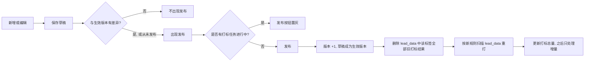
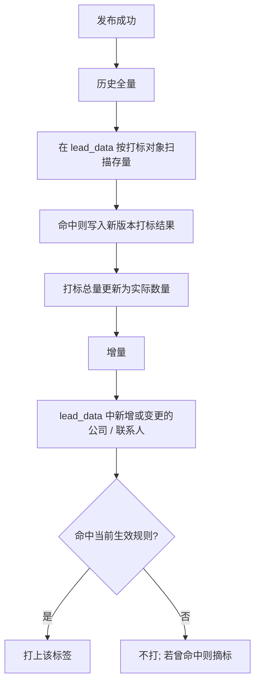
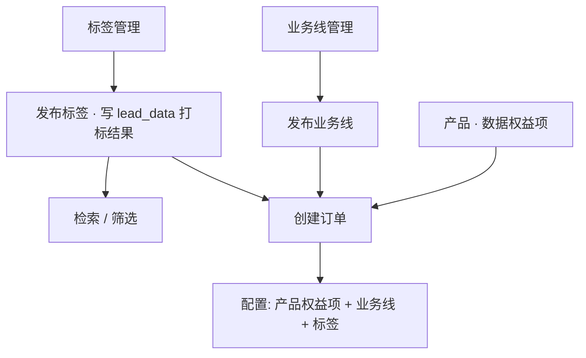

# XLeads-标签管理 PRD

Last edited time: October 8, 2026
模块: XLeads
原型：[标签管理](./原型图/标签管理/标签管理.html)

| 版本号 | 修订日期 | 修订人 | 修订内容 |
| --- | --- | --- | --- |
| v1.0 | 2026-09-27 | 产品经理 | 初始版本。基于标签管理原型，补齐发布、打标、软删除与唯一性规则 |
| v1.1 | 2026-09-28 | 产品经理 | 曾引入「业务标签」承载业务属性（历史版本，已废弃） |
| v1.2 | 2026-10-08 | 产品经理 | 对齐当前定位与原型：标签统一用于**方便检索**，取消「基础标签 / 业务标签」；去掉类型 Tab 与业务字段配置区；规则仅展示条件规则，「提示词规则」暂隐藏；条件字段三组改为公司信息 / 联系人信息 / **业务信息** ,行业为国标行业门类 / 大类 / 中类；打标基于 **lead_data**，修改 / 删除只改打标结果、不涉及 Baby Lead；与业务线、产品权益项在创建订单时搭配 |

# 一、需求背景

- **标签的核心价值是方便检索**
    - 公司、联系人进入 XLeads 后，需要按特征被快速筛出、组合使用。
    - 标签是打在数据上的检索结论：一旦打上，列表筛选、订单取数条件、作业查找都按标签结果走。
- **现在缺一套可发布、可回滚语义的规则**
    - 规则如果一改就生效，历史数据和新数据会混在两套标准里。
    - 运营无法区分「正在编辑的草稿」和「线上正在打标的版本」。
- **标签、业务线、产品是不同对象，在订单里才组合**
    - **标签管理**：维护标签本身（规则、发布、打标），服务检索。打标读写都在 **lead_data**。
    - **业务线管理**：维护业务线这一独立对象（预判规则、业务字段），会关联 Baby Lead 等下游事实（见业务线管理 PRD）。
    - **产品**：不与业务线直接绑定；产品中的**数据权益项**与业务线的搭配，发生在创建订单时。
    - **订单**是配置「产品权益项 + 业务线 + 标签」的核心场所。
- **标签变更边界比业务线更简单**
    - 标签不产出 Baby Lead，也不参与归属有效 / 归属无效。
    - 修改规则、删除标签，影响面只在 lead_data 的打标结果层，**不推动、不打断**后续线索 / 交付流转。
- **本需求要解决的事**
    - 在运营端统一维护标签。
    - 用「保存草稿 + 发布生效」把规则变更和线上打标拆开。
    - 发布后先清掉 lead_data 中该标签的旧打标结果，再按新规则重跑，保证检索口径一致。

# 二、需求目标

- **检索口径统一**
    - 改规则不再立刻污染正在使用的标签结果。
    - 发布后旧结果一次清掉，历史和新数据都按同一版规则重新计算。
- **标签能跟着数据变，而不是只打一次**
    - 存量数据在发布时补齐。
    - 之后新增或变更的数据自动判断，该打上的打上，不再符合的摘掉。
- **相同对象下不会出现重复标签**
    - 同一打标对象不能有同名标签。
- **删标签不打断正在跑的任务**
    - 查找进行到一半时标签被删，本次任务仍按开始时的版本跑完。
    - 新任务不再使用已删除标签。
- **变更只落在打标层**
    - 修改 / 删除标签只改 lead_data 上的打标结果，不涉及 Baby Lead，不影响后续数据流转。
- **边界清晰**
    - 本模块不配置业务字段，不管理业务线，不绑定产品。
    - 标签在订单中作为检索 / 取数条件之一被选用，见第四章。

# 三、名词解释

| 名词 | 说明 |
| --- | --- |
| 标签 | 打在公司或联系人上的检索结论。在标签管理中维护；发布后用于筛选、订单条件等场景。不再区分「基础标签 / 业务标签」。 |
| 打标对象 | 标签打在谁身上：公司或联系人。 |
| 标签定义 | 给人看的说明。下游展示取该标签**已发布版本**的定义。 |
| 条件规则 | 用字段配置出来的规则。一条条件是「字段判断」或「统计判断」，多条之间用「且 / 或」连接。本期唯一对外展示的规则模式。 |
| 字段条件 | 选字段、运算符、值。例如：所属行业 是 制造业。 |
| 统计条件 | 先对同一字段做筛选，再聚合，最后用运算符和值判断。例如：职位包含「销售」的数量 > 5。 |
| 提示词规则 | 一段给模型的提示词，由 AI 判断是否命中。**本期界面暂不展示**（原型已注释保留，后续迭代恢复）。 |
| 规则签名 | 把当前规则归一化后的唯一串。用于判断两套规则是否完全相同。 |
| 生效版本 | 最近一次发布成功的标签内容与规则。线上打标与检索都只读这一版。 |
| 草稿 | 已保存、尚未发布的修改。只在编辑页可见。 |
| 规则版本 | 从 V1 起。每次发布成功 +1。保存草稿不加版本。 |
| 打标结果 | lead_data 中某个公司或联系人身上的一枚标签。带标签 ID 和规则版本。 |
| 打标总量 | 当前生效版本已经打上的对象数量。历史任务未跑完时显示「执行中」。 |
| 软删除 | 打删除标记、不物理删除主数据。原型交互为列表移除；在途任务仍可按开始时版本跑完。 |
| lead_data | 标签的**判定与落库库**。规则字段从 lead_data 读取；打标结果也写回 lead_data。本模块的修改 / 删除只作用于这一层。 |
| 数据权益项 | 产品侧的数据权益配置项。与业务线、标签的组合发生在订单，不在本模块维护。 |

# 四、整体流程

## （一）配置到生效



## （二）发布后的两段打标



## （三）运行逻辑：标签如何被使用



- **标签管理**：定义规则并发布，在 **lead_data** 上打标，主要服务**检索**。
- **业务线**：独立对象，会关联 Baby Lead 等下游事实（见业务线管理 PRD）；标签不参与这一层。
- **订单**：配置「产品权益项 + 业务线 + 标签」的核心地方；三者在此搭配，而不是在产品或标签模块里互相绑定。

## （四）与业务线的边界

| 维度 | 标签管理 | 业务线管理 |
| --- | --- | --- |
| 用途 | 检索 / 筛选 | 业务能力配置与归属预判 |
| 数据读写 | 判定与打标结果均在 **lead_data** | mid_data 判定，lead_data 落业务关联 |
| 是否产出 Baby Lead | **否** | 是 |
| 修改 / 删除影响面 | 仅 lead_data 打标结果 | 可影响公司—业务线关系、Baby Lead、Lead 等 |
| 对后续流转 | **不影响**线索交付等后续流程 | 需按业务线历史数据规则处理 |

# 五、业务设计

## （一）标签范围与定位

- 本模块维护的对象统一称为**标签**，不再使用「基础标签 / 业务标签」分类。
- 打标对象可选 **公司**、**联系人**。
- 不配置业务字段（业务字段在业务线管理）。
- 不管理业务线，不绑定产品或数据权益项，**不产出 Baby Lead**。
- 列表与编辑页均无「标签类型」字段。

### 打标对象规则

| 可选打标对象 | 交互 |
| --- | --- |
| 公司、联系人 | 运营自选，必填 |

- 已发布后，打标对象不可再改。

## （二）「发布」按钮的出现条件

以原型为准：

- **列表行内「发布」**：仅当该标签 `published = false`（从未发布，或保存后尚未再次发布）时显示；已发布行不显示「发布」。
- **编辑抽屉「发布」**：底部始终展示「发布」按钮（与取消、保存并列）。
- 对比范围（发布后线上是否按新内容生效，仍以是否点击发布为准）：
    - 标签信息：名称、标签定义。
    - 标签规则：条件规则全文、条件之间的且 / 或。（提示词规则本期不展示，恢复后一并纳入对比。）
- 打标对象：原型中**不锁定**，编辑时可改；产品侧建议发布后勿轻易改对象，以免历史打标口径混乱。
- **打标进行中**：打标总量显示「执行中」。产品规则：本轮 lead_data 打标未完成前，不允许再次发布（原型可置灰「发布」并提示 `数据打标中，完成后可发布`）。

## （三）发布前与发布后

- **发布前**
    - 线上检索、订单条件使用的名称与定义，仍是生效版本。
    - 草稿只存在于编辑页。
- **发布时，系统按顺序做两件事**（均发生在 lead_data）
    1. 删除该标签在 lead_data 中的全部旧打标结果。旧版本结果不保留、不并存。
    2. 按新规则重新打标。先历史，后增量。
- **发布成功**
    - 草稿覆盖为新的生效版本。
    - 规则版本 +1。首次发布记为 V1。
    - 列表行标记为已发布，行内「发布」消失；抽屉内「发布」仍在。
    - 打标总量在任务未完成前显示「执行中」，完成后改为实际数量。

## （四）打标执行

打标的判定字段与结果写入，**全部基于 lead_data**。不读写 Baby Lead，不触发归属判定，不改动后续数据流转。

### 1. 历史数据

- 发布成功后立刻启动。
- 在 lead_data 中扫描该打标对象的全部存量数据。
- 命中则写入打标结果，并记下本次规则版本。
- 未完成前，打标总量显示「执行中」。完成后改为实际数量。

### 2. 增量数据

- 历史任务结束后才进入增量。
- lead_data 中对象新增，或参与规则判断的字段发生变化时，重算这一条。
- 命中则打标；不再命中则摘掉该标签。
- 增量始终使用当前生效版本，不使用草稿。

### 3. 规则判定方式（本期）

- **数据来源**：条件规则中使用的字段，**均取自 lead_data**。
- **条件规则**：按配置逐条计算，再用且 / 或合并。统计条件先筛选，再聚合，再比较。
- **提示词规则**：本期界面隐藏，不作为线上生效模式。后续迭代恢复后接入模型判定。
- 增量重算时，以 lead_data 中字段变更作为触发依据。

## （五）操作与历史数据处理

标签没有 Baby Lead 层，变更只改 lead_data 上的打标结果。

**一句话原则**：规则变更先清旧标再重打；删除只停用标签主数据并停止新增打标；二者都不影响后续线索 / 交付流转。

| 操作 | lead_data 打标结果 | Baby Lead / Lead / 交付 | 检索与订单选用 |
| --- | --- | --- | --- |
| 修改名称 / 定义（发布后） | 不重打；结果上的标签展示随生效版本更新 | 不影响 | 下游读新名称 / 定义 |
| 修改规则（发布后） | **先删该标签全部旧结果，再按新规则重打** | 不影响 | 重打完成后按新结果检索 |
| 保存草稿（未发布） | 不变 | 不影响 | 仍用生效版本 |
| 删除（原型：列表移除；产品：建议软删除） | 停止新增打标；不级联改下游 | 不影响 | 新任务不可再选；在途任务按开始时版本跑完 |
| 打标任务进行中再次改规则 | 可存草稿；本轮打完前不可再次发布 | 不影响 | — |

要点：

- 标签改规则 = 检索口径重算，不是业务事实重建。
- 订单里曾经选用过该标签作条件的历史订单配置本身不因打标重跑而改写；之后新的检索 / 取数按最新打标结果走。
- 与业务线不同：这里**没有**「归属有效 / 归属无效」「未交付撤销 / 已交付失效」等分支。

## （六）唯一性

同一打标对象下，名称不能重复。

| 情况 | 是否允许 |
| --- | --- |
| 名称相同 + 打标对象相同 | 不允许 |
| 名称不同 + 打标对象不同 + 规则相同 | 允许 |
| 规则部分重叠 | 允许，可提示 |
| 规则完全不同 | 允许 |

### 1. 「完全相同」的判定（本期：条件规则）

- **条件规则**：且 / 或、每一条的字段、运算符、值、统计筛选、聚合方式，归一化后一致。
- 标签名称不参与规则签名。

### 2. 「部分重叠」的判定

- 仅对条件规则。
- 同一打标对象下，两条标签至少有一条原子条件相同，但整份规则不同。

### 3. 校验时机与提示

- 保存和发布都校验。
- 名称重复：阻断，不允许保存、不允许发布。
- 规则部分重叠：不阻断。可提示存在部分相同条件。
- 比对范围：未软删除的标签。已删除标签不参与占用。
- 和自己的生效版本、草稿比较，不算冲突。

## （七）删除

- **原型交互**：行内「删除」→ 确认「确认删除该标签？」→ 列表移除，toast「已删除」。
- **产品建议**：后端按软删除实现（打删除标记、记删除时间，不物理删主数据），以支持在途任务与审计；列表默认不展示已删标签。
- **在途任务不受影响**：任务开始时已读到该标签的，按开始时的生效版本跑完。
- **删除之后**：新的打标与增量计算不再使用它；名称与规则签名释放，可新建同名。
- 删除**不级联修改** Baby Lead、Lead、交付等下游数据（本模块本就不产出这些对象），也不触发「清旧标再重打」。

# 六、功能设计

> 页面以运营端原型[标签管理](./原型图/标签管理/标签管理.html)为准。标签管理在 XLeads 下，与业务线管理同级。

## （一）标签列表

路径：XLeads → 标签管理。

### 1. 页面结构

- 顶部：「标签管理」+「新增标签」。
- 无类型 Tab、无标签类型维度。
- 筛选：标签名称、打标对象（全部 / 公司 / 联系人）、更新时间。
- 表内搜索：placeholder「搜索」，按名称、对象、定义、打标总量、更新时间过滤。

### 2. 列表字段

| 列 | 说明 |
| --- | --- |
| 标签名称 | 当前展示名称 |
| 打标对象 | 公司 / 联系人 |
| 打标总量 | 命中数；打标未完成时为「执行中」 |
| 标签定义 | 说明文字 |
| 规则版本 | `V{n}`（原型默认至少 V1） |
| 更新时间 | 最近一次保存或发布的时间 |
| 操作 | 编辑、发布（仅未发布行）、删除 |

### 3. 行内「发布」的出现条件

- 仅 `published = false` 的行显示「发布」。
- 点击后直接发布，不打开编辑页。
- 打标进行中：总量显示「执行中」；产品规则本轮未完成前不可再次发布。

## （二）新增 / 编辑标签

右侧抽屉（约 1080px）。标题为「新增标签」或「编辑标签」。

底部按钮：取消、保存、发布（三者均展示）。

### 1. 标签信息

| 字段 | 必填 | 说明 |
| --- | --- | --- |
| 标签名称 | 是 | 同一打标对象下不可重复（产品校验；原型以必填为主） |
| 打标对象 | 是 | 公司 / 联系人；原型可编辑 |
| 标签定义 | 否 | 说明文字 |

- 不展示「标签类型」（原型中类型控件已隐藏）。

### 2. 标签规则

- 标题旁展示版本：`V{n}`。
- **本期只展示条件规则**。
- 「条件规则 / 提示词规则」模式切换与提示词输入框：**暂不展示**（原型中已注释保留）。
- 规则区 hint（对齐原型）：字段选字段后配规则和值；统计需分别设筛选与聚合；分组随打标对象变化——选公司时优先公司字段，联系人分组为「所含联系人信息」；选联系人时优先联系人字段，公司分组为「所属公司信息」，业务分组为「关联业务信息」。

### 3. 业务字段配置区

- **本模块不展示「业务字段」配置区**（原型 `#fieldsSection` 强制 hidden；与条件规则里的「业务信息」字段组不是一回事）。

### 4. 保存

- 校验标签名称、打标对象必填。
- 通过后写入草稿，关闭抽屉，提示「已保存」。
- 保存不启动打标、不改变线上检索结果。
- 未发布标签保存后，列表仍可显示行内「发布」。

### 5. 发布按钮

- 抽屉底部始终展示「发布」。
- 成功后提示「已发布」，启动第五章（四）的打标（清 lead_data 旧结果 → 按 lead_data 重打）。
- 打标未完成前，产品规则禁止再次发布。

## （三）条件规则

条件规则由若干条件行组成。每一行只做一件事：对**一个实际字段**做判断，或者先筛选再对该字段做聚合判断。字段选择器里永远是真实字段，不把「职位包含销售」做成独立字段。

### 1. 条件行

- 「新增条件」增加一行。草稿可 0 行；空态文案：「暂无条件，请点击「新增条件」」。
- 多于 1 行时，行首出现关系：**且**、**或**。整组只用一种关系。
- 每行可删。
- 每行先选算法：**字段** 或 **统计**。再选字段。
- 一条完整条件：
    - **字段**：已选字段 + 已选运算符；运算符不是「为空 / 不为空」时，值必填。
    - **统计**：已选字段 + 已选聚合方式 + 已选比较符 + 已填数值。筛选条件可选（「不筛选」时对该字段全部记录做聚合）。
- **属于 / 不属于**：多选面板，或多个值用 `|` 分隔。

### 2. 可选字段

字段按来源分成三组，**与原型 `FIELDS` 一致，全部取自 lead_data**：

| 分组 key | 默认展示名 | 动态展示名（随打标对象） |
| --- | --- | --- |
| company | 公司信息 | 打标对象为联系人时 → **所属公司信息** |
| contact | 联系人信息 | 打标对象为公司时 → **所含联系人信息** |
| biz | 业务信息 | 打标对象为联系人时 → **关联业务信息** |

字段选择器顺序：打标对象为公司时 `公司 → 联系人 → 业务`；为联系人时 `联系人 → 公司 → 业务`。

- **公司信息**：作用在公司本身。打标对象是联系人时，取该联系人所属公司。
- **联系人信息**：作用在联系人。打在公司上时，联系人字段主要用于**统计**；若用**字段**，按「该公司任意一条联系人满足」判断。
- **业务信息**：作用在业务相关属性（业务线、负责人、预算等）。打标对象为联系人时展示为「关联业务信息」。

#### （1）公司信息

| 字段 | 类型 | 说明 |
| --- | --- | --- |
| 公司名称 | 文本 | — |
| 英文名 | 文本 | — |
| 企业规模 | 单选 | 0-19人 … 5000人以上 |
| 登记状态 | 文本 | — |
| 法定代表人 | 文本 | — |
| 注册资本 | 数字 | — |
| 成立日期 | 日期 | — |
| 营业期限 | 文本 | — |
| 注册地址 | 文本 | — |
| 经营范围 | 文本 | — |
| 国标行业门类 | 单选 | 选项见国民经济行业分类 · 门类 |
| 国标行业大类 | 单选 | 选项见国民经济行业分类 · 大类 |
| 国标行业中类 | 单选 | 选项见国民经济行业分类 · 中类 |
| 关键词 | 文本 | — |
| 统一社会信用代码 | 文本 | — |
| 参保人数 | 数字 | — |
| 福利 | 文本 | — |

国标行业选项与业务线管理共用 [industry-options.js](./原型图/标签管理/industry-options.js)（数据来自国民经济行业分类 JSON）。

#### （2）联系人信息

| 字段 | 类型 | 说明 |
| --- | --- | --- |
| 姓名 | 文本 | — |
| 手机号 | 文本 | — |
| 邮箱 | 文本 | — |
| 微信号 | 文本 | — |
| 性别 | 单选 | 男、女 |
| 职位 | 文本 | — |
| 在职状态 | 单选 | 在职、离职 |
| 定位是否有效 | 单选 | 是、否 |
| 定位情况 | 单选 | 已定位、未定位 |
| 是否人工外呼 | 单选 | 未人工外呼、已人工外呼 |
| 手机号是否接通 | 单选 | 接通、未接通 |

#### （3）业务信息

| 字段 | 类型 | 说明 |
| --- | --- | --- |
| 业务线 | 单选 | 如：海外招聘、企业培训、福利 |
| 业务负责人 | 单选 | 组织用户 |
| 业务描述 | 文本 | — |
| 业务角色 | 单选 | 决策人、影响人、执行人 |
| 业务覆盖人数 | 数字 | — |
| 预算下限 | 数字 | — |
| 预算上限 | 数字 | — |
| 预计采购时间 | 日期 | — |

> 注意：本组是条件规则可选字段，**不是**业务线管理里的「配置字段」抽屉，也不是原型中已隐藏的「业务字段」配置区。

### 3. 字段类型、逻辑运算符、统计方式

#### （1）文本

| 能力 | 选项 |
| --- | --- |
| 逻辑运算符 | 是、不是、包含、不包含、为空、不为空 |
| 统计方式 | 数量 |

#### （2）单选

| 能力 | 选项 |
| --- | --- |
| 逻辑运算符 | 是、不是、属于、不属于、为空、不为空 |
| 统计方式 | 数量、去重计数 |
| 取值说明 | **是 / 不是**为单值；**属于 / 不属于**为多值集合，值控件为多选（命中集合中任一值即「属于」） |

#### （3）数字

| 能力 | 选项 |
| --- | --- |
| 逻辑运算符 | 等于、不等于、大于、小于、大于等于、小于等于、为空、不为空 |
| 统计方式 | 数量、求和、平均值、最大值、最小值 |
| 统计比较符 | 等于、不等于、大于、小于、大于等于、小于等于 |

#### （4）日期

| 能力 | 选项 |
| --- | --- |
| 逻辑运算符 | 等于、早于、晚于、为空、不为空 |
| 统计方式 | 数量、最早、最晚、时间跨度 |
| 统计比较符 | 等于、不等于、大于、小于、大于等于、小于等于 |

### 4. 一行里的两种算法

**（1）字段**：对当前对象上的这一个字段做一次判断。

**（2）统计**：对同一实际字段先筛选、再聚合、再比较。**「职位包含销售」是筛选条件，不是字段。**

```text
职位
├── 字段：职位 包含 销售
└── 统计：职位
        ├── 筛选：包含 销售
        ├── 统计：数量
        └── 判断：> 5
```

## （四）提示词规则（本期暂不展示）

> 以下能力在原型中已实现并注释保留，**当前版本界面不展示**。

- 规则区右上角切换：**条件规则**、**提示词规则**。
- 一个多行输入框。占位：「请输入提示词，描述如何识别并打上该标签」。
- 发布时提示词不能为空。
- 判定结果只有命中或未命中。

## （五）删除

- 行内「删除」二次确认：「确认删除该标签？」。
- 确认后列表不再展示，toast「已删除」（原型为直接移除；产品建议后端软删除，见第五章（七））。
- 不中断已经开始的、针对该标签的查找或打标任务。
- 删除后该名称和规则签名释放，新建标签可以重新使用。
- 删除只停用标签主数据与后续打标，**不级联影响**后续数据流转；作用面限于 lead_data 打标层。

# 七、迭代计划

| **优先级** | **范围** | **说明** |
| --- | --- | --- |
| **P0** | 标签配置与发布门禁 | 列表、新增编辑抽屉、条件规则（公司 / 联系人 / 业务信息字段对齐原型）；名称唯一；删除；定位为检索，无标签类型 |
| **P1** | lead_data 打标与订单选用 | 发布后清 lead_data 旧标再重打；历史 / 增量打标；打标中禁止再次发布；订单创建时可选用已发布标签（与权益项、业务线搭配） |
| **P2** | 提示词规则恢复与运行态 | 恢复「提示词规则」并接入模型；在途任务版本快照；发布重跑进度与失败重试 |
