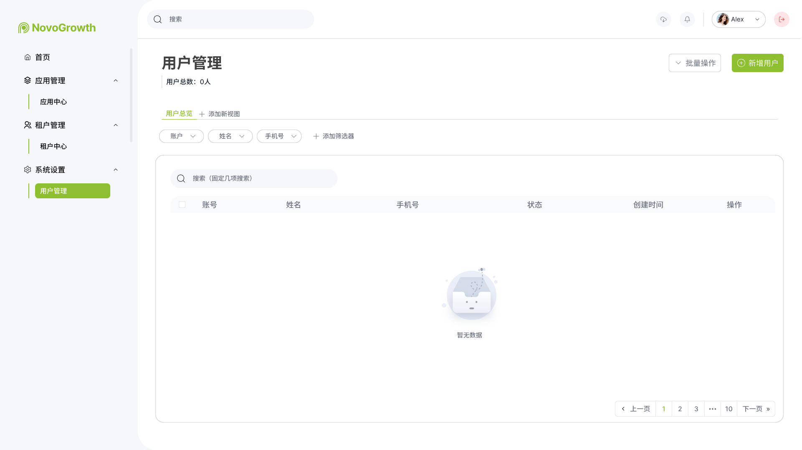
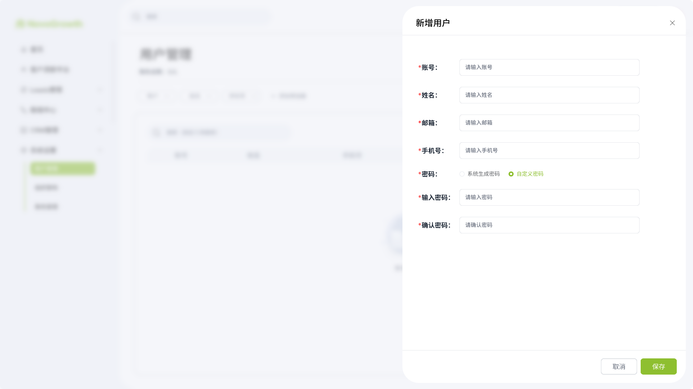
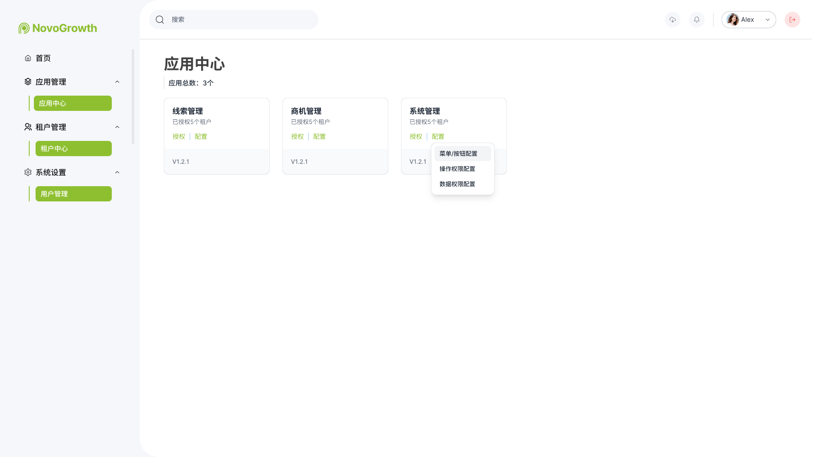
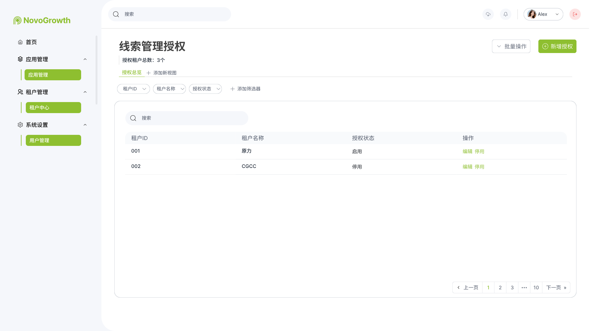
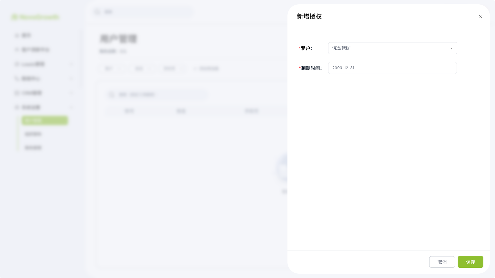
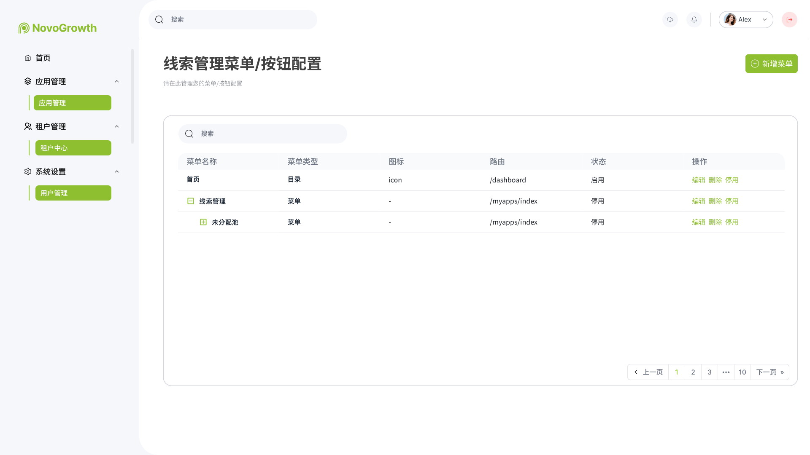
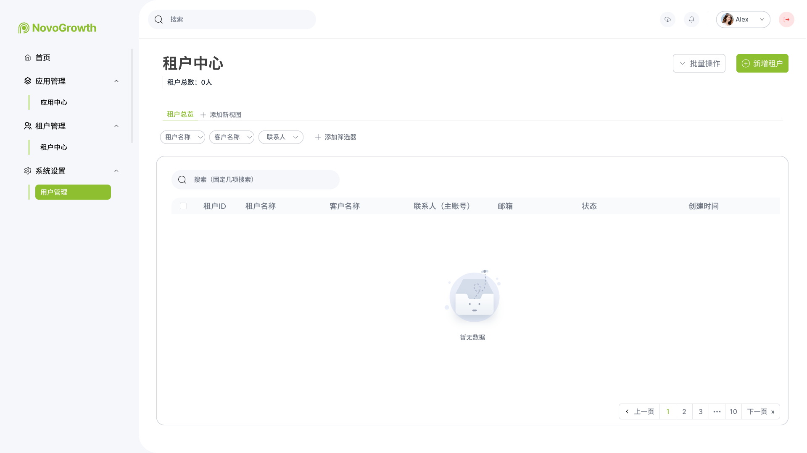
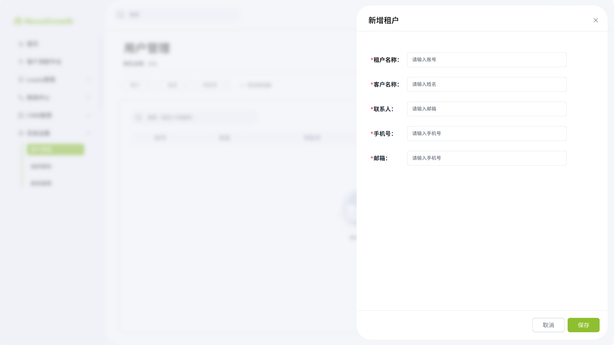

# 租户运营平台产品需求文档

> 版本号：v1.0-MVP  
> 创建日期：2025-10-10  
> 最后更新：2025-10-15  
> 负责人：产品经理  
> 状态：✅ 已确认

---

## 📋 文档修订历史

| 版本号 | 修订日期 | 修订人 | 修订内容 |
|--------|----------|--------|----------|
| v1.0-MVP | 2025-10-10 | 产品经理 | MVP版本，聚焦核心功能 |
| v1.1-MVP | 2025-10-10 | 产品经理 | 调整架构，以应用管理为核心 |
| v1.2-MVP | 2025-10-10 | 产品经理 | 删除开发技术细节，转为产品需求表达 |
| v1.3-MVP | 2025-10-10 | 产品经理 | 简化为自动授权模式 |
| v1.4-MVP | 2025-10-15 | 产品经理 | 按标准模板重新整理 |

---

## 1. 需求背景

### 1.1 业务背景

NovoGrowth租户平台是一款面向企业的SaaS产品，需要一个配套的运营平台来管理租户、配置应用功能、控制租户授权。当前面临以下问题：

**现状与痛点**：
- 缺少统一的租户管理后台
- 无法灵活配置NovoGrowth租户平台的菜单和权限
- 租户授权流程不清晰
- 运营人员无法高效管理租户账号

**业务发展需要**：
- 快速上线MVP版本验证商业模式
- 支持租户的全生命周期管理
- 实现NovoGrowth租户平台应用的统一配置
- 建立运营平台与NovoGrowth租户平台的数据同步机制

### 1.2 用户角色

| 角色名称 | 角色描述 | 使用场景 |
|----------|----------|----------|
| 超级管理员 | 运营平台最高权限管理员 | 管理运营人员、配置应用、管理所有租户 |
| 运营人员 | 负责日常租户运营工作 | 创建租户、查看租户信息、处理租户问题 |

### 1.3 需求来源

- **来源**：产品规划 + 商业需求
- **优先级**：P0-紧急（MVP核心功能）
- **预期上线时间**：2025-11-01

---

## 2. 需求目标

### 2.1 核心目标

1. **快速验证商业模式**：在2周内完成MVP开发并上线
2. **统一应用配置管理**：为NovoGrowth租户平台提供统一的菜单和权限配置
3. **高效租户管理**：支持租户创建和自动授权，简化操作流程
4. **稳定数据同步**：确保运营平台与NovoGrowth租户平台的数据一致性

### 2.2 MVP范围

**包含的核心功能**：

1. **系统管理应用**
   - ✅ 运营人员管理（增删改查）
   - ✅ 登录认证功能

2. **应用管理应用** ⭐ 核心
   - ✅ 应用中心
     - ✅ 应用授权（应用模块配置）
     - ✅ 菜单按钮配置（界面化管理菜单和按钮）
     - ✅ 操作权限配置（界面化管理操作权限）
     - ❌ 数据权限配置（本期不提供前端配置界面，通过后端配置）

3. **租户管理**
   - ✅ 租户列表和创建
   - ✅ 新增租户自动授权所有应用
   - ✅ 授权配置自动推送到NovoGrowth租户平台

**不包含的功能**：
- ❌ 套餐管理（V1.1版本）
- ❌ 灵活的授权控制（V1.1版本）
- ❌ 授权到期提醒（V1.1版本）
- ❌ 配额管理和监控（V1.1版本）
- ❌ 运营人员的权限控制（MVP所有人全权限）
- ❌ 操作日志审计（V1.1版本）
- ❌ 数据统计和报表（V2.0版本）
- ❌ 数据权限的前端配置界面（本期通过后端配置，V1.1版本提供前端界面）

### 2.3 成功指标

| 指标名称 | 当前值 | 目标值 | 衡量方式 |
|----------|--------|--------|----------|
| 租户创建成功率 | - | 100% | 系统监控 |
| 授权同步成功率 | - | ≥99% | 接口成功率 |
| 运营效率 | - | 5分钟/租户 | 操作时长统计 |
| 系统可用性 | - | ≥99.5% | 可用性监控 |
| 开发周期 | - | 2周 | 项目进度 |

---

## 3. 名词解释

| 术语 | 英文 | 定义 | 说明 |
|------|------|------|------|
| 租户 | Tenant | 使用NovoGrowth租户平台服务的企业/组织 | 数据隔离的基本单位 |
| 应用 | Application | 平台中的一个大功能模块 | 如租户管理、应用管理 |
| 功能 | Feature | 应用中的一个具体功能 | 如租户列表、菜单管理 |
| 操作 | Operation | 功能中的具体操作 | 如新增、删除、编辑、查看 |
| 菜单 | Menu | NovoGrowth租户平台界面左侧导航菜单 | 树形结构，包含一级、二级、三级菜单 |
| 权限 | Permission | 功能操作的访问控制 | 如查看、编辑、删除等 |
| 授权 | Authorization | 为租户开通应用和功能权限 | MVP阶段自动授权所有应用 |
| 自动授权 | Auto Authorization | 新增租户时自动授权所有应用 | 有效期固定为2099-12-31 |
| Tenant ID | Tenant ID | 租户唯一标识符 | 系统自动生成 |

---

## 4. 需求范围

### 4.1 功能范围

**包含的功能**：
- 运营人员账号管理
- 登录认证和会话管理
- NovoGrowth租户平台菜单结构配置
- NovoGrowth租户平台权限项配置
- 应用模块定义
- 租户创建和列表查询
- 租户自动授权（所有应用）
- 授权配置推送到NovoGrowth租户平台
- 运营平台与NovoGrowth租户平台的数据同步

**不包含的功能**：
- 套餐管理和订阅管理（后续版本）
- 灵活的授权控制（后续版本）
- 配额管理和监控（后续版本）
- 运营人员权限控制（后续版本）
- 操作日志和审计（后续版本）
- 租户详情页（后续版本）
- 租户状态管理（启用/停用/删除）（后续版本）

### 4.2 涉及的系统

| 系统名称 | 说明 | 影响范围 | 备注 |
|----------|------|----------|------|
| 运营平台 | 本需求主体 | 新建系统 | 运营后台管理系统 |
| 租户平台 | SaaS产品 | 接口对接 | 需要新增授权接口 |

---

## 5. 需求大纲

### 层级结构

**平台** → **应用** → **功能** → **操作**

### 功能清单

- **应用1：系统管理应用**
  - **功能1：用户管理功能**
    - 查看用户列表
    - 新增用户
    - 编辑用户
    - 删除用户（逻辑删除）
    - 禁用/启用用户
  - **功能2：登录认证功能**
    - 用户登录
    - 会话管理
    - 退出登录
    
- **应用2：应用管理应用** ⭐ 核心应用
  - **功能1：应用中心**
    - **子功能1.1：应用授权**
      - 查看应用模块列表
      - 配置应用模块（功能组合）
      - 授权管理
    - **子功能1.2：菜单按钮配置**
      - 查看菜单列表
      - 新增菜单
      - 编辑菜单
      - 删除菜单
      - 配置按钮权限
    - **子功能1.3：操作权限配置**
      - 查看操作权限列表
      - 新增操作权限
      - 编辑操作权限
      - 删除操作权限
    - **子功能1.4：数据权限配置**
      - 查看数据权限规则
      - 配置数据范围
      - 配置数据过滤条件
    
- **应用3：租户管理应用**
  - **功能1：租户列表功能**
    - 查看租户列表
    - 搜索和筛选租户
  - **功能2：租户创建功能**
    - 新增租户
    - 创建NovoGrowth租户平台主账号
    - 自动授权所有应用
    - 推送授权配置

---

## 6. 详细需求

### 6.1 应用：系统管理应用

**应用概述**：
- **应用名称**：系统管理应用
- **主要功能**：运营人员管理、登录认证
- **使用角色**：超级管理员

---

### 6.2 功能：用户管理功能

**功能概述**：
提供运营人员的创建、查询、更新、禁用等基础管理功能。

**功能目标**：
- 支持运营人员全生命周期管理
- 支持用户状态管理（启用/禁用）
- 简化MVP流程，所有用户拥有全部权限

**核心数据字段**：

| 字段名 | 必填 | 说明 | 示例 |
|--------|------|------|------|
| 账号 | 是 | 登录账号 | admin001 |
| 姓名 | 是 | 用户真实姓名 | 张三 |
| 邮箱 | 是 | 联系邮箱 | admin@example.com |
| 手机号 | 是 | 联系电话 | 13800138000 |
| 密码 | 是 | 登录密码 | ******* |
| 状态 | 是 | 启用/禁用 | 启用 |
| 创建时间 | 自动 | 账号创建时间 | 2025-10-15 10:30:00 |

---

#### 操作：查看用户列表

**原型图**：


**功能需求**：

1. **页面入口**
   - 位置：左侧导航 → 系统管理 → 用户管理
   - 默认页面：用户列表

2. **列表展示**

用户列表界面功能说明：
- **顶部统计区域**：
  - 用户总数显示
  - 批量操作按钮
  - 新增用户按钮（绿色高亮）
- **筛选搜索区域**：
  - 多维度筛选器（支持按账户、姓名、手机号筛选）
  - 添加筛选器功能
  - 固定项目搜索框
- **用户列表表格**：
  - 全选/单选复选框
  - 账号列
  - 姓名列
  - 手机号列
  - 状态列（启用/禁用）
  - 创建时间列
  - 操作列（编辑、删除等）
- **分页控制**：
  - 上一页/下一页按钮
  - 页码导航（1 2 3 ... 10）
  - 当前页高亮显示
- **空状态展示**：
  - 暂无数据时显示空状态图标和提示文字

3. **搜索条件**
   - 账号（模糊搜索）
   - 姓名（模糊搜索）
   - 手机号（精确搜索）

4. **分页配置**
   - 默认每页20条
   - 支持翻页

**注意事项**：
- ⚠️ 密码字段不返回给前端
- ⚠️ 禁用的用户灰色显示

---

#### 操作：新增用户

**原型图**：


**功能需求**：

1. **页面入口**
   - 位置：用户列表页面
   - 触发方式：点击"新增用户"按钮
   - 展现形式：弹窗

2. **表单字段**

新增用户界面字段说明：
- **账号**：用户登录账号（必填）
- **姓名**：用户真实姓名（必填）
- **邮箱**：用户邮箱地址（必填）
- **手机号**：用户联系电话（必填）
- **密码**：初始登录密码，支持系统自动生成或手动输入
  - 系统生成密码：12位随机密码
  - 自定义密码选项
- **输入密码**：设置用户密码（必填）
- **确认密码**：再次输入密码进行确认（必填）

操作按钮：
- **取消**：关闭弹窗
- **保存**（绿色按钮）：提交创建用户

3. **字段校验规则**

| 字段名 | 类型 | 必填 | 校验规则 | 错误提示 |
|--------|------|------|----------|----------|
| 账号 | 文本框 | 是 | 4-20位字母数字 | 账号格式不正确 |
| 姓名 | 文本框 | 是 | 2-20位中文或字母 | 姓名格式不正确 |
| 邮箱 | 文本框 | 是 | 标准邮箱格式 | 邮箱格式不正确 |
| 手机号 | 文本框 | 是 | 11位手机号 | 手机号格式不正确 |
| 密码 | 密码框 | 是 | 8-20位 | 密码格式不正确 |
| 确认密码 | 密码框 | 是 | 与密码一致 | 两次密码不一致 |

4. **业务逻辑**
   - 邮箱全局唯一性验证
   - 密码需要加密存储
   - 用户创建后默认状态为"启用"
   - 系统自动生成12位随机密码
   - 记录创建时间

5. **操作流程**
   ```
   用户输入 → 前端校验 → 提交表单 → 后端验证 → 保存数据 → 提示成功
   ```

6. **成功提示**
   - 显示消息："用户创建成功"
   - 自动关闭弹窗
   - 刷新用户列表

7. **失败场景**
   - 邮箱已存在：提示"该邮箱已被使用，请更换"
   - 参数格式错误：提示具体错误信息
   - 系统异常：提示"系统繁忙，请稍后重试"

**业务规则**：
1. 邮箱全局唯一
2. 初始密码由系统生成（12位随机密码）
3. 用户创建后立即生效
4. 用户不能被删除（MVP阶段）
5. 所有账号统一拥有全部权限（MVP阶段）

**注意事项**：
- ⚠️ 密码必须加密存储，不能明文
- ⚠️ 邮箱需要验证唯一性
- 💡 后续版本支持用户删除功能
- 💡 后续版本支持权限控制

---

#### 操作：编辑用户

**功能需求**：

1. **可编辑字段**
   - 姓名
   - 邮箱
   - 手机号
   - 密码（单独修改）

2. **不可编辑字段**
   - 账号（创建后不可改）
   - 创建时间

3. **业务逻辑**
   - 支持部分字段更新
   - 邮箱修改需要验证唯一性
   - 显示最后更新时间

---

#### 操作：禁用用户

**功能需求**：

1. **禁用方式**
   - 修改状态字段为"禁用"
   - 不删除用户数据

2. **禁用效果**
   - 禁用用户后立即退出登录
   - 禁用用户不能登录系统

**注意事项**：
- ⚠️ 不能禁用自己
- ⚠️ MVP阶段不能删除用户
- 💡 后续版本支持用户删除

---

### 6.3 功能：登录认证功能

**功能概述**：
提供运营人员的登录认证和会话管理功能。

**功能目标**：
- 支持账号密码登录
- 保持登录状态
- 会话超时自动退出

**核心数据字段**：

| 字段名 | 必填 | 说明 | 示例 |
|--------|------|------|------|
| 账号 | 是 | 登录账号 | admin001 |
| 密码 | 是 | 登录密码 | ******* |

---

#### 操作：用户登录

**原型图**：


**功能需求**：

1. **页面入口**
   - 地址：系统根路径 `/login`
   - 未登录访问其他页面自动跳转到登录页

2. **登录界面元素**

登录界面包含以下元素：
- **NovoGrowth租户平台品牌标识**：显示在页面顶部
- **账号输入框**：输入登录账号（占位符：请输入账号）
- **密码输入框**：输入登录密码（占位符：请输入密码），支持密码显示/隐藏切换
- **登录按钮**：大尺寸绿色按钮，点击提交登录
- **左侧插图**：展示办公场景的视觉插画

3. **登录流程**
   1. 用户输入账号和密码
   2. 点击"登录"按钮
   3. 系统验证账号存在性
   4. 验证账号状态（是否启用）
   5. 验证密码正确性
   6. 生成登录会话和Token
   7. 记录登录日志
   8. 跳转到主界面（应用管理应用）

4. **业务规则**

**输入验证**：
- 账号：必填，不能为空
- 密码：必填，不能为空

**登录安全**：
- 密码错误5次锁定账号30分钟
- 会话超时时间：24小时无操作自动退出
- 登录成功后生成Token，有效期24小时

**错误提示**：
- 账号不存在：提示"账号或密码错误"
- 密码错误：提示"账号或密码错误"
- 账号被禁用：提示"账号已被禁用，请联系管理员"
- 账号被锁定：提示"账号已被锁定，请30分钟后再试"

5. **操作流程**
   ```
   输入账号密码 → 点击登录 → 验证账号 → 验证密码 → 生成Token → 跳转首页
   ```

**注意事项**：
- ⚠️ 密码传输需要加密
- ⚠️ 防止暴力破解（5次锁定）
- 💡 后续版本支持验证码

---

### 6.4 应用：应用管理应用

**应用概述**：
- **应用名称**：应用管理应用
- **主要功能**：应用中心（应用授权、菜单按钮配置、操作权限配置、数据权限配置）
- **使用角色**：超级管理员、运营人员

应用管理应用是运营平台的核心，负责：
1. 定义NovoGrowth租户平台有哪些功能（菜单/按钮/权限）
2. 配置功能模块和应用授权
3. 管理租户授权（新增租户自动授权所有应用）

---

### 6.5 功能：应用中心

**功能概述**：
应用中心是应用管理的核心功能，提供应用授权、菜单按钮配置、操作权限配置、数据权限配置的统一管理。

**功能目标**：
- 统一管理NovoGrowth租户平台的所有应用配置
- 支持菜单、按钮、操作权限、数据权限的可视化配置
- 支持应用模块的组合和授权管理

**应用中心界面**：



应用中心界面功能说明：
- **顶部标题区域**：
  - 页面标题"应用管理"
  - 应用总数统计（应用总数：3个）
- **应用卡片展示区域**：
  - **线索管理**卡片
    - 已授权给6个租户
    - 授权/配置按钮
    - 版本号：V1.2.1
  - **商机管理**卡片
    - 已授权给4个租户
    - 授权/配置按钮
    - 版本号：V1.2.1
  - **系统管理**卡片
    - 已授权给5个租户
    - 授权/配置按钮
    - 版本号：V1.2.1
    - 悬浮菜单：菜单/按钮配置、操作权限配置、数据权限配置
- **卡片功能**：
  - 显示应用名称和授权租户数
  - 授权按钮（绿色）
  - 配置按钮（灰色）
  - 悬浮显示子功能菜单

---

#### 6.5.1 子功能：应用授权

**功能概述**：
管理NovoGrowth租户平台的应用模块定义和授权配置。每个模块包含一组菜单、按钮、操作权限和数据权限。

**应用授权界面**：



应用授权界面功能说明：
- **顶部标题区域**：
  - 页面标题"线索管理授权"
  - 授权租户总数统计（授权租户总数：3个）
- **操作按钮区域**：
  - 批量操作按钮
  - 新增授权按钮（绿色高亮）
- **筛选标签区域**：
  - 授权总览标签
  - 添加新视图按钮
- **筛选搜索区域**：
  - 多维度筛选器（租户ID、租户名称、授权状态）
  - 添加筛选器功能
  - 搜索框
- **授权列表表格**：
  - 租户ID列
  - 租户名称列
  - 授权状态列（启用/停用）
  - 操作列（编辑、停用按钮）
- **分页控制**：
  - 上一页/下一页按钮
  - 页码导航（1 2 3 ... 10）
  - 当前页高亮显示

**核心数据字段**：

| 字段名 | 必填 | 说明 | 示例 |
|--------|------|------|------|
| 应用名称 | 是 | 应用模块名称 | 线索管理 |
| 应用编码 | 是 | 模块唯一标识 | leads |
| 状态 | 是 | 启用/禁用 | 启用 |

**应用模块列表**：

| 应用名称 | 应用编码 | 状态 | 说明 |
|---------|---------|------|------|
| 线索管理 | leads | 启用 | 包含业务需求分析、大库、私有库、触达工具等功能 |
| 商机管理 | crm | 启用 | 包含销售仪表盘、渠道管理、客户管理、商机管理等功能 |

**自动授权规则**：
- 新增租户自动授权所有应用模块
- 授权有效期固定为：2099-12-31 23:59:59
- 所有租户权限完全一致
- 不支持自定义授权范围（MVP阶段）

---

**操作：新增授权**

**原型图**：



**功能需求**：

1. **页面入口**
   - 位置：应用授权列表页面
   - 触发方式：点击"新增授权"按钮
   - 展现形式：弹窗

2. **表单字段**

新增授权界面字段说明：
- **租户**：选择要授权的租户（必填，下拉选择框，占位符：请选择租户）
- **到期时间**：授权有效期（必填，日期选择，默认值：2099-12-31）

操作按钮：
- **取消**：关闭弹窗，放弃新增
- **保存**（绿色按钮）：提交创建授权

3. **业务逻辑**
   - 租户下拉列表只显示未授权该应用的租户
   - 授权有效期默认为2099-12-31（MVP阶段固定）
   - 保存后自动推送授权配置到NovoGrowth租户平台
   - 授权成功后更新授权列表

4. **成功提示**
   - 显示消息："授权创建成功"
   - 自动关闭弹窗
   - 刷新授权列表

5. **失败场景**
   - 租户已存在授权：提示"该租户已授权此应用"
   - 授权推送失败：提示"授权配置推送失败，系统将自动重试"
   - 系统异常：提示"系统繁忙，请稍后重试"

**MVP简化说明**：
- 🔶 初始数据通过配置文件导入，后续可在界面查看和管理
- ✅ 支持手动为租户新增应用授权
- ✅ 授权有效期固定为2099-12-31
- ❌ 不支持修改授权有效期（MVP阶段）
- ❌ 不支持模块的动态生效（需重新同步租户授权）
- ⏭️ V1.1：支持灵活的模块组合和授权
- ⏭️ V1.1：支持自定义授权有效期

---

#### 6.5.2 子功能：菜单按钮配置

**功能概述**：
管理NovoGrowth租户平台的菜单结构和按钮配置，包括菜单的增删改查和按钮权限配置。

**功能目标**：
- 可视化管理NovoGrowth租户平台的菜单结构
- 支持树形结构展示
- 支持按钮权限配置
- 支持拖拽排序（后续版本）

**核心数据字段**：

**菜单字段**：

| 字段名 | 必填 | 说明 | 示例 |
|--------|------|------|------|
| 菜单类型 | 是 | 目录/菜单/按钮 | 目录 |
| 菜单名称 | 是 | 菜单显示名称 | 线索管理 |
| 菜单编码 | 是 | 菜单唯一标识 | leads |
| 父级菜单 | 否 | 上级菜单 | - |
| 图标 | 否 | 菜单图标 | icon-leads |
| 路由路径 | 否 | 前端路由 | /leads |
| 排序 | 是 | 显示顺序 | 1 |
| 关联按钮 | 否 | 页面按钮列表 | 新增、编辑、删除 |

**按钮字段**：

| 字段名 | 必填 | 说明 | 示例 |
|--------|------|------|------|
| 菜单类型 | 是 | 目录/菜单/按钮 | 按钮 |
| 按钮名称 | 是 | 按钮显示名称 | 新增线索 |
| 按钮编码 | 是 | 前端按钮标识 | btn_add_lead |
| 所属菜单 | 是 | 关联的菜单 | 私有库 |
| 按钮类型 | 是 | 主要/次要/危险 | 主要按钮 |
| 权限编码 | 是 | 关联的操作权限编码 | leads:private:add |

**说明**：
- **按钮编码**：前端按钮的唯一标识，用于前端控制按钮显示隐藏
- **权限编码**：关联到"操作权限配置"中的权限项，该权限项绑定了后端接口列表

---

**菜单管理界面**：



菜单管理界面功能说明：
- **顶部标题区域**：
  - 页面标题"菜单/按钮配置"
  - 副标题"请在此管理您的菜单/按钮配置"
- **操作按钮区域**：
  - 新增菜单按钮（绿色高亮）
- **搜索区域**：
  - 搜索框（支持菜单搜索）
- **菜单列表表格（树形结构）**：
  - 菜单名称列（支持树形展开/收起）
    - 一级菜单：首页
    - 二级菜单：线索管理（可展开）
      - 三级菜单：未分配池
  - 菜单类型列（目录/菜单）
  - 图标列
  - 路由列
  - 状态列（启用/停用）
  - 操作列（编辑、删除、停用按钮）
- **分页控制**：
  - 上一页/下一页按钮
  - 页码导航（1 2 3 ... 10）
  - 当前页高亮显示

---

#### 操作：查看菜单列表

**功能需求**：

1. **页面入口**
   - 位置：应用中心 → 选择应用 → 配置 → 菜单/按钮配置
   - 默认页面：菜单列表

2. **列表展示**
   - 树形结构展示
   - 支持展开/收起
   - 显示：菜单名称、菜单类型、图标、路由、状态、操作

3. **搜索条件**
   - 菜单名称（模糊搜索）
   - 菜单编码（模糊搜索）

**NovoGrowth租户平台菜单结构**：

```
一级菜单
├─ 线索管理
│  ├─ 业务需求分析（页面）
│  ├─ 大库
│  ├─ 私有库
│  ├─ 线索仪表盘
│  └─ 触达工具
├─ 销售管理
│  ├─ 销售仪表盘
│  ├─ 渠道管理
│  ├─ 客户管理
│  └─ Mapping
└─ 系统管理
   ├─ 用户管理
   ├─ 角色管理
   └─ 应用配置
```

---

#### 操作：新增菜单

**功能需求**：

1. **页面入口**
   - 位置：菜单列表页面
   - 触发方式：点击"新增菜单"按钮
   - 展现形式：弹窗

**新增菜单界面**：


新增菜单界面功能说明：
- **弹窗标题**：新增菜单/按钮
- **表单字段**：
  - **菜单类型**（必填）：下拉选择（请选择菜单类型）
  - **菜单名称**（必填）：文本输入框（请输入按钮名称）
  - **菜单编码**（必填）：文本输入框（请输入按钮编码）
  - **上级菜单**（条件必填）：下拉选择（请选择上级菜单）
  - **访问路径**：文本输入框（请输入访问路径）
  - **菜单图标**：文本输入框（请输入菜单图标）
  - **排序**（必填）：文本输入框（请输入排序）
- **底部按钮区域**：
  - 取消按钮（灰色）
  - 保存按钮（绿色高亮）

2. **表单字段详情**

| 字段名 | 必填 | 类型 | 说明 | 示例 |
|--------|------|------|------|------|
| 菜单类型 | 是 | 下拉 | 目录/菜单/按钮 | 目录 |
| 菜单名称 | 是 | 文本 | 菜单显示名称 | 线索管理 |
| 菜单编码 | 是 | 文本 | 菜单唯一标识（英文） | leads |
| 上级菜单 | 条件 | 下拉 | 父级菜单（菜单类型为"菜单"或"按钮"时必填） | 线索管理 |
| 访问路径 | 否 | 文本 | 前端路由路径 | /leads |
| 菜单图标 | 否 | 文本 | 图标标识 | icon-leads |
| 排序 | 是 | 数字 | 显示顺序 | 1 |

3. **业务逻辑**
   - **菜单编码唯一性**：系统内全局唯一
   - **菜单类型规则**：
     - 目录：一级菜单，不需要上级菜单
     - 菜单：二级/三级菜单，必须选择上级菜单
     - 按钮：关联到具体菜单，必须选择上级菜单
   - **上级菜单联动**：
     - 选择"目录"时，隐藏"上级菜单"字段
     - 选择"菜单"或"按钮"时，显示并要求必填"上级菜单"
   - **排序规则**：数字越小越靠前显示

4. **表单验证**
   - 菜单名称：不能为空，1-20个字符
   - 菜单编码：不能为空，仅支持英文字母、数字、下划线、冒号，1-50个字符
   - 菜单类型：必须选择
   - 上级菜单：当菜单类型为"菜单"或"按钮"时必须选择
   - 排序：必须为正整数

5. **成功场景**
   - 显示消息："菜单创建成功"
   - 关闭弹窗
   - 刷新菜单列表，新菜单按排序显示

6. **失败场景**
   - 菜单编码重复：提示"菜单编码已存在"
   - 上级菜单不存在：提示"请选择有效的上级菜单"
   - 必填项未填：提示"请填写必填项"

---

#### 操作：新增按钮

**功能需求**：

1. **页面入口**
   - 位置：菜单列表页面
   - 触发方式：点击"新增菜单"按钮，选择菜单类型为"按钮"
   - 展现形式：弹窗

**新增按钮界面**：


新增按钮界面功能说明：
- **弹窗标题**：新增菜单/按钮
- **表单字段**：
  - **菜单类型**（必填）：下拉选择，已选择"按钮"
  - **按钮名称**（必填）：文本输入框（默认显示：2099-12-31）
  - **按钮编码**（必填）：文本输入框（默认显示：2099-12-31）
  - **上级菜单**（必填）：下拉选择（请选择菜单类型）
  - **访问路径**：文本输入框（默认显示：2099-12-31）
  - **授权标识**：文本输入框（默认显示：2099-12-31）
- **底部按钮区域**：
  - 取消按钮（灰色）
  - 保存按钮（绿色高亮）

2. **表单字段详情**

| 字段名 | 必填 | 类型 | 说明 | 示例 |
|--------|------|------|------|------|
| 菜单类型 | 是 | 下拉 | 固定为"按钮" | 按钮 |
| 按钮名称 | 是 | 文本 | 按钮显示名称 | 新增线索 |
| 按钮编码 | 是 | 文本 | 前端按钮标识（英文） | btn_add_lead |
| 上级菜单 | 是 | 下拉 | 所属菜单 | 私有库 |
| 权限编码 | 是 | 下拉 | 关联的操作权限编码 | leads:private:add |
| 访问路径 | 否 | 文本 | 前端路由（可选） | /leads/add |

**说明**：
- **按钮编码**：前端按钮的唯一标识，格式为 btn_xxx
- **权限编码**：从"操作权限配置"中选择已配置的权限项，该权限项已绑定后端接口
- **访问路径**：前端路由（可选），主要用于页面跳转类按钮

3. **业务逻辑**
   - **按钮编码唯一性**：系统内全局唯一，格式为 btn_xxx
   - **上级菜单限制**：只能选择菜单类型为"菜单"的项，不能选择"目录"
   - **权限编码关联**：
     - 权限编码从"操作权限配置"中选择
     - 该权限项已绑定了后端接口列表
     - 前端通过按钮编码控制按钮显示，后端通过权限编码验证接口权限
   - **按钮归属**：按钮必须归属于某个具体菜单页面

**权限关联流程**：

```
1. 在"操作权限配置"中创建权限项
   权限名称：新增线索
   权限编码：leads:private:add
   按钮编码：btn_add_lead
   后端接口：
     - /api/leads/validate (POST)
     - /api/leads/add (POST)

2. 在"菜单按钮配置"中创建按钮
   按钮名称：新增线索
   按钮编码：btn_add_lead
   权限编码：leads:private:add（从下拉列表选择）
   所属菜单：私有库

3. 权限生效
   - 前端：根据 btn_add_lead 控制按钮显示/隐藏
   - 后端：根据 leads:private:add 验证接口权限
   - 用户点击按钮时，自动调用绑定的接口列表
```

4. **表单验证**
   - 按钮名称：不能为空，1-20个字符
   - 按钮编码：不能为空，仅支持英文字母、数字、下划线，格式为 btn_xxx
   - 上级菜单：必须选择，且只能选择"菜单"类型
   - 权限编码：必须选择，且必须是已在"操作权限配置"中创建的权限
   - 访问路径：可选，如填写必须以 / 开头

5. **成功场景**
   - 显示消息："按钮创建成功"
   - 关闭弹窗
   - 刷新菜单列表，新按钮显示在所属菜单下

6. **失败场景**
   - 按钮编码重复：提示"按钮编码已存在"
   - 上级菜单无效：提示"请选择有效的菜单"
   - 权限编码无效：提示"请先在操作权限配置中创建该权限"
   - 必填项未填：提示"请填写必填项"

**MVP简化说明**：
- ✅ 支持按钮与操作权限的关联
- ✅ 一个权限可以绑定多个后端接口
- ❌ 暂不支持按钮类型（主要/次要/危险）配置
- ❌ 暂不支持按钮图标配置
- ⏭️ V1.1：支持按钮类型和图标配置
- ⏭️ V1.1：支持按钮的前置条件判断

---

#### 6.5.3 子功能：操作权限配置

**功能概述**：
管理NovoGrowth租户平台的操作权限项，将前端按钮和后端接口绑定在同一个权限项下。以按钮为主键，后端接口作为"后端映射"关联到权限项，一个按钮可以关联多个后端接口。

**功能目标**：
- 可视化管理NovoGrowth租户平台的操作权限项
- 支持前端按钮与后端接口的绑定关系
- 一个按钮权限可以关联多个后端接口
- 支持权限分类和分组

**核心数据字段**：

**权限项字段**：

| 字段名 | 必填 | 说明 | 示例 |
|--------|------|------|------|
| 权限名称 | 是 | 权限显示名称（即按钮名称） | 新增线索 |
| 权限编码 | 是 | 权限唯一标识 | leads:private:add |
| 按钮编码 | 是 | 前端按钮标识 | btn_add_lead |
| 权限类型 | 是 | 查看/新增/编辑/删除/导出/导入等 | 新增权限 |
| 所属应用 | 是 | 所属应用模块 | 线索管理 |
| 所属功能 | 是 | 所属功能页面 | 私有库 |
| 后端映射 | 是 | 关联的后端接口列表 | /api/leads/add<br>/api/leads/validate |
| 权限说明 | 否 | 权限功能描述 | 允许在私有库中新增线索 |

**后端接口映射字段**：

| 字段名 | 必填 | 说明 | 示例 |
|--------|------|------|------|
| 接口路径 | 是 | 后端API路径 | /api/leads/add |
| 请求方法 | 是 | HTTP方法 | POST |
| 接口说明 | 否 | 接口功能描述 | 创建新线索 |
| 排序 | 否 | 接口调用顺序 | 1 |

**权限与接口绑定关系**：

```
权限项（按钮）
  ├── 权限名称：新增线索
  ├── 权限编码：leads:private:add
  ├── 按钮编码：btn_add_lead
  └── 后端映射（接口列表）
      ├── /api/leads/validate (POST) - 验证线索数据
      └── /api/leads/add (POST) - 创建线索
```

---

#### 操作：查看权限列表

**功能需求**：

1. **页面入口**
   - 位置：应用中心 → 选择应用 → 配置 → 操作权限配置
   - 默认页面：权限列表

2. **列表展示**
   - 表格形式展示
   - 显示：权限名称、权限编码、按钮编码、权限类型、后端接口数量、所属功能、操作
   - 支持展开查看后端接口映射详情

3. **搜索条件**
   - 权限名称（模糊搜索）
   - 权限编码（模糊搜索）
   - 所属功能（下拉选择）
   - 权限类型（下拉选择）

**NovoGrowth租户平台权限项列表示例**：

| 权限名称 | 权限编码 | 按钮编码 | 权限类型 | 后端接口 | 所属功能 |
|---------|---------|---------|---------|---------|---------|
| 新增线索 | leads:private:add | btn_add_lead | 新增权限 | 2个接口 | 私有库 |
| 编辑线索 | leads:private:edit | btn_edit_lead | 编辑权限 | 3个接口 | 私有库 |
| 删除线索 | leads:private:delete | btn_delete_lead | 删除权限 | 1个接口 | 私有库 |
| 导入线索 | leads:import | btn_import_lead | 导入权限 | 4个接口 | 线索导入 |
| 查看仪表盘 | leads:dashboard:view | btn_view_dashboard | 查看权限 | 2个接口 | 线索仪表盘 |
| 导出线索 | leads:export | btn_export_lead | 导出权限 | 2个接口 | 私有库 |
| AI搜索 | leads:ai:search | btn_ai_search | 功能权限 | 1个接口 | AI搜索 |
| 新增客户 | sales:customer:add | btn_add_customer | 新增权限 | 2个接口 | 客户管理 |
| 编辑客户 | sales:customer:edit | btn_edit_customer | 编辑权限 | 3个接口 | 客户管理 |
| 删除客户 | sales:customer:delete | btn_delete_customer | 删除权限 | 1个接口 | 客户管理 |

**后端接口映射示例**（展开"新增线索"权限）：

| 接口路径 | 请求方法 | 接口说明 | 排序 |
|---------|---------|---------|------|
| /api/leads/validate | POST | 验证线索数据有效性 | 1 |
| /api/leads/add | POST | 创建新线索 | 2 |

**权限项详细示例**：

1. **新增线索权限**
   - 权限名称：新增线索
   - 权限编码：leads:private:add
   - 按钮编码：btn_add_lead
   - 权限类型：新增权限
   - 所属应用：线索管理
   - 所属功能：私有库
   - 后端映射：
     - /api/leads/validate (POST) - 验证线索数据
     - /api/leads/add (POST) - 创建线索

2. **编辑线索权限**
   - 权限名称：编辑线索
   - 权限编码：leads:private:edit
   - 按钮编码：btn_edit_lead
   - 权限类型：编辑权限
   - 所属应用：线索管理
   - 所属功能：私有库
   - 后端映射：
     - /api/leads/{id} (GET) - 获取线索详情
     - /api/leads/validate (POST) - 验证线索数据
     - /api/leads/{id} (PUT) - 更新线索

3. **导入线索权限**
   - 权限名称：导入线索
   - 权限编码：leads:import
   - 按钮编码：btn_import_lead
   - 权限类型：导入权限
   - 所属应用：线索管理
   - 所属功能：线索导入
   - 后端映射：
     - /api/leads/import/template (GET) - 下载导入模板
     - /api/leads/import/upload (POST) - 上传文件
     - /api/leads/import/validate (POST) - 验证数据
     - /api/leads/import/confirm (POST) - 确认导入

---

#### 操作：新增权限

**功能需求**：

1. **页面入口**
   - 位置：权限列表页面
   - 触发方式：点击"新增权限"按钮
   - 展现形式：弹窗

2. **表单字段**

| 字段名 | 必填 | 类型 | 说明 | 示例 |
|--------|------|------|------|------|
| 权限名称 | 是 | 文本 | 按钮显示名称 | 新增线索 |
| 权限编码 | 是 | 文本 | 权限唯一标识（英文，冒号分隔） | leads:private:add |
| 按钮编码 | 是 | 文本 | 前端按钮标识 | btn_add_lead |
| 权限类型 | 是 | 下拉 | 查看/新增/编辑/删除/导出/导入/功能 | 新增权限 |
| 所属应用 | 是 | 下拉 | 所属应用模块 | 线索管理 |
| 所属功能 | 是 | 下拉 | 所属功能页面 | 私有库 |
| 后端接口 | 是 | 列表 | 关联的后端接口（可添加多个） | - |
| 权限说明 | 否 | 文本 | 权限功能描述 | 允许在私有库中新增线索 |

**后端接口配置区域**：

每个权限可以添加多个后端接口，每个接口包含：

| 字段名 | 必填 | 类型 | 说明 | 示例 |
|--------|------|------|------|------|
| 接口路径 | 是 | 文本 | 后端API路径 | /api/leads/add |
| 请求方法 | 是 | 下拉 | GET/POST/PUT/DELETE | POST |
| 接口说明 | 否 | 文本 | 接口功能描述 | 创建新线索 |
| 排序 | 否 | 数字 | 接口调用顺序（可选） | 1 |

界面操作：
- **添加接口**：点击"+ 添加接口"按钮，新增一行接口配置
- **删除接口**：点击接口行的删除按钮，移除该接口
- **调整顺序**：拖拽调整接口调用顺序（可选功能）

3. **业务逻辑**
   - **权限编码唯一性**：系统内全局唯一
   - **权限编码格式**：应用:功能:操作（如 leads:private:add）
   - **按钮编码唯一性**：前端按钮标识唯一
   - **权限类型**：查看权限、新增权限、编辑权限、删除权限、导出权限、导入权限、功能权限
   - **接口数量**：至少添加1个后端接口，最多不限
   - **接口路径验证**：必须以 / 开头
   - **接口排序**：按排序号从小到大执行（相同排序号则按添加顺序）

4. **表单验证**
   - 权限名称：不能为空，1-20个字符
   - 权限编码：不能为空，仅支持英文字母、数字、下划线、冒号，格式为 app:feature:action
   - 按钮编码：不能为空，仅支持英文字母、数字、下划线
   - 权限类型：必须选择
   - 所属应用：必须选择
   - 所属功能：必须选择
   - 后端接口：至少添加1个接口
   - 接口路径：必须以 / 开头，支持路径参数（如 /api/leads/{id}）
   - 请求方法：必须选择

5. **成功场景**
   - 显示消息："权限创建成功"
   - 关闭弹窗
   - 刷新权限列表

6. **失败场景**
   - 权限编码重复：提示"权限编码已存在"
   - 按钮编码重复：提示"按钮编码已存在"
   - 未添加接口：提示"请至少添加一个后端接口"
   - 接口路径格式错误：提示"接口路径格式不正确，必须以 / 开头"
   - 必填项未填：提示"请填写必填项"

**表单填写示例**：

```
权限名称：新增线索
权限编码：leads:private:add
按钮编码：btn_add_lead
权限类型：新增权限
所属应用：线索管理
所属功能：私有库
权限说明：允许在私有库中新增线索

后端接口列表：
  接口1：
    - 接口路径：/api/leads/validate
    - 请求方法：POST
    - 接口说明：验证线索数据有效性
    - 排序：1
  
  接口2：
    - 接口路径：/api/leads/add
    - 请求方法：POST
    - 接口说明：创建新线索
    - 排序：2
```

**MVP简化说明**：
- ✅ 支持一个按钮关联多个后端接口
- ✅ 支持接口排序（调用顺序）
- ❌ 暂不支持接口参数配置
- ❌ 暂不支持条件判断（根据参数决定调用哪个接口）
- ⏭️ V1.1：支持接口参数映射配置
- ⏭️ V1.1：支持接口调用的条件判断

---

#### 6.5.4 子功能：数据权限配置

> **⚠️ 重要说明：本期数据权限不提供前端配置界面**
> 
> 本期数据权限功能通过后端配置实现，不提供前端可视化配置界面。以下设计为完整的数据权限架构，供后端开发和未来前端界面开发参考。
> 
> **本期实现方式**：
> - 通过数据库配置表或配置文件管理数据权限
> - 仅支持负责人维度（owner_id）的权限控制
> - 后端自动在SQL查询中应用权限过滤条件
> - V1.1版本将提供完整的前端配置界面

**功能概述**：
管理NovoGrowth租户平台的数据权限规则，通过配置数据对象、数据维度和策略表达式，精细化控制用户可以访问的数据范围。

**功能目标**：
- 配置数据对象（定义哪些功能需要数据权限控制）
- 配置数据维度（定义数据过滤的维度，如所有者、部门、区域等）
- 配置策略表达式（定义具体的数据过滤规则）
- 支持灵活的数据权限组合

**数据权限三要素**：

```
数据权限 = 数据对象 + 数据维度 + 策略表达式

示例：
  数据对象：线索数据
  数据维度：负责人
  策略表达式：owner_id = {current_user_id}
  
  含义：用户只能查看自己负责的线索
```

---

#### 操作：配置数据对象

**功能概述**：
定义哪些功能模块的数据需要进行权限控制。

**数据对象字段**：

| 字段名 | 必填 | 说明 | 示例 |
|--------|------|------|------|
| 对象名称 | 是 | 数据对象显示名称 | 线索数据 |
| 对象编码 | 是 | 数据对象唯一标识 | leads_data |
| 所属应用 | 是 | 所属应用模块 | 线索管理 |
| 所属功能 | 是 | 所属功能页面 | 私有库 |
| 数据表 | 是 | 对应的数据库表名 | t_leads |
| 主键字段 | 是 | 数据表主键字段 | id |
| 对象说明 | 否 | 数据对象描述 | 线索管理模块的线索数据 |

**数据对象示例**：

| 对象名称 | 对象编码 | 所属应用 | 所属功能 | 数据表 | 主键字段 |
|---------|---------|---------|---------|--------|---------|
| 线索数据 | leads_data | 线索管理 | 私有库 | t_leads | id |
| 商机数据 | opportunity_data | 销售管理 | 商机管理 | t_opportunities | id |

---

#### 操作：配置数据维度

**功能概述**：
定义数据过滤的维度，即从哪个角度来控制数据访问权限。

**数据维度字段**：

| 字段名 | 必填 | 说明 | 示例 |
|--------|------|------|------|
| 维度名称 | 是 | 数据维度显示名称 | 负责人维度 |
| 维度编码 | 是 | 数据维度唯一标识 | owner |
| 维度类型 | 是 | 用户/部门/角色/自定义 | 用户 |
| 字段名称 | 是 | 数据表中的字段名 | owner_id |
| 字段类型 | 是 | 字段数据类型 | bigint |
| 可用变量 | 否 | 策略中可用的变量 | {current_user_id} |
| 维度说明 | 否 | 数据维度描述 | 基于数据负责人进行过滤 |

**数据维度示例**：

| 维度名称 | 维度编码 | 维度类型 | 字段名称 | 可用变量 | 说明 |
|---------|---------|---------|---------|---------|------|
| 负责人维度 | owner | 用户 | owner_id | {current_user_id} | 数据负责人（本期仅处理此维度） |
| 部门维度 | department | 部门 | department_id | {current_department_id} | 所属部门 |
| 部门路径维度 | department_tree | 部门 | department_path | {current_department_path} | 部门路径（用于查询本部门及下级） |

**可用变量说明**：

| 变量 | 说明 | 示例值 |
|------|------|--------|
| {current_user_id} | 当前登录用户ID | 10001 |
| {current_user_name} | 当前登录用户名 | 张三 |
| {current_department_id} | 当前用户部门ID | 2001 |
| {current_department_path} | 当前用户部门路径 | /1/2001/ |

---

#### 操作：配置策略表达式

**功能概述**：
定义具体的数据过滤规则，通过表达式组合数据对象和数据维度，实现精细化的数据权限控制。

**策略表达式字段**：

| 字段名 | 必填 | 说明 | 示例 |
|--------|------|------|------|
| 策略名称 | 是 | 策略显示名称 | 仅看本人负责的数据 |
| 策略编码 | 是 | 策略唯一标识 | policy_self_owned |
| 数据对象 | 是 | 关联的数据对象 | 线索数据 |
| 策略表达式 | 是 | 过滤条件表达式 | owner_id = {current_user_id} |
| 策略级别 | 是 | 个人级/部门级/全局级 | 个人级 |
| 优先级 | 是 | 策略执行优先级 | 10 |
| 状态 | 是 | 启用/禁用 | 启用 |
| 策略说明 | 否 | 策略功能描述 | 用户只能查看自己负责的线索 |

**策略表达式语法**：

```
基本语法：
  字段名 运算符 值

运算符：
  =   等于
  !=  不等于

逻辑运算符：
  OR   或

示例：
  owner_id = {current_user_id}
  creator_id = {current_user_id}
  owner_id = {current_user_id} OR creator_id = {current_user_id}
```

**策略表达式示例**：

1. **查看本人数据**
   ```
   策略名称：查看本人数据
   策略编码：policy_self
   数据对象：线索数据 / 商机数据
   策略表达式：{field} = {current_user_id}
   策略级别：个人级
   说明：用户只能查看与自己相关的数据
   
   使用示例：
   - 关联"负责人维度" → owner_id = {current_user_id}（查看自己负责的数据）
   ```

2. **查看本部门数据**
   ```
   策略名称：查看本部门数据
   策略编码：policy_department
   数据对象：线索数据 / 商机数据
   策略表达式：{field} = {current_department_id}
   策略级别：部门级
   说明：用户可以查看本部门所有成员的数据
   
   使用示例：
   - 关联"部门维度" → department_id = {current_department_id}（查看本部门数据）
   ```

3. **查看本部门及下级数据**
   ```
   策略名称：查看本部门及下级数据
   策略编码：policy_department_tree
   数据对象：线索数据 / 商机数据
   策略表达式：{field} LIKE '{current_department_path}%'
   策略级别：部门级
   说明：用户可以查看本部门及所有下级部门的数据
   
   使用示例：
   - 关联"部门路径维度" → department_path LIKE '{current_department_path}%'（查看本部门及下级）
   ```

4. **查看全部数据**
   ```
   策略名称：查看全部数据
   策略编码：policy_all
   数据对象：线索数据 / 商机数据
   策略表达式：1=1
   策略级别：全局级
   说明：用户可以查看所有数据，无限制
   ```

---

#### 操作：新增数据权限策略

**功能需求**：

1. **页面入口**
   - 位置：应用中心 → 选择应用 → 配置 → 数据权限配置
   - 触发方式：点击"新增策略"按钮
   - 展现形式：弹窗

2. **表单字段**

| 字段名 | 必填 | 类型 | 说明 | 示例 |
|--------|------|------|------|------|
| 策略名称 | 是 | 文本 | 策略显示名称 | 仅看本人负责的数据 |
| 策略编码 | 是 | 文本 | 策略唯一标识（英文） | policy_self_owned |
| 数据对象 | 是 | 下拉 | 选择已配置的数据对象 | 线索数据 |
| 策略表达式 | 是 | 文本域 | 过滤条件表达式 | owner_id = {current_user_id} |
| 策略级别 | 是 | 下拉 | 个人级/部门级/全局级 | 个人级 |
| 优先级 | 是 | 数字 | 数字越大优先级越高 | 10 |
| 状态 | 是 | 下拉 | 启用/禁用 | 启用 |
| 策略说明 | 否 | 文本域 | 策略功能描述 | 用户只能查看自己负责的线索 |

**表达式构建辅助**：
- **可用维度列表**：显示当前数据对象关联的所有维度
- **可用变量列表**：显示每个维度支持的变量
- **表达式验证**：实时验证表达式语法正确性
- **表达式模板**：提供常用表达式模板快速选择

3. **业务逻辑**
   - **策略编码唯一性**：系统内全局唯一
   - **表达式验证**：提交前验证表达式语法
   - **变量检查**：确保使用的变量在可用变量列表中
   - **优先级规则**：优先级高的策略优先执行
   - **策略组合**：多个策略可以组合使用（OR逻辑）

4. **表单验证**
   - 策略名称：不能为空，1-50个字符
   - 策略编码：不能为空，仅支持英文字母、数字、下划线
   - 数据对象：必须选择
   - 策略表达式：不能为空，必须符合表达式语法
   - 策略级别：必须选择
   - 优先级：必须为正整数，范围1-100

5. **成功场景**
   - 显示消息："策略创建成功"
   - 关闭弹窗
   - 刷新策略列表

6. **失败场景**
   - 策略编码重复：提示"策略编码已存在"
   - 表达式语法错误：提示"表达式语法不正确，请检查"
   - 变量不存在：提示"使用了未定义的变量：{variable_name}"
   - 必填项未填：提示"请填写必填项"

---

#### 数据权限配置流程

**完整配置流程**：

```
1. 配置数据对象（本期支持2种）
   对象1：线索数据（leads_data）-> 数据表：t_leads
   对象2：商机数据（opportunity_data）-> 数据表：t_opportunities
   
2. 配置数据维度（本期支持3种）
   维度1：负责人维度（owner）-> 字段：owner_id（可用于负责人或创建人）
   维度2：部门维度（department）-> 字段：department_id
   维度3：部门路径维度（department_tree）-> 字段：department_path
   
3. 配置策略表达式（4种标准策略）
   策略1：查看本人数据
   策略2：查看本部门数据
   策略3：查看本部门及下级数据
   策略4：查看全部数据
   
4. 关联配置（策略 + 维度 = 实际权限）
   
   场景1：查看自己负责的线索
   - 数据对象：线索数据
   - 策略：查看本人数据（policy_self）
   - 维度：负责人维度（owner）
   - 生成表达式：owner_id = {current_user_id}
   
   场景2：查看本部门线索
   - 数据对象：线索数据
   - 策略：查看本部门数据（policy_department）
   - 维度：部门维度（department）
   - 生成表达式：department_id = {current_department_id}
   
   场景3：查看本部门及下级部门线索
   - 数据对象：线索数据
   - 策略：查看本部门及下级数据（policy_department_tree）
   - 维度：部门路径维度（department_tree）
   - 生成表达式：department_path LIKE '{current_department_path}%'
   
   场景4：查看所有线索
   - 数据对象：线索数据
   - 策略：查看全部数据（policy_all）
   - 维度：无需指定
   - 生成表达式：1=1
   
5. 应用到角色/用户
   销售人员角色 -> policy_self + owner维度（查看自己负责的数据）
   部门经理角色 -> policy_department + department维度（查看本部门数据）
   总监角色 -> policy_department_tree + department_tree维度（查看本部门及下级数据）
   管理员角色 -> policy_all（查看全部数据）
```

---

**本期实现范围**：
- ✅ 支持2种数据对象：线索数据、商机数据
- ✅ 支持3种数据维度：
  - 负责人维度（owner）→ owner_id **（本期仅实现此维度）**
  - 部门维度（department）→ department_id
  - 部门路径维度（department_tree）→ department_path
- ✅ 支持4种标准策略：
  - 策略1：查看本人数据（policy_self）→ {field} = {current_user_id}
  - 策略2：查看本部门数据（policy_department）→ {field} = {current_department_id}
  - 策略3：查看本部门及下级数据（policy_department_tree）→ {field} LIKE '{current_department_path}%'
  - 策略4：查看全部数据（policy_all）→ 1=1
- ✅ 支持"策略+维度"的关联配置：
  - policy_self + owner维度 → 查看自己负责的数据 **（本期实现）**
  - policy_department + department维度 → 查看本部门数据
  - policy_department_tree + department_tree维度 → 查看本部门及下级数据
  - policy_all + 无需维度 → 查看全部数据 **（本期实现）**
- ✅ 支持的可用变量：
  - {current_user_id} - 当前用户ID
  - {current_user_name} - 当前用户名
  - {current_department_id} - 当前用户部门ID
  - {current_department_path} - 当前用户部门路径

**⚠️ 本期实现方式**：
- ❌ **不提供前端配置界面**：数据权限配置通过数据库配置表或配置文件管理
- ✅ **仅支持负责人维度**：本期只实现 owner_id = {current_user_id} 的权限控制
- ✅ **后端自动应用**：根据用户角色和权限策略，后端自动在SQL查询中添加权限过滤条件
- ❌ 暂不支持创建人维度、区域维度、团队维度等
- ❌ 暂不支持多维度组合（如同时基于负责人和创建人）
- ⏭️ V1.1：增加前端配置界面，支持可视化配置数据权限
- ⏭️ V1.1：增加创建人维度、区域维度、团队维度
- ⏭️ V1.2：支持多维度组合（OR逻辑）
- ⏭️ V1.2：支持策略模拟和测试功能
- ⏭️ V2.0：支持动态策略（基于时间、条件的动态调整）

---

### 6.6 应用：租户管理应用

**应用概述**：
- **应用名称**：租户管理应用
- **主要功能**：租户列表、租户创建、自动授权
- **使用角色**：超级管理员、运营人员

---

### 6.7 功能：租户管理功能

**功能概述**：
提供租户的创建、查询功能。MVP阶段新增租户自动授权所有应用，有效期至2099年。

**功能目标**：
- 支持租户创建和列表查询
- 新增租户自动在NovoGrowth租户平台创建主账号
- 新增租户自动授权所有应用
- 授权配置自动推送到NovoGrowth租户平台

**核心数据字段**：

| 字段名 | 必填 | 说明 | 示例 |
|--------|------|------|------|
| 租户名称 | 是 | 租户企业标识名称 | 测试企业A |
| 客户名称 | 是 | 租户企业正式名称 | 北京测试科技有限公司 |
| 联系人 | 是 | 租户主账号联系人 | 张三 |
| 手机号 | 是 | 联系人手机号 | 13800138000 |
| 邮箱 | 是 | 联系人邮箱（NovoGrowth租户平台登录账号） | tenant@example.com |
| 租户ID | 自动 | 系统自动生成 | T202510150001 |
| 授权状态 | 自动 | 已授权/未授权 | 已授权 |
| 授权到期时间 | 自动 | 固定为2099-12-31 | 2099-12-31 23:59:59 |
| 创建时间 | 自动 | 租户创建时间 | 2025-10-15 10:30:00 |

---

#### 操作：查看租户列表

**原型图**：



**功能需求**：

1. **页面入口**
   - 位置：左侧导航 → 租户管理 → 租户中心
   - 默认页面：租户列表

2. **列表展示**

租户列表界面功能说明：
- **顶部标题区域**：
  - 页面标题"租户中心"
  - 租户总数统计（租户总数：0人）
- **操作按钮区域**：
  - 批量操作按钮
  - 新增租户按钮（绿色高亮）
- **筛选标签区域**：
  - 租户总览标签
  - 添加新视图按钮
- **筛选搜索区域**：
  - 多维度筛选器（租户名称、客户名称、联系人）
  - 添加筛选器功能
  - 搜索框（支持固定几项搜索）
- **租户列表表格**：
  - 全选/单选复选框
  - 租户ID列
  - 租户名称列
  - 客户名称列
  - 联系人（主账号）列
  - 邮箱列
  - 状态列
  - 创建时间列
- **分页控制**：
  - 上一页/下一页按钮
  - 页码导航（1 2 3 ... 10）
  - 当前页高亮显示
- **空状态展示**：
  - 暂无数据时显示空状态图标和"暂无数据"提示

3. **搜索条件**
   - 租户名称（模糊搜索）
   - 客户名称（模糊搜索）
   - 联系人（模糊搜索）

4. **分页配置**
   - 默认每页20条
   - 支持翻页

---

#### 操作：新增租户

**原型图**：


**功能需求**：

1. **页面入口**
   - 位置：租户列表页面
   - 触发方式：点击"新增租户"按钮
   - 展现形式：弹窗

2. **表单字段**

新增租户界面字段说明：
- **租户名称**：租户企业的标识名称（必填，占位符：请输入账号）
- **客户名称**：租户企业的正式名称（必填，占位符：请输入姓名）
- **联系人**：租户主账号联系人姓名（必填，占位符：请输入邮箱）
- **手机号**：联系人手机号码（必填，占位符：请输入手机号）
- **邮箱**：联系人邮箱地址，用于登录NovoGrowth租户平台（必填，占位符：请输入手机号）

操作按钮：
- **取消**：关闭弹窗，放弃新增
- **保存**（绿色按钮）：提交创建租户

3. **字段校验规则**

| 字段名 | 类型 | 必填 | 校验规则 | 错误提示 |
|--------|------|------|----------|----------|
| 租户名称 | 文本框 | 是 | 2-50位中文或字母 | 租户名称格式不正确 |
| 客户名称 | 文本框 | 是 | 2-100位 | 客户名称格式不正确 |
| 联系人 | 文本框 | 是 | 2-20位中文或字母 | 联系人格式不正确 |
| 手机号 | 文本框 | 是 | 11位手机号 | 手机号格式不正确 |
| 邮箱 | 文本框 | 是 | 标准邮箱格式 | 邮箱格式不正确 |

4. **新增租户流程**

点击"保存"按钮后系统自动执行：

1. 验证租户信息（名称唯一性、邮箱格式等）
2. 在运营平台创建租户记录
3. 调用NovoGrowth租户平台 API创建租户主账号
4. 自动授权所有应用模块（有效期：2099-12-31）
5. 推送授权配置到NovoGrowth租户平台
6. 更新租户状态为"已授权"
7. 发送邮件通知租户（含登录地址和初始密码）

5. **业务规则**

**新增租户规则**：
- 租户名称全局唯一
- 邮箱全局唯一（作为NovoGrowth租户平台主账号）
- 创建成功后自动授权所有应用
- 授权有效期：2099-12-31 23:59:59
- 授权立即推送到NovoGrowth租户平台（异步，支持重试）
- 授权成功后发送邮件通知租户

6. **操作流程**
   ```
   输入租户信息 → 前端校验 → 提交表单 → 后端验证 → 创建租户 
   → 创建NovoGrowth租户平台账号 → 自动授权 → 推送配置 → 提示成功
   ```

7. **成功提示**
   - 显示消息："租户创建成功，授权配置已推送"
   - 自动关闭弹窗
   - 刷新租户列表

8. **失败场景**
   - 租户名称已存在：提示"该租户名称已被使用，请更换"
   - 邮箱已存在：提示"该邮箱已被使用，请更换"
   - NovoGrowth租户平台账号创建失败：提示"NovoGrowth租户平台账号创建失败，请重试"
   - 授权推送失败：提示"授权配置推送失败，系统将自动重试"
   - 系统异常：提示"系统繁忙，请稍后重试"

**MVP简化说明**：
- ✅ 新增租户自动授权所有应用，无需手动授权
- ✅ 固定授权有效期：2099-12-31
- ❌ 不支持自定义授权范围（所有租户权限一致）
- ❌ 不支持授权到期提醒
- ❌ 不支持授权的修改和撤销
- ⏭️ V1.1：支持套餐体系和灵活授权

**注意事项**：
- ⚠️ 租户创建后不可删除（MVP阶段）
- ⚠️ 邮箱将作为NovoGrowth租户平台主账号
- ⚠️ 授权配置推送失败会自动重试（最多3次）
- 💡 建议：租户创建前与客户确认邮箱准确性
- 💡 后续版本支持租户状态管理（启用/停用）

---

## 7. 系统集成

### 7.1 与NovoGrowth租户平台的数据交互

运营平台与NovoGrowth租户平台需要进行数据同步，确保授权配置的一致性。

#### 7.1.1 数据交互清单

| 业务场景 | 数据流向 | 交互内容 | 触发时机 |
|---------|---------|---------|----------|
| 创建租户主账号 | 运营→NovoGrowth租户平台 | 租户基本信息、管理员信息 | 创建租户时 |
| 同步账号状态 | 运营→NovoGrowth租户平台 | 租户状态变更（停用、启用） | 状态发生变化时 |
| 同步授权配置 | 运营→NovoGrowth租户平台 | 授权的模块、菜单、权限 | 新增租户时 |
| 删除租户数据 | 运营→NovoGrowth租户平台 | 租户标识 | 删除租户时 |

#### 7.1.2 授权配置推送

运营平台需要将授权信息推送到NovoGrowth租户平台：

**推送内容**：
- 授权的所有应用模块
- 完整的菜单树结构
- 完整的权限列表
- 授权到期时间：2099-12-31 23:59:59

**推送时机**：
- 新增租户时自动推送（无需手动操作）

**推送结果**：
- NovoGrowth租户平台确认接收成功并缓存授权配置
- 租户即可登录使用

#### 7.1.3 数据一致性规则

**失败重试**：
- 数据同步失败时自动重试
- 最多重试3次
- 重试间隔：1秒、3秒、5秒

**异常告警**：
- 3次重试失败后发送告警
- 运营人员可手动重新推送

**补偿机制**：
- 提供手动同步功能
- 记录同步失败日志

---

## 8. 交互设计要点

### 8.1 页面布局

- **列表页**：顶部搜索栏 + 操作按钮 + 数据表格 + 分页组件
- **创建/编辑页**：弹窗形式，表单布局，必填项标红星
- **左侧导航**：树形菜单，展示应用和功能
- **顶部导航栏**：用户信息、消息通知、退出登录

### 8.2 交互规范

**按钮样式**：
- 主要操作：绿色按钮（如"保存"、"确定"、"新增"）
- 次要操作：灰色按钮（如"取消"、"返回"）
- 危险操作：红色按钮（如"删除"、"禁用"）

**提示信息**：
- 成功操作：绿色提示，3秒自动消失
- 错误信息：红色提示，需手动关闭
- 警告信息：黄色提示，需确认

**加载状态**：
- 列表加载：显示骨架屏或loading动画
- 按钮操作：按钮置灰并显示loading
- 数据提交：按钮loading状态

**表单验证**：
- 实时验证：失焦时验证
- 提交验证：点击保存时统一验证
- 错误提示：字段下方红色文字提示

### 8.3 空状态设计

- **无数据状态**：显示友好的空状态图标和提示文字
- **搜索无结果**：提示"未找到相关数据"，并提供清空搜索建议
- **操作引导**：首次使用显示操作引导

---

## 9. 非功能需求

### 9.1 性能要求

| 指标 | 要求 | 说明 |
|------|------|------|
| 页面加载时间 | < 2秒 | 首屏加载完成时间 |
| 系统操作响应时间 | < 500ms | 用户操作后的反馈时间 |
| 搜索响应时间 | < 500ms | 搜索结果展示时间 |
| 授权推送时间 | < 3秒 | NovoGrowth租户平台接收授权配置时间 |

### 9.2 安全要求

| 要求类别 | 具体要求 |
|----------|----------|
| 用户认证 | 登录后才能访问，会话有效期24小时 |
| 密码安全 | 密码加密存储，传输加密 |
| 数据安全 | 租户数据隔离，敏感信息脱敏 |
| 传输安全 | 生产环境使用HTTPS |
| 防攻击 | 防止SQL注入、XSS攻击、CSRF攻击 |
| 登录保护 | 密码错误5次锁定账号30分钟 |

### 9.3 可用性要求

| 指标 | 要求 |
|------|------|
| 系统可用性 | ≥ 99.5% |
| 故障恢复时间 | < 10分钟 |
| 数据保护 | 每日备份 |

### 9.4 兼容性要求

| 类型 | 要求 |
|------|------|
| 浏览器 | Chrome 90+, Firefox 88+, Edge 90+, Safari 14+ |
| 屏幕分辨率 | 最小1366x768，推荐1920x1080 |
| 网络环境 | 支持4G/5G/WiFi |

---

## 10. 验收标准

### 10.1 功能验收

**系统管理应用**：
- ✅ 运营人员账号的增删改查功能完整
- ✅ 登录认证功能正常，会话管理有效
- ✅ 密码错误5次锁定功能生效

**应用管理应用**：
- ✅ 菜单管理功能完整（增删改查）
- ✅ 权限管理功能完整（增删改查）
- ✅ 应用模块配置功能完整
- ✅ 菜单和权限数据正确配置

**租户管理应用**：
- ✅ 租户列表查询和筛选功能正常
- ✅ 租户创建功能完整
- ✅ NovoGrowth租户平台账号创建成功
- ✅ 自动授权所有应用功能正常
- ✅ 授权配置成功推送到NovoGrowth租户平台
- ✅ 邮件通知发送成功

### 10.2 性能验收

- ✅ 页面加载时间 < 2秒
- ✅ 操作响应时间 < 500ms
- ✅ 授权推送成功率 ≥ 99%
- ✅ 系统可用性 ≥ 99.5%

### 10.3 安全验收

- ✅ 密码加密存储
- ✅ 登录会话管理正常
- ✅ 账号锁定机制生效
- ✅ HTTPS传输加密

### 10.4 数据验收

- ✅ 租户数据正确创建
- ✅ NovoGrowth租户平台账号同步成功
- ✅ 授权配置推送成功
- ✅ 数据同步失败自动重试

---

## 11. 开发计划

### 11.1 开发阶段

| 阶段 | 功能范围 | 预计时间 |
|------|----------|----------|
| 第一阶段 | 系统管理应用（用户管理、登录认证） | 3天 |
| 第二阶段 | 应用管理应用（菜单管理、权限管理） | 4天 |
| 第三阶段 | 租户管理应用（租户列表、租户创建、自动授权） | 4天 |
| 第四阶段 | 数据同步（NovoGrowth租户平台集成） | 2天 |
| 第五阶段 | 联调测试和优化 | 1天 |

### 11.2 里程碑

| 里程碑 | 日期 | 说明 |
|--------|------|------|
| 需求确认 | 2025-10-15 | PRD评审通过 |
| 开发完成 | 2025-10-28 | 所有功能开发完成 |
| 测试完成 | 2025-10-30 | 测试通过，无P0/P1问题 |
| 上线发布 | 2025-11-01 | 正式上线 |

---

## 12. 后续迭代计划

### 12.1 V1.1版本（1个月后）

**核心功能**：
- 套餐体系建设
- 灵活的授权控制
- 租户状态管理（启用/停用/删除）
- 租户详情页
- 授权到期提醒
- 运营人员权限控制

### 12.2 V2.0版本（3个月后）

**核心功能**：
- 配额管理和监控
- 操作日志和审计
- 数据统计和报表
- 菜单和权限的实时生效
- 租户自助注册
- 在线支付集成

---

## 13. 附录

### 13.1 相关设计资料

- 原型设计文件：`/产品设计文档/原型图/`
- UI设计稿：待补充

### 13.2 问题记录

| 日期 | 问题描述 | 解决方案 | 状态 |
|------|----------|----------|------|
| 2025-10-15 | 授权推送失败如何处理？ | 增加自动重试机制（最多3次） | ✅ 已解决 |
| 2025-10-15 | MVP是否需要套餐管理？ | MVP阶段简化，所有租户自动授权全部功能 | ✅ 已确认 |

### 13.3 术语对照表

| 中文 | 英文 | 说明 |
|------|------|------|
| 租户运营平台 | Tenant Operation Platform | 本系统 |
| NovoGrowth租户平台 | NovoGrowth Tenant Platform | SaaS产品 |
| 租户 | Tenant | 使用NovoGrowth租户平台的企业 |
| 应用 | Application | 功能模块 |
| 菜单 | Menu | 导航菜单 |
| 权限 | Permission | 访问控制 |
| 授权 | Authorization | 功能开通 |

---

**文档维护者**：产品团队  
**最后更新时间**：2025-10-15  
**下次评审时间**：2025-10-20

