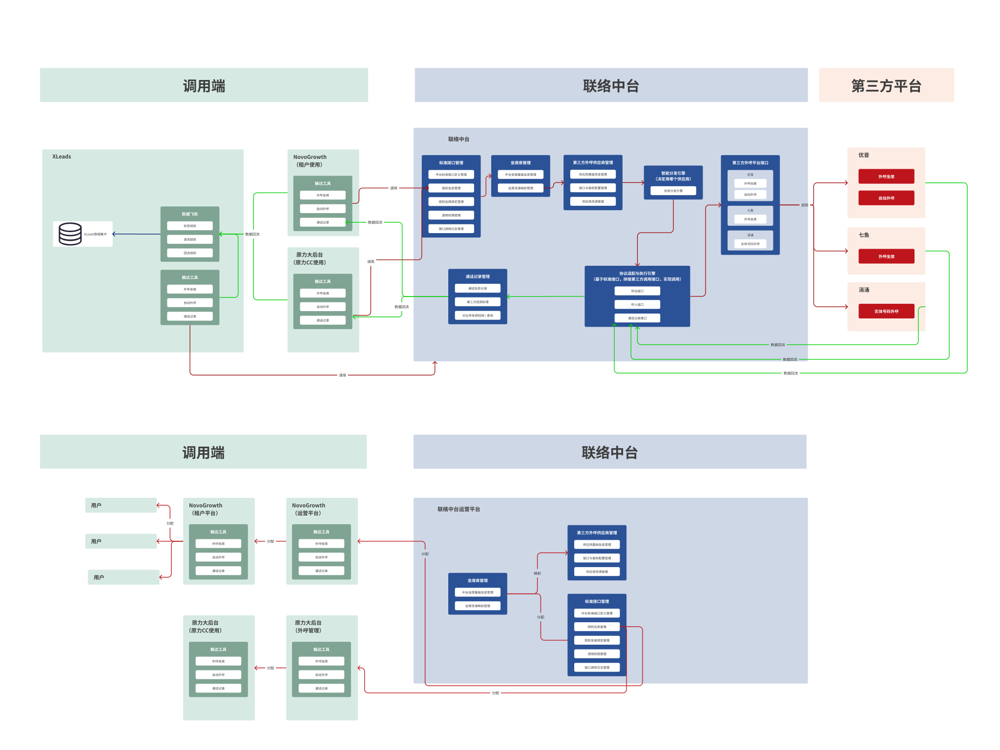
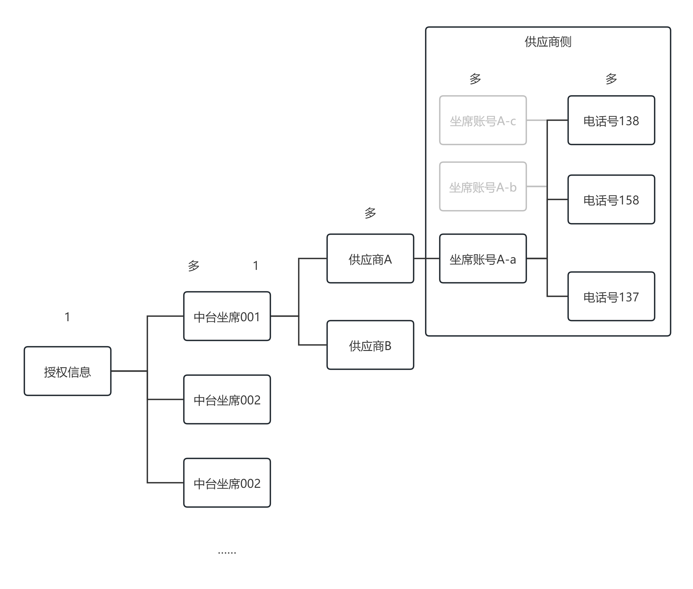
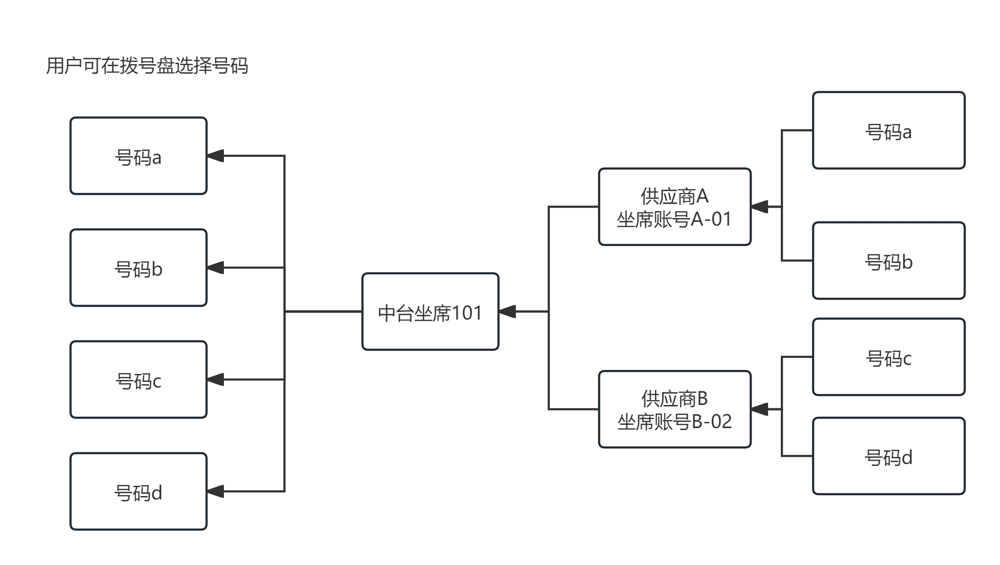

# 触达工具-中台PRD

模块: 联络中心

| **版本号** | **修订日期** | **修订人** | **修订内容** |
| --- | --- | --- | --- |
| v1.0 | 2025-12-25 | 产品经理 | 初始版本 |
| v1.1 | 2025-01-27 | 产品经理 | 补充了外呼中台运营界面、用量记录、对外统一接口设计、与调用端交互逻辑，优化坐席智能分发路径设计 |
| v1.2 | 2026-03-09 | 产品经理 | 收敛中台坐席授权状态，仅保留“未授权/已授权”两种授权状态，并梳理与启用状态、授权与资源有效性的关联关系 |

## 外呼中台运营平台原型图（补充了外呼中台的前端页面）

[https://mastergo.com/goto/Q9v2VHhw?page_id=M&file=182921676658183](https://mastergo.com/goto/Q9v2VHhw?page_id=M&file=182921676658183) 邀请您进入《联络中台》，点击链接开始协作

## **需求背景**

随着业务规模的扩大，公司多个业务系统（如原力大后台、AI CRM等）均需要外呼能力来支撑业务场景。在缺乏统一中台的情况下，各业务系统需要直接对接第三方外呼供应商，面临以下问题：

1. **对接成本高**：每个业务系统都需要独立对接供应商接口，重复开发工作量大，维护成本高
2. **供应商管理分散**：不同业务系统可能使用不同供应商，供应商信息、配置、资源管理分散，难以统一管控
3. **接口标准不统一**：各供应商接口规范、参数格式、鉴权方式、回调机制差异大，业务系统需要适配多种接口标准
4. **资源调度困难**：坐席资源分散在各供应商平台，无法统一调度和分配，资源利用率低
5. **扩展性差**：新增供应商或切换供应商时，需要修改多个业务系统代码，影响面大

为解决上述问题，需要构建一个统一的外呼中台，将第三方外呼供应商整合管理，为业务系统提供标准化的外呼能力。中台的核心价值在于：

- **统一封装**：通过中台封装和适配代码，将不同供应商的接口差异统一屏蔽，业务系统只需调用中台标准接口
- **资源统一管理**：统一管理中台坐席资源、供应商资源，支持灵活的坐席分配和资源调度
- **智能分发**：根据任务类型、坐席资源映射和供应商配置，智能决策最优供应商执行外呼任务
- **标准化输出**：将供应商的回调数据转换为统一标准格式，业务系统无需关心供应商内部实现
- **灵活扩展**：新增供应商时仅需在中台侧新增API与鉴权配置，并补充对应的协议适配代码，无需修改业务系统代码

## **功能流程图**





**关系说明**：

- **中台坐席（1）- 供应商坐席账号（多）**：一个中台坐席可以绑定多个供应商的坐席，但是只能绑定每个供应商的一个坐席
- **鉴权信息（1）- 中台坐席（多）**：一个鉴权信息下有多个中台坐席，也即是一个使用端可以有多个坐席
- **供应商坐席账号（多）- 号码（多）**：供应商坐席账号和供应商提供的号码是多对多关系，一个坐席账号可以对应多个号码，一个号码也可以对应多个坐席账号
- 一个供应商坐席账号只能绑定一个中台坐席（同一时间）
- 外呼时智能分发引擎根据用户选择的号码反向回溯到对应的供应商坐席账号和中台坐席，验证匹配关系
- 支持更换绑定：可以新增关联，历史关联记录保留

**整体流程**：

1. 坐席库管理 → 提供中台坐席和资源映射
2. 第三方外呼供应商管理 → 提供供应商配置和资源
3. 智能分发引擎 → 根据坐席和供应商配置，决定调用哪个供应商的哪个坐席账号和号码
4. 协议适配与执行引擎 → 将标准参数转换为供应商接口调用
5. 第三方平台 → 执行实际外呼
6. 数据回流 → 第三方平台回调 → 通话记录管理 → 业务系统

---

# **一、中台核心功能**

## **一、坐席库管理**

**功能概述**： 坐席库管理模块负责管理中台坐席和资源映射关系。中台坐席是中台唯一的调度单位，不直接存储供应商和号码信息，通过映射表将中台坐席与供应商资源关联。

**核心价值**：

- **统一调度**：将不同供应商的坐席资源统一管理，业务系统无需关心具体供应商
- **灵活映射**：中台坐席通过映射表关联供应商坐席，支持资源切换和扩展
- **资源隔离**：中台坐席与供应商资源解耦，通过映射表关联，便于资源切换和扩展

---

### **（一）中台坐席管理**

**功能概述**： 管理中台坐席的基础信息，包括坐席ID、坐席名称、状态等。中台坐席是中台对外提供服务的统一单位。

**核心功能**：

- **维护中台坐席**：
    - 创建中台坐席（设置坐席名称、备注等基础信息）
    - 编辑中台坐席信息（修改坐席名称、备注等）
    - 启用/禁用坐席（控制坐席是否可用）
    - 删除坐席（删除不需要的坐席）
- **绑定授权**：
    - 将坐席绑定到授权（一个坐席只能绑定一个授权）
    - 解绑授权（释放坐席与授权的绑定关系）
    - 系统自动根据绑定状态和资源可用性更新坐席状态（未授权/已授权/供应商过期/授权过期）
- **查询坐席信息**：
    - 查询可用坐席列表（状态为”已授权”且启用状态，排除”过期”状态的坐席）
    - 根据坐席ID查询详情（包含基础信息、状态、映射的资源信息、授权信息）
    - 查询坐席的关联历史（所有启用的映射和关联历史）

**数据模型**：

**表：`seat`（中台坐席主表）**

| 字段名 | 类型 | 说明 |
| --- | --- | --- |
| seat_id | BIGINT | 主键，坐席唯一标识（内部使用） |
| seat_name | VARCHAR(100) | 坐席名称（唯一标识，用于定位坐席） |
| authorization_id | BIGINT | 外键，关联授权表（一个坐席只能绑定一个授权） |
| status | TINYINT | 业务可用性状态（仅在 enable_flag=1 时有效，禁用时为 NULL）：1-未授权，2-已授权，4-供应商过期，5-授权过期 |
| enable_flag | TINYINT(1) | 是否启用：1-启用，0-禁用（物理开关） |
| remark | TEXT | 备注 |
| create_time | DATETIME | 创建时间 |
| update_time | DATETIME | 更新时间 |

**中台坐席状态设计**：

- **双层含义**：
    - `enable_flag` 表示坐席是否在中台整体“开机”；为 0 时，无论 `status` 如何，调用端都不可见、不可用
    - `status` 表示在启用前提下的业务可用性，由系统根据授权与资源实时计算
- **状态更新规则（仅在 `enable_flag = 1` 时生效）**：
    - 绑定授权成功时：
        - 如授权在有效期内，且存在至少 1 条启用的供应商映射 → 置为 **已授权**
        - 如授权已过期/禁用 → 置为 **授权过期**
    - 解绑授权时：置为 **未授权**
    - 供应商资源状态变化时：
        - 若所有启用映射均因合同到期/资源禁用而不可用 → 置为 **供应商过期**
        - 若存在至少 1 条可用映射 → 保持/恢复为 **已授权**
    - 授权状态变化时：
        - 授权时间到期或被禁用 → 置为 **授权过期**
        - 授权续期或重新启用，且存在可用映射 → 恢复为 **已授权**

| enable_flag | status | 中台坐席状态名称 | 前端列表展示示例 | 说明 | 调用端是否可用（出现在 `GET /api/v1/seats/available`） |
| --- | --- | --- | --- | --- | --- |
| 1（启用） | 1 | 未授权 | 未授权 | 坐席已启用但未绑定任何授权信息 | ❌ 否 |
| 1（启用） | 2 | 已授权 | 已授权（可用） | 授权有效，且至少存在一条可用供应商映射 | ✅ 是 |
| 1（启用） | 4 | 供应商过期 | 资源过期 | 所有关联供应商资源不可用（合同到期/映射禁用等），需续期或更换资源 | ❌ 否 |
| 1（启用） | 5 | 授权过期 | 授权过期 | 授权时间到期或被禁用，需续期或重新启用授权 | ❌ 否 |
| 0（禁用） | NULL | 已禁用 | 已禁用 | 坐席整体关闭，不参与任何分发和查询，前端仅在管理列表中展示 | ❌ 否 |

**自动外呼**：

自动外呼任务将自动外呼线路视为一个特殊的外呼坐席。在供应商资源管理中，通过`supplier_seat.seat_type`字段区分坐席类型（人工坐席/自动外呼坐席）。自动外呼任务的处理流程与人工坐席外呼类似：

- 用户在前端选择自动外呼线路对应的号码
- 智能分发引擎根据用户选择的号码反向回溯到对应的自动外呼坐席账号和中台坐席
- 验证匹配关系并执行状态检查
- 执行外呼任务

**模块关系**：

- **与资源映射模块**：通过映射表关联，获取坐席对应的供应商资源
- **与智能分发引擎**：为分发引擎提供可用坐席列表
- **与授权管理模块**：通过授权ID关联授权表，一个坐席只能绑定一个授权

---

### **（二）坐席资源映射管理**

**功能概述**： 坐席资源映射是中台坐席与供应商坐席账号之间的桥梁。中台坐席通过映射表关联供应商坐席账号，实现灵活的资源关联和切换。映射关系主要用于确定使用哪家供应商/哪个供应商坐席账号。

**核心功能**：

- **配置映射关系**：
    - 为中台坐席配置供应商坐席账号映射（一个中台坐席可以绑定多个供应商坐席账号，支持主备供应商模式）
    - 设置映射优先级（用于外呼时选择最优供应商）
    - 一个供应商坐席账号在同一时间只能绑定一个中台坐席
- **管理映射状态**：
    - 启用/禁用映射（支持同时存在多个启用的映射，便于资源切换和主备供应商配置）
    - 取消映射关联（禁用指定映射，坐席仍可使用其他启用的映射）
    - 更换绑定关系（新增关联可以替换指定映射，原关联记录保留在关联历史中）
    - 系统自动根据供应商合同到期情况更新映射状态
- **查询映射信息**：
    - 根据坐席ID查询所有启用的映射（支持多个映射同时启用）
    - 根据坐席ID查询关联历史（所有历史关联记录）
    - 查询供应商坐席列表（用于配置映射时选择资源）

**数据模型**：

**表：`seat_resource_mapping`（坐席资源映射表）**

| 字段名 | 类型 | 说明 |
| --- | --- | --- |
| mapping_id | BIGINT | 主键 |
| seat_id | BIGINT | 外键，关联seat表 |
| resource_type | TINYINT | 资源类型：1-供应商坐席（固定值，不再支持实体号模式） |
| resource_id | BIGINT | 资源ID，根据resource_type关联不同表 |
| supplier_id | BIGINT | 外键，关联供应商表 |
| is_enable | TINYINT(1) | 是否启用：1-启用，0-禁用（不参与智能分发） |
| disable_reason | VARCHAR(100) | 禁用原因（可选）：合同到期、资源不可用、手动禁用等 |
| create_time | DATETIME | 创建时间 |
| update_time | DATETIME | 更新时间 |

**映射逻辑与资源状态设计**：

1. **映射关系**：
    - 中台坐席映射到供应商坐席账号，供应商提供坐席+虚拟号码/实体号码
    - 外呼时使用供应商坐席的虚拟号码和对应的供应商坐席资源
2. **绑定规则**：
    - 一个中台坐席可以绑定多个供应商坐席账号（1对多关系）
    - 一个中台坐席可以同时有多个启用的映射，外呼时使用哪个号码由用户在前端拨号盘选择
    - 外呼时智能分发引擎根据用户选择的号码反向回溯到对应的供应商坐席账号和中台坐席，验证匹配关系
    - 一个供应商坐席账号在同一时间只能绑定一个中台坐席
    - 新增关联时，可以添加新的映射（不替换现有映射），支持同时存在多个映射
3. **映射查询流程**：
    - 用户在前端拨号盘选择号码（号码支持启用/禁用状态管理）
    - 根据号码通过`supplier_seat_number_mapping`表查找对应的供应商坐席账号（一个号码可能对应多个供应商坐席账号）
    - 结合当前中台坐席的绑定关系，通过`seat_resource_mapping`表验证并唯一确定一个供应商坐席账号（约束：一个中台坐席只能绑定一个供应商的一个坐席账号）
    - 检查供应商及坐席状态，确保资源可用
    - 获取供应商坐席信息和号码信息
4. **映射状态管理**：
    - 当供应商合同到期、供应商坐席或号码被禁用时，系统自动将对应映射 `is_enable` 更新为 `0`，并写入 `disable_reason`
    - 当供应商合同续签、资源恢复可用后，可由运营手动或系统任务将映射恢复为启用（`is_enable = 1`）
    - 运营可手动禁用某条映射（`disable_reason = 手动禁用`），用于临时下线某个资源，不影响同一坐席下的其他启用映射
    - 智能分发引擎在计算“是否有可用资源”时，只统计 `is_enable = 1` 且底层供应商坐席/号码状态为可用的映射；若统计结果为 0，则对应中台坐席更新为“供应商过期”

**模块关系**：

- **与中台坐席管理**：关联中台坐席
- **与供应商管理**：关联供应商，关联供应商坐席账号
- **与智能分发引擎**：为分发引擎提供坐席映射信息，用于调用供应商API

---

## **二、第三方外呼供应商管理**

**功能概述**： 第三方外呼供应商管理模块负责统一管理所有外呼供应商的配置信息，包括供应商基础信息、API接口配置、鉴权配置等。前端运营页面仅支持管理供应商基础信息和API+鉴权配置；参数映射、响应映射、回调配置等由研发在协议适配层通过代码和内部配置表维护，对运营前端不可见。通过中台统一封装，业务系统在调用中台标准接口时无需关心具体供应商实现。

**核心价值**：

- **统一封装**：将不同供应商的接口差异通过配置表管理，实现统一调用方式
- **灵活扩展**：支持动态添加新供应商，只需配置相关映射规则，无需修改代码
- **标准化处理**：通过参数映射和响应映射，将供应商接口转换为中台标准格式

---

### **（一）供应商基础信息管理**

**功能概述**： 管理第三方外呼供应商的基础信息，包括供应商编码、名称、类型、联系方式、合同信息、能力支持等。为其他模块提供供应商查询和筛选能力。

**核心功能**：

- **维护供应商信息**：
    - 创建供应商（设置供应商编码、名称、联系人信息、合同信息、能力支持等）
    - 编辑供应商信息（修改供应商基础信息、合同信息、能力支持等）
    - 管理供应商状态（启用/禁用供应商）
- **查询供应商信息**：
    - 查询可用供应商列表（合同未到期）
    - 根据供应商ID查询详情
    - 根据供应商类型筛选（支持虚拟号）
    - 根据合同状态筛选（合同到期/未到期）

**数据模型**：

**表：`supplier`（供应商主表）**

| 字段名 | 类型 | 说明 |
| --- | --- | --- |
| supplier_id | BIGINT | 主键，供应商唯一标识 |
| supplier_code | VARCHAR(50) | 供应商编码，唯一 |
| supplier_name | VARCHAR(100) | 供应商名称 |
| support_virtual_number | TINYINT(1) | 是否支持虚拟号模式（提供坐席+虚拟号码） |
| contact_person | VARCHAR(50) | 联系人 |
| contact_phone | VARCHAR(20) | 联系电话 |
| contract_no | VARCHAR(50) | 合同编号 |
| contract_start_date | DATE | 合同开始日期 |
| contract_end_date | DATE | 合同结束日期 |
| support_intl_call | TINYINT(1) | 是否支持国际呼叫 |
| support_asr | TINYINT(1) | 是否支持通话录音 |
| remark | TEXT | 备注 |
| create_time | DATETIME | 创建时间 |
| update_time | DATETIME | 更新时间 |

**设计说明**：

- 供应商信息由运营人员人工配置，不通过系统自动创建
- 查询可用供应商时，自动过滤合同已到期的供应商
- 供应商必须支持虚拟号模式（提供坐席+虚拟号码）
- 供应商类型通过是否支持虚拟号模式来区分

**模块关系**：

- **与智能分发引擎**：为分发引擎提供可用供应商列表和供应商详情
- **与坐席资源管理**：供应商提供坐席资源（供应商坐席账号）
- **与接口配置管理**：供应商关联多个API接口配置

---

### **（二）接口与鉴权配置管理**

**功能概述**： 管理供应商API接口的基础配置信息，包括接口地址、请求方式、超时重试策略、接口类型等，以及与之关联的鉴权信息。前端页面仅提供API与鉴权配置管理；参数映射、响应映射、回调配置等由协议适配与执行引擎内部的代码和配置表维护，用于支撑标准化转换，不对运营前端开放编辑。

**核心功能**：

- **配置供应商API接口**：
    - 配置接口基础信息（接口地址、请求方式、数据格式、接口类型：人工坐席外呼/自动外呼）
    - 配置接口策略（超时时间、重试策略、错误码映射、接口级限流）
    - 启用/禁用接口配置
- **配置鉴权信息**：
    - 配置鉴权类型（无、Token、签名）
    - 配置鉴权参数（认证Key/AppId、认证Secret、额外参数）
    - 管理鉴权配置的启用/禁用状态
- **配置参数映射规则（研发内部维护，前端不开放）**：
    - 配置中台标准参数到供应商参数的映射关系
    - 配置参数位置（body/header/query）、参数类型、是否必填、默认值
    - 配置参数转换规则（如去掉+86前缀等格式转换）
- **配置响应映射规则（研发内部维护，前端不开放）**：
    - 配置供应商返回字段到中台标准字段的映射关系
    - 配置字段类型、转换规则、是否必需字段
- **配置回调映射规则（研发内部维护，前端不开放）**：
    - 配置供应商回调类型和回调事件映射
    - 配置回调地址、鉴权方式、签名算法
    - 配置通话记录字段映射（供应商回调字段路径 → 中台标准字段，支持JSON路径表达式）
    - 配置数据转换规则（类型转换、时间格式转换、时间戳转换、时长单位转换、状态码映射）

**数据模型**：

**表：`supplier_api_config`（供应商API配置表）**

| 字段名 | 类型 | 说明 |
| --- | --- | --- |
| api_id | BIGINT | 主键 |
| supplier_id | BIGINT | 外键，关联供应商 |
| api_code | VARCHAR(50) | API唯一编码：人工坐席外呼、自动外呼 |
| api_name | VARCHAR(100) | API名称 |
| api_url | VARCHAR(255) | 接口地址 |
| request_method | VARCHAR(10) | 请求方式 |
| timeout | INT | 请求超时时间（秒） |
| retry_times | TINYINT | 最大重试次数 |
| retry_interval | INT | 重试间隔（秒） |
| error_code_mapping | JSON | 错误码映射（平台 → 中台） |
| rate_limit_rps | INT | 接口级限流（每秒请求数） |
| is_enable | TINYINT(1) | 是否启用 |
| version | INT | 接口版本号 |

**表：`supplier_auth_config`（供应商鉴权配置表）**

| 字段名 | 类型 | 说明 |
| --- | --- | --- |
| auth_id | BIGINT | 主键 |
| supplier_id | BIGINT | 外键，关联供应商表 |
| auth_type | TINYINT | 鉴权类型：无、Token、签名 |
| auth_key | VARCHAR(100) | 认证Key/AppId |
| auth_secret | VARCHAR(255) | 认证Secret（加密存储） |
| extra_params | TEXT | 额外参数（JSON格式） |
| is_enable | TINYINT(1) | 是否启用 |

**表：`supplier_param_mapping`（供应商参数映射表）**

| 字段名 | 类型 | 说明 |
| --- | --- | --- |
| mapping_id | BIGINT | 主键 |
| api_id | BIGINT | 外键，关联供应商API配置 |
| standard_param | VARCHAR(50) | 中台标准参数名 |
| supplier_param | VARCHAR(50) | 供应商参数名 |
| param_location | VARCHAR(20) | 参数位置（body/header/query） |
| is_required | TINYINT(1) | 是否必填 |
| default_value | VARCHAR(100) | 默认值 |
| transform_rule | VARCHAR(255) | 参数转换规则 |

**表：`supplier_response_mapping`（供应商响应映射表）**

| 字段名 | 类型 | 说明 |
| --- | --- | --- |
| mapping_id | BIGINT | 主键 |
| api_id | BIGINT | 外键，关联供应商API配置 |
| supplier_field | VARCHAR(100) | 供应商返回字段路径 |
| standard_field | VARCHAR(50) | 中台标准字段名 |
| field_type | VARCHAR(20) | 字段类型 |
| transform_rule | VARCHAR(255) | 转换规则 |
| is_required | TINYINT(1) | 是否必需字段 |

**表：`supplier_callback_config`（供应商回调配置表）**

| 字段名 | 类型 | 说明 |
| --- | --- | --- |
| callback_id | BIGINT | 主键 |
| api_id | BIGINT | 外键，关联供应商API配置 |
| callback_code | VARCHAR(50) | 回调编码 |
| supplier_callback_event | VARCHAR(50) | 供应商回调事件 |
| callback_url | VARCHAR(255) | 我方回调地址 |
| auth_type | VARCHAR(20) | 鉴权方式 |
| sign_algorithm | VARCHAR(50) | 签名算法 |
| is_enable | TINYINT(1) | 是否启用 |

**表：`supplier_call_record_mapping`（供应商通话记录字段映射表）**

| 字段名 | 类型 | 说明 |
| --- | --- | --- |
| mapping_id | BIGINT | 主键 |
| supplier_id | BIGINT | 外键，关联供应商表 |
| supplier_field | VARCHAR(100) | 供应商回调字段路径（支持JSON路径） |
| standard_field | VARCHAR(50) | 中台标准字段名 |
| field_type | VARCHAR(20) | 字段类型 |
| transform_rule | VARCHAR(500) | 转换规则（JSON格式） |
| is_required | TINYINT(1) | 是否必需字段 |

**设计说明**：

- **配置+代码驱动**：可抽象的供应商接口差异通过内部配置表管理，复杂或个性化逻辑通过协议适配层代码实现，新供应商接入需要补充适配代码
- **统一标准**：通过参数映射和响应映射，将供应商接口转换为中台标准格式
- **灵活扩展**：支持复杂JSON路径表达式，支持多种数据转换规则（类型转换、时间格式、状态码映射等）
- **通话记录映射**：将不同供应商的回调数据映射到中台标准字段，支持统一状态码（ANSWERED、BUSY、NO_ANSWER等）

**模块关系**：

- **与智能分发引擎**：为分发引擎提供供应商API配置、鉴权信息、参数映射规则
- **与通话记录管理**：通过通话记录字段映射，将供应商回调数据转换为中台标准格式

---

### **（三）供应商资源管理**

> 供应商资源仅包括供应商坐席账号：
> 
> 
> 这些资源通过 `seat_resource_mapping` 映射表与中台坐席关联
> 

---

**功能概述**： 管理供应商提供的坐席账号资源。供应商坐席账号通过`seat_resource_mapping`映射表与中台坐席关联。

**核心功能**：

- **维护供应商坐席账号**：
    - 创建供应商坐席账号（设置坐席编码、虚拟号码等）
    - 编辑供应商坐席账号信息
    - 启用/禁用供应商坐席账号（控制资源可用性）
- **查询供应商资源**：
    - 查询指定供应商的所有可用坐席账号
    - 查询坐席账号的绑定情况（是否已绑定中台坐席）
    - 根据供应商ID查询资源列表

**数据模型**：

**表：`supplier_seat`（供应商坐席表）**

| 字段名 | 类型 | 说明 |
| --- | --- | --- |
| supplier_seat_id | BIGINT | 主键 |
| supplier_id | BIGINT | 外键，关联供应商表 |
| supplier_seat_code | VARCHAR(100) | 供应商坐席编码（供应商侧唯一标识） |
| seat_type | TINYINT | 坐席类型：1-人工坐席，2-自动外呼坐席 |
| virtual_phone | VARCHAR(20) | 供应商提供的虚拟号码（用于实际外呼，可选，保留字段） |
| status | TINYINT | 运行状态：1-可用，2-禁用 |
| is_enable | TINYINT(1) | 是否启用：1-启用，0-禁用（中台侧是否纳入资源池） |
| create_time | DATETIME | 创建时间 |
| update_time | DATETIME | 更新时间 |

**表：`supplier_seat_number_mapping`（供应商坐席号码映射表）**

| 字段名 | 类型 | 说明 |
| --- | --- | --- |
| mapping_id | BIGINT | 主键 |
| supplier_seat_id | BIGINT | 外键，关联supplier_seat表 |
| phone_number | VARCHAR(20) | 号码（用户在前端选择的号码） |
| is_enable | TINYINT(1) | 是否启用：1-启用，0-禁用（是否对前端展示） |
| status | TINYINT | 号码状态：1-可用，2-占用（保留）、3-禁用 |
| create_time | DATETIME | 创建时间 |
| update_time | DATETIME | 更新时间 |

**设计说明（供应商资源状态）**：

- **供应商坐席账号**：供应商提供坐席+虚拟号码，用于中台坐席映射；只有当 `is_enable = 1` 且 `status = 1（可用）` 时，才会被视为“可用资源”
- **资源关联**：通过 `seat_resource_mapping` 与中台坐席关联；若供应商坐席被禁用或删除，对应映射将自动置为禁用
- **资源查询**：查询可用资源时，自动排除已被其他中台坐席绑定的资源（同一时间只能绑定一个中台坐席），以及 `is_enable = 0 / status != 1` 的资源
- **绑定关系**：一个供应商坐席账号在同一时间只能绑定一个中台坐席，但一个中台坐席可以绑定多个供应商坐席账号
- **号码映射关系**：一个供应商坐席账号可以对应多个号码（一对多关系），通过`supplier_seat_number_mapping`表管理。号码是用户在前端拨号盘上看到并选择的号码，支持号码的启用/禁用和状态管理。从供应商角度来说，多个坐席账号可能对应多个号码，一个号码可能对应多个供应商坐席账号。但在回溯过程中，由于约束条件（一个中台坐席只能绑定一个供应商的一个坐席账号），结合当前中台坐席的绑定关系，能够唯一确定一个供应商坐席账号
- **号码可用性**：号码仅在 `is_enable = 1` 且 `status = 1（可用）` 时，对前端展示并允许选择；占用/禁用状态只用于运营排查与历史记录
- **坐席类型**：通过`seat_type`字段区分人工坐席和自动外呼坐席，自动外呼线路作为特殊的外呼坐席进行管理

**模块关系**：

- **与中台坐席管理**：中台坐席通过映射表获取对应的供应商坐席账号资源

---

## **三、智能分发引擎（更新了分发路径）**

**功能概述**： 智能分发引擎是外呼中台的核心决策模块。其核心职责是根据用户在拨号盘选择的主叫号码，结合当前操作的中台坐席ID，智能回溯并验证对应的供应商、供应商坐席账号以及号码的可用性。引擎专注于任务调度、资源匹配和分发决策，将决策结果传递给协议适配与执行引擎进行实际调用，不涉及具体的API调用实现。

**核心价值**：

- **智能回溯**：根据用户选择的号码，反向推导出具体使用的中台坐席、供应商坐席账号及供应商
- **统一调度**：将不同供应商的号码资源统一管理，业务系统无需关心具体供应商实现
- **任务管理**：支持任务状态跟踪、结果记录等功能

### **（一）核心业务关系梳理**

根据业务需求，坐席与号码之间的关系梳理如下：

1. **外呼中台授权信息**：对应多个 **中台坐席**。
2. **中台坐席**：一个中台坐席可以绑定多个 **供应商坐席账号**。
3. **供应商坐席账号（组）**：在供应商侧，一个坐席组（或一个供应商坐席账号）可能包含多个实际的坐席，并共享一组可用的 **供应商号码**。这意味着坐席组中的所有坐席都可以使用这组号码进行外呼。
4. **前端用户交互**：用户在拨号盘上会看到并选择一个号码进行外呼。这些号码由不同供应商提供，并关联到当前登录的中台坐席。

**可视化关系图**：



外呼中台坐席对应关系.png

### **（二）任务分发引擎**

**功能概述**： 任务分发引擎负责接收外呼任务请求，根据用户选择的主叫号码和当前操作的中台坐席ID，智能回溯并验证资源，最终确定应使用哪个供应商资源来执行任务。引擎专注于回溯、校验和决策，将决策结果传递给协议适配与执行引擎进行实际调用。

**核心流程（人工坐席外呼）**：

1. **接收外呼任务请求**：
    - 接收任务参数：当前操作的中台坐席、用户从拨号盘选择的主叫号码、被叫号码等。
2. **号码回溯与资源匹配**：
    - 根据用户选择的主叫号码，查找该号码关联的供应商坐席账号。
    - 验证该供应商坐席账号是否已绑定到当前操作的中台坐席。
    - 由于一个中台坐席只能绑定一个供应商的一个坐席账号，结合当前中台坐席的绑定关系，能够唯一确定对应的供应商坐席账号。
    - 如果无法找到有效的绑定关系，返回错误提示"号码与当前坐席的绑定关系无效"或"号码不可用"。
3. **资源状态校验**：
    - 检查供应商合同是否在有效期内。
    - 检查供应商、供应商坐席账号、中台坐席、号码是否均为启用状态。
    - 检查中台坐席是否为"已授权"状态，排除"供应商过期"、"授权过期"、"未授权"等不可用状态。
    - 所有检查项通过后继续执行，否则返回错误。
4. **执行外呼任务**：
    - 将确定的供应商、供应商坐席账号、主叫号码等信息传递给协议适配与执行引擎，执行实际的外呼操作。
5. **故障处理**：
    - 当供应商发生故障时（如接口返回错误、超时、资源不可用等），明确告知用户选择的号码暂时无法使用，终止本次外呼任务（不自动切换到其他号码）。
    - 记录故障信息，便于问题排查。
6. **记录分配结果**：
    - 记录本次外呼任务使用的供应商、坐席账号、号码、分配原因以及故障情况（如有）。
    - 记录回溯过程中的关键决策信息，便于追溯和分析。

### **（三）数据模型**

**表：`call_task`（外呼任务表）**

| 字段名 | 类型 | 说明 |
| --- | --- | --- |
| call_task_id | BIGINT | 主键 |
| task_type | TINYINT | 任务类型：人工坐席外呼、自动外呼 |
| seat_id | BIGINT | 外键，关联中台坐席表（人工坐席外呼必填） |
| selected_caller_number | VARCHAR(20) | 用户选择的主叫号码（新增，必填） |
| caller_number | VARCHAR(20) | 实际使用的主叫号码（冗余字段，通常与selected_caller_number相同） |
| callee_number | VARCHAR(20) | 被叫号码 |
| call_type | TINYINT | 呼叫类型：本地、长途、国际 |
| mapping_id | BIGINT | 外键，关联坐席资源映射表（冗余字段，记录实际使用的映射） |
| supplier_id | BIGINT | 外键，关联供应商表（冗余字段，记录实际使用的供应商） |
| supplier_seat_id | BIGINT | 外键，关联供应商坐席表（新增，冗余字段） |
| task_status | TINYINT | 任务状态：待分发、分发中、完成、失败 |
| retry_count | TINYINT | 重试次数 |
| max_retry | TINYINT | 最大重试次数 |
| priority | INT | 任务优先级（小号优先） |
| dispatch_result | JSON | 调用供应商API结果（包含供应商通话ID、回溯决策结果、故障信息等） |
| dispatch_rule_result | JSON | 回溯决策结果（记录回溯路径、验证结果等） |

**模块关系**：

- **与坐席库管理**：通过 `middleware_seat_id` 查询中台坐席信息，通过 `seat_resource_mapping` 获取映射关系
- **与供应商管理**：通过 `supplier_id` 查询供应商基础信息和能力配置；通过 `supplier_seat_id` 查询供应商坐席账号详情
- **与协议适配与执行引擎**：将分发决策结果传递给协议适配与执行引擎，接收执行结果
- **与通话记录管理**：通过分发结果中的供应商通话ID关联通话记录

### **（四）供应商合同到期处理机制（针对供应商资源到期，但用户使用外呼中台的权益还未到期）**

**功能概述**： 智能分发引擎需要处理供应商合同到期的情况，通过三层防护机制确保业务连续性，同时通过预警机制提前识别和处理风险。

**设计原则**：

- **透明展示**：号码始终展示给用户，合同到期时标注”暂时不可用”
- **分级处理**：预警期允许使用，到期后标注不可用但保留展示
- **严格回溯**：遵循用户选择号码→智能回溯→验证匹配的流程，不自动切换供应商
- **自动恢复**：合同续签后自动恢复可用性，无需手动操作

---

### **1. 整体流程**

**正常流程**：

```
用户选择号码 → 前端展示（第一层） → 智能分发引擎检查（第二层） → 协议执行检查（第三层） → 执行外呼

```

**预警流程**：

```
定时任务检查 → 判断预警级别 → 创建预警记录 → 发送通知 → 运营人员处理

```

**到期处理流程**：

```
定时任务检查 → 发现合同已到期 → 更新映射状态（is_enable=0） → 号码标注"暂时不可用"但仍展示 → 判断坐席状态 → 发送紧急通知

```

**恢复流程**：

```
更新合同信息 → 系统自动检查 → 恢复映射状态 → 移除"暂时不可用"标注 → 恢复坐席状态 → 更新预警状态

```

**供应商切换流程**：

```
运营创建新供应商映射 → 配置新号码 → 禁用旧映射 → 系统更新号码展示（旧号码标注"已停用"，新号码正常展示） → 恢复坐席状态

```

---

### **2. 三层防护机制**

**第一层：号码选择阶段（前端展示）**

- **实现逻辑**：
    - 合同已到期：展示号码，标注”暂时不可用”（用户可见），禁止选择
    - 合同3天内到期：展示号码，标注”即将到期”（仅运营可见），允许使用
    - 合同7天内到期：展示号码，标注”即将到期”（仅运营可见），允许使用
    - 合同正常：正常展示，允许使用
- **效果**：用户始终能看到自己的号码，合同到期时明确标注状态，避免困惑

**第二层：智能分发引擎检查（实时验证）**

- **增强检查逻辑**（在原有状态检查基础上增强）：
    1. **供应商合同状态检查**：
        - 检查 `supplier.contract_end_date` 是否已到期
        - 检查合同剩余天数
        - 检查供应商映射是否被标记为不可用（`seat_resource_mapping.is_enable = 0`）
    2. **检查结果处理**：
        - **合同已到期**：
            - 返回错误码 `CONTRACT_EXPIRED`
            - 严格遵循用户选择的号码，不自动切换供应商
        - **合同即将到期（3天内）**：
            - 允许外呼，记录预警日志
    3. **用户提示文案**（隐去内部信息）：
        - 合同已到期场景：
            - 用户提示：“该号码暂时不可用，请联系客服处理”

**第三层：协议执行阶段（兜底检查）**

- **实现逻辑**：
    - 在调用供应商API前再次确认合同状态
    - 如发现合同在检查间隙到期，立即终止调用并返回友好错误

---

### **3. 预警机制与状态流转**

**预警阶段划分**：

| 预警阶段 | 时间范围 | 号码展示 | 外呼允许 | 系统处理 |
| --- | --- | --- | --- | --- |
| **正常** | 合同到期时间 > 30天 | ✅ 正常展示 | ✅ 允许 | 无特殊处理 |
| **预警期（低）** | 30天 ≥ 剩余天数 > 7天 | ✅ 正常展示 | ✅ 允许 | 创建预警记录，发送提醒 |
| **预警期（中）** | 7天 ≥ 剩余天数 > 3天 | ✅ 正常展示 | ✅ 允许 | 更新预警级别，发送催促通知 |
| **预警期（高）** | 3天 ≥ 剩余天数 > 0天 | ✅ 正常展示 | ✅ 允许（记录预警） | 更新预警级别，发送紧急通知 |
| **已到期** | 剩余天数 ≤ 0 | ✅ 展示+标注”暂时不可用” | ❌ 禁止 | 更新映射状态，处理坐席状态 |

**状态更新流程**（定时任务，每天早上9点执行）：

1. **查询已到期供应商**：查找合同已到期且处于启用状态的供应商
2. **遍历受影响的中台坐席**：
    - 通过 `seat_resource_mapping` 表查找所有绑定该供应商的中台坐席
    - 只处理当前启用且已授权的坐席
3. **更新映射状态**：
    - 更新 `seat_resource_mapping.is_enable = 0`（标记该供应商映射不可用）
    - 该供应商的号码在前端标注”暂时不可用”，但仍展示给用户
4. **更新坐席状态**：
    - 检查该中台坐席是否还有其他可用的供应商映射
    - 如果还有其他可用映射：保持坐席状态为”已授权”
    - 如果无其他可用映射：更新坐席状态为”供应商过期”，同步更新调用端坐席状态为”过期”
5. **创建处理记录**：记录供应商ID、受影响坐席信息、处理结果
6. **页面通知**：通知中台运营人员和调用端运营人员

**预警触发流程**：

- **预警期触发**（合同到期前30天、7天、3天）：
    1. 定时任务检查供应商合同到期时间
    2. 计算剩余天数，判断预警级别
    3. 创建或更新预警记录
    4. 统计受影响的中台坐席数量
    5. 发送对应级别的预警通知
- **处理期触发**（合同已到期）：
    1. 定时任务检查供应商合同是否已到期
    2. 执行状态更新流程（见上述流程）
    3. 创建紧急预警记录
    4. 发送紧急通知

---

### **4. 合同续签恢复机制**

**触发条件**：运营人员在后台更新供应商合同到期时间

**恢复流程**：

1. **更新供应商合同信息**：更新 `supplier.contract_end_date`
2. **系统自动检查**：
    - 查找所有因该供应商合同到期而被标记为不可用的映射（`seat_resource_mapping.is_enable = 0`）
    - 检查映射关联的中台坐席状态
3. **恢复映射状态**：
    - 将 `seat_resource_mapping.is_enable` 更新为 `1`
    - 该供应商的号码恢复为正常展示，移除”暂时不可用”标注
4. **恢复坐席状态**（如适用）：
    - 如果坐席被标记为”供应商过期”
    - 检查是否已有可用供应商映射
    - 如果有，更新坐席状态为”已授权”
    - 同步更新调用端坐席状态
5. **更新预警状态**：将相关预警记录标记为”已处理”

---

### **5. 供应商切换与号码迁移机制**

**业务场景**：原供应商合同到期，更换为新供应商，电话号码也发生变化

**处理流程**：

1. **运营人员操作**：
    - 在后台为受影响的中台坐席创建新的供应商映射（绑定新供应商的坐席账号）
    - 配置新供应商的号码到 `supplier_seat_number_mapping` 表
    - 将旧供应商的映射标记为不可用（`seat_resource_mapping.is_enable = 0`）
2. **系统自动处理**：
    - 检测到新供应商映射创建且旧映射被禁用
    - 更新号码展示：旧号码标注”已停用”或”已迁移”，新号码正常展示
    - 如果坐席状态为”供应商过期”，检查新映射后恢复为”已授权”
3. **用户侧体验**：
    - 用户仍能看到旧号码（标注”已停用”），但无法选择
    - 用户可以看到新号码并正常使用
    - 避免用户发现号码”莫名其妙没了”的困惑
4. **数据记录**：
    - 保留旧号码的历史映射记录（`is_enable = 0`），用于历史查询
    - 记录号码迁移信息，便于追溯和问题排查

---

## **四、协议适配与执行引擎**

**功能概述**： 协议适配与执行引擎是外呼中台的标准协议转换层，位于智能分发引擎和第三方供应商接口之间。该模块的核心职责是将中台的标准接口调用转换为各供应商实际可调用的接口请求，通过集中适配代码结合内部配置的方式实现协议适配，将供应商差异收敛在中台侧，业务系统无需感知。

**核心价值**：

- **集中适配**：新供应商接入时，由研发在协议适配层补充适配代码，并复用统一的执行引擎能力（鉴权、重试、限流等），业务系统侧无需改动
- **标准协议转换**：将中台统一的标准参数、标准接口转换为各供应商特定的接口格式和参数结构
- **统一执行策略**：统一处理鉴权、重试、限流等执行策略，确保调用可靠性

**设计理念**：

- **配置结合代码驱动**：使用内部配置表管理可抽象的通用规则（如参数名映射、状态码映射），复杂逻辑通过适配代码实现
- **标准接口稳定**：中台对外暴露的标准接口（呼出、呼入、通话记录等）保持稳定，业务层无需感知供应商差异
- **适配层解耦业务**：执行引擎提供通用的协议转换能力，供应商特定规则集中在适配层代码中维护

---

### **核心执行逻辑**

**功能概述**： 协议适配与执行引擎是中台与供应商协议交互的统一入口，负责双向协议转换

- **主动调用场景**：接收来自智能分发引擎的执行上下文（包含供应商ID、资源信息、标准业务参数），通过配置驱动的转换流程，将标准调用转换为供应商可执行的请求，并返回标准化结果
- **被动回调场景**：接收来自第三方回调处理模块的供应商回调数据，通过配置驱动的映射规则，将供应商回调数据转换为中台标准格式，用于更新通话记录

**执行流程**：

- **主动调用供应商接口（外呼任务执行）**
    
    ```markdown
    ┌─────────────────────────────────────────────────────────────┐
    │ 1. 接收执行上下文 │
    │ - 来源：智能分发引擎 │
    │ - 输入：供应商ID、接口类型、标准业务参数、资源信息、追踪ID│
    └─────────────────────────────────────────────────────────────┘
    ↓
    ┌─────────────────────────────────────────────────────────────┐
    │ 2. 加载供应商配置 │
    │ - 接口配置：URL、请求方法、超时、重试、限流 │
    │ - 鉴权配置：鉴权方式、鉴权参数位置 │
    │ - 参数映射规则：标准参数名 → 供应商参数名 │
    │ - 响应映射规则：供应商返回字段 → 标准字段 │
    └─────────────────────────────────────────────────────────────┘
    ↓
    ┌─────────────────────────────────────────────────────────────┐
    │ 3. 标准参数适配 │
    │ - 字段名转换 │
    │ - 参数位置分配（body/header/query） │
    │ - 数据格式转换（时间戳转换等） │
    │ - 必填校验 │
    └─────────────────────────────────────────────────────────────┘
    ↓
    ┌─────────────────────────────────────────────────────────────┐
    │ 4. 鉴权处理与请求构建 │
    │ - Token模式：注入Token到Header/Query │
    │ - 签名模式：生成签名并注入 │
    │ - Key-Secret模式：注入Key和Secret │
    │ - 构建完整HTTP请求 │
    └─────────────────────────────────────────────────────────────┘
    ↓
    ┌─────────────────────────────────────────────────────────────┐
    │ 5. 执行调用与策略控制 │
    │ - 限流控制（QPS限制） │
    │ - 请求执行（HTTP请求） │
    │ - 重试策略（网络超时、特定错误码） │
    │ - 全程追踪（记录请求参数、响应结果、耗时等） │
    └─────────────────────────────────────────────────────────────┘
    ↓
    ┌─────────────────────────────────────────────────────────────┐
    │ 6. 响应解析与标准化输出 │
    │ - 原始响应保存 │
    │ - 响应映射（JSONPath提取、字段转换） │
    │ - 状态码与错误码映射 │
    │ - 标准化输出（返回给智能分发引擎） │
    └─────────────────────────────────────────────────────────────┘
    ```
    
- **解析供应商回调数据（通话记录回流）**
    
    ```markdown
    ┌─────────────────────────────────────────────────────────────┐
    │ 1. 接收回调数据 │
    │ - 来源：第三方回调处理模块 │
    │ - 输入：供应商ID、回调类型、原始回调数据、供应商通话ID │
    └─────────────────────────────────────────────────────────────┘
    ↓
    ┌─────────────────────────────────────────────────────────────┐
    │ 2. 加载回调映射配置 │
    │ - 回调配置：回调类型、回调事件映射 │
    │ - 字段映射规则：供应商回调字段路径 → 中台标准字段 │
    │ - 数据转换规则：时间格式、时间戳、时长单位、状态码映射 │
    └─────────────────────────────────────────────────────────────┘
    ↓
    ┌─────────────────────────────────────────────────────────────┐
    │ 3. 回调数据解析与转换 │
    │ - 字段提取（JSONPath提取，支持数组、嵌套对象） │
    │ - 数据转换（时间格式、时间戳、时长单位、状态码） │
    │ - 必填字段校验 │
    └─────────────────────────────────────────────────────────────┘
    ↓
    ┌─────────────────────────────────────────────────────────────┐
    │ 4. 标准化输出 │
    │ - 生成统一格式的标准通话记录数据 │
    │ - 返回给第三方回调处理模块，用于更新中台通话记录表 │
    └─────────────────────────────────────────────────────────────┘
    ```
    

**模块关系**：

- **与智能分发引擎**：接收分发决策结果，执行协议转换和调用，返回标准化结果
- **与供应商管理**：从配置表获取供应商接口配置、鉴权信息、参数映射规则、响应映射规则、回调字段映射规则
- **与通话记录管理**：
    - 主动调用场景：通过执行结果中的供应商通话ID关联通话记录
    - 被动回调场景：接收第三方回调处理模块的调用，将供应商回调数据转换为标准格式，返回给回调处理模块用于更新通话记录

---

## **五、通话记录管理**

### **（一）中台坐席通话记录**

> 记录的是：中台视角下“中台坐席发起的一次通话记录”
> 

**数据模型**：

**表：`call_record`（中台坐席通话记录表）**

| 字段名 | 类型 | 说明 |
| --- | --- | --- |
| call_record_id | BIGINT | 主键，中台坐席通话记录唯一标识 |
| call_task_id | BIGINT | 外键，关联外呼任务表（分发引擎的任务ID） |
| seat_id | BIGINT | 外键，关联中台坐席表（必填，标识该通话记录属于哪个中台坐席） |
| supplier_id | BIGINT | 实际供应商（冗余字段，用于快速查询） |
| supplier_call_id | VARCHAR(100) | 供应商通话ID（用于关联供应商通话记录，从外呼任务的分发结果中获取） |
| caller | VARCHAR(30) | 主叫号码（中台坐席的号码） |
| callee | VARCHAR(30) | 被叫号码 |
| x_number | VARCHAR(30) | 中间号/隐私号 |
| call_direction | TINYINT | 通话方向：呼出、呼入、内部 |
| call_status | VARCHAR(30) | 通话最终状态（统一状态码） |
| fail_code | VARCHAR(30) | 统一失败码 |
| start_time | DATETIME | 呼叫发起时间 |
| alert_time | DATETIME | 振铃时间 |
| connect_time | DATETIME | 接通时间 |
| end_time | DATETIME | 通话结束时间 |
| duration | INT | 通话时长（秒） |
| record_url | VARCHAR(255) | 录音地址 |
| call_mode | TINYINT | 通话模式：AXB等 |
| payload | JSON | 业务透传字段 |
| create_time | DATETIME | 创建时间 |
| update_time | DATETIME | 更新时间 |

**表：`supplier_call_record`（供应商通话记录表）**

| 字段名 | 类型 | 说明 |
| --- | --- | --- |
| supplier_record_id | BIGINT | 主键，供应商通话记录唯一标识 |
| supplier_id | BIGINT | 供应商ID |
| supplier_call_id | VARCHAR(100) | 供应商通话ID（供应商侧唯一标识，用于关联中台坐席通话记录） |
| call_record_id | BIGINT | 外键，关联中台坐席通话记录表（一对一关系） |
| raw_data | JSON | 供应商原始通话数据（完整保存，作为审计依据） |
| standard_data | JSON | 标准化后的通话数据（经过协议适配与执行引擎转换） |
| create_time | DATETIME | 创建时间 |
| update_time | DATETIME | 更新时间 |

**设计说明**：

- **中台坐席通话记录为主**：中台坐席的通话记录是调用端应用查询和回调的主要数据源
- **一对一关联**：每一条中台坐席通话记录对应一条供应商通话记录，通过供应商通话ID双向关联
- **数据流向**：
    1. 供应商回调 → 第三方回调处理模块接收
    2. 协议适配与执行引擎转换 → 生成标准化通话数据
    3. 根据供应商通话ID查询或创建中台坐席通话记录
    4. 同时保存供应商原始通话记录，关联到中台坐席通话记录
    5. 更新中台坐席通话记录的标准字段
- **统一状码**：通话状态使用全系统统一状态码（ANSWERED、BUSY、NO_ANSWER、REJECT等）
- **数据来源**：通话详情数据通过供应商回调更新，使用通话记录字段映射规则转换；供应商通话ID来自协议适配与执行引擎的执行结果
- **对外查询**：调用端应用查询通话记录时，返回的是中台坐席通话记录，不暴露供应商内部字段和原始数据

**模块关系**：

- **与智能分发引擎**：通过任务ID关联，获取任务执行信息
- **与协议适配与执行引擎**：通过执行结果中的供应商通话ID关联，获取供应商通话ID
- **与第三方回调处理**：通过供应商通话ID接收供应商回调，创建或更新中台坐席通话记录和供应商通话记录
- **与业务系统回调**：为业务系统提供标准化的中台坐席通话记录数据

### **（二）第三方回调处理**

**功能概述**： 第三方回调处理是供应商推送通话状态变更的入口，负责接收、校验、解析供应商回调数据，并将回调数据转换为中台标准格式更新到通话记录中。回调原始数据永久保存，作为审计和兜底依据。

**核心功能**：

- **接收供应商回调**：
    - 接收供应商推送的通话状态变更回调
    - 校验回调签名和鉴权信息
    - 记录回调原始数据（永不修改，作为审计依据）
- **解析回调数据**：
    - 从回调数据中提取供应商通话ID
    - 调用协议适配与执行引擎进行数据转换（将供应商原始回调数据转换为中台标准格式）
    - 获取标准格式的通话记录数据
- **更新通话记录**：
    - 根据供应商通话ID关联通话任务，获取中台坐席ID
    - 查询或创建中台坐席通话记录
    - 创建或更新供应商通话记录（保存原始数据和标准化数据）
    - 更新中台坐席通话记录的标准字段
    - 记录通话状态变更事件

---

**数据模型**：

**表：`supplier_callback_log`（供应商回调原始日志表）**

| 字段名 | 类型 | 说明 |
| --- | --- | --- |
| callback_id | BIGINT | 主键 |
| supplier_id | BIGINT | 供应商ID |
| supplier_call_id | VARCHAR(100) | 供应商通话ID |
| callback_type | VARCHAR(50) | 回调类型 |
| raw_payload | JSON | 原始回调内容（永不修改） |
| receive_time | DATETIME | 接收时间 |

**表：`call_task_event`（通话事件表）**

| 字段名 | 类型 | 说明 |
| --- | --- | --- |
| event_id | BIGINT | 主键 |
| call_task_id | BIGINT | 中台通话任务ID |
| event_type | VARCHAR(50) | 事件类型 |
| event_time | DATETIME | 事件时间 |
| event_detail | JSON | 事件详情 |

**设计说明**：

- **原始数据保护**：原始回调内容存储完整的回调原始数据，永不修改，作为审计和兜底依据；同时保存供应商原始通话记录
- **协议适配统一处理**：回调数据的解析和转换统一由协议适配与执行引擎处理，通过通话记录字段映射配置进行字段映射和数据转换，保持架构一致性
- **双重记录机制**：同时维护中台坐席通话记录和供应商通话记录，确保每一条中台坐席通话记录对应一条供应商通话记录
- **职责分离**：第三方回调处理模块负责接收、校验、保存原始数据；协议适配与执行引擎负责数据解析和转换；通话记录管理负责业务数据处理
- **事件记录**：通过通话事件表记录通话状态流转事件，便于追溯

**模块关系**：

- **与供应商管理**：通过供应商ID查询回调配置、鉴权信息
- **与协议适配与执行引擎**：将供应商原始回调数据传递给协议适配与执行引擎进行解析和转换，接收标准格式的通话记录数据
- **与智能分发引擎**：通过供应商通话ID关联通话任务，获取任务执行信息
- **与通话任务记录**：使用协议适配与执行引擎返回的标准数据更新中台坐席通话记录的标准字段，同时创建或更新供应商通话记录，记录状态变更事件

### **（三）对应用回调 / 查询**

**功能概述**： 对应用回调/查询是中台对外的唯一真相出口，负责将标准化的通话结果推送给调用端应用，并提供应用主动查询通话记录的能力。确保应用获取的是经过标准化处理的通话数据，不暴露供应商内部字段。

**核心功能**：

- **配置应用回调**：
    - 配置应用的回调地址和鉴权信息（每个授权可独立配置）
    - 启用/禁用回调（支持临时关闭回调）
    - 更新/删除回调配置
- **推送通话结果**：
    - 通话结束或关键状态变更时，主动推送标准化通话结果给应用
    - 从通话记录和事件记录组装标准结果
    - 支持回调重试机制（自动重试，记录回调日志）
- **提供查询接口**：
    - 提供应用主动查询中台坐席通话记录的能力
    - 返回标准化结构（不暴露供应商内部字段和原始数据）
    - 支持查询通话详情、任务执行信息、事件流转记录

---

**数据模型**：

**表：`authorization_callback_config`（授权回调配置表）**

| 字段名 | 类型 | 说明 |
| --- | --- | --- |
| id | BIGINT | 主键 |
| authorization_id | BIGINT | 外键，关联authorization表 |
| callback_url | VARCHAR(255) | 回调地址 |
| auth_type | VARCHAR(30) | 鉴权方式 |
| auth_config | JSON | 鉴权配置 |
| is_enable | TINYINT | 是否启用 |
| create_time | DATETIME | 创建时间 |
| update_time | DATETIME | 更新时间 |

**表：`authorization_callback_log`（授权回调日志表）**

| 字段名 | 类型 | 说明 |
| --- | --- | --- |
| id | BIGINT | 主键 |
| call_task_id | BIGINT | 通话任务ID |
| authorization_id | BIGINT | 外键，关联authorization表 |
| callback_status | VARCHAR(20) | 回调状态 |
| request_payload | JSON | 请求内容 |
| response_payload | JSON | 响应内容 |
| create_time | DATETIME | 回调时间 |

**设计说明**：

- **标准化输出**：向应用推送的数据来自中台坐席通话记录，经过标准化处理，不暴露供应商内部字段和原始数据
- **回调可靠性**：支持回调重试机制，记录回调日志，确保应用可靠接收
- **多业务支持**：支持多个授权配置，每个授权可独立配置回调地址和鉴权方式
- **查询能力**：提供主动查询接口，调用端可按需查询通话记录详情

**模块关系**：

- **与通话任务记录**：从中台坐席通话记录获取标准化数据，推送给调用端
- **与第三方回调处理**：接收供应商回调后，触发授权回调

---

## **六、标准接口管理（补充了中台坐席对外的标准接口）**

**功能概述**： 标准接口管理模块负责管理中台对外提供的标准接口定义，以及调用端应用（下称“应用”）的接入配置，包括中台标准接口定义、应用基础信息、鉴权配置、调用权限管理、坐席分配管理等。通过统一的接口管理，为各类应用提供标准化的外呼能力接入，确保接口调用的安全性和可控性。

**整体流程**：

1. 在中台运营界面管理中台标准接口定义（接口编码、名称、路径等）
2. 在外呼中台运营界面创建应用并配置基础信息（应用名称、应用编码、联系人邮箱等）
3. 为应用生成鉴权信息（如 API Key / Client ID / Client Secret 等），并通过邮箱发送给客户
4. 客户在自身系统中使用鉴权信息配置调用逻辑（如生成签名、Token 等）
5. 客户侧应用在调用中台标准接口时携带凭证和业务参数，中台据此识别调用方并进行权限、限流校验
6. 中台记录接口调用日志，便于追溯和审计

---

### **（一）中台标准接口定义管理**

**功能概述**： 管理中台对外提供的标准接口定义信息，包括接口编码、接口名称、接口路径、请求方式、接口类型、功能说明等。通过统一的接口定义管理，为应用权限配置、接口调用日志、前端展示等提供标准接口元数据支持。

**核心功能**：

- **维护标准接口定义**：
    - 创建标准接口定义（设置接口编码、名称、路径、请求方式、接口类型、功能说明等）
    - 编辑接口定义信息
    - 管理接口状态（启用/禁用/废弃）
    - 管理接口版本
- **查询接口定义**：
    - 查询所有标准接口列表
    - 根据接口编码查询详情
    - 根据接口类型筛选接口
    - 根据状态筛选接口

**数据模型**：

**表：`standard_api_config`（中台标准接口配置表）**

| 字段名 | 类型 | 说明 |
| --- | --- | --- |
| api_code | VARCHAR(50) | 主键，接口唯一编码 |
| api_name | VARCHAR(100) | 接口名称 |
| api_path | VARCHAR(255) | 接口路径（完整URL路径） |
| request_method | VARCHAR(10) | 请求方式：GET / POST / PUT / DELETE |
| api_type | VARCHAR(50) | 接口类型：外呼接口、查询接口、配置接口 |
| api_category | VARCHAR(50) | 接口分类：任务管理、通话记录、坐席管理、回调配置 |
| description | TEXT | 接口功能说明 |
| version | VARCHAR(20) | 接口版本号（如：v1） |
| status | TINYINT | 状态：1-启用，2-禁用，3-废弃 |
| is_require_auth | TINYINT(1) | 是否 require 鉴权（默认：1-是） |
| is_require_seat | TINYINT(1) | 是否 require 坐席（如人工坐席外呼接口） |
| sort_order | INT | 排序顺序（用于前端展示） |
| remark | TEXT | 备注 |
| create_time | DATETIME | 创建时间 |
| update_time | DATETIME | 更新时间 |
- **接口状态管理**：
    - 启用状态：接口正常使用，可被业务系统配置和调用
    - 禁用状态：接口暂时不可用，已配置的业务系统也无法调用
    - 废弃状态：接口不再允许新业务系统配置，但已配置的业务系统仍可使用（向后兼容）
- **接口分类**：接口分类用于前端展示和权限配置时的分组，便于管理和查找

**标准接口列表**（初始数据）：

| 接口编码 | 接口名称 | 接口路径 | 请求方式 | 接口类型 | 接口分类 | 是否需坐席 |
| --- | --- | --- | --- | --- | --- | --- |
| seat_outbound | 发起人工坐席外呼任务 | /api/v1/call/seats/outbound | POST | 外呼接口 | 任务管理 | 是 |
| auto_outbound | 发起自动外呼任务 | /api/v1/call/auto/outbound | POST | 外呼接口 | 任务管理 | 否 |
| get_record_by_task | 根据任务ID查询通话记录 | /api/v1/call/records/by-task/{taskId} | GET | 查询接口 | 通话记录 | 否 |
| get_record_by_id | 根据通话记录ID查询详情 | /api/v1/call/records/{recordId} | GET | 查询接口 | 通话记录 | 否 |
| query_records | 分页查询通话记录 | /api/v1/call/records | GET | 查询接口 | 通话记录 | 否 |
| get_task_status | 查询任务状态 | /api/v1/call/tasks/{taskId}/status | GET | 查询接口 | 任务管理 | 否 |
| batch_task_status | 批量查询任务状态 | /api/v1/call/tasks/batch-status | POST | 查询接口 | 任务管理 | 否 |
| get_available_seats | 查询可用坐席列表 | /api/v1/seats/available | GET | 查询接口 | 坐席管理 | 否 |
| get_seat_detail | 根据坐席ID查询详情 | /api/v1/seats/{seatId} | GET | 查询接口 | 坐席管理 | 否 |
| callback_config | 配置业务回调地址 | /api/v1/callbacks/config | POST | 配置接口 | 回调配置 | 否 |
| get_callback_config | 查询回调配置 | /api/v1/callbacks/config | GET | 查询接口 | 回调配置 | 否 |
| update_callback_config | 更新回调配置 | /api/v1/callbacks/config | PUT | 配置接口 | 回调配置 | 否 |
| delete_callback_config | 删除回调配置 | /api/v1/callbacks/config | DELETE | 配置接口 | 回调配置 | 否 |

### **（二）调用端接入接口设计**

**功能概述**： 调用端通过授权信息（AppKey/AppSecret）调用中台标准接口，中台智能分发引擎决策供应商并执行外呼，供应商回调更新通话记录，中台推送标准化结果给调用端（或调用端主动查询）。

**整体流程**：

1. 调用端通过授权信息调用中台接口发起外呼任务
2. 中台智能分发引擎决策使用哪个供应商执行任务
3. 中台协议适配与执行引擎调用供应商接口执行外呼
4. 供应商回调中台更新通话记录
5. 中台推送标准化通话结果给调用端（或调用端主动查询）

---

### **（1）外呼任务发起接口**

**接口编码**：`seat_outbound`、`auto_outbound`

**功能概述**： 调用端应用向中台提交外呼任务，支持人工坐席外呼和自动外呼两种任务类型。中台接收任务后，自动选择最优供应商执行任务，并返回任务ID和初始状态。

**接口能力**：

- **人工坐席外呼**（`POST /api/v1/call/seats/outbound`）：
    - 支持指定坐席名称或坐席ID进行人工坐席外呼
    - 支持提交主叫号码、被叫号码（必填）
    - 支持设置任务优先级、业务透传字段、定时外呼（可选）
    - 支持任务去重（通过业务ID避免重复提交）
    - 同步返回任务ID和初始状态，外呼任务异步执行
- **自动外呼**（`POST /api/v1/call/auto/outbound`）：
    - 支持无需指定坐席的自动外呼
    - 支持提交主叫号码、被叫号码（必填）
    - 支持设置任务优先级、业务透传字段、定时外呼（可选）
    - 支持任务去重（通过业务ID避免重复提交）
    - 同步返回任务ID和初始状态，外呼任务异步执行

---

### **（2）通话记录查询接口**

**接口编码**：`get_record_by_task`、`get_record_by_id`、`query_records`

**功能概述**： 调用端应用主动查询中台坐席通话记录详情，包括通话状态、通话时长、录音地址等标准化信息。接口返回经过标准化处理的数据，不暴露供应商内部字段。

**接口能力**：

- **根据任务ID查询**（`GET /api/v1/call/records/by-task/{taskId}`）：
    - 根据外呼任务ID精确查询对应的通话记录详情
    - 返回通话基础信息、时间信息、结果信息、关联信息
- **根据通话记录ID查询**（`GET /api/v1/call/records/{recordId}`）：
    - 根据通话记录ID精确查询通话记录详情
    - 返回完整的通话记录信息（同任务ID查询）
- **分页查询通话记录**（`GET /api/v1/call/records`）：
    - 支持多条件组合查询（坐席ID、主叫号码、被叫号码、通话状态、呼叫类型等）
    - 支持时间范围查询（发起时间、接通时间、结束时间）
    - 支持业务透传字段自定义条件查询
    - 支持分页查询（页码、每页数量）
    - 返回数据经过标准化处理，使用统一状态码，不暴露供应商内部字段
    - 调用端只能查询绑定给自己的坐席产生的通话记录

---

### **（3）任务状态查询接口**

**接口编码**：`get_task_status`、`batch_task_status`

**功能概述**： 调用端查询外呼任务的执行状态，包括任务分发状态、执行结果等。区别于通话记录查询，任务状态查询关注任务执行层面的状态，通话记录查询关注通话业务层面的结果。

**接口能力**：

- **查询任务状态**（`GET /api/v1/call/tasks/{taskId}/status`）：
    - 根据任务ID查询单个任务的执行状态和分发结果
    - 返回任务分发状态（待分发、分发中、完成、失败）、任务基础信息、分发信息、执行结果、执行时间、重试信息
    - 任务状态实时更新，查询结果反映最新状态
- **批量查询任务状态**（`POST /api/v1/call/tasks/batch-status`）：
    - 支持批量查询多个任务的执行状态
    - 提高查询效率，减少接口调用次数
    - 返回每个任务的完整状态信息（同单个任务查询）

---

### **（4）可用坐席查询接口**

**接口编码**：`get_available_seats`、`get_seat_detail`

**功能概述**： 调用端查询分配给当前授权的可用中台坐席列表，用于调用端的坐席管理页面（如CRM的坐席分配页面）或前端选择坐席。接口自动过滤可用坐席（启用+已授权+授权绑定），调用端无需关心坐席状态判断逻辑。

**接口能力**：

- **查询可用坐席列表**（`GET /api/v1/seats/available`）：
    - 自动过滤可用坐席（启用状态+已授权状态+授权绑定到当前查询的授权方）
    - 返回分配给当前授权的所有可用坐席列表
    - 返回坐席基础信息、关联的供应商坐席账号信息、授权信息
    - 调用端只能查询分配给自己的坐席，无法查询其他授权的坐席
    - 适用于坐席管理页面和坐席选择场景
- **根据坐席ID查询详情**（`GET /api/v1/seats/{seatId}`）：
    - 根据坐席ID查询坐席详情
    - 返回完整的坐席信息（包含映射的资源信息）
    - 确保应用只能查询分配给自己的坐席
    - 不直接暴露供应商信息，只返回关联的供应商坐席账号信息

---

### **（5）业务回调配置接口**

**接口编码**：`callback_config`、`get_callback_config`、`update_callback_config`、`delete_callback_config`

**功能概述**： 调用端配置回调地址和鉴权信息，用于接收中台推送的标准化通话结果。每个授权可独立配置回调地址和鉴权方式。中台在通话结束或关键状态变更时，主动推送标准化通话结果给对应授权。

**接口能力**：

- **配置业务回调地址**（`POST /api/v1/callbacks/config`）：
    - 配置回调地址（必填）、鉴权方式（签名/Token/IP白名单等）、鉴权参数
    - 启用/禁用回调（支持临时关闭回调）
    - 每个授权可独立配置
- **查询回调配置**（`GET /api/v1/callbacks/config`）：
    - 查询当前授权的回调配置信息
    - 查看回调地址、鉴权方式等配置详情
- **更新回调配置**（`PUT /api/v1/callbacks/config`）：
    - 更新回调地址或鉴权信息
    - 支持修改回调配置的所有参数
- **删除回调配置**（`DELETE /api/v1/callbacks/config`）：
    - 删除回调配置，取消回调推送

**回调推送内容**：

- 通话基础信息：任务ID、通话记录ID、主叫号码、被叫号码
- 通话结果信息：通话状态、通话时长、接通时间、结束时间
- 通话资源信息：坐席ID、录音地址
- 业务透传字段：应用提交的透传数据原样返回

**回调特性**：

- 通话结束或关键状态变更时触发回调
- 回调失败时自动重试，重试次数和间隔可配置
- 记录回调日志，便于问题排查

**模块关系**：

- **与调用权限管理**：调用端应用权限配置（如`client_app_permission.allowed_apis`字段）中的接口编码关联此表的`api_code`
- **与接口调用日志**：`api_call_log`表通过`api_path`和`request_method`关联此表，获取接口名称和类型等信息

---

### **（三）授权信息管理**

**功能概述**： 管理调用端的授权信息，包括授权名称、鉴权信息（AppKey、AppSecret）、状态、生效时间、失效时间、联系人信息等。授权是调用中台标准接口的逻辑主体，用于承载鉴权信息、权限配置和回调配置。

**核心功能**：

- **维护授权信息**：
    - 创建授权（设置授权名称、生成AppKey/AppSecret、设置生效时间、失效时间、联系人信息等）
    - 编辑授权信息（修改联系人信息、生效时间、失效时间、备注等）
    - 管理授权状态（启用/禁用授权，禁用时同步更新绑定坐席状态）
    - 重置鉴权信息（重置AppKey/AppSecret，通过邮箱发送给客户）
- **查询授权信息**：
    - 查询所有授权列表
    - 根据授权名称查询详情
    - 根据状态筛选授权
    - 根据授权名称、联系人等条件搜索

**数据模型**：

**表：`authorization`（授权主表）**

| 字段名 | 类型 | 说明 |
| --- | --- | --- |
| authorization_id | BIGINT | 主键，授权唯一标识 |
| authorization_name | VARCHAR(100) | 授权名称（唯一） |
| app_key | VARCHAR(100) | AppKey（唯一，用于接口鉴权） |
| app_secret | VARCHAR(255) | AppSecret（加密存储，用于接口鉴权） |
| status | TINYINT | 状态：1-启用，2-禁用 |
| effective_time | DATETIME | 授权生效时间 |
| expire_time | DATETIME | 授权失效时间 |
| contact_name | VARCHAR(50) | 联系人姓名 |
| contact_phone | VARCHAR(20) | 联系人电话 |
| contact_email | VARCHAR(100) | 联系人邮箱（用于接收鉴权信息） |
| remark | TEXT | 备注 |
| create_time | DATETIME | 创建时间 |
| update_time | DATETIME | 更新时间 |

**设计说明**：

- 授权名称创建后不可修改，作为授权的唯一标识
- AppKey和AppSecret用于接口调用时的鉴权，AppSecret需要加密存储
- **授权状态说明**：
    - **启用（status = 1）**：对于调用端就是可以使用，绑定该授权的坐席可以正常使用
    - **禁用（status = 2）**：对于调用端就是禁用，绑定该授权的坐席将无法使用，调用端坐席状态会同步为”禁用”
- 授权失效时间用于控制授权的有效期，过期后自动禁用（`status = 2`）
- 一个授权可以绑定多个坐席，但一个坐席只能绑定一个授权
- 授权被禁用时，会同步更新绑定该授权的所有中台坐席状态为”授权过期”，并同步更新调用端坐席状态为”禁用”

**调用端坐席状态定义**：

| 状态值 | 状态名称 | 说明 | 业务含义 | 是否可恢复 |
| --- | --- | --- | --- | --- |
| 1 | 空闲 | 已分配给租户，可以使用 | 正常可用状态 | - |
| 2 | 忙碌 | 租户正在使用该坐席（外呼任务中） | 使用中 | - |
| 3 | 保留 | 套餐到期或手动停用，在保留期内 | 临时不可用，可恢复 | ✅ 可恢复 |
| 4 | 过期 | 供应商资源或授权信息过期 | 资源过期，需续期 | ✅ 可恢复（续期后） |
| 5 | 禁用 | 授权信息被禁用，无法使用 | 运营禁用，需启用 | ✅ 可恢复（启用后） |

**状态关系说明**：

中台坐席状态、调用端坐席状态、授权信息状态三者之间的关系如下：

1. **中台坐席状态**（资源配置层面）：
    - 反映坐席资源的配置状态和资源可用性
    - 当前状态包括：未授权、已授权、供应商过期、授权过期
    - 仅在启用状态下有效，禁用时无当前状态
2. **授权信息状态**（授权管理层面）：
    - 反映授权信息的启用/禁用状态
    - 状态包括：启用、禁用
    - 启用：调用端可以使用绑定该授权的坐席
    - 禁用：调用端无法使用绑定该授权的坐席，调用端坐席状态同步为”禁用”
3. **调用端坐席状态**（分配关系层面）：
    - 反映租户与坐席的分配关系和使用状态
    - 状态包括：空闲、忙碌、保留、过期、禁用
    - **空闲、忙碌、保留**：属于调用端自身的业务逻辑状态，由调用端管理
    - **过期、禁用**：继承自中台坐席状态和授权信息状态
        - 过期：当供应商过期或授权过期（时间到期）时，调用端坐席状态为”过期”
        - 禁用：当授权被手动禁用时，调用端坐席状态为”禁用”
4. **状态同步机制**：
    - 中台坐席状态变更会同步影响调用端坐席状态
    - 授权信息状态变更会同步影响中台坐席状态和调用端坐席状态
    - 调用端的”空闲、忙碌、保留”状态由调用端自身业务逻辑管理，不影响中台坐席状态

**状态映射关系**：

```
中台坐席状态 + 授权信息状态 → 调用端坐席状态
─────────────────────────────────────────────
已授权 + 启用 → 空闲/忙碌/保留（根据调用端业务）
供应商过期 + 启用/禁用 → 过期
授权过期（时间到期）+ 禁用 → 过期
授权过期（被禁用）+ 禁用（未到期） → 禁用

```

**模块关系**：

- **与中台标准接口定义管理**：授权通过调用权限管理关联标准接口定义，获取可调用的接口列表
- **与鉴权配置**：授权信息本身包含鉴权配置（AppKey、AppSecret）
- **与坐席绑定管理**：授权可以绑定多个中台坐席（通过`seat.authorization_id`关联）
- **与调用权限管理**：控制授权的接口调用权限

---

### **（三）坐席绑定管理**

**功能概述**： 管理授权与中台坐席的绑定关系，包括坐席绑定、释放、绑定历史查询等。通过坐席绑定，将中台坐席资源绑定给授权使用，调用端可以通过接口查询绑定给自己的坐席列表。

**核心功能**：

- **坐席绑定**：
    - 将中台坐席绑定给授权
    - 支持批量绑定坐席
    - 记录绑定操作人和绑定时间
    - 绑定前检查坐席是否已被其他授权绑定（一个坐席只能绑定一个授权）
- **坐席释放**：
    - 释放授权已绑定的坐席
    - 坐席释放后回收到中台坐席库
    - 记录释放操作人和释放时间
    - 释放前检查是否有正在进行的通话任务
- **绑定历史查询**：
    - 查询授权的坐席绑定历史
    - 查询坐席的绑定历史（绑定给哪些授权）

**数据模型**：

**表：`authorization_seat_binding`（授权坐席绑定表）**

| 字段名 | 类型 | 说明 |
| --- | --- | --- |
| id | BIGINT | 主键 |
| app_id | BIGINT | 外键，关联`client_app`表 |
| auth_type | VARCHAR(50) | 鉴权方式：API_KEY / TOKEN / OAUTH2 |
| api_key | VARCHAR(100) | API Key（唯一） |
| api_secret | VARCHAR(255) | API Secret（加密存储） |
| token | VARCHAR(500) | Token（如使用Token鉴权） |
| token_expire_time | DATETIME | Token过期时间 |
| oauth_client_id | VARCHAR(100) | OAuth Client ID（如使用OAuth2） |
| oauth_client_secret | VARCHAR(255) | OAuth Client Secret（加密存储） |
| is_enable | TINYINT(1) | 是否启用 |
| create_time | DATETIME | 创建时间 |
| update_time | DATETIME | 更新时间 |

**设计说明**：

- API Secret和OAuth Client Secret需要加密存储
- Token过期后需要重新生成或刷新
- 一个应用在同一时间只能有一种鉴权方式生效
- API Key和Token用于接口调用时的应用身份识别
- “应用管理”页面新增应用后，可在详情页查看当前鉴权方式和部分脱敏信息，并支持触发“重置并通过邮箱下发”的操作

**模块关系**：

- **与中台标准接口定义管理**：鉴权配置应用于所有标准接口调用，通过接口定义表可获取接口列表
- **与接口调用日志**：通过鉴权信息识别调用方身份

---

### **（四）调用权限管理**

**核心功能**：

- **配置接口调用权限**：
    - 配置允许调用的接口列表（通过接口编码配置，如人工坐席外呼、自动外呼、通话记录查询等）
    - 启用/禁用接口调用权限（禁用后该授权无法调用任何接口）
- **配置限流策略**：
    - 配置QPS限制（每秒最大请求数）
    - 配置并发限制（最大并发请求数）
    - 配置限流策略（固定窗口/滑动窗口/令牌桶）
    - 启用/禁用限流功能

**数据模型**：

**表：`authorization_permission`（授权调用权限表）**

| 字段名 | 类型 | 说明 |
| --- | --- | --- |
| id | BIGINT | 主键 |
| authorization_id | BIGINT | 外键，关联`authorization`表 |
| allowed_apis | JSON | 允许调用的接口列表（数组，元素为接口编码） |
| is_enable | TINYINT(1) | 是否启用接口调用权限 |
| rate_limit_enable | TINYINT(1) | 是否启用限流 |
| qps_limit | INT | QPS限制（每秒最大请求数） |
| concurrency_limit | INT | 并发限制（最大并发请求数） |
| rate_limit_strategy | VARCHAR(50) | 限流策略：FIXED_WINDOW / SLIDING_WINDOW / TOKEN_BUCKET |
| create_time | DATETIME | 创建时间 |
| update_time | DATETIME | 更新时间 |

**设计说明**：

- 允许调用的接口列表存储为JSON数组，数组元素为接口编码，如：[“seat_outbound”, “auto_outbound”, “get_record_by_task”]
- 接口编码必须存在于标准接口定义中，且状态为”启用”
- 禁用接口调用权限后，该授权无法调用任何接口
- 限流策略支持固定窗口、滑动窗口、令牌桶三种方式
- 超限时返回429状态码和限流提示信息

**模块关系**：

- **与授权信息管理**：通过授权ID关联授权
- **与中台标准接口定义管理**：通过允许调用的接口列表中的接口编码关联标准接口定义，获取接口名称、路径等信息
- **与接口调用日志**：记录限流触发情况

### **（五）接口调用日志管理**

**功能概述**： 记录调用端通过授权调用中台接口的所有请求和响应信息，包括请求参数、响应结果、耗时、错误信息等。通过调用日志，可以追溯接口调用历史，便于问题排查和性能分析。

**核心功能**：

- **记录调用日志**：
    - 记录所有接口调用请求（请求URL、请求方法、请求参数，脱敏处理）
    - 记录所有接口调用响应（响应状态码、响应数据、错误信息）
    - 记录接口调用耗时、调用方身份（授权ID、授权名称、AppKey、IP地址）
    - 记录关联信息（人工坐席外呼时记录坐席ID、供应商ID、号码等，用于统计分析）
- **查询调用日志**：
    - 根据授权ID或授权名称查询调用日志
    - 根据接口路径查询调用日志
    - 根据时间范围查询调用日志
    - 根据状态码筛选（成功/失败）
    - 支持按坐席、供应商、号码等维度统计分析

**数据模型**：

**表：`api_call_log`（接口调用日志表）（补充了各调用端用量记录，随着商业化，这一部分相当于记账部分）**

| 字段名 | 类型 | 说明 |
| --- | --- | --- |
| id | BIGINT | 主键 |
| authorization_id | BIGINT | 外键，关联authorization表 |
| authorization_name | VARCHAR(100) | 授权名称 |
| app_key | VARCHAR(100) | AppKey（用于快速查询） |
| api_path | VARCHAR(255) | 接口路径 |
| request_method | VARCHAR(10) | 请求方法：GET / POST / PUT / DELETE |
| request_params | JSON | 请求参数（脱敏处理） |
| response_code | INT | 响应状态码 |
| response_data | JSON | 响应数据 |
| error_message | TEXT | 错误信息（如有） |
| duration | INT | 接口调用耗时（毫秒） |
| ip_address | VARCHAR(50) | 调用方IP地址 |
| request_id | VARCHAR(100) | 请求ID（用于链路追踪） |
| seat_id | BIGINT | 外键，关联中台坐席表（人工坐席外呼接口调用时记录，其他接口为NULL） |
| seat_name | VARCHAR(100) | 坐席名称（冗余字段，用于快速查询和统计） |
| supplier_id | BIGINT | 外键，关联供应商表（冗余字段，用于快速查询和统计） |
| supplier_name | VARCHAR(100) | 供应商名称（冗余字段，用于快速查询和统计） |
| phone_number | VARCHAR(20) | 实际使用的号码（虚拟号，冗余字段，用于快速查询和统计） |
| create_time | DATETIME | 调用时间 |

**设计说明**：

- 请求参数需要进行脱敏处理（如手机号、身份证号等敏感信息）
- 响应数据过大时，可以只记录关键字段或摘要信息
- 请求ID用于全链路追踪，关联上下游调用
- 建议定期归档历史日志，保持表数据量在合理范围
- 可通过接口路径和请求方式关联标准接口定义，获取接口名称、类型等信息，便于统计分析和前端展示
- **坐席和供应商信息记录**：
    - 对于人工坐席外呼接口，记录调用时实际使用的中台坐席、供应商和号码信息
    - 通过”鉴权信息+坐席名称/ID”定位到中台坐席，获取坐席ID和坐席名称
    - 智能分发引擎根据用户选择的号码反向回溯到对应的供应商坐席账号，记录供应商ID和实际使用的号码
    - 获取供应商名称，作为冗余信息便于快速查询和统计
    - 对于非人工坐席外呼接口（如自动外呼、查询接口等），这些信息不记录
- **统计价值**：
    - 支持按坐席统计接口调用情况
    - 支持按供应商统计接口调用情况
    - 支持按号码统计接口调用情况
    - 便于问题排查和性能分析

**模块关系**：

- **与授权信息管理**：通过authorization_id关联授权
- **与中台标准接口定义管理**：通过`api_path`和`request_method`关联`standard_api_config`表，获取接口编码、名称、类型等信息
- **与调用权限管理**：记录限流触发情况

---

# **二、调用端接入设计**

## **调用端交互逻辑（补充了外呼中台与调用端的交互设计）**

### **（一）概述**

外呼中台作为统一的外呼能力提供平台，为多个业务系统（调用端）提供标准化的外呼服务。目前主要对接的调用端包括：

- **CRM系统**：包含运营平台和租户平台，采用两阶段分配模式（中台→运营平台→租户）
- **原力大后台**：公司内部运营后台，采用单阶段分配模式（中台→运营平台）
- **XLeads**：数据验证系统，采用验证模式，主要使用人工坐席外呼

虽然各调用端在坐席分配方式上存在差异，但在接口调用、中台处理、结果反馈等核心环节采用统一的交互流程，确保系统的一致性和可维护性。

### **（二）统一交互逻辑表**

**调用端差异对比**：

| 交互环节 | CRM系统（运营平台+租户平台） | 原力大后台（运营后台） | XLeads（验证系统） |
| --- | --- | --- | --- |
| **坐席分配方式** | 两阶段分配：中台→运营平台→租户 | 单阶段分配：中台→运营平台 | 单阶段分配：中台→XLeads |
| **分配关系管理** | CRM内部管理（租户ID ↔︎ 坐席ID），中台不直接管理 | 公司平台内部管理（团队ID ↔︎ 坐席ID） | 中台直接管理，支持共享验证坐席池 |
| **鉴权信息获取** | 租户调用时回溯分配流程：租户ID → 查找坐席分配记录 → 获取授权信息+坐席名称/ID | 通过业务系统编码识别，携带授权信息+坐席名称/ID | 通过业务系统编码识别，携带授权信息+坐席名称/ID |
| **核心特点** | • 租户调用时需回溯分配流程• 支持租户级别的坐席管理 | • 运营平台内部管理团队分配关系• 支持团队级别的坐席管理 | • 使用人工坐席外呼，确保验证质量• 支持共享验证坐席池，提高资源利用率 |

### **（三）统一交互流程**（所有调用端相同）：

- **外呼接口**：`POST /api/v1/call/seats/outbound`（人工坐席外呼）
- **接口参数**：鉴权信息（请求头：AppKey/AppSecret）、坐席名称或坐席ID、主叫号码、被叫号码、业务透传字段（可选）
- **中台坐席定位**：通过”鉴权信息+坐席名称/ID”直接定位到对应的中台坐席
- **中台处理流程**：
    1. 接收与校验（参数校验、权限校验、坐席有效性校验）
    2. 智能分发引擎决策（根据用户选择的号码反向回溯到对应的供应商资源）
    3. 协议适配与执行（参数转换、鉴权处理、调用供应商接口）
    4. 返回任务ID和初始状态
- **结果反馈方式**：
    - 回调推送（推荐）：中台推送标准化通话结果到配置的回调地址
    - 主动查询：`GET /api/v1/call/records/by-task/{taskId}`
    - 分页查询：`GET /api/v1/call/records`
- **返回数据格式**：统一标准化格式（通话基础信息、时间信息、结果信息，不暴露供应商内部字段）
- **权限校验**：中台通过鉴权信息识别调用端身份，校验坐席是否绑定到该授权，校验坐席状态

### **（四）统一处理流程**

中台对所有调用端的请求采用统一的处理流程：

1. **接收与校验**：
    - 参数完整性校验（必填参数检查）
    - 号码格式校验（主叫、被叫号码格式验证）
    - 权限校验（授权有效性、坐席使用权限）
    - 坐席有效性校验（坐席状态、资源可用性）
2. **智能分发引擎决策**：
    - 人工坐席外呼：根据用户选择的号码反向回溯到对应的供应商坐席账号和中台坐席，验证匹配关系
    - 自动外呼：根据供应商配置自动选择可用供应商
3. **协议适配与执行**：
    - 加载供应商配置（接口配置、鉴权配置、参数映射规则）
    - 协议转换（标准参数 → 供应商格式）
    - 鉴权处理（Token/签名/Key-Secret）
    - 执行调用（限流、重试、追踪）
4. **返回初始结果**：
    - 同步返回任务ID和初始状态
    - 外呼任务异步执行，不阻塞调用端

### **（五）坐席列表获取流程**

**1.流程概述**

调用端（如CRM系统、原力大后台）在获取到鉴权信息（AppKey/AppSecret）后，需要通过中台接口查询分配给自己的坐席列表，用于坐席管理页面展示和二次分配。

**核心流程**：

1. 调用端获取鉴权信息（AppKey/AppSecret）
2. 调用端在坐席管理页面加载时，调用中台查询接口获取坐席列表
3. 中台根据鉴权信息识别授权身份，返回绑定到该授权的可用坐席
4. 调用端在页面上展示坐席列表，进行二次分配（如CRM分配给租户）

**2.接口调用方式**

**接口信息**：

- **接口名称**：查询可用坐席列表
- **接口路径**：`GET /api/v1/seats/available`
- **鉴权方式**：通过HTTP请求头传递AppKey/AppSecret

**返回数据说明**：

- 返回绑定到当前授权的所有可用坐席列表
- 坐席信息包括：坐席ID、坐席名称、状态、关联的供应商坐席账号信息等
- 可用条件：启用状态（enable_flag=1）+ 已授权状态（status=2）+ 授权绑定到当前查询的授权方（authorization_id=当前授权ID）

**3.页面加载流程**

**调用端坐席管理页面（如CRM的坐席分配页面）的加载流程**：

- **页面初始化**：
    - 调用端页面加载时，自动调用 `GET /api/v1/seats/available` 接口
    - 请求头携带鉴权信息（AppKey/AppSecret），中台通过鉴权信息识别授权身份
- **接口调用**：
    - 中台根据鉴权信息识别授权ID
    - 查询条件：`enable_flag = 1` AND `status = 2` AND `authorization_id = 当前授权ID`
    - 返回绑定到该授权的所有可用坐席列表
- **数据展示**：
    - 调用端接收接口返回的坐席列表数据
    - 在页面上展示坐席列表（坐席ID、坐席名称、状态等）
    - 支持坐席的二次分配操作（如CRM分配给租户）
- **数据更新**：
    - **每次页面加载时**：自动调用接口获取最新的坐席列表
    - **手动刷新时**：用户点击刷新按钮，重新调用接口获取最新数据
    - **定时刷新**（可选）：可以设置定时任务，定期调用接口更新坐席列表

### **（六）调用端差异说明**

各调用端在核心交互流程上保持一致，但在坐席分配方式上存在差异：

**1.CRM系统（两阶段分配模式）**

**分配流程**：

1. 中台坐席分配给CRM运营平台（绑定CRM授权信息）
2. CRM运营平台将坐席分配给租户（维护租户ID ↔︎ 坐席ID映射）

**调用流程**：

- 租户发起外呼 → CRM根据租户ID查找坐席分配记录 → 获取授权信息+坐席名称/ID → 调用中台接口

**2.原力大后台（单阶段分配模式）**

**分配流程**：

- 运营人员直接分配坐席给团队/部门（绑定原力大后台授权信息）

**调用流程**：

- 团队发起外呼 → 直接携带授权信息+坐席名称/ID → 调用中台接口

**3.XLeads（验证模式）**

**分配流程**：

- 运营人员将中台坐席分配给XLeads业务系统（绑定XLeads授权信息）

**调用流程**：

- XLeads系统发起外呼 → 携带授权信息+坐席名称/ID → 调用人工坐席外呼接口