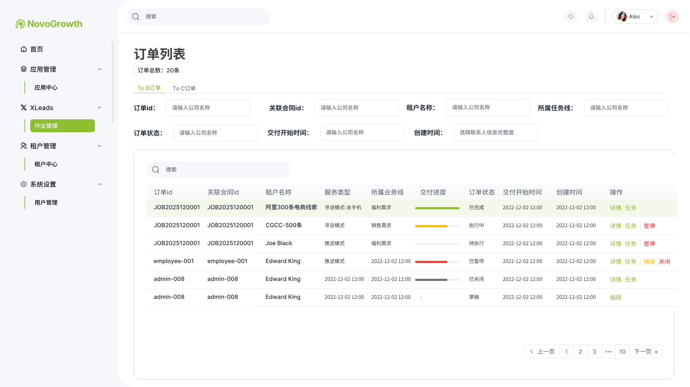
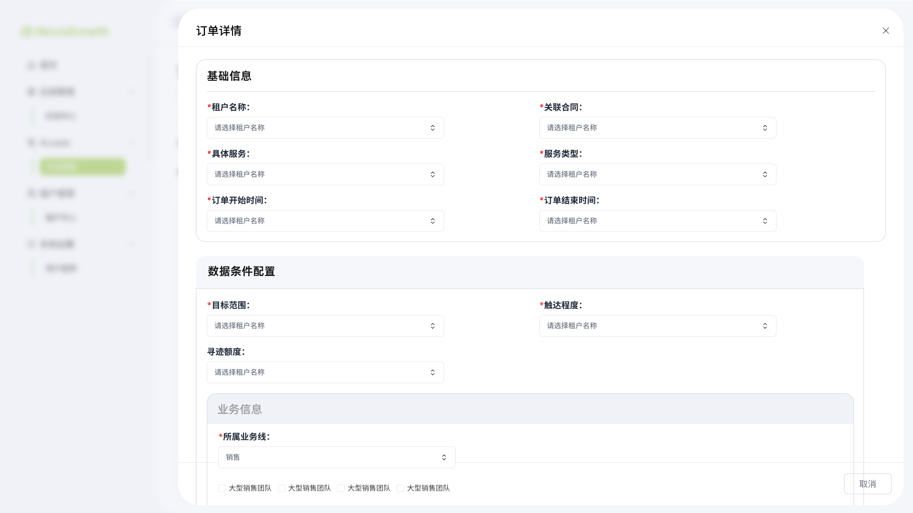
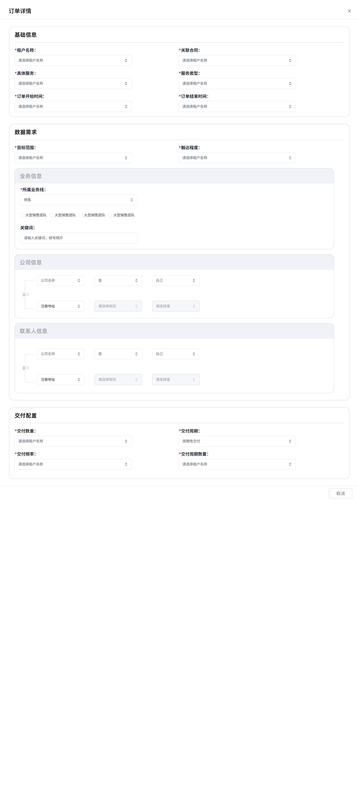
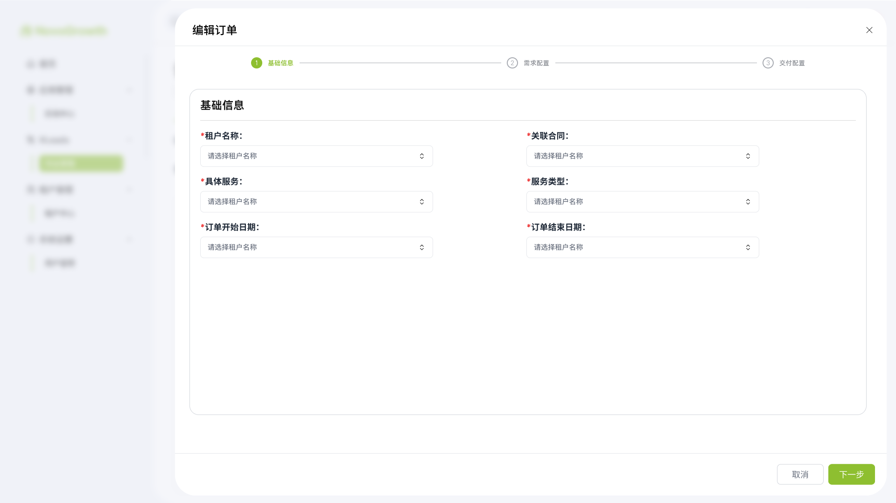
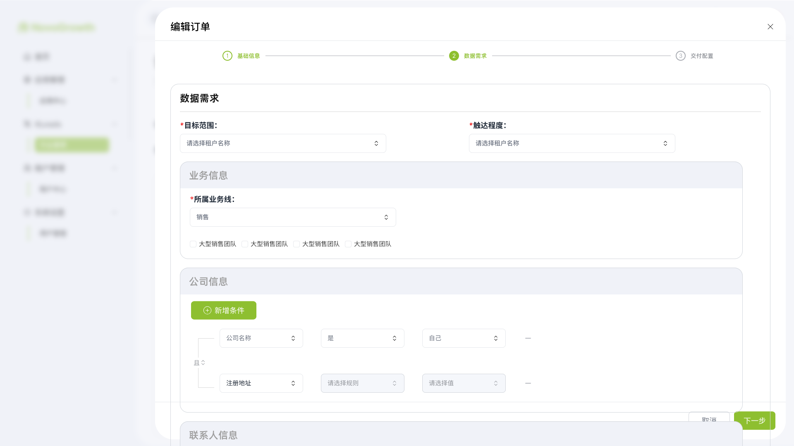
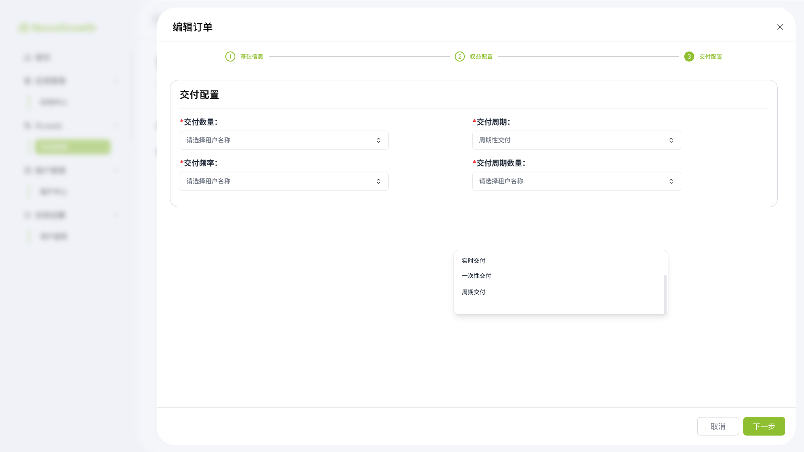
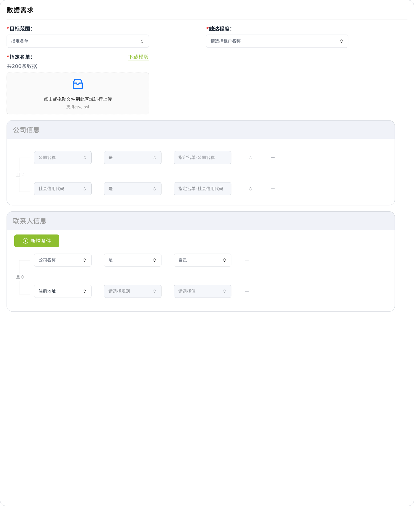
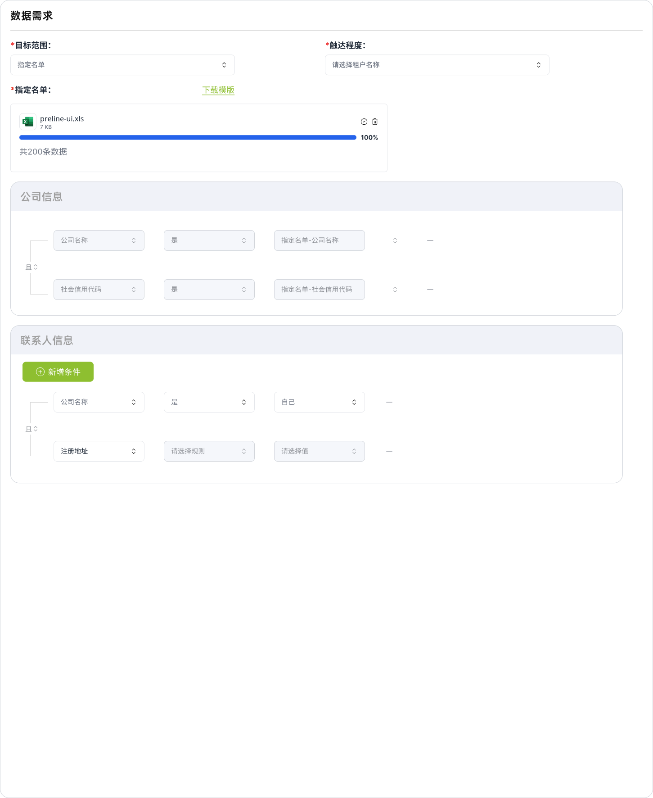

# 订单管理PRD

| **版本号** | **修订日期** | **修订人** | **修订内容** |
| --- | --- | --- | --- |
| v1.0～v2.0 | 2026-06～07 | 产品经理 | 历史版本（含人工新增订单、三步表单等） |
| v3.0 | 2026-07-31 | 产品经理 | 取消人工建单；合同服务项强关联；继承只读与目标范围显隐按原型重写 |
| v3.1 | 2026-07-31 | 产品经理 | 固化合同→订单→任务主链路；订单正式保存后锁定；明确寻迹/推送建任务时机 |
| v3.2 | 2026-08-03 | 产品经理 | 对齐优化后订单列表：筛选/列字段、按状态操作（继续/关闭等） |
| v3.3 | 2026-08-03 | 产品经理 | 指定名单上传后解析条数；交付数量不得超过名单数据量 |
| v3.4 | 2026-08-07 | 产品经理 | 一次性交付取消「交付时间」；本批数据齐后立刻统一推送（与任务侧对齐） |

# 一、需求背景

合同、订单、任务构成中台交付链路的三层对象：

| 对象 | 本质 | 时间代表什么 |
| --- | --- | --- |
| 合同 | 商业承诺 | 客户购买服务的有效周期 |
| 订单 | 某一项服务交付 | 该服务计划交付周期 |
| 任务 | 执行动作 | 某个具体执行动作的时间安排 |

订单与合同**强关联**：**合同中的一个服务项对应一个订单**。主链路如下（与《合同列表PRD》《任务管理PRD》一致）：

```
合同「存草稿」     → 仅合同草稿，不生成订单
合同「正式保存」   → 合同锁定不可再改
                   → 每个服务项自动生成 1 条「订单草稿」

订单「草稿编辑」   → 补数据需求 / 交付配置等（按可编辑规则）
订单「正式保存」   → 订单锁定不可再改
                   ├─ 服务=寻迹 → 暂不建任务；客户每次寻迹 → 生成 1 条「租户订单-寻迹」任务
                   └─ 服务=推送 → 立刻生成 1 条「租户订单-推送」草稿任务
```

**不支持人工手动新增订单。** 订单仅能在草稿态编辑；正式保存后配置锁定。

# 二、需求目标

1. 打通「合同 → 订单 → 租户订单任务」：合同正式保存生成订单草稿；订单正式保存后按寻迹/推送规则驱动任务。
2. 明确基础信息 / 数据需求中哪些字段从合同继承且**不可编辑**，哪些仅在订单草稿态允许调整。
3. 目标范围支持「条件筛选 / 指定名单」，并按选项显隐业务信息、写死或放开公司 / 联系人条件。
4. 交付配置与《任务管理PRD》周期频率规则对齐；订单正式保存后任务侧可回填且受订单约束。
5. 提供 To B / To C 列表、筛选、进度查看与运维操作（暂停 / 关闭等）；**正式保存后不可再编辑配置**。

# 三、名词解释

| 名词 | 定义描述 |
| --- | --- |
| 订单 | 某一合同**服务项**的交付单元；与该服务项一一对应 |
| 关联合同 | 订单所属合同；一份合同可对应多个订单（一对多） |
| 订单草稿 | 合同正式保存后由系统按服务项自动创建、尚未正式保存的订单；**唯一可编辑配置的阶段** |
| 订单正式保存 | 草稿补全后确认生效；此后订单配置**锁定不可再改**，并按服务类型驱动任务 |
| 具体服务 | 合同服务范围中的某一服务项 |
| 服务类型 | 继承自合同服务项：寻迹模式 / 寻迹模式-含手机 / 推送模式 / 推送模式-含手机 等 |
| 目标范围 | 线索圈选方式：**条件筛选** / **指定名单**（可编辑） |
| 触达程度 | 继承自合同服务项「Leads 触达程度」：定位 / 邀约 / 成交（不可编辑） |
| 所属业务线 | 继承自合同服务项「业务线」（不可编辑）；其下**标签**可选 |
| 交付周期 | 一次性交付 / 实时交付 / 周期性交付（原型字段名；语义同任务侧「交付模式」） |
| 交付频率 | 周期性交付下的节奏：每天 / 每周 / 每月 / 自定义（语义同任务侧「交付周期」） |
| 频率规则 | 随交付频率变化的具体排期，如每周 →「周五 18:00」 |
| 交付周期数量 | 每个周期节点单次交付条数（如 500 条） |

# 四、功能设计

## （一）订单设计

### 1. 对象结构（三步配置）

> 订单**仅能**通过编辑合同自动生成的**草稿**进入配置；表单仍为三步：基础信息 → 数据需求 → 交付配置。无「从零新增订单」路径。**正式保存后不可再编辑。**

| 步骤 | 模块 | 作用 |
| --- | --- | --- |
| Step 1 | 基础信息 | 展示合同继承字段；可改订单起止日期 |
| Step 2 | 数据需求 | 目标范围及业务 / 公司 / 联系人条件（按规则显隐与只读） |
| Step 3 | 交付配置 | 交付数量、交付周期、频率及周期数量等 |

### 2. 对象核心字段

| 字段 | 说明 |
| --- | --- |
| `order_id` | 订单 ID，系统自动生成 |
| `contract_id` | 关联合同 ID（继承，不可改） |
| `tenant_name` | 租户名称（继承，不可改） |
| `specific_service` | 具体服务（继承，不可改） |
| `service_type` | 服务类型（继承，不可改） |
| `customer_mode` | To B / To C（随合同，列表 Tab 维度） |
| `business_line` | 所属业务线（继承，不可改） |
| `business_tags` | 业务线下标签多选（可编辑） |
| `keywords` | 关键词（条件筛选下可编；逗号隔开） |
| `reach_level` | 触达程度（继承，不可改） |
| `target_quantity` | 交付数量（默认继承合同 Leads 交付量，交付配置中可调） |
| `start_date` / `end_date` | 订单开始、结束日期（**可编辑**，受合同区间约束） |
| `target_scope` | 目标范围：条件筛选 / 指定名单（**可编辑**） |
| `delivery_cycle` | 交付周期：一次性 / 实时 / 周期性 |
| `order_status` | 见「订单生命周期」 |
| `delivery_progress` | 交付进度（已交付 / 目标数量） |
| `created_at` / `updated_at` | 创建、更新时间 |

### 3. 订单与合同的关系（强关联）

- **一一对应**：合同服务范围中**每一个服务项**生成**一条**订单；订单生命周期内绑定该服务项，不可改挂其他服务 / 合同
- **唯一创建路径**：合同「正式保存」→ 按服务项自动生成订单草稿；合同「存草稿」**不**生成订单
- **禁止人工建单**：订单列表**不提供**「新增订单」；不可脱离合同凭空创建订单

**主链路（合同 → 订单 → 租户订单任务）**

| 步骤 | 动作 | 结果 |
| --- | --- | --- |
| 1 | 合同「存草稿」 | 仅合同草稿，**不生成订单** |
| 2 | 合同「正式保存」 | 合同锁定；每个服务项 → **1 条订单草稿** |
| 3 | 订单「草稿编辑」 | 按可编辑规则补数据需求、交付配置等 |
| 4 | 订单「正式保存」 | 订单锁定不可再改；按服务类型分流建任务 |
| 4a | 服务 = 寻迹（含「含手机」） | **此刻不建任务**；此后客户**每次寻迹** → 1 条「租户订单-寻迹」任务 |
| 4b | 服务 = 推送（含「含手机」） | **立刻**生成 1 条「租户订单-推送」**草稿**任务 |

**字段继承与可编辑性（仅订单草稿态；正式保存后全部只读）**

| 合同侧（服务项 / 合同） | 订单侧 | 草稿态可编辑性 |
| --- | --- | --- |
| 租户名称 | 租户名称 | ❌ 只读，完全按合同 |
| 关联合同（自身） | 关联合同 | ❌ 只读 |
| 服务项 | 具体服务 | ❌ 只读 |
| 服务类型 | 服务类型 | ❌ 只读（如寻迹模式 / 推送模式等） |
| 业务线 | 所属业务线 | ❌ 只读同步 |
| Leads 触达程度 | 触达程度 | ❌ 只读同步 |
| Leads 交付量 | 交付数量（默认） | ✅ 交付配置中可调（默认带回合同值） |
| 合同开始日期 | 订单开始日期（默认） | ✅ 可编辑；须 ≥ 合同开始日期 |
| 合同结束日期 | 订单结束日期（默认） | ✅ 可编辑；须 ≤ 合同结束日期 |

> 另需满足：订单开始日期 ≤ 订单结束日期。正式保存后上表「可编辑」字段一并锁定。

---

### 4. 订单表单设计

> 入口仅为：**编辑订单草稿**。标题可为「编辑订单」；正式保存后及详情页全部只读。

#### （1）基础信息

| 字段 | 必填 | 可编辑 | 说明 |
| --- | --- | --- | --- |
| 租户名称 | 是 | ❌ | 继承合同，只读展示 |
| 关联合同 | 是 | ❌ | 继承，只读展示 |
| 具体服务 | 是 | ❌ | 继承对应服务项，只读 |
| 服务类型 | 是 | ❌ | 继承服务项服务类型，只读 |
| 订单开始日期 | 是 | ✅ | 默认 = 合同开始日期；须 ≥ 合同开始日期 |
| 订单结束日期 | 是 | ✅ | 默认 = 合同结束日期；须 ≤ 合同结束日期 |

> 无「租户 → 合同 → 服务」手工级联选择；上述只读字段在自动建单时已写死，编辑页仅允许改起止日期。

#### （2）数据需求

> 决定交付什么、圈选哪些线索。

**公共字段**

| 字段 | 必填 | 可编辑 | 说明 |
| --- | --- | --- | --- |
| 目标范围 | 是 | ✅ | **条件筛选** / **指定名单** |
| 触达程度 | 是 | ❌ | 同步合同服务项「Leads 触达程度」，只读 |
| 导迹额度 | 否 | ✅ | 可选（原型展示字段，以实际上线为准） |

---

##### A. 目标范围 = 条件筛选

展示：**业务信息** + **公司信息** + **联系人信息**。

**业务信息**

| 字段 | 必填 | 可编辑 | 说明 |
| --- | --- | --- | --- |
| 所属业务线 | 是 | ❌ | 同步合同业务线（如「销售」），只读 |
| 标签 / 团队 | 否 | ✅ | 展示该业务线下标签 checkbox，运营可多选（如大型销售团队、大型快消团队等） |
| 关键词 | 否 | ✅ | 文本；多个关键词用**逗号**隔开（占位：请输入关键词，逗号隔开） |

**公司信息 / 联系人信息**

- 均提供「+ 新增条件」
- 条件行：字段 + 规则 + 值；多行之间默认「且」
- 支持删除单行
- **均可编辑**（自由配置公司 / 联系人侧筛选条件）

---

##### B. 目标范围 = 指定名单

> 指定名单规定了查找的公司列表。

| 模块 | 表现 |
| --- | --- |
| 指定名单上传 | 「下载模板」+ 点击/拖拽上传；支持 csv / xls（或 xsl，以模板为准） |
| **业务信息** | **不展示**（无业务信息模块配置） |
| **公司信息** | **写死**：条件取值来自指定名单，不可增删改自由条件 |
| **联系人信息** | 仍可「+ 新增条件」，联系人侧条件可编辑 |

**上传与解析（重点）**

1. 用户上传名单文件（如 `preline-ui.xls`）  
2. 系统解析文件，展示上传进度与文件信息  
3. 解析成功后，**统计名单有效数据条数**，在上传区下方展示，例如：**「共 200 条数据」**  
4. 将该条数记为 **目标范围数据量**（`list_row_count`），供 Step 3 交付数量校验使用  

| 解析结果 | 说明 |
| --- | --- |
| 展示文案 | `共 {N} 条数据`（N = 解析后的有效行数） |
| 存储 | 写入订单草稿的目标范围数据量，随名单替换而更新 |
| 更换/清除文件 | 重新解析或清空 N；若已填交付数量大于新 N，需提示并截断至 N |

**公司信息 · 写死规则（对齐原型）**

| 字段 | 规则 | 值（只读） |
| --- | --- | --- |
| 公司名称 | 是 | 指定名单-公司名称 |
| 社会信用代码（或统一社会信用代码） | 是 | 指定名单-社会信用代码 |

- 行间逻辑：且
- 不提供新增 / 删除公司条件；控件禁用

**切换目标范围**

| 操作 | 处理 |
| --- | --- |
| 条件筛选 → 指定名单 | 隐藏业务信息；公司信息改为写死行；保留/提示联系人条件 |
| 指定名单 → 条件筛选 | 提示将清除名单、解析条数与写死绑定；恢复业务信息 + 可编辑公司 / 联系人条件 |

---

#### （3）交付配置

> 决定怎么交付；与《任务管理PRD》结果交付中的周期 / 频率规则对齐。订单确认后，关联任务（尤其推送模式）的交付相关字段可由本配置回填并受订单约束。

| 字段 | 必填 | 说明 |
| --- | --- | --- |
| 交付数量 | 是 | 订单计划交付总量；默认 = 合同服务项「Leads 交付量」；**若目标范围=指定名单，受名单条数上限约束（见下）** |
| 交付周期 | 是 | **实时交付 / 一次性交付 / 周期性交付** |
| 交付频率 | 条件 | 交付周期 = 周期性交付时展示：每天 / 每周 / 每月 / 自定义 |
| 频率规则 | 条件 | 随交付频率变化的具体排期 |
| 交付周期数量 | 条件 | 周期性交付时；每个周期节点交付条数 |

**指定名单 · 交付数量校验（重点）**

当 Step 2 目标范围 = **指定名单** 且已成功解析出名单条数 N 时：

| 规则 | 说明 |
| --- | --- |
| 输入框最大值 | 数字输入框 `max = N`（名单数据量），不可输入超过 N 的值 |
| 超限提示 | 若输入值（或粘贴/默认带回值）**大于 N**，提示：**「交付数量大于目标范围数据量」** |
| 与合同默认值 | 若合同带回的 Leads 交付量 > N，进入交付配置时应自动截断为 N，或首次展示即触发上述提示并要求改至 ≤ N |
| 未上传/未解析 | 交付数量暂不可超过合理校验；建议未解析成功前禁止正式保存或禁用交付数量提交 |

> 目标范围 = 条件筛选时，无「名单条数」上限（仍可受合同/业务其他规则约束）。

**交付周期联动**

| 交付周期 | 额外字段 | 执行语义 |
| --- | --- | --- |
| 一次性交付 | **无**（不展示交付时间） | 本批目标数据**全部找到后，立刻统一推送**；不以预约时刻触发 |
| 实时交付 | 无额外周期字段 | 按实时策略交付 |
| 周期性交付 | 交付频率 + 频率规则 + 交付周期数量 | 按频率规则分批推送 |

**周期性交付 · 频率规则（与任务侧一致）**

```
交付周期：○ 周期性交付
  ├── 交付频率：每天 / 每周 / 每月 / 自定义
  ├── 频率规则：随交付频率变化
  └── 交付周期数量：每次节点条数
```

**配置示例（每周）**

| 配置项 | 取值 |
| --- | --- |
| 交付周期 | 周期性交付 |
| 交付频率 | 每周 |
| 频率规则 | **周五 18:00** |
| 交付周期数量 | **500 条** |

| 交付频率 | 频率规则内容 | 示例 |
| --- | --- | --- |
| 每天 | 交付时刻 | `09:00` |
| 每周 | 星期（可多选）+ 时刻 | `周五 18:00` |
| 每月 | 几号 + 时刻 | `每月 1 日 09:00` |
| 自定义 | 间隔天数 N + 时刻 | `每 3 天 09:00` |

> 校验：各次「交付周期数量」累计不宜超过订单「交付数量」；任务侧交付上限 = 订单待交付量（需求量 − 已交付）。  
> 字段命名对照：订单 / 任务原型统一为「交付周期 / 交付频率 / 频率规则 / 周期（交付）数量」；一次性交付**不配交付时间**，本批数据齐后立刻统一推送。

---

### 5. 订单生命周期

| 状态 | 说明 |
| --- | --- |
| 草稿 Draft | 合同正式保存后自动生成；**唯一可编辑配置**的阶段；待运营补全后正式保存 |
| 待执行 Pending | **正式保存**后进入；配置已锁定；等待 / 已关联任务 |
| 执行中 Running | 正在生产和交付 |
| 已暂停 Paused | 暂停，可恢复；**不再产生新的租户订单任务**；在途租户订单任务应暂停（见任务 PRD） |
| 已完成 Completed | 达成交付目标 |
| 已关闭 Closed | 生命周期结束；**不再产生新任务**；在途租户订单任务应关闭 |

**进度字段**

| 字段 | 说明 |
| --- | --- |
| target_quantity | 目标交付数量 |
| delivered_quantity | 已交付数量 |
| remaining_quantity | 剩余待交付 |
| delivery_progress | 交付进度（已交付 / 目标数量） |

**操作矩阵（对齐列表原型）**

| 状态 | 详情 | 任务 | 编辑 | 暂停 | 继续 | 关闭 | 正式保存 |
| --- | --- | --- | --- | --- | --- | --- | --- |
| 草稿 | ❌ | ❌ | ✅（唯一操作） | ❌ | ❌ | ❌ | ✅（编辑表单内） |
| 待执行 | ✅ | ✅ | ❌ | ✅ | ❌ | ❌ | — |
| 执行中 | ✅ | ✅ | ❌ | ✅ | ❌ | ❌ | — |
| 已暂停 | ✅ | ✅ | ❌ | ❌ | ✅ | ✅ | — |
| 已完成 | ✅ | ✅ | ❌ | ❌ | ❌ | ❌ | — |
| 已关闭 | ✅ | ✅ | ❌ | ❌ | ❌ | ❌ | — |

> - **正式保存**后配置不可再编辑。  
> - **任务**：跳转至该订单关联的任务列表（非草稿态均有）。  
> - **继续**：已暂停订单恢复执行（文案对齐原型；语义同「恢复」）。  
> - 草稿态列表**仅展示「编辑」**，无删除、无任务入口。

**订单运维 → 租户订单任务（摘要）**

| 订单操作 | 新任务 | 已有租户订单任务（寻迹/推送） |
| --- | --- | --- |
| 暂停 | 禁止再生成（含寻迹） | 非终态 → 暂停 |
| 继续（恢复） | 恢复允许生成 | 因订单暂停而暂停的 → 恢复 |
| 关闭 | 禁止再生成 | 非终态 → 关闭 |

> 手动创建任务、Agent 执行任务不挂本订单，不受上述级联影响。细则见《任务管理PRD》。

---

## （二）创建与正式保存

### 1. 合同正式保存 → 自动创建订单草稿（唯一建单路径）

入口：合同列表「新增合同 / 导入合同」→ **正式保存**（非存草稿）。

流程：

1. 合同正式保存成功且进入生效态（配置锁定）  
2. 系统遍历服务范围中的每一个服务项  
3. 为每个服务项创建一条**订单草稿**，并写入继承字段（租户、合同、具体服务、服务类型、业务线、触达程度、交付数量默认、起止日期默认等）  
4. **此时不生成任务**

> 合同「存草稿」不生成订单。详见《合同列表PRD》。

### 2. 订单草稿编辑 → 正式保存 → 驱动任务

1. 运营打开「编辑订单」，按可编辑规则补全数据需求、交付配置等  
2. 点击**正式保存**：订单离开草稿，配置**锁定**，进入待执行（或按策略进入执行中）  
3. 按服务类型：  
   - **寻迹**：正式保存时**不建任务**；之后仅当订单处于可运行态（待执行/执行中），客户每次寻迹生成 1 条「租户订单-寻迹」任务  
   - **推送**：正式保存时**立刻**生成 1 条「租户订单-推送」草稿任务（任务侧可再编辑 Agent 配置后确认）

### 3. 人工手动创建 —— **已取消**

- 订单列表**不再提供**「+ 新增订单」
- 不支持脱离合同手工创建订单

### 4. 导入合同

导入合同经解析并在合同侧**正式保存**成功后，仍走「按服务项自动生成订单草稿」。

---

# 五、页面设计

**原型图**：

















## （一）订单列表页

**导航**：侧栏 XLeads → 作业管理 → 订单列表。

**页头**

- 标题：订单列表  
- 汇总：订单总数：N 条  
- **无「新增订单」按钮**（订单仅由合同正式保存自动生成）

**Tab**

- **To B 订单** / **To C 订单**

**筛选区（对齐优化后原型）**

| 筛选项 | 类型 |
| --- | --- |
| 订单 id | 文本 |
| 关联合同 id | 文本 |
| 租户名称 | 文本 |
| 所属任务线 | 文本 / 下拉（与所属业务线对应，以实际上线命名为准） |
| 订单状态 | 下拉：草稿 / 待执行 / 执行中 / 已暂停 / 已完成 / 已关闭 |
| 交付开始时间 | 日期 / 时间范围 |
| 创建时间 | 日期 / 时间范围 |

**列表字段**

| 列 | 说明 |
| --- | --- |
| 订单 id | 如 JOB2025120001 |
| 关联合同 id | 关联合同编号 |
| 租户名称 | 租户展示名 |
| 服务类型 | 如寻迹模式、寻迹模式-含手机、推送模式 |
| 所属业务线 | 如福利需求、销售需求 |
| 交付进度 | 进度条（已交付 / 目标）；颜色可随状态区分 |
| 订单状态 | 草稿 / 待执行 / 执行中 / 已暂停 / 已完成 / 已关闭 |
| 交付开始时间 | 日期时间 |
| 创建时间 | 日期时间 |
| 操作 | **严格按状态矩阵展示**（见下） |

**列表操作（按状态，对齐原型）**

| 订单状态 | 操作入口 |
| --- | --- |
| 草稿 | **编辑** |
| 待执行 | 详情、任务、暂停 |
| 执行中 | 详情、任务、暂停 |
| 已暂停 | 详情、任务、**继续**、关闭 |
| 已完成 | 详情、任务 |
| 已关闭 | 详情、任务 |

**分页**：底部分页器。

## （二）编辑订单弹窗

**标题**：编辑订单（详情页标题可为「订单详情」，字段只读）

**步骤条（三步）**

1. 基础信息  
2. 数据需求  
3. 交付配置  

**条件显隐与只读汇总**

| 触发条件 | 展示 / 行为 |
| --- | --- |
| 始终（基础信息） | 租户名称、关联合同、具体服务、服务类型 **只读**；起止日期可编辑 |
| 触达程度 / 所属业务线 | **只读**（同步合同） |
| 目标范围 = 条件筛选 | 业务信息（业务线只读 + 标签可选 + 关键词）+ **可编辑**公司信息 + **可编辑**联系人信息 |
| 目标范围 = 指定名单 | 名单上传 + 解析展示「共 N 条数据」；**无**业务信息；公司信息**写死**；联系人可编辑；交付数量 max=N |
| 交付周期 = 一次性交付 | 无额外字段（**不配交付时间**）；本批数据齐后立刻统一推送 |
| 交付周期 = 实时交付 | 无额外周期字段 |
| 交付周期 = 周期性交付 | 交付频率 + 频率规则 + 交付周期数量 |

**日期校验**

- 订单开始日期 ≥ 合同开始日期  
- 订单结束日期 ≤ 合同结束日期  
- 订单开始日期 ≤ 订单结束日期  

**底部按钮**

| 步骤 | 按钮 |
| --- | --- |
| Step 1～2 | 取消、下一步（可含上一步） |
| Step 3 | 取消、上一步、**正式保存**（校验通过后锁定并驱动任务） |

## （三）订单详情

结构与编辑表单三块一致（基础信息 / 数据需求 / 交付配置），全部只读；关闭按钮返回列表。

---

# 六、规则对照速查

### 1. 主链路

| 步骤 | 结果 |
| --- | --- |
| 合同存草稿 | 无订单 |
| 合同正式保存 | 合同锁定；每服务项 → 1 订单草稿 |
| 订单草稿编辑 | 按规则补配置 |
| 订单正式保存 | 订单锁定；寻迹不建任务 / 推送立刻建草稿任务 |
| 寻迹（订单已正式保存且可运行） | 每次寻迹 → 1 条租户订单-寻迹任务 |

### 2. 创建与关联

| 规则 | 说明 |
| --- | --- |
| 强关联 | 合同 1 个服务项 = 1 个订单 |
| 唯一建单 | 合同正式保存 → 自动草稿；**禁止**人工新增订单 |
| 合同存草稿 | 不生成订单 |
| 订单正式保存后 | **不可再编辑**配置 |

### 3. 可编辑性（仅草稿）

| 区域 | 只读（合同继承） | 可编辑 |
| --- | --- | --- |
| 基础信息 | 租户名称、关联合同、具体服务、服务类型 | 订单开始 / 结束日期 |
| 数据需求 | 触达程度、所属业务线 | 目标范围、业务线标签、关键词（条件筛选时）、公司/联系人条件（按目标范围） |
| 交付配置 | — | 交付数量、交付周期及频率相关字段 |

### 4. 目标范围

| 选项 | 业务信息 | 公司信息 | 联系人信息 | 交付数量 |
| --- | --- | --- | --- | --- |
| 条件筛选 | 有（业务线只读 + 标签可选） | 可编辑条件 | 可编辑条件 | 无名单条数上限 |
| 指定名单 | **无** | **写死**指定名单 | 可编辑条件 | **≤ 解析条数 N**；超限提示「交付数量大于目标范围数据量」 |

### 5. 周期性交付示例

| 配置项 | 示例 |
| --- | --- |
| 交付周期 | 周期性交付 |
| 交付频率 | 每周 |
| 频率规则 | 周五 18:00 |
| 交付周期数量 | 500 条 |

---

# 七、迭代计划

| 阶段 | 目标 | 说明 |
| --- | --- | --- |
| v3.0 | 合同强关联与只读继承 | 取消人工建单；继承字段只读；目标范围指定名单写死公司信息；频率规则对齐任务 |
| v3.1 | 主链路与锁定 | 正式保存锁定；寻迹/推送建任务时机；订单→任务运维级联摘要 |
| v3.2 | 列表对齐 | 筛选含所属任务线/交付开始时间；列含交付开始时间；操作：草稿仅编辑、已暂停含继续 |
| v3.3 | 指定名单与交付量 | 上传解析「共 N 条」；交付数量不得超过目标范围数据量 |
| v3.4 | 一次性交付语义 | 取消「交付时间」字段；本批数据齐后立刻统一推送（与任务侧对齐） |
| 后续 | 列表与运维增强 | 批量操作；导迹额度细则；详情只读态与任务跳转体验优化 |
| 后续 | To C 差异 | To C 指定名单 / 条件形态若与 To B 不同，单独补齐 |
